# 公共卫生服务系统 1.0（PKB-JC-PHSS）· 软件需求规格说明（SRS）

| 项目   | 内容                                                                                                           |
| ---- | ------------------------------------------------------------------------------------------------------------ |
| 文档名称 | 软件需求规格说明（SRS）                                                                                                |
| 项目名称 | 公共卫生服务系统                                                                                                     |
| 应用代号 | PKB-JC-PHSS                                                                                                  |
| 当前版本 | v1.0                                                                                                         |
| 文件状态 | 草稿                                                                                                           |
| 作者   | 公共卫生服务系统项目组                                                                                                  |
| 审批   | 公共卫生服务系统项目组                                                                                                  |
| 产出日期 | 2026-10-15                                                                                                   |
| 上游输入 | 《1-需求规格说明-公共卫生服务系统.docx》、`01.需求分析-公共卫生服务系统-20261014.md`、`02.产品需求列表-公共卫生服务系统-20261014.md`、Demo《公共卫生服务系统.html》 |

**修订记录**

| 编号 | 软件版本 | 修订人         | 修订章节与内容                                                                                                                                                                                                                                                                                                                                                                                       | 修订日期       |
| -- | ---- | ----------- | --------------------------------------------------------------------------------------------------------------------------------------------------------------------------------------------------------------------------------------------------------------------------------------------------------------------------------------------------------------------------------------------- | ---------- |
| 1  | V1.0 | 公共卫生服务系统项目组 | 起草                                                                                                                                                                                                                                                                                                                                                                                            | 2026-10-15 |
| 2  | V1.0 | 公共卫生服务系统项目组 | 补充功能明细与数据字典                                                                                                                                                                                                                                                                                                                                                                                   | 2026-10-15 |
| 3  | V1.0 | 公共卫生服务系统项目组 | 第 7 章改为「模块表 + 功能点表」两级承载：为全部 72 个功能点补功能描述表，回填原型页面标识并补全业务流程图                                                                                                                                                                                                                                                                                                                                    | 2026-10-15 |
| 4  | V1.0 | 公共卫生服务系统项目组 | 第 7 章模块级取消「模块说明表」，改为**功能用例图**（参与者取 6.1 功能清单的模块主要角色）                                                                                                                                                                                                                                                                                                                                           | 2026-10-15 |
| 5  | V1.0 | 公共卫生服务系统项目组 | 7.2.2 居民档案创建补充**人群归属判定流程**与「人群 × 业务模块 权限开放矩阵」；7.2.3 档案维护界面按人群归属开放业务入口；7.15.10 承载儿童／老年人年龄界定参数                                                                                                                                                                                                                                                                                                  | 2026-10-15 |
| 6  | V1.0 | 公共卫生服务系统项目组 | 7.2.2 按 Demo「居民档案创建界面」补全三步向导的**表单字段与输入规则**（含个人基本信息表全量字段、控件类型、长度上限、枚举取值），完成后度口径同步；8.11 数据字典补充个人基本信息表相关字典项                                                                                                                                                                                                                                                                                      | 2026-10-15 |
| 7  | V1.0 | 公共卫生服务系统项目组 | 按 Demo 原型为第 7 章**全部 72 个功能点**补充「表单字段与输入规则」表（查询条件 ／ 列表字段 ／ 建档与处理弹窗字段，含必填标识）                                                                                                                                                                                                                                                                                                                    | 2026-10-15 |
| 8  | V1.0 | 公共卫生服务系统项目组 | 依据新版《居民档案列表.html》重写 7.2.1 居民档案（列表）：24 项查询条件（收起 8／展开 16）、输入即过滤、24 列冻结表格、行内操作随锁定与居民状态动态变化、5 个弹框（新建个人档案／居民状态管理／上锁／解锁／撤销）与封面内容·个档内容条件组合弹框；同步更新 7.2.2 入口、13.1 通用填报要求与 8.11 数据字典                                                                                                                                                                                                                    | 2026-10-15 |
| 9  | V1.0 | 公共卫生服务系统项目组 | 删除「新建个人档案」弹框（无此功能点）；新增功能点 **7.2.13 档案上锁与居民状态管理**（承载上锁／解锁／居民状态管理／注销／撤销的弹框字段、校验与提示语），功能页总数 72 → 73，同步更新 6.1 功能清单、第 10 章需求可追踪性、13.3 原型页面映射与 13.4 文档统计汇总                                                                                                                                                                                                                                          | 2026-10-15 |
| 10 | V1.0 | 公共卫生服务系统项目组 | **第 7 章改为「功能 + 子功能」两级编号**：「居民档案」作为一个功能（7.2.1），其下分设 4 个子功能点 **7.2.1.1 居民档案列表、7.2.1.2 居民档案创建、7.2.1.3 档案上锁、7.2.1.4 居民状态管理**（原 7.2.13 拆分为 2 个）；档案管理其余功能点顺延重编号为 7.2.2～7.2.11；全文交叉引用、目录、6.1 功能清单、第 10 章需求可追踪性、13.3 原型页面映射与 13.4 文档统计汇总同步重排；总计 15 个模块、71 个功能、74 个功能点                                                                                                                                 | 2026-10-15 |
| 11 | V1.0 | 公共卫生服务系统项目组 | 7.2.1.3 档案上锁／解锁改为**直接操作**：点击即打开对应弹框，去掉「档案已上锁?」状态判定与对应的两条前置提示；前提条件、异常流程、验收标准、流程图与表单字段表同步调整；7.2.1.1 的异常流程与验收标准引用同步收敛                                                                                                                                                                                                                                                                            | 2026-10-15 |
| 12 | V1.0 | 公共卫生服务系统项目组 | 依据原型《家庭档案.html》重写 **7.2.3 家庭档案**（原「家庭基本信息」）：补全列表视图（13 列冻结表格、9+2 项查询条件、操作列随扶贫状态变化、点击行弹出成员抽屉）、详情三 Tab（家庭基本信息／家庭成员／精准扶贫）与 6 个弹框；补充「与户主关系」「血缘关系」字典与户主同步规则；同步更新 7.2 用例图、13.3 原型页面映射、13.4 文档统计汇总与需求列表                                                                                                                                                                                               | 2026-10-15 |
| 13 | V1.0 | 公共卫生服务系统项目组 | 依据原型调整同步 **7.2.3 家庭档案编辑态锁定**：新增「建档基础信息（档案编号／户主信息／建档信息，共 9 字段）编辑时置灰只读 + 悬浮提示 + 标题旁锁定提示」规则；新建态仅家庭档案编号与建档负责人只读；编辑保存范围收敛为「详细地址 + 管辖行政区」；功能描述、基本事件流、异常流程、页面内交互、验收标准、流程图与表单字段表（新增「新建／编辑／查看」三态可编辑性列）同步更新                                                                                                                                                                                             | 2026-10-15 |
| 14 | V1.0 | 公共卫生服务系统项目组 | 依据 **2026-10-17 全量合并原型**做全量差异核对后同步：**D1** 7.2.1.4 补「注销个人档案」弹框（注销机构／医生／日期／原因，提示语与前置校验）；**D2** 7.2.4 体检登记去除「新建」入口；**D3** 7.2.5 体检管理去除「新建」并新增「删除体检记录」；**D4** 7.2.10 档案恢复改为勾选批量恢复（提示「请先勾选需要恢复的档案」）；**D5** 7.3.1 计划提醒去除「导出」；**D6** 7.4.1 补「血压项目」条件面板（逻辑／项目／存在／比较符／值）；**D7** 7.15.9 表单维护重写为完整度参与字段／随访分类阈值／随访不佳分类三组配置；**D8** 7.15.11 疾病诊疗设置重写为 ICD10 疾病列表 + 新增／删除弹框。7.2.1.3 上锁／解锁仍按 D-012 口径保持「直接操作」 | 2026-10-17 |
| 15 | V1.0 | 公共卫生服务系统项目组 | 7.4.1 高血压管理**按原型收紧范围**：删除原型中不存在的「随访录入、控制效果评估、分级调整、转诊、结案、行展开」；补齐「新建专项（先经居民选择弹框）」「行内更多▾（暂不管理／跳转档案／注销档案）」「管理状态弹框」「注销档案弹框（级联注销随访）」「21 列列表」与血压项目条件面板；同步调整 7.4 模块同构说明与需求列表对应行                                                                                                                                                                                                                       | 2026-10-17 |
| 16 | V1.0 | 公共卫生服务系统项目组 | 7.4.1 高血压管理**补全功能描述与业务菜单**：功能描述补「编辑专项档案、查看专项档案、新建随访、分层评估」；基本事件流改为「选定居民 → 进入居民档案维护界面维护高血压专项档案」「填写后点『保存』建档」；行内「更多▾」开放编辑／查看／暂不管理／新建随访／分层评估／注销 6 项菜单；**新增 3 个子功能点 7.4.1.1 高血压专项、7.4.1.2 高血压随访、7.4.1.3 高血压评估**（取自档案维护界面，含字段、按钮与校验）；功能点总数 74 → 77，同步更新目录、6.1 功能清单、7.4 同构说明、第 10 章可追踪性、13.3 原型映射、13.4 统计汇总与需求列表                                                                                      | 2026-10-17 |
| 17 | V1.0 | 公共卫生服务系统项目组 | 7.4.1.2 高血压随访**按新版流程图修正**：补「历史记录 → 展示历史记录列表」分支；保存并校验通过后直接「更新历史记录列表」；「失访」不再作为独立流程分支（作为表单字段保留在页面内交互与异常流程）；基本事件流、页面内交互、验收标准与流程图同步更新                                                                                                                                                                                                                                                              | 2026-10-17 |
| 18 | V1.0 | 公共卫生服务系统项目组 | 流程图入口对齐：7.4.1.2 补入口节点「进入高血压随访业务」；7.4.1.3 高血压评估**按新版流程图重画**（入口「进入高血压评估业务」→ 用户操作 → 点击新建／历史记录两分支；新建 → 填写并保存 → 必填校验 → 保存 → 更新历史记录列表），基本事件流、页面内交互与验收标准同步                                                                                                                                                                                                                                           | 2026-10-17 |
| 19 | V1.0 | 公共卫生服务系统项目组 | **慢病管理 6 个功能点按高血压管理模式改造**：7.4.2 糖尿病（3 子功能）、7.4.3 慢阻肺（2）、7.4.4 高血脂（2）、7.4.5 心脑血管（2：评估／随访）、7.4.6 肿瘤（2）、7.4.7 高危人群（2），均补「子功能清单 + 功能描述表 + 流程图 + 表单字段表 + 子功能详表」；**菜单严格按原型**：高血压／糖尿病＝暂不管理+新建随访+分层评估+注销，慢阻肺＝暂不管理+新建随访+注销，高血脂／心脑血管／肿瘤／高危人群＝查看+注销；功能点总数 77 → 90（子功能 20 个），同步更新 6.1 功能清单、7.4 同构说明、目录、第 10 章可追踪性、13.3 原型映射与 13.4 统计汇总                                                                    | 2026-10-17 |
| 20 | V1.0 | 公共卫生服务系统项目组 | 依据原型《档案维护.html》重写 **7.2.2 居民健康档案（档案维护）**：以「个人首页」为健康概览入口，补全左侧「个人档案」分组下封面、个人基本信息、健康信息卡、死亡登记表、卫生健康服务活动 5 张表单，新增 6 个子功能点 **7.2.2.1 个人首页、7.2.2.2 居民健康档案封面、7.2.2.3 个人基本信息表、7.2.2.4 健康信息卡、7.2.2.5 居民死亡医学证明（推断）书、7.2.2.6 卫生健康服务活动记录**；按原型补封面 13 项必填与回填规则、个人基本信息表全部分段及完整度口径、健康信息卡正反面字段与 3 项电话校验、死亡证明 4 段字段与 9 项必填、服务活动逐行校验；同步更新目录与本节流程图                                                                | 2026-10-17 |
| 21 | V1.0 | 公共卫生服务系统项目组 | 7.2.2.6 卫生健康服务活动记录**补充自动记录规则**：慢病业务→疾病管理服务、重精与肺结核→疾病控制服务、妇女管理与孕产妇管理→妇女保健服务、儿童管理→儿童保健服务、中医管理→中医药服务、健康教育→健康咨询服务、个人档案→居民健康档案管理服务；业务模块仅「新增」时自动追加 1 条服务活动记录，修改业务数据不同步更新；「医疗服务」类型记录取自数据中心 SY_JZSJ 表；服务类型枚举、自动记录规则表、页面行为、流程图及 7.2.2 总表同步更新                                                                                                                                                           | 2026-10-17 |
| 22 | V1.0 | 公共卫生服务系统项目组 | 7.2.2.1～7.2.2.6 **结构对齐 7.2.1.4 居民状态管理**：每个子功能统一为「功能描述表（功能名称／所属模块／功能描述／前提条件／入口／基本事件流／后置条件／异常流程／输入／处理／输出／页面内交互／验收标准／原型图／流程图／时序图／活动图）→ Mermaid 流程图 → 表单字段与输入规则表（类别／字段／必填／长度上限／取值 ／ 校验）→ 提示语说明」；补齐原缺失的功能描述表与 5 列字段表，保存校验、完整度、只读项与自动记录规则改为表后说明                                                                                                                                                     | 2026-10-17 |
| 23 | V1.0 | 公共卫生服务系统项目组 | 7.8.1 妇女管理**按流程图修正新建专项流程**：打开「新建妇女档案」弹框 → 录入居民基本信息 → 录入妇女档案数据 → 校验必填（不完整则阻止保存并提示）→ 判断是否已有居民档案（有：修改居民基本信息、获取个档标识符、保存档案数据；无：组装居民基本信息、保存个档信息并生成个档标识符）→ 保存妇女档案信息 → 左侧展开 4 个子表入口；关联说明、功能描述、事件流、异常流程、字段表与流程图同步                                                                                                                                                                                      | 2026-10-18 |
| 24 | V1.0 | 公共卫生服务系统项目组 | 7.8.3 儿童管理**与妇女管理统一新建专项流程**：打开「新建儿童专项档案」弹框 → 录入居民基本信息 → 录入儿童档案数据 → 校验必填（不完整则阻止保存并提示）→ 判断是否已有居民档案（有：修改居民基本信息、获取个档标识符、保存档案数据；无：组装居民基本信息、保存个档信息并生成个档标识符）→ 保存儿童档案信息 → 左侧展开 14 个子表入口；功能描述、事件流、异常流程、字段表、流程图与 7.8.3.1 入口/前提/异常同步                                                                                                                                                                     | 2026-10-18 |
| 25 | V1.0 | 公共卫生服务系统项目组 | 7.5 重精管理、7.6 结核病管理、7.7 老年人管理**按 7.4 慢病管理结构重写**：补模块同构说明与子功能清单，拆出 7.5.1.1 个人信息补充表／7.5.1.2 重精随访、7.6.1.1 第一次入户随访／7.6.1.2 肺结核随访、7.7.1.1 自理能力评估；各功能补「功能描述表＋流程图＋表单字段与输入规则＋子功能详表」，并按原型明确行内菜单（重精／结核：编辑／新建随访／更多▾查看注销；老年人：查看／编辑／更多▾评估／中医干预）；功能点总数 90 → 95，同步更新目录、6.1 功能清单、第 10 章可追踪性与 13.4 统计汇总 | 2026-10-18 |


**说明**

1. 《软件需求规格说明》（SRS）描述对计算机软件配置项 CSCI 的需求，及确保每个要求得以满足的所使用的方法。涉及该 CSCI 外部接口的需求可在本 SRS 中给出，或在本 SRS 引用的一个或多个《接口需求规格说明》（IRS）中给出。
2. 本 SRS 可能还需用 IRS 加以补充，是 CSCI 设计与合格性测试的基础。

---

## 目录

1. 引言
   - 1.1 文档概述 ｜ 1.2 系统概述 ｜ 1.3 基线 ｜ 1.4 涉众 ｜ 1.5 引用文件
2. 背景描述
   - 2.1 问题现状 ｜ 2.2 问题分析 ｜ 2.3 解决提议
3. 产品定位
4. 产品目标
5. 业务流程
6. 功能描述
   - 6.1 功能清单 ｜ 6.2 角色与权限层级
7. 详细功能描述
   - 写法约定
   - 7.1 首页 → 7.1.1
   - 7.2 档案管理 → 7.2.1（含 7.2.1.1～7.2.1.4）、7.2.2（含 7.2.2.1～7.2.2.6 共 6 个子功能）～ 7.2.11
   - 7.3 计划提醒 → 7.3.1～7.3.3
   - 7.4 慢病管理 → 7.4.1～7.4.7（共 16 个子功能点）
   - 7.5 重精管理 → 7.5.1（含 7.5.1.1～7.5.1.2）
   - 7.6 结核病管理 → 7.6.1（含 7.6.1.1～7.6.1.2）
   - 7.7 老年人管理 → 7.7.1（含 7.7.1.1）
   - 7.8 妇幼管理 → 7.8.1～7.8.11
   - 7.9 中医管理 → 7.9.1～7.9.4
   - 7.10 健教管理 → 7.10.1～7.10.6
   - 7.11 卫生监督 → 7.11.1～7.11.3
   - 7.12 三网监测 → 7.12.1～7.12.4
   - 7.13 疾病报卡 → 7.13.1～7.13.3
   - 7.14 业务统计 → 7.14.1～7.14.2
   - 7.15 系统设置 → 7.15.1～7.15.13
8. 非功能需求（8.1～8.20）
9. 合格性规定
10. 需求可追踪性
11. 尚未解决的问题
12. 注解
13. 附录

---

## 1 引言

### 1.1 文档概述

本文档从用户角度（系统的外部行为）以及从开发者角度（一些内部特性）阐述公共卫生服务系统的需求，描述系统的行为、特性或属性，是开发过程中对系统的约束。文档依据《公共卫生服务系统》原型交互文档（73 个业务页面）及国家基本公共卫生服务规范编制，完整描述系统的功能需求、角色用例与数据采集要求。

文档核心查看对象包括：业务与需求负责人、产品总监与关联产品经理、研发团队、测试团队和设计团队。本文档能且只能有开发方和投资方阅读和修改。

### 1.2 系统概述

公共卫生服务系统面向基层医疗卫生机构，围绕国家基本公共卫生服务规范，实现居民健康档案全生命周期管理，覆盖档案管理、慢病管理、妇幼管理、老年人管理、中医管理、健康教育、卫生监督、三网监测、疾病报卡与业务统计等业务域，形成「建档—服务—随访—评估—上报—统计」的完整业务闭环。

系统采用 B/S 架构，具备以下总体特征：

- **区域网格化管理**：按行政区划／社区划分管理网格，将居民与责任医生、服务机构进行归属绑定。
- **多层级数据隔离**：支持区县—机构—网格多层级的数据归属与权限隔离，跨机构数据按授权共享。
- **外设接入**：支持身份证读卡器等外设接入，减少人工录入，提升数据准确性。
- **服务规范内置**：内置各类随访表、评估表与报告卡，减少自由录入，保证数据口径统一。
- **数据安全管控**：对身份证号、联系方式等敏感字段提供脱敏展示与受控查阅，操作全程留痕。

### 1.3 基线

主要依据《国家基本公共卫生服务规范（第三版）》《区域人口健康信息平台应用功能指引》《医院信息互联互通标准化成熟度测评方案（2020 年版）》及国家信创相关政策作为需求大纲，部分需求来源于基层公共卫生服务业务调研分析报告及项目招标要求。

遵循 GB/T 8567-2006《计算机软件文档编制规范——软件需求规格说明（SRS）》。

### 1.4 涉众

| 涉众        | 涉众代表        | 涉众利益                  | 优先级 | 要满足 |
| --------- | ----------- | --------------------- | --- | --- |
| 责任医生／建档医生 | 基层全科医生、公卫医生 | 快速建档、按规范完成随访、减少重复录入   | 高   | 是   |
| 妇保／儿保医生   | 妇幼保健人员      | 孕产妇与儿童专案管理、两癌筛查、母婴阻断  | 高   | 是   |
| 公卫管理人员    | 机构／区县公卫科    | 档案审核、迁移审批、业务统计与质量管理   | 高   | 是   |
| 卫生监督协管员   | 卫生监督人员      | 监管地点维护、日常巡查、事件上报      | 中   | 是   |
| 临床医生／报告人  | 门诊与住院医生     | 疾病报卡填报、诊疗信息采集         | 高   | 是   |
| 系统管理员     | 运维人员        | 辖区网格、权限、模板、参数、日志与脱敏配置 | 高   | 是   |

### 1.5 引用文件

- 《国家基本公共卫生服务规范（第三版）》
- 国家卫生健康委员会. 关于促进「互联网+医疗健康」发展的意见. 2018.4
- 国务院办公厅. 深化医药卫生体制改革 2019 年重点工作任务. 2019.6
- 《区域人口健康信息平台应用功能指引》
- 《医院信息互联互通标准化成熟度测评方案（2020 年版）》
- 《基于电子病历的医院信息平台建设技术解决方案》
- GB/T 8567-2006《计算机软件文档编制规范——软件需求规格说明（SRS）》
- 国家信创产业相关政策文件（信创适配要求）

---

## 2 背景描述

### 2.1 问题现状

基层公共卫生服务涉及条线多、表单多、服务周期长，居民健康档案分散在各类纸质台账与多个业务系统中，数据标准不统一、重复录入现象严重；慢病、妇幼、老年人等重点人群的随访管理依靠人工台账提醒，漏访、超期现象难以发现；孕产妇死亡、围产儿死亡、新生儿缺陷与儿童死亡等监测信息上报链路长、时效性差；健康档案的迁移、恢复与查阅缺乏流程管控与操作留痕，数据安全与居民隐私保护存在风险；业务统计依赖人工汇总，口径不一，无法支撑管理决策与绩效考核。

### 2.2 问题分析

- **数据分散、标准不一**：档案数据分散在多个系统与纸质台账中，缺乏统一的数据基座与唯一主键，跨机构、跨条线数据无法互通。
- **重复录入、效率低下**：同一居民信息在多个条线表单中反复填写，基层医生工作量大，数据质量难以保证。
- **服务不规范、质量难控**：随访周期、服务项目与评估口径依赖个人经验，服务质量缺乏统一标准与质量预警。
- **流程不闭环、缺乏留痕**：档案迁移、档案恢复、档案查阅等关键操作无审批流程与操作日志，责任无法追溯。
- **统计滞后、决策缺少支撑**：业务数据依靠人工上报汇总，口径不一、时效性差。
- **安全合规不足**：居民身份证号、联系方式等敏感信息无脱敏展示与权限管控，不符合个人信息保护相关要求。
- **监测上报链条长**：三网监测与疾病报卡以纸质或线下方式流转，易出现漏报、迟报。

### 2.3 解决提议

- 建立统一的居民健康档案数据基座，实现「一人一档、一档一号」，家庭档案与居民档案关联，专项档案外键关联主档案。
- 按国家基本公共卫生服务规范内置各类随访表、评估表与报告卡，减少自由录入，降低填报门槛。
- 建立计划提醒与随访质量预警机制，按服务规范自动生成到期提醒，驱动基层医生按时履约。
- 构建档案全生命周期流程管控，迁移、恢复、查阅等关键操作走审核流程并全程留痕。
- 提供覆盖 15 个业务域的统计报表与工作量统计，支撑精细化管理与绩效考核。
- 建立脱敏规则与权限矩阵，敏感字段列表掩码、详情受控。
- 支持国产服务器、操作系统、数据库与中间件的信创适配部署。

---

## 3 产品定位

公共卫生服务系统定位为基层医疗卫生机构的公共卫生服务一体化业务平台，以居民健康档案为核心数据基座，提供档案管理、重点人群专项管理、服务履约提醒、疾病监测上报、健康教育、卫生监督与业务统计一体化能力，面向社区卫生服务中心、乡镇卫生院、村卫生室等基层机构，满足国家基本公共卫生服务规范的落地、考核与数据上报需求，降低基层医生工作负担，提升公共卫生服务的规范化、精细化与信息化水平。

---

## 4 产品目标

本项目旨在通过构建标准化的居民健康档案体系、实现重点人群服务的全周期闭环管理、提供履约提醒与质量预警、提供监测上报与统计分析能力，全面提升基层公共卫生服务的管理效率与服务质量，同时满足信创环境部署要求。系统需具备以下核心价值：

- **规范档案管理**：建立统一的居民健康档案与家庭档案体系，实现档案的规范化登记、维护、迁移与恢复。
- **提升服务效率**：内置规范化随访与评估表单，减少重复录入，提升基层医生履约效率。
- **强化过程管控**：通过计划提醒、随访不佳提醒与操作日志，实现服务过程可追踪、可考核。
- **保障数据安全**：通过脱敏规则、权限矩阵与查阅留痕，防范居民隐私泄露风险。
- **支撑管理决策**：通过业务统计与工作量统计，为质量考核与资源调配提供数据支撑。
- **适配信创环境**：兼容国产服务器、操作系统、数据库与中间件，满足信创改造要求。

---

## 5 业务流程

系统主业务流程围绕居民健康档案的全生命周期展开，形成「建档—分类—服务—评估—上报—统计—流转」的完整闭环：

1. **建档**：录入居民个人基本信息与家庭信息，生成居民健康档案编号，形成家庭档案与成员关联。
2. **分类管理**：依据年龄、性别、疾病与健康状态自动归类至老年人、高血压、糖尿病、孕产妇、儿童等重点人群。
3. **服务履约**：系统按服务规范生成随访、体检与健康教育计划提醒，责任医生按计划开展服务并录入随访记录。
4. **记录与评估**：随访结果记入专项档案，系统按规范进行控制效果评估与管理级别调整。
5. **监测上报**：孕产妇死亡、围产儿死亡、新生儿缺陷、儿童死亡及传染病、慢病、早孕等按要求填报报告卡并上报。
6. **质量管理**：公卫管理人员通过随访不佳提醒、业务统计与工作量统计开展质量核查与绩效考核。
7. **流转与归档**：档案迁移、档案恢复经审核后变更归属机构与网格，全过程写入操作日志。

> 各模块内部的分支流程见第 7 章各功能点的「流程图」。

---

## 6 功能描述

系统按「数据基座层—业务服务层—监测上报层—统计分析层—系统管理层」五层组织功能，共划分 **15 个业务模块、71 个功能、95 个功能点**（其中「7.2.1 居民档案」含 4 个子功能点、「7.4.1～7.4.7」共含 16 个子功能点、重精管理 2 个、结核病管理 2 个、老年人管理 1 个）：

- **数据基座层**：档案管理、计划提醒——承担居民健康档案的建档、维护、迁移与履约提醒，是全系统的数据基础。
- **业务服务层**：慢病管理、重精管理、结核病管理、老年人管理、妇幼管理、中医管理、健教管理、卫生监督——承担各类重点人群的服务履约与专项管理。
- **监测上报层**：三网监测、疾病报卡——承担法定监测信息与报告卡的填报、订正与上报。
- **统计分析层**：业务统计——承担健康宣教与医生工作量的统计汇总。
- **系统管理层**：系统设置——承担辖区网格、权限、模板、参数与数据安全等基础配置。

### 6.1 功能清单

| 序号 | 模块    | 主要角色        | 功能页数            | 模块职责                                                                                  |
| -- | ----- | ----------- | --------------- | ------------------------------------------------------------------------------------- |
| 1  | 首页    | 医务人员        | 1 个功能页          | 公共卫生服务系统工作台，汇总待办任务、指标概览与快捷入口。                                                         |
| 2  | 档案管理  | 建档医生／公卫管理人员 | 11 个功能（14 个功能点） | 承担居民个人健康档案、家庭档案、体检、残疾档案及档案迁移／恢复／查阅的全生命周期管理；其中「居民档案」含列表、创建、上锁、居民状态管理 4 个子功能，是全系统的数据基座。 |
| 3  | 计划提醒  | 责任医生／公卫管理人员 | 3 个功能页          | 基于服务规范和随访计划自动生成到期提醒与随访质量预警，驱动基层医生按时完成服务。                                              |
| 4  | 慢病管理  | 慢病管理医生／责任医生 | 7 个功能（23 个功能点）  | 面向高血压、糖尿病、慢阻肺、高血脂、心脑血管、肿瘤及高危人群的专项建档、随访与评估管理；7 个功能下共含 16 个子功能点（专项／随访／评估）。              |
| 5  | 重精管理  | 精防医生        | 1 个功能（3 个功能点）    | 严重精神障碍患者的个人信息补充、随访管理与危险性评估。                                                           |
| 6  | 结核病管理 | 结防医生        | 1 个功能（3 个功能点）    | 肺结核患者的第一次入户随访及后续规范随访管理。                                                               |
| 7  | 老年人管理 | 责任医生        | 1 个功能（2 个功能点）    | 65 岁及以上老年人的健康管理、自理能力评估与年度体检组织。                                                        |
| 8  | 妇幼管理  | 妇保／儿保医生     | 11 个功能页         | 覆盖妇女、孕产妇、儿童、计划免疫、两癌筛查及母婴阻断（乙肝／梅毒／艾滋）全流程管理。                                            |
| 9  | 中医管理  | 中医医生／责任医生   | 4 个功能页          | 老年人及儿童中医药健康管理、中医体质辨识与中医健康指导。                                                          |
| 10 | 健教管理  | 健康教育专员      | 6 个功能页          | 健康教育活动、宣传栏、音像资料、广播、个体化教育及年度计划管理。                                                      |
| 11 | 卫生监督  | 卫生监督协管员     | 3 个功能页          | 监管地点维护、日常巡查登记与卫生事件报告。                                                                 |
| 12 | 三网监测  | 妇幼保健管理人员    | 4 个功能页          | 孕产妇死亡、围产儿死亡、新生儿缺陷、儿童死亡的四类监测上报与评审。                                                     |
| 13 | 疾病报卡  | 临床医生／公卫人员   | 3 个功能页          | 传染病、早孕、慢病三类法定报告卡的填报、订正与查询。                                                            |
| 14 | 业务统计  | 公卫管理人员      | 2 个功能页          | 健康宣教与医生工作量的统计分析。                                                                      |
| 15 | 系统设置  | 系统管理员       | 13 个功能页         | 辖区、网格、权限、业务模板、系统参数、疾病诊疗、操作日志与脱敏规则等基础配置。                                               |

### 6.2 角色与权限层级

| 角色        | 层级      | 职责范围                   |
| --------- | ------- | ---------------------- |
| 临床医生／报告人  | 机构级     | 疾病报卡填报、患者诊疗信息采集。       |
| 建档医生／责任医生 | 网格级     | 居民建档、专项建档、随访服务、健康教育执行。 |
| 妇保／儿保医生   | 网格级     | 妇女、孕产妇、儿童专案管理与筛查、阻断管理。 |
| 公卫管理人员    | 机构级／区县级 | 档案审核、迁移审批、业务统计、质量管理。   |
| 系统管理员     | 系统级     | 辖区网格、权限、模板、参数、日志与脱敏配置。 |

---

## 7 详细功能描述

### 写法约定

本章按业务模块组织，两级承载：

1. **模块级功能用例图**（每模块一张）——以该模块的**主要角色**（取 6.1 功能清单「主要角色」列）为参与者，展示本模块各功能页面与角色的对应关系。模块整体的功能描述、前提条件、后置条件、输入、处理与输出由各功能点表承载，模块级不另设汇总表。
2. **功能点级表**（每功能点一张）——**每个功能点**各一张功能描述表：沿用字段骨架「功能描述／前提条件／后置条件／输入／处理／输出／原型图／流程图／时序图／活动图」，并叠加 EARS 纪律所需的「入口、基本事件流、异常流程、页面内交互、验收标准」五行。

**EARS 约束**：用户动作触发用 `When`（事件驱动），异常分支用 `If … then`（本文档以「若…则系统应…」表述），状态约束用 `While`，始终生效规则用「系统应」；一个 `When` 只对应一个 `系统应` 响应，通过／失败分支拆分表述。

**图件行口径**：

- `原型图`：填 Demo《公共卫生服务系统.html》中的**原型页面标识**（所在菜单路径 + Demo 页面文件名）。Demo 为「框架壳子（index）+ 各业务页面」结构，页面级界面文件未随壳子文件一并分发，故此处给定位标识而非图形；回填图形时按此标识对应截图即可。
- `流程图`：填「见下方 Mermaid 流程图」，图体紧随该功能点表格之后，**依据该功能点已确认的 EARS 基本事件流与异常流程推导**（Demo 页面级交互文件未分发，无法从页面交互反查）。
- `时序图`／`活动图`：无独立内容时保留空行／标「无」，与原 SRS 一致。

---

### 7.1 首页

**功能用例图**（参与者：医务人员）


#### 7.1.1 首页（工作台）

| 字段    | 内容                                                                                                                                                            |
| ----- | ------------------------------------------------------------------------------------------------------------------------------------------------------------- |
| 功能名称  | 首页（工作台）                                                                                                                                                       |
| 所属模块  | 首页                                                                                                                                                            |
| 功能描述  | 汇总待办任务、重点指标概览与常用功能快捷入口，支持按疾病情况、辖区人口分布、卫健管理者三类视图切换。                                                                                                            |
| 前提条件  | 用户已登录并具备所属机构／网格的数据查看权限。                                                                                                                                       |
| 入口    | 登录后默认首页                                                                                                                                                       |
| 基本事件流 | 当用户进入首页，系统应展示待办任务、指标概览与快捷入口。<br />当用户切换视图，系统应渲染对应视图的卡片与图表。<br />当用户设置机构、日期区间等筛选条件并查询，系统应刷新工作台数据。<br />当用户点击待办某一类别，系统应跳转至对应业务模块列表。<br />当用户点击快捷入口，系统应进入对应业务页面。 |
| 后置条件  | 无数据变更。                                                                                                                                                        |
| 异常流程  | 若概览或待办数据加载失败，则系统应展示占位并支持点击重试。<br />若用户无某模块权限，则系统应不展示该快捷入口。                                                                                                    |
| 输入    | 机构、日期区间、疾病／人群类型等筛选条件；视图切换与跳转指令。                                                                                                                               |
| 处理    | 待办数量汇总；指标卡片与图表渲染；视图切换；条件筛选与重置；跳转路由分发。                                                                                                                         |
| 输出    | 待办列表、指标卡片与图表、快捷入口列表。                                                                                                                                          |
| 页面内交互 | 视图切换 Tab；筛选区支持重置；卡片点击跳转并带入当前筛选条件。                                                                                                                             |
| 验收标准  | 待办数量与各业务模块数据一致。<br />三类视图均可正常切换与渲染。<br />跳转后列表的筛选条件与卡片口径一致。<br />无权限模块的入口不展示。                                                                                 |
| 原型图   | 首页 › 首页（原型页：首页.html）                                                                                                                                          |
| 流程图   | 见下方 Mermaid 流程图                                                                                                                                               |
| 时序图   |                                                                                                                                                               |
| 活动图   | 无                                                                                                                                                             |

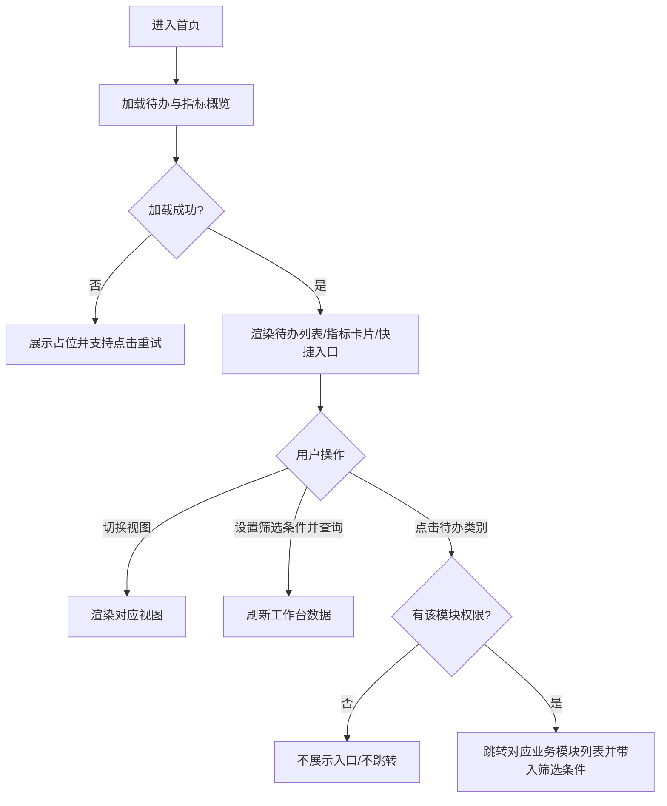

**表单字段与输入规则**（取自原型页：首页.html）

| 类别   | 字段              | 必填 | 说明              |
| ---- | --------------- | -- | --------------- |
| 查询条件 | 机构、日期区间、疾病／人群类型 | 否  | 工作台筛选条件         |
| 表单字段 | 无               | —  | 本功能点为工作台页，无填报表单 |

---


### 7.2 档案管理

**功能用例图**（参与者：建档医生、公卫管理人员）

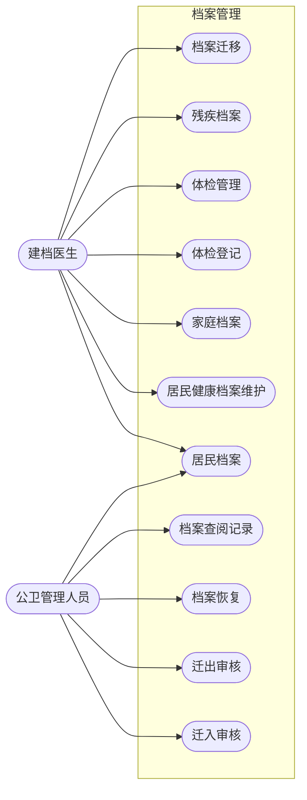

#### 7.2.1 居民档案

> **功能级说明**：居民档案是档案管理的核心功能，由以下 4 个子功能点共同构成。

| 子功能编号   | 子功能    | 说明                                  |
| ------- | ------ | ----------------------------------- |
| 7.2.1.1 | 居民档案列表 | 居民档案列表页：24 项条件查询、列表展示、导出与行内操作入口、分页  |
| 7.2.1.2 | 居民档案创建 | 三步向导建档：填报基本信息 → 填报档案封面信息 → 填报档案基本信息 |
| 7.2.1.3 | 档案上锁   | 档案上锁与解锁，控制档案的可编辑与可下载状态              |
| 7.2.1.4 | 居民状态管理 | 居民状态变更（失访／死亡）、档案注销与状态撤销             |

**功能用例图**（参与者：建档医生、公卫管理人员）

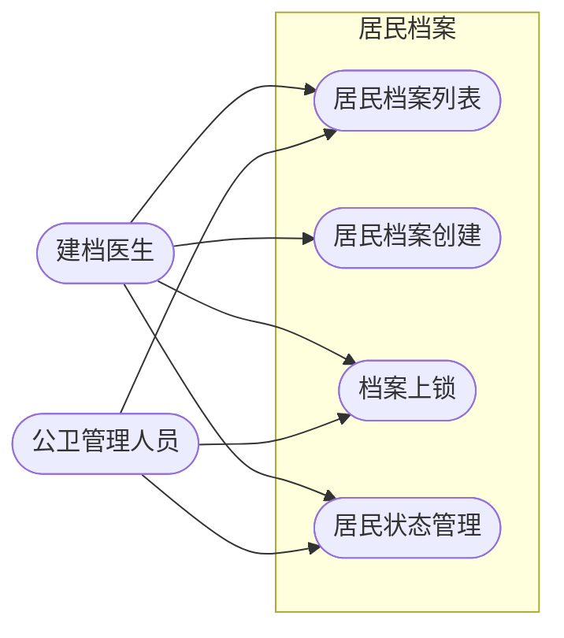

#### 7.2.1.1 居民档案列表

| 字段    | 内容                                                                                                                                                                                                                                                                                                                                                                                                                                                                                                                                                                                                                                                                                                                                                                 |
| ----- | ------------------------------------------------------------------------------------------------------------------------------------------------------------------------------------------------------------------------------------------------------------------------------------------------------------------------------------------------------------------------------------------------------------------------------------------------------------------------------------------------------------------------------------------------------------------------------------------------------------------------------------------------------------------------------------------------------------------------------------------------------------------ |
| 功能名称  | 居民档案列表                                                                                                                                                                                                                                                                                                                                                                                                                                                                                                                                                                                                                                                                                                                                                             |
| 所属模块  | 档案管理 › 居民档案（子功能）                                                                                                                                                                                                                                                                                                                                                                                                                                                                                                                                                                                                                                                                                                                                                   |
| 功能描述  | 以列表方式集中展示辖区内居民健康档案，支持 24 项条件组合查询与**输入即过滤**、导出与明细导出、身份证读卡，并通过行内操作完成查看、编辑、居民状态管理、档案上锁／解锁、档案注销与撤销居民状态，是档案管理与各类专项业务的统一入口。                                                                                                                                                                                                                                                                                                                                                                                                                                                                                                                                                                                                                                              |
| 前提条件  | 用户已登录并具备档案管理查看权限；管辖网格内已有居民档案。                                                                                                                                                                                                                                                                                                                                                                                                                                                                                                                                                                                                                                                                                                                                      |
| 入口    | 左侧菜单「档案管理」→「居民档案」                                                                                                                                                                                                                                                                                                                                                                                                                                                                                                                                                                                                                                                                                                                                                  |
| 基本事件流 | 当用户进入列表页，系统应展示用户管辖范围内的居民档案列表与总记录数。<br />当用户在文本类查询条件中录入内容，系统应即时按条件过滤并刷新列表。<br />当用户选择下拉类查询条件，系统应即时按条件过滤并刷新列表。<br />当用户在管理机构／重点人群类型／建档机构多选框中勾选选项，系统应按勾选项过滤并回显「已选择（N）」。<br />当用户选择管辖行政区级联或管辖网格树形节点，系统应按所选行政区／网格过滤。<br />当用户在「封面内容」或「个档内容」中配置条件并点击「确定」，系统应按所配置的字段条件过滤。<br />当用户点击「展开」，系统应追加展示 16 项扩展查询条件。<br />当用户点击「收起」，系统应隐藏扩展查询条件。<br />当用户点击「重置」，系统应清空全部查询条件并恢复默认列表。<br />当用户点击「查询」，系统应刷新列表并提示查询结果条数。<br />当用户点击行内「查看」或「编辑」，系统应携带该居民信息跳转至档案维护界面。<br />当用户点击行内「更多」，系统应展示「状态管理／上锁／注销」菜单项。<br />当用户点击行内「解锁」，系统应打开解锁个人档案弹框。<br />当用户点击行内「撤销XX」，系统应打开撤销居民状态弹框。<br />当用户在上锁／解锁／居民状态管理／撤销弹框中提交，系统应按 7.2.1.3、7.2.1.4 的校验规则处理并更新档案状态。<br />当用户点击「导出」或「明细导出」，系统应导出列表数据。<br />当用户点击「新建」，系统应进入居民档案创建流程。<br />当用户点击「身份证读卡」，系统应提示「请连接身份证读卡器」。<br />当用户切换每页条数、翻页或跳页，系统应按所选分页展示列表。 |
| 后置条件  | 行内操作（居民状态管理／上锁／解锁／注销／撤销）变更档案状态并刷新列表；查看／编辑携带居民信息跳转至档案维护界面；查询与导出行为写入操作日志。                                                                                                                                                                                                                                                                                                                                                                                                                                                                                                                                                                                                                                                                                            |
| 异常流程  | 若查询条件无匹配记录，则系统应展示空态「暂无符合条件的居民档案」。<br />若对已上锁档案发起状态管理或注销、或对状态为「正常」的档案发起撤销，则系统应按 7.2.1.4 的前置校验规则提示并阻止操作。<br />若导出数据量超过单次上限，则系统应提示分批导出。<br />若身份证读卡器未连接或读取失败，则系统应提示连接读卡器并保留手工录入能力。                                                                                                                                                                                                                                                                                                                                                                                                                                                                                                                                                                                    |
| 输入    | 24 项查询条件（详见「表单字段与输入规则」）；行内操作指令；分页参数。                                                                                                                                                                                                                                                                                                                                                                                                                                                                                                                                                                                                                                                                                                                               |
| 处理    | 条件组合过滤与即时刷新；多选下拉／四级级联／树形多选／条件组合弹框的取值归一；24 列列表渲染与徽标、状态圆点映射；行内操作按「锁定状态＋居民状态」动态生成；分页与每页条数切换；导出与明细导出；跳转档案维护界面。                                                                                                                                                                                                                                                                                                                                                                                                                                                                                                                                                                                                                                                         |
| 输出    | 居民档案列表（含分页与总数）、导出文件、档案维护界面跳转、状态变更结果与提示。                                                                                                                                                                                                                                                                                                                                                                                                                                                                                                                                                                                                                                                                                                                            |
| 页面内交互 | 筛选区为 4 列栅格：收起状态常显 8 项条件，展开后追加 16 项，按钮区（重置／查询／展开▾）固定落在最后一个条件行行尾；文本类条件输入即过滤、下拉类条件选择即过滤；多选框回显「已选择（N）」并支持一键清空；管辖行政区为四级级联面板（省／市／区／街道），管辖网格为树形面板；列表横向滚动时左侧 4 列（序号／管理机构／姓名／证件号）与右侧操作列冻结；重点人群类型以绿色徽标展示、人群性质展示全称、是否合格以合格／不合格徽标展示、居民状态与锁定状态以彩色圆点展示。                                                                                                                                                                                                                                                                                                                                                                                                                                                                                                                          |
| 验收标准  | 24 项查询条件均生效，条件组合结果与库内数据一致，重置后回到默认列表。<br />文本类条件与下拉类条件变更后列表即时刷新，无需点击查询。<br />收起状态仅展示 8 项条件，展开后展示全部 24 项。<br />列表为 24 列，横向滚动时前 4 列与操作列保持可见。<br />重点人群类型、人群性质、是否合格、居民状态、锁定状态的展示形态与原型一致（徽标／全称／圆点）。<br />行内操作随「锁定状态＋居民状态」变化：已上锁为「查看／解锁」、未上锁且正常为「查看／编辑／更多」、未上锁且非正常为「查看／撤销XX」。<br />上锁／解锁点击即直接打开对应弹框（不做状态判定）；状态管理／撤销的前置校验与各弹框必填提示文案与 7.2.1.3、7.2.1.4 一致。<br />导出与明细导出范围与当前筛选条件一致。<br />分页支持 20／50／100 条每页与跳页。                                                                                                                                                                                                                                                                                                                                                             |
| 原型图   | 档案管理 › 居民档案（原型页：居民档案列表.html）                                                                                                                                                                                                                                                                                                                                                                                                                                                                                                                                                                                                                                                                                                                                       |
| 流程图   | 见下方 Mermaid 流程图                                                                                                                                                                                                                                                                                                                                                                                                                                                                                                                                                                                                                                                                                                                                                    |
| 时序图   |                                                                                                                                                                                                                                                                                                                                                                                                                                                                                                                                                                                                                                                                                                                                                                    |
| 活动图   | 无                                                                                                                                                                                                                                                                                                                                                                                                                                                                                                                                                                                                                                                                                                                                                                  |

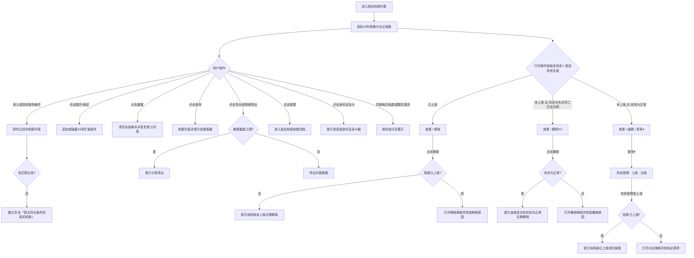

**表单字段与输入规则**（取自原型页：居民档案列表.html）

> 页面结构：页头操作按钮 ／ 筛选区（收起 8 项 + 展开 16 项）／ 24 列数据表格 ／ 分页。

**① 页头操作按钮**

| 按钮    | 说明                    |
| ----- | --------------------- |
| 导出    | 按当前筛选条件导出列表           |
| 明细导出  | 按当前筛选条件导出明细           |
| 身份证读卡 | 提示「请连接身份证读卡器」         |
| 新建    | 进入居民档案创建流程（见 7.2.1.2） |

**② 查询条件——收起状态常显（8 项）**

| 字段     | 控件             | 必填 | 取值 ／ 说明                            |
| ------ | -------------- | -- | ---------------------------------- |
| 管理机构   | 多选下拉           | 否  | 回显「已选择（N）」；支持一键清空                  |
| 姓名     | 文本             | 否  | 输入即过滤                              |
| 证件号    | 文本             | 否  | 输入即过滤                              |
| 管辖行政区  | 四级级联（省／市／区／街道） | 否  | 下钻 + 勾选，末级选中；支持清空                  |
| 居民状态   | 下拉             | 否  | 全部（默认）、正常、失访、死亡、迁出、注销              |
| 管辖网格   | 树形多选           | 否  | 回显「已选择（N）」；支持展开／收起节点               |
| 重点人群类型 | 且／或 + 多选       | 否  | 高血压、糖尿病、慢阻肺、老年人、肺结核、严重精神障碍、脑卒中、冠心病 |
| 封面内容   | 条件组合弹框         | 否  | 见「⑤ 封面内容 / 个档内容 项目弹框」              |

**③ 查询条件——展开后追加（16 项）**

| 字段       | 控件           | 必填 | 取值 ／ 说明                                                         |
| -------- | ------------ | -- | --------------------------------------------------------------- |
| 个档内容     | 条件组合弹框       | 否  | 见「⑤ 封面内容 / 个档内容 项目弹框」                                           |
| 性别       | 下拉           | 否  | 男、女                                                             |
| 档案完整度    | 比较符 + 数值 + % | 否  | 比较符：大于／小于／等于                                                    |
| 人群性质     | 且／或 + 下拉     | 否  | 普通人群、农村建档立卡贫困人口、城乡低保五保人口、计划生育特殊家庭人口、失能(失智)老年人、残疾人、0-6 岁儿童、高血压患者 |
| 锁定状态     | 下拉           | 否  | 已上锁、未上锁                                                         |
| 责任医生     | 文本           | 否  | 输入即过滤                                                           |
| 建档机构     | 多选下拉         | 否  | 回显「已选择（N）」                                                      |
| 建档医生     | 文本           | 否  | 输入即过滤                                                           |
| 建档日期     | 日期区间         | 否  | 开始日期 ~ 结束日期                                                     |
| 状态变更日期   | 日期区间         | 否  | 开始日期 ~ 结束日期                                                     |
| 档案编号     | 文本           | 否  | 输入即过滤                                                           |
| 是否合格     | 下拉           | 否  | 合格、不合格                                                          |
| 出生日期     | 日期区间         | 否  | 开始日期 ~ 结束日期                                                     |
| 更新医生     | 文本           | 否  | 输入即过滤                                                           |
| 更新日期     | 日期区间         | 否  | 开始日期 ~ 结束日期                                                     |
| 只看个人管理档案 | 复选框          | 否  | 勾选后仅展示本人管理的档案                                                   |

> 筛选区按钮区（重置／查询／展开▾）固定落在最后一个条件行行尾；「展开」后按钮文案变为「收起 ▴」。

**④ 列表字段（24 列；横向滚动时左侧 4 列与右侧操作列冻结）**

| 列      | 展示形态                             | 列        | 展示形态                                         |
| ------ | -------------------------------- | -------- | -------------------------------------------- |
| 序号     | 居中文                              | 管理行政区    | 文本                                           |
| 管理机构   | 文本（冻结）                           | 行政区      | 居中：社区／村                                      |
| 姓名     | 文本（冻结，可点击查看）                     | 责任医生     | 文本                                           |
| 证件号    | 文本（冻结）                           | 建档医生     | 文本                                           |
| 证件类型   | 文本                               | 建档日期     | 文本                                           |
| 性别     | 居中                               | 建档机构     | 文本                                           |
| 年龄     | 居中                               | 档案完整度(%) | 居中数值                                         |
| 电话号码   | 文本                               | 人群性质     | 文本：重点人群全称（65 岁及以上老年人／高血压患者／2 型糖尿病患者／0-6 岁儿童） |
| 出生日期   | 文本                               | 居民状态     | 圆点：正常=绿、失访=橙、死亡／迁出／注销=灰                      |
| 重点人群类型 | 居中：绿色徽标（高／糖／慢／老／肺／精／脑／冠），无则显示「-」 | 锁定状态     | 圆点：已上锁=蓝、未上锁=橙                               |
| 是否合格   | 居中：合格（绿）／不合格（红）徽标                | 操作       | 冻结于右侧                                        |
| 现居住址   | 文本                               |          |                                              |
| 档案编号   | 文本                               |          |                                              |

> 证件号在列表按脱敏规则展示（原型演示为完整值，生产环境以 7.15.13 脱敏设置生效结果为准）。

**⑤ 行内操作（随「锁定状态 + 居民状态」动态生成）**

| 前置状态                   | 行内操作                           |
| ---------------------- | ------------------------------ |
| 已上锁                    | 查看 ／ 解锁                        |
| 未上锁 且 居民状态＝正常          | 查看 ／ 编辑 ／ 更多▾（状态管理、上锁、注销）      |
| 未上锁 且 居民状态＝失访／死亡／迁出／注销 | 查看 ／ 撤销XX（撤销失访／撤销死亡／撤销迁出／撤销注销） |

> 「查看」「编辑」均携带居民信息（档案编号／姓名／性别／证件类型／证件号／出生日期／电话／民族／人群／行政区／地址／机构／建档日期）跳转至档案维护界面。
>
> 「解锁」「更多▾（状态管理／上锁／注销）」「撤销XX」的弹框字段、校验与提示语见 **7.2.1.3 档案上锁** 与 **7.2.1.4 居民状态管理**。

**⑥ 弹框表单**

> 本页行内操作涉及的上锁／解锁／居民状态管理／撤销弹框，其字段、校验与提示语统一由 **7.2.1.3 档案上锁** 与 **7.2.1.4 居民状态管理** 承载，本节不重复展开；本页仅承载查询条件类的「封面内容／个档内容」条件组合弹框（见 ⑦）。

**⑦ 封面内容 / 个档内容 项目弹框（条件组合）**

| 项              | 封面内容                                              | 个档内容                       |
| -------------- | ------------------------------------------------- | -------------------------- |
| 可选字段           | 现住址社区、管辖网格、户籍地址社区、本人电话、乡镇(街道)名称、村(居)委会名称、建档单位、建档人 | 本人电话、文化程度、婚姻状况、职业、医疗费用支付方式 |
| 操作符            | 不为空、为空                                            | 不为空、为空                     |
| 比较符（操作符≠为空时启用） | 包含、等于                                             | —（无比较符与取值输入）               |
| 行组合            | 行首逻辑连接符（且／或）＋字段＋操作符（＋比较符＋取值）                      | 字段＋操作符                     |
| 行操作            | 支持「＋」增行、「−」删行；至少保留一行                              | 同左                         |
| 确定校验           | 未选任何字段时提示「请至少选择一项封面内容字段」                          | 提示「请至少选择一项个档内容字段」          |
| 按钮             | 确定、重置、取消                                          | 同左                         |

#### 7.2.1.2 居民档案创建

| 字段    | 内容                                                                                                                                                                                                                                                                                                                                                                                                                                                                                                                                                                                                                                                             |
| ----- | -------------------------------------------------------------------------------------------------------------------------------------------------------------------------------------------------------------------------------------------------------------------------------------------------------------------------------------------------------------------------------------------------------------------------------------------------------------------------------------------------------------------------------------------------------------------------------------------------------------------------------------------------------------- |
| 功能名称  | 居民档案创建                                                                                                                                                                                                                                                                                                                                                                                                                                                                                                                                                                                                                                                         |
| 所属模块  | 档案管理                                                                                                                                                                                                                                                                                                                                                                                                                                                                                                                                                                                                                                                           |
| 功能描述  | 以三步向导（填报基本信息 → 填报档案封面信息 → 填报档案基本信息）采集居民个人基本信息，完成必填与格式校验后保存，生成唯一的居民健康档案编号；保存时依据证件解析的**性别与年龄**判定人群归属（0-6 岁儿童／老年人／正常居民），据此确定该居民在档案维护界面中开放的业务模块范围。                                                                                                                                                                                                                                                                                                                                                                                                                                                                                                                 |
| 前提条件  | 用户具备建档权限；该居民尚未在管辖网格内建立档案；性别、出生日期可采集（或可经身份证读卡解析）。                                                                                                                                                                                                                                                                                                                                                                                                                                                                                                                                                                                                               |
| 入口    | 「居民档案」列表页 →「新建」→ 居民档案创建界面（三步向导）；另可由「档案维护」界面的新建入口进入                                                                                                                                                                                                                                                                                                                                                                                                                                                                                                                                                                                                             |
| 基本事件流 | 当用户点击「新建建档」，系统应打开建档向导并定位至第一步「填报基本信息」。<br />当用户在证件号字段录入满 18 位，系统应解析证件号并回填出生日期与性别。<br />当用户点击「身份证读卡」，系统应提示「点击上方『身份证读卡』，自动读取并回填居民身份信息」。<br />当读卡器读取成功，系统应自动回填居民基本信息（姓名、性别、民族、出生日期、证件号与地址）。<br />当用户点击「下一步」，系统应校验「填报基本信息」步骤的必填项。<br />当第一步校验通过，系统应进入第二步「填报档案封面信息」，并自动取第一步的姓名、联系电话与住址带入封面。<br />当用户在「填报档案封面信息」点击「下一步」，系统应校验该步骤的必填项。<br />当第二步校验通过，系统应进入第三步「填报档案基本信息（个人基本信息表）」，并自动带入档案编号、建档单位与责任医生。<br />当用户点击「上一步」，系统应保留已填内容并返回上一步骤。<br />当用户在第三步点击「保存」，系统应校验全部必填项、生成居民健康档案编号并写入系统。<br />当档案保存成功，系统应依据出生日期计算年龄并结合性别判定该居民的人群归属。<br />当人群归属判定完成，系统应依据「人群 × 业务模块 权限开放矩阵」确定该档案在档案维护界面开放的业务模块入口。                                                                         |
| 后置条件  | 生成全局唯一档案编号，档案进入「在管」状态并可被各专项业务引用；人群归属（0-6 岁儿童／老年人／正常居民）与性别标识写入档案，作为档案维护界面业务入口可见性的判定依据。                                                                                                                                                                                                                                                                                                                                                                                                                                                                                                                                                                          |
| 异常流程  | 若三步向导中任一步骤存在带 * 的必填项未填写，则系统应以「请完善必填项：…」提示并高亮全部缺失字段（提示内容列出缺失字段名称），同时阻止流转或保存。<br />若证件号未满 18 位，则系统应不触发出生日期与性别的自动解析，相关字段保持手工可编辑。<br />若证件号末位非 X 且校验位不合法，则系统应阻止保存并定位该字段。<br />若证件号在同一辖区内已存在，则系统应提示疑似重复档案并要求人工确认。<br />若读卡器未连接或读取失败，则系统应提示连接读卡器并保留手工录入能力。<br />若出生日期缺失或无法据以计算年龄，则系统应阻止保存并提示补全出生日期。<br />若「儿童结束年龄」或「老年人起始年龄」参数未配置或取值非法，则系统应阻止保存并提示管理员检查基本参数配置。<br />若人群归属判定失败，则系统应按「正常居民」降级开放业务入口并记录异常日志。<br />若保存请求超时，则系统应保留已填内容并提示重试。                                                                                                                                                                                                                              |
| 输入    | 居民个人基本信息（姓名、性别、出生日期、证件号、联系电话、现地址等）、证件读卡数据；人群年龄界定参数（儿童结束年龄、老年人起始年龄，取自 7.15.10 基本参数维护）。                                                                                                                                                                                                                                                                                                                                                                                                                                                                                                                                                                          |
| 处理    | 分步采集与步骤级校验；身份证读卡解析回填；必填与格式校验；档案编号生成与唯一性判重。<br />人群归属判定：按出生日期计算年龄，依据「儿童结束年龄」（默认 6 岁）与「老年人起始年龄」（默认 65 岁）划分 0-6 岁儿童／老年人／正常居民，未落入上述两档者归为正常居民。<br />权限开放：依据性别与人群归属命中「人群 × 业务模块 权限开放矩阵」的对应列，确定档案维护界面的业务模块入口可见范围。                                                                                                                                                                                                                                                                                                                                                                                                                                                     |
| 输出    | 居民健康档案编号、建档结果提示、人群归属标签与性别标识、按人群开放的档案维护界面业务入口、操作日志记录。                                                                                                                                                                                                                                                                                                                                                                                                                                                                                                                                                                                                           |
| 页面内交互 | 向导为三步：填报基本信息 → 填报档案封面信息 → 填报档案基本信息（个人基本信息表）；顶部步骤条展示步骤序号与名称，各步操作按钮统一置于右上角（第一步：下一步／取消；第二步：上一步／下一步；第三步：上一步／保存）。<br />证件号字段满 18 位时自动解析并回填出生日期、性别，字段右侧实时显示字数计数（n/18）；字段旁提供「身份证读卡」，未读卡时展示提示「点击上方『身份证读卡』，自动读取并回填居民身份信息」，读卡成功后展示回填信息区。<br />带 * 字段为必填；校验不通过时以「请完善必填项：…」提示、高亮缺失字段并自动定位至首个缺失字段。<br />第三步展示「健康档案管理状态」与「完成度」；保存成功后跳转至档案维护界面，按该居民的人群归属与性别渲染业务模块入口，未开放模块不展示入口。                                                                                                                                                                                                                                                                                               |
| 验收标准  | 向导为三步：填报基本信息 → 填报档案封面信息 → 填报档案基本信息（个人基本信息表），步骤条与「上一步／下一步／保存」可用。<br />证件号录入满 18 位后自动解析并回填出生日期与性别；未满 18 位时不触发解析且两字段可手工录入。<br />点击「身份证读卡」出现提示「点击上方『身份证读卡』，自动读取并回填居民身份信息」；读卡成功后基本信息被自动回填。<br />各步字段的必填标识、长度上限与校验规则与「向导表单字段与输入规则」表逐格一致，超长输入被 maxlength 截断。<br />点击「下一步」而必填项缺失时，提示文案为「请完善必填项：…」且全部缺失字段被高亮。<br />第一步通过后姓名、联系电话与住址自动带入封面；第二步通过后档案编号、建档单位与责任医生自动带入第三步。<br />保存后档案编号全局唯一。<br />重复证件号被拦截并给出提示。<br />分步前进／后退过程中已填内容不丢失。<br />年龄 ≤ 儿童结束年龄（默认 6 岁）的居民判定为「0-6 岁儿童」；年龄 ≥ 老年人起始年龄（默认 65 岁）的居民判定为「老年人」；其余判定为「正常居民」。<br />女性居民在对应人群列上额外开放妇女管理、两癌筛查、孕产妇管理，男性不开放。<br />档案维护界面开放的业务模块入口与「人群 × 业务模块 权限开放矩阵」逐格一致。<br />修改 7.15.10 中的儿童结束年龄或老年人起始年龄参数后，重新建档的人群判定结果随之变化。 |
| 原型图   | 档案管理 › 居民档案（原型页：居民档案列表.html，新建建档弹层）                                                                                                                                                                                                                                                                                                                                                                                                                                                                                                                                                                                                                            |
| 流程图   | 见下方 Mermaid 流程图                                                                                                                                                                                                                                                                                                                                                                                                                                                                                                                                                                                                                                                |
| 时序图   |                                                                                                                                                                                                                                                                                                                                                                                                                                                                                                                                                                                                                                                                |
| 活动图   | 无                                                                                                                                                                                                                                                                                                                                                                                                                                                                                                                                                                                                                                                              |

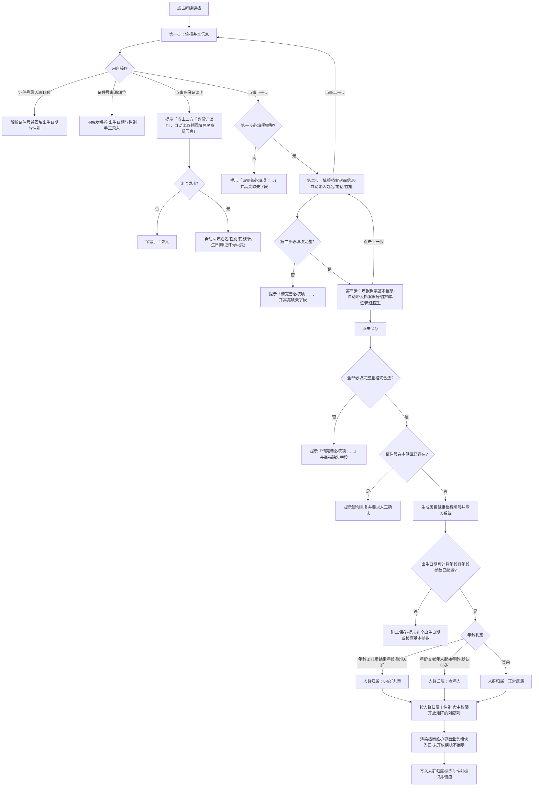

**向导表单字段与输入规则**

> 字段清单与长度上限取自 Demo《公共卫生服务系统.html》「居民档案创建界面」。通用格式规则（身份证号、手机号、日期、脱敏等）见 13.1，本表只写该字段特有的长度与校验，不重复展开。带 * 字段为必填。

**第一步：填报基本信息**（操作：身份证读卡 ／ 下一步 ／ 取消）

| 字段   | 控件   | 必填 | 长度上限  | 取值 ／ 选项                                                    | 校验与说明                             |
| ---- | ---- | -- | ----- | ---------------------------------------------------------- | --------------------------------- |
| 证件类型 | 下拉选择 | 是  | —     | 居民身份证、居民户口簿、护照、军官证、其他                                      | 必须选择                              |
| 姓名   | 文本   | 是  | 8 字符  | —                                                          | 非空；右侧实时字数计数                       |
| 性别   | 下拉选择 | 是  | —     | 男、女、未说明的性别、未知的性别                                           | 可由证件号解析或身份证读卡回填                   |
| 民族   | 下拉选择 | 是  | —     | 汉族、蒙古族、回族、藏族、维吾尔族、苗族、彝族、壮族、布依族、朝鲜族、其他（原型示例，完整字典按 56 个民族维护） | 默认「汉族」；可由身份证读卡回填                  |
| 联系电话 | 文本   | 是  | 11 位  | —                                                          | 11 位数字、以 1 开头（见 13.1）；可由读卡回填      |
| 出生日期 | 日期   | 是  | —     | YYYY-MM-DD                                                 | 不得晚于当前日期（见 13.1）；证件号满 18 位时自动解析回填 |
| 证件号  | 文本   | 是  | 18 位  | —                                                          | 满 18 位触发解析出生日期与性别；校验位规则见 13.1     |
| 详细地址 | 文本   | 是  | 50 字符 | 与五级级联地址合并构成完整联系地址                                          | 非空；右侧实时字数计数；可由读卡回填                |

**第二步：填报档案封面信息**（操作：上一步 ／ 下一步）

| 字段       | 控件   | 必填 | 长度上限  | 取值 ／ 选项                  | 校验与说明                        |
| -------- | ---- | -- | ----- | ------------------------ | ---------------------------- |
| 姓名       | 文本   | 是  | 8 字符  | —                        | 自动取第一步姓名，可修改；右侧实时字数计数        |
| 现住址      | 级联下拉 | 是  | —     | 五级级联（省／市／区县／乡镇街道／社区村）    | 自动取第一步地址，可修改                 |
| 管辖网格     | 下拉选择 | 是  | —     | 管辖网格编码列表（如 321012103002） | 决定该档案的数据归属与可见范围              |
| 住址详细地址   | 文本   | 是  | 50 字符 | —                        | 非空；与现住址合并构成完整住址              |
| 户籍地址     | 级联下拉 | 是  | —     | 五级级联                     | —                            |
| 户籍详细地址   | 文本   | 是  | 50 字符 | —                        | 非空；右侧实时字数计数                  |
| 联系电话     | 文本   | 是  | 11 位  | —                        | 11 位数字、以 1 开头；自动取第一步联系电话，可修改 |
| 乡镇（街道）名称 | 文本   | 是  | 50 字符 | —                        | 可由现住址级联自动带出                  |
| 村（居）委会名称 | 文本   | 是  | 50 字符 | —                        | 可由现住址级联自动带出                  |
| 建档单位     | 下拉选择 | 是  | —     | 机构列表                     | 默认取当前登录用户所属机构                |
| 建档人      | 文本   | 是  | 8 字符  | —                        | 默认取当前登录用户                    |
| 责任医生     | 下拉选择 | 是  | —     | 本机构医生列表                  | 默认取当前登录用户                    |
| 建档日期     | 日期   | 是  | —     | YYYY-MM-DD               | 默认当前日期；不得晚于当前日期              |

**第三步：填报档案基本信息（个人基本信息表）**（操作：上一步 ／ 保存）

> 页面顶部展示「个人基本信息表」标题、「完成度」百分比、「健康档案管理状态：正常」与档案编号（只读，自动取封面档案编号）。表体字段与分组取自 Demo《公共卫生服务系统.html》「居民档案创建界面」第三步表体。

| 分组     | 字段       | 控件       | 必填 | 取值 ／ 选项                                                      | 校验与说明                                              |
| ------ | -------- | -------- | -- | ------------------------------------------------------------ | -------------------------------------------------- |
| 个人健康标识 | 人群标识     | 单选       | 否  | 0-6 岁儿童、65 岁及以上老年人、孕产妇                                       | 与建档时判定的人群归属保持一致                                    |
| 个人健康标识 | 婚姻/重点疾病  | 多选       | 是  | 慢病与重点疾病选项（字典见系统设置）                                           | 本项为必填                                              |
| 个人健康标识 | 法定传染病    | 多选       | 否  | 肺结核、肝炎、疟疾、其他法定传染病                                            | 选「其他法定传染病」时启用补充文本输入（≤30 字）                         |
| 个人健康标识 | 体重情况     | 单选       | 否  | 低、正常、超重、肥胖                                                   | —                                                  |
| 个人健康标识 | 血型       | 单选       | 否  | A 型、B 型、AB 型、O 型、不详                                          | ABO 血型                                             |
| 个人健康标识 | RH 血型    | 单选       | 否  | 阴性、阳性、不详、未查                                                  | —                                                  |
| 个人健康标识 | 姓名       | 文本       | 是  | —                                                            | 由前置步骤带入，可修改                                        |
| 个人健康标识 | 性别       | 单选       | 是  | 男性、女性、未知的性别                                                  | 由证件号解析或读卡带入                                        |
| 个人健康标识 | 证件类型     | 下拉       | 是  | 居民身份证、居民户口簿、护照 等                                             | 由前置步骤带入                                            |
| 个人健康标识 | 证件号      | 文本       | 是  | —                                                            | ≤18 位；校验位规则见 13.1                                  |
| 个人健康标识 | 出生日期     | 日期       | 是  | YYYY-MM-DD                                                   | 不得晚于当前日期                                           |
| 个人健康标识 | 工作单位/学校  | 文本       | 是  | —                                                            | —                                                  |
| 个人健康标识 | 籍贯       | 文本       | 是  | —                                                            | —                                                  |
| 个人健康标识 | 出生地      | 文本       | 是  | —                                                            | —                                                  |
| 个人健康标识 | 民族       | 下拉       | 否  | 汉族、回族、蒙古族 等                                                  | 由前置步骤带入                                            |
| 个人健康标识 | 管理机构     | 下拉       | 是  | 机构列表                                                         | 决定档案归属                                             |
| 个人健康标识 | 档案管理机构电话 | 文本       | 否  | —                                                            | —                                                  |
| 个人健康标识 | 家庭医生是否签约 | 单选       | 否  | 是、否                                                          | —                                                  |
| 个人健康标识 | 家庭医生姓名   | 文本       | 否  | —                                                            | —                                                  |
| 个人健康标识 | 家庭医生电话   | 文本       | 否  | —                                                            | —                                                  |
| 个人健康标识 | 本人电话     | 文本       | 是  | —                                                            | 11 位数字、以 1 开头（见 13.1）                              |
| 紧急联系人  | 联系人 1    | 组合       | 是  | 姓名 ／ 与本人关系 ／ 电话                                              | 三项均为必填                                             |
| 紧急联系人  | 联系人 2    | 组合       | 否  | 姓名 ／ 与本人关系 ／ 电话                                              | —                                                  |
| —      | 常住类型     | 单选       | 是  | 户籍、非户籍                                                       | 选「户籍」时行内展示户籍地址只读文本                                 |
| —      | 常住地址     | 级联       | 否  | 五级级联（省／市／区县／乡镇街道／社区村）                                        | 由前置步骤带入                                            |
| —      | 文化程度     | 单选       | 是  | 研究生、本科、大专、高中、初中、小学 等                                         | —                                                  |
| —      | 职业       | 单选       | 是  | 国家机关、党群组织、企业、事业单位负责人 ／ 专业技术人员 ／ … ／ 无职业                      | —                                                  |
| —      | 婚姻状况     | 单选       | 是  | 未婚、已婚、初婚、再婚、离异、丧偶、未说明的婚姻状况                                   | —                                                  |
| —      | 医疗费用支付方式 | 单选       | 否  | 城镇职工基本医疗保险 等                                                 | —                                                  |
| —      | 个人健康证件   | 组合       | 否  | 证件类型 ／ 证件号                                                   | 支持添加、删除多本健康证件                                      |
| —      | 药物过敏史    | 多选       | 否  | 无、青霉素、磺胺、链霉素、其他                                              | 选「其他」时显示补充输入框；「无」与其他项互斥                            |
| —      | 暴露史      | 多选       | 是  | 无、化学品、毒物、射线、其他                                               | 独立成行，不并入既往史；「无」与其他项互斥                              |
| 既往史    | 疾病       | 多选（两列排布） | 否  | 无、高血压、糖尿病、冠心病、慢性阻塞性肺疾病、恶性肿瘤、脑卒中、严重精神障碍、结核病、肝炎、其他法定传染病、职业病、其他 | 「无」与其他项互斥                                          |
| 既往史    | 手术       | 单选 + 明细  | 是  | 有、无；选「有」展开明细表                                                | 明细为「名称／原因 + 时间」，支持增行／删行                            |
| 既往史    | 外伤       | 单选 + 明细  | 是  | 有、无；同上                                                       | 明细同上                                               |
| 既往史    | 输血       | 单选 + 明细  | 否  | 有、无；同上                                                       | 明细同上                                               |
| 既往史    | 预防接种史    | 单选 + 明细  | 否  | 有、无；同上                                                       | 明细同上                                               |
| 家族史    | 父亲       | 多选       | 否  | 无、高血压、糖尿病、冠心病、慢性阻塞性肺疾病、恶性肿瘤、脑卒中、严重精神障碍、结核病、肝炎、先天畸形、其他        | 一、二级亲属；「无」与其他项互斥；选「其他」时显示补充文本（≤30 字）；档案维护页将该组标记为必填 |
| 家族史    | 母亲       | 多选       | 否  | 同上                                                           | 同上                                                 |
| 家族史    | 兄弟姐妹     | 多选       | 否  | 同上                                                           | 同上                                                 |
| 家族史    | 子女       | 多选       | 否  | 同上                                                           | 同上                                                 |
| 家族史    | 遗传病史     | 单选       | 否  | 无、有                                                          | —                                                  |
| —      | 残疾情况     | 多选       | 是  | 无残疾（默认）、视力残疾、听力残疾、言语残疾、肢体残疾、智力残疾、精神残疾、其他残疾                   | 选「其他残疾」时显示补充输入框                                    |
| —      | 村居委会     | 下拉       | 是  | 由管辖网格下的村／居委会列表带出                                             | 自动取第二步村（居）委会名称                                     |
| —      | 人群性质     | 多选       | 否  | 普通人群、农村建档立卡贫困人口、城乡低保五保人口、计划生育特殊家庭人口、失能（失智）老年人 等              | —                                                  |
| —      | 责任医生     | 下拉       | 是  | 机构医生列表                                                       | 自动取第二步责任医生                                         |
| —      | 建档单位     | 下拉       | 否  | 机构列表                                                         | 自动取第二步建档单位                                         |
| —      | 建档人      | 文本       | 是  | —                                                            | 自动取第二步建档人                                          |
| —      | 建档日期     | 日期       | 是  | YYYY-MM-DD                                                   | 不得晚于当前日期；自动取第二步建档日期                                |

> **完成度口径**：页面顶部的「完成度」按分组填写情况计算——基本信息表划分为 12 个分组（人群标识、健康状态、血型、基本信息、管理信息、紧急联系人、文化程度/职业/婚姻、医疗费用支付方式、健康证件、药物过敏史、既往史、人群性质），完成度 ＝ 已填写分组数 ÷ 12 × 100%（向上取整）。
>
> **注**：表中「分组」列对应原型表体的分组列（个人健康标识／紧急联系人／既往史／家族史），无分组的字段以「—」表示单独成行；「控件」与「取值／选项」依原型实际控件类型（单选 radio／多选 checkbox／下拉 select／文本 input／级联）整理，选项为原型示例值，完整字典以 8.11 数据字典与系统设置为准。多选组统一具备「无」与具体项的互斥逻辑（勾「无」清空其他，勾其他取消「无」）。

**人群 × 业务模块 权限开放矩阵**

> 本矩阵在建档保存时判定一次，作用于**档案维护界面中各业务模块入口的可见性**（✓ 开放、— 不开放）。矩阵约束的是入口可见范围；模块内是否可将该对象纳入管理，仍以各功能点的前提条件为准（如 7.9.1 老年人中医药健康管理需年满 65 周岁）。年龄界定的取值口径由 7.15.10 基本参数维护承载（当前标准：儿童结束年龄 6 岁、老年人起始年龄 65 岁）。

| 业务模块   | 0-6 岁儿童           | 老年人（男）           | 老年人（女）           | 正常居民（男）              | 正常居民（女）              |
| ------ | ----------------- | ---------------- | ---------------- | -------------------- | -------------------- |
| 个人首页   | ✓                 | ✓                | ✓                | ✓                    | ✓                    |
| 个人档案   | ✓                 | ✓                | ✓                | ✓                    | ✓                    |
| 儿童管理   | ✓                 | —                | —                | —                    | —                    |
| 预防接种   | ✓                 | —                | —                | —                    | —                    |
| 家庭管理   | —                 | ✓                | ✓                | ✓                    | ✓                    |
| 妇女管理   | —                 | —                | ✓                | —                    | ✓                    |
| 两癌筛查   | —                 | —                | ✓                | —                    | ✓                    |
| 孕产妇管理  | —                 | —                | ✓                | —                    | ✓                    |
| 转诊跟踪   | ✓                 | ✓                | ✓                | ✓                    | ✓                    |
| 健康体检   | ✓                 | ✓                | ✓                | ✓                    | ✓                    |
| 高血压管理  | —                 | ✓                | ✓                | ✓                    | ✓                    |
| 糖尿病管理  | —                 | ✓                | ✓                | ✓                    | ✓                    |
| 高血脂管理  | ✓                 | ✓                | ✓                | ✓                    | ✓                    |
| 健康教育   | ✓                 | ✓                | ✓                | ✓                    | ✓                    |
| 老年人管理  | —                 | ✓                | ✓                | —                    | —                    |
| 中医管理   | ✓（不含老年人中医药健康服务管理） | ✓（不含儿童中医药健康服务管理） | ✓（不含儿童中医药健康服务管理） | ✓（不含老年人、儿童中医药健康服务管理） | ✓（不含老年人、儿童中医药健康服务管理） |
| 结核病管理  | ✓                 | ✓                | ✓                | ✓                    | ✓                    |
| 重精管理   | ✓                 | ✓                | ✓                | ✓                    | ✓                    |
| 肿瘤管理   | ✓                 | ✓                | ✓                | ✓                    | ✓                    |
| 慢阻肺管理  | ✓                 | ✓                | ✓                | ✓                    | ✓                    |
| 心脑血管管理 | ✓                 | ✓                | ✓                | ✓                    | ✓                    |
| 高危管理   | ✓                 | ✓                | ✓                | ✓                    | ✓                    |
| 残疾人管理  | ✓                 | ✓                | ✓                | ✓                    | ✓                    |

**矩阵模块名与本 SRS 功能页对照**

| 矩阵业务模块 | 对应本 SRS 功能页                       | 说明                                         |
| ------ | --------------------------------- | ------------------------------------------ |
| 个人首页   | 7.1.1 首页（工作台）                     | —                                          |
| 个人档案   | 7.2.1 居民档案（列表）、7.2.3 居民健康档案（档案维护） | —                                          |
| 儿童管理   | 7.8.3 儿童管理                        | —                                          |
| 预防接种   | 7.8.4 计免管理                        | 命名对照                                       |
| 家庭管理   | 7.2.4 家庭基本信息                      | 命名对照                                       |
| 妇女管理   | 7.8.1 妇女管理                        | —                                          |
| 两癌筛查   | 7.8.5 宫颈癌筛查、7.8.6 乳腺癌筛查           | —                                          |
| 孕产妇管理  | 7.8.2 孕产妇管理                       | —                                          |
| 转诊跟踪   | —                                 | 本 SRS 未单列功能页；Demo 菜单「就诊跟踪」亦无独立页面文件（见 13.3） |
| 健康体检   | 7.2.5 体检登记、7.2.6 体检管理             | —                                          |
| 高血压管理  | 7.4.1 高血压管理                       | —                                          |
| 糖尿病管理  | 7.4.2 糖尿病管理                       | —                                          |
| 高血脂管理  | 7.4.4 高血脂管理                       | —                                          |
| 健康教育   | 7.10.1～7.10.6 健教管理                | —                                          |
| 老年人管理  | 7.7.1 老年人管理                       | —                                          |
| 中医管理   | 7.9.1～7.9.4 中医管理                  | 括注限定的开放范围在模块内细分到功能页                        |
| 结核病管理  | 7.6.1 结核病管理                       | —                                          |
| 重精管理   | 7.5.1 重精管理                        | —                                          |
| 肿瘤管理   | 7.4.6 肿瘤管理                        | —                                          |
| 慢阻肺管理  | 7.4.3 慢阻肺管理                       | —                                          |
| 心脑血管管理 | 7.4.5 心脑血管管理                      | —                                          |
| 高危管理   | 7.4.7 高危人群管理                      | 命名对照                                       |
| 残疾人管理  | 7.2.7 残疾档案                        | 命名对照                                       |

#### 7.2.1.3 档案上锁

| 字段    | 内容                                                                                                                                                                                                                                                                                                                             |
| ----- | ------------------------------------------------------------------------------------------------------------------------------------------------------------------------------------------------------------------------------------------------------------------------------------------------------------------------------ |
| 功能名称  | 档案上锁                                                                                                                                                                                                                                                                                                                           |
| 所属模块  | 档案管理 › 居民档案（子功能）                                                                                                                                                                                                                                                                                                               |
| 功能描述  | 对居民档案执行上锁与解锁，控制档案的可编辑与可下载状态，全过程留痕。                                                                                                                                                                                                                                                                                             |
| 前提条件  | 用户具备档案管理相应操作权限。                                                                                                                                                                                                                                                                                                                |
| 入口    | 「档案管理」→「居民档案」列表 → 行内「更多 ▾」→「上锁」／ 已上锁档案行内「解锁」                                                                                                                                                                                                                                                                                   |
| 基本事件流 | 当用户点击行内「上锁」，系统应直接打开上锁弹框，不判定档案当前锁定状态。<br />当用户点击行内「解锁」，系统应直接打开解锁弹框，不判定档案当前锁定状态。<br />当用户打开上锁弹框并点击「确定」，系统应校验上锁原因并将该档案置为已上锁。<br />当档案被上锁，系统应禁止该档案的编辑与下载，行内操作仅保留「查看」「解锁」。<br />当用户打开解锁弹框并点击「确定」，系统应校验解锁原因并将该档案置为未上锁。<br />当档案被解锁，系统应恢复该档案的编辑与上传能力。<br />当上锁或解锁完成，系统应刷新列表并更新「锁定状态」列的状态圆点。<br />当上锁或解锁完成，系统应记录操作人、操作时间、操作类型与原因至操作日志。 |
| 后置条件  | 档案的锁定状态更新并写入操作日志；列表展示同步刷新；已上锁档案转为不可编辑与不可下载。                                                                                                                                                                                                                                                                                    |
| 异常流程  | 若上锁原因为空，则系统应提示「请填写上锁原因」并阻止提交。<br />若解锁原因为空，则系统应提示「请填写解锁原因」并阻止提交。                                                                                                                                                                                                                                                               |
| 输入    | 上锁原因（≤50 字）、解锁原因（≤50 字）。                                                                                                                                                                                                                                                                                                       |
| 处理    | 上锁／解锁状态流转与编辑、下载、上传权限联动；弹框必填校验与实时字数计数；列表刷新与锁定状态圆点重算；操作留痕。                                                                                                                                                                                                                                                                       |
| 输出    | 更新后的锁定状态、操作结果提示、操作日志记录。                                                                                                                                                                                                                                                                                                        |
| 页面内交互 | 上锁弹框回显姓名／证件号，提示「该档案若被上锁则该档案将不允许编辑和下载，确定上锁？」；解锁弹框回显姓名／证件号／上锁医生，提示「该档案已被上锁，解锁后该档案将不被允许上传，确定解锁？」；原因文本域实时显示字数计数（n/50）。                                                                                                                                                                                                             |
| 验收标准  | 点击行内「上锁」直接打开上锁弹框，不做档案锁定状态判定。<br />点击行内「解锁」直接打开解锁弹框，不做档案锁定状态判定。<br />上锁成功后档案不可编辑与下载，行内操作仅剩「查看／解锁」。<br />解锁成功后档案恢复编辑与上传能力。<br />上锁／解锁原因的必填提示文案与原型逐字一致。<br />上锁或解锁后列表「锁定状态」圆点同步更新。<br />每次上锁／解锁均可在操作日志中按操作人、时间、原因追溯。                                                                                                              |
| 原型图   | 档案管理 › 居民档案（原型页：居民档案列表.html，上锁／解锁弹框）                                                                                                                                                                                                                                                                                           |
| 流程图   | 见下方 Mermaid 流程图                                                                                                                                                                                                                                                                                                                |
| 时序图   |                                                                                                                                                                                                                                                                                                                                |
| 活动图   | 无                                                                                                                                                                                                                                                                                                                              |

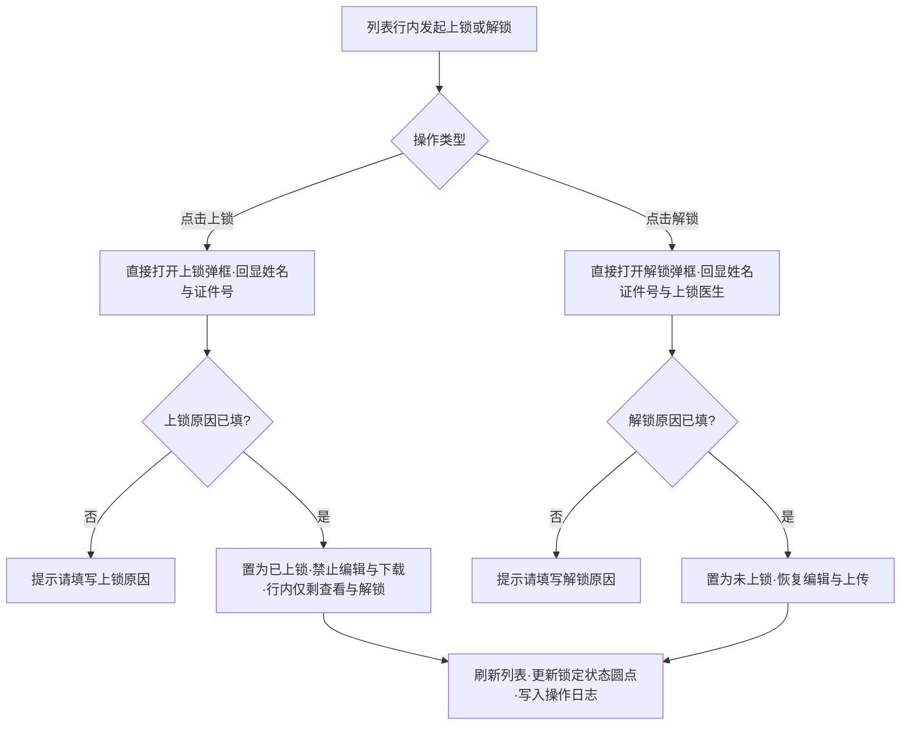

**表单字段与输入规则**（取自原型页：居民档案列表.html，上锁／解锁弹框）

| 类别       | 字段                    | 必填 | 长度上限 | 取值 ／ 校验                            |
| -------- | --------------------- | -- | ---- | ---------------------------------- |
| 行内操作入口   | 更多▾ →「上锁」；已上锁档案行内「解锁」 | —  | —    | 入口随「锁定状态」渲染；**点击即直接打开对应弹框，不做状态判定** |
| 上锁个人档案弹框 | 姓名、证件号                | —  | —    | 只读回显                               |
| 上锁个人档案弹框 | 上锁原因                  | 是  | 50 字 | 实时字数计数；为空提示「请填写上锁原因」               |
| 解锁个人档案弹框 | 姓名、证件号、上锁医生           | —  | —    | 只读回显                               |
| 解锁个人档案弹框 | 解锁原因                  | 是  | 50 字 | 实时字数计数；为空提示「请填写解锁原因」               |

> 操作直达：点击「上锁」／「解锁」直接打开对应弹框，弹框内仅校验上锁／解锁原因是否已填。

#### 7.2.1.4 居民状态管理

| 字段    | 内容                                                                                                                                                                                                                                                                                                                                                                                         |
| ----- | ------------------------------------------------------------------------------------------------------------------------------------------------------------------------------------------------------------------------------------------------------------------------------------------------------------------------------------------------------------------------------------------ |
| 功能名称  | 居民状态管理                                                                                                                                                                                                                                                                                                                                                                                     |
| 所属模块  | 档案管理 › 居民档案（子功能）                                                                                                                                                                                                                                                                                                                                                                           |
| 功能描述  | 变更居民档案的居民状态（失访／死亡），对已变更状态执行撤销，并对档案发起注销，全过程留痕。                                                                                                                                                                                                                                                                                                                                              |
| 前提条件  | 用户具备档案管理相应操作权限；目标档案为未上锁状态；撤销要求当前居民状态不为「正常」。                                                                                                                                                                                                                                                                                                                                                |
| 入口    | 「档案管理」→「居民档案」列表 → 行内「更多 ▾」→「状态管理」／「注销」；非正常状态档案行内「撤销XX」                                                                                                                                                                                                                                                                                                                                     |
| 基本事件流 | 当用户打开居民状态管理弹框并点击「确定」，系统应校验必填项并将该居民状态变更为所选值。<br />当用户打开撤销弹框并点击「确定」，系统应校验撤销原因并将该居民的居民状态恢复为「正常」。<br />当用户点击行内「注销」，系统应打开「注销个人档案」弹框。<br />当用户在注销弹框中点击「确认注销」，系统应校验注销日期与注销原因并将该档案注销。<br />当档案被注销，系统应禁止该档案继续使用并将其从列表中隐藏。<br />当状态变更、撤销或注销完成，系统应刷新列表并更新「居民状态」列的状态圆点。<br />当上述操作完成，系统应记录操作人、操作时间、操作类型与原因至操作日志。                                                                                       |
| 后置条件  | 居民状态更新并写入操作日志；列表展示同步刷新；注销后档案停止随访计划并转为只读。                                                                                                                                                                                                                                                                                                                                                   |
| 异常流程  | 若对已上锁档案发起状态管理或注销，则系统应提示「该档案已上锁，请先解锁」。<br />若对居民状态为「正常」的档案发起撤销，则系统应提示「该居民当前状态为正常，无需撤销」。<br />若居民状态选为「失访」而失访日期为空，则系统应提示「请填写失访日期」并阻止提交。<br />若变更日期为空，则系统应提示「请填写变更日期」并阻止提交。<br />若变更医生未选择，则系统应提示「请选择变更医生」并阻止提交。<br />若变更说明为空，则系统应提示「请填写变更说明」并阻止提交。<br />若撤销原因为空，则系统应提示「请填写撤销原因」并阻止提交。<br />若注销日期为空，则系统应提示「请选择注销日期」并阻止提交。<br />若注销原因为空，则系统应提示「请填写注销原因」并阻止提交。<br />若对已注销档案再次发起注销，则系统应提示「该档案已注销」。 |
| 输入    | 居民状态（死亡／失访）、失访日期、变更日期、变更医生、变更说明（≤200 字）、撤销原因（≤50 字）。                                                                                                                                                                                                                                                                                                                                       |
| 处理    | 居民状态变更与撤销还原；注销流程发起；弹框必填校验与实时字数计数；列表刷新与居民状态圆点重算；操作留痕。                                                                                                                                                                                                                                                                                                                                       |
| 输出    | 更新后的居民状态、操作结果提示、操作日志记录。                                                                                                                                                                                                                                                                                                                                                                    |
| 页面内交互 | 居民状态管理弹框的居民状态为单选（死亡／失访），失访日期与变更日期默认取当天，变更说明实时显示字数计数（n/200）；撤销弹框标题动态为「撤销失访／撤销死亡／撤销迁出／撤销注销」，提示「撤销XX后该档案的居民状态将恢复为「正常」，确定撤销XX？」；撤销原因实时显示字数计数（n/50）；注销弹框回显证件号并展示提示「该档案若注销，则档案不允许继续使用，确定注销？」，注销机构取档案所属机构、注销医生取当前登录人，注销原因实时显示字数计数（n/50）。                                                                                                                                                          |
| 验收标准  | 状态变更后列表「居民状态」圆点同步更新。<br />选「失访」而失访日期为空时提交被阻止并提示「请填写失访日期」。<br />变更日期、变更医生、变更说明缺失时分别给出对应提示并阻止提交。<br />撤销成功后居民状态恢复为「正常」。<br />对正常状态档案发起撤销时提示「该居民当前状态为正常，无需撤销」。<br />注销成功后档案不在列表中展示且不可继续使用。<br />注销日期与注销原因为必填，缺失时分别提示「请选择注销日期」「请填写注销原因」。<br />注销后档案停止随访计划并转为只读。<br />每次状态变更、撤销与注销均可在操作日志中按操作人、时间、类型、原因追溯。                                                                                      |
| 原型图   | 档案管理 › 居民档案（原型页：居民档案列表.html，居民状态管理／撤销弹框）                                                                                                                                                                                                                                                                                                                                                   |
| 流程图   | 见下方 Mermaid 流程图                                                                                                                                                                                                                                                                                                                                                                            |
| 时序图   |                                                                                                                                                                                                                                                                                                                                                                                            |
| 活动图   | 无                                                                                                                                                                                                                                                                                                                                                                                          |

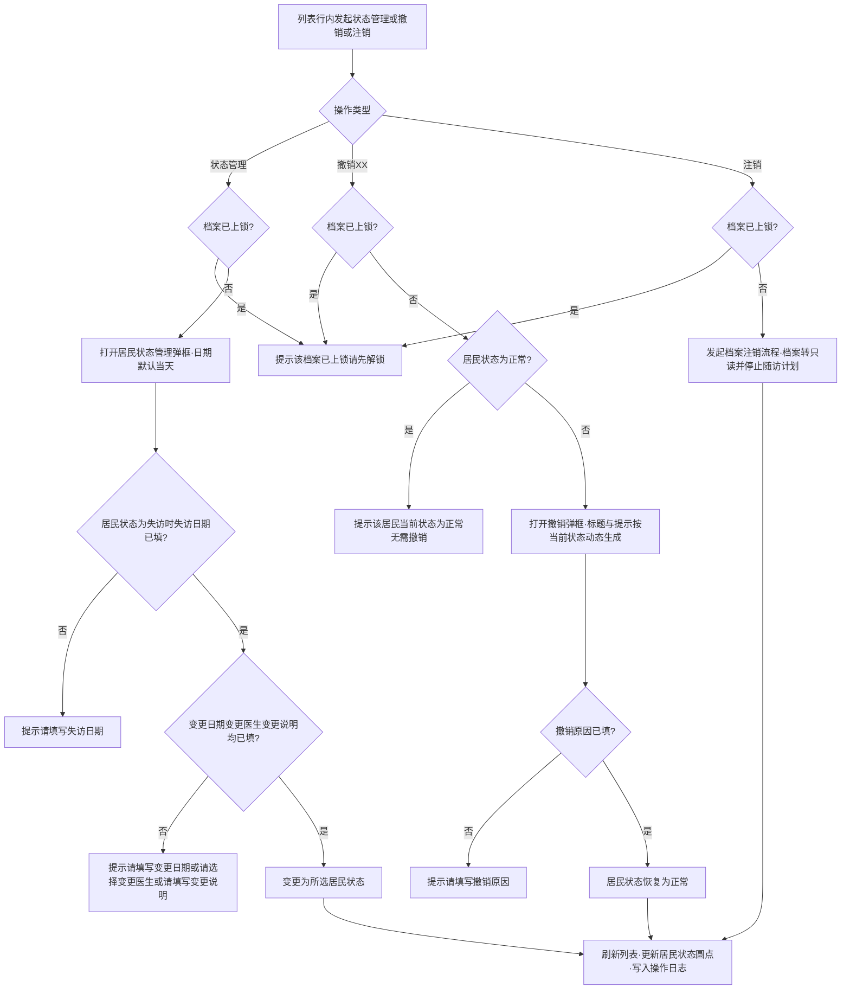

**表单字段与输入规则**（取自原型页：居民档案列表.html，居民状态管理／撤销弹框）

| 类别       | 字段                        | 必填 | 长度上限  | 取值 ／ 校验                         |
| -------- | ------------------------- | -- | ----- | ------------------------------- |
| 行内操作入口   | 更多▾ →「状态管理」／「注销」；行内「撤销XX」 | —  | —     | 随「锁定状态＋居民状态」动态生成（见 7.2.1.1 ⑤）   |
| 居民状态管理弹框 | 居民状态                      | 是  | —     | 单选：死亡、失访                        |
| 居民状态管理弹框 | 失访日期                      | 是  | —     | 默认当天；居民状态为「失访」时必填，为空提示「请填写失访日期」 |
| 居民状态管理弹框 | 变更日期                      | 是  | —     | 默认当天；为空提示「请填写变更日期」              |
| 居民状态管理弹框 | 变更医生                      | 是  | —     | 医生下拉；未选提示「请选择变更医生」              |
| 居民状态管理弹框 | 变更说明                      | 是  | 200 字 | 实时字数计数；为空提示「请填写变更说明」            |
| 撤销居民状态弹框 | 标题                        | —  | —     | 动态为「撤销失访／撤销死亡／撤销迁出／撤销注销」        |
| 撤销居民状态弹框 | 姓名、证件号                    | —  | —     | 只读回显                            |
| 撤销居民状态弹框 | 撤销原因                      | 是  | 50 字  | 实时字数计数；为空提示「请填写撤销原因」            |
| 注销个人档案弹框 | 证件号                       | —  | —     | 只读回显                            |
| 注销个人档案弹框 | 注销机构                      | 是  | —     | 默认取该档案所属机构                      |
| 注销个人档案弹框 | 注销医生                      | 是  | —     | 默认取当前登录人                        |
| 注销个人档案弹框 | 注销日期                      | 是  | —     | 日期选择器；为空提示「请选择注销日期」             |
| 注销个人档案弹框 | 注销原因                      | 是  | 50 字  | 实时字数计数；为空提示「请填写注销原因」            |

> 提示语（原文）：注销个人档案 —— 「该档案若注销，则档案不允许继续使用，确定注销？」；按钮为「确认注销」「取消」。
>
> 前置校验（点击入口时触发）：对已上锁档案发起注销 → 「该档案已上锁，请先解锁」；对已注销档案发起注销 → 「该档案已注销」。

> 前置校验（点击入口时触发）：对已上锁档案发起状态管理或注销 → 「该档案已上锁，请先解锁」；对状态为「正常」的档案发起撤销 → 「该居民当前状态为正常，无需撤销」。

#### 7.2.2 居民健康档案（档案维护）

> **功能级说明**：档案维护以「个人首页」为统一入口，左侧导航「个人档案」（个人档案管理）分组下提供封面、个人基本信息、健康信息卡、死亡登记表、卫生健康服务活动 5 张表单。个人首页只做健康概览展示、不承担录入；5 张表单承担档案信息的填报、校验与归档，合计 6 个子功能点。儿童、妇女、孕产妇、慢病、中医、结核、重精、肿瘤等其他专项表单在各自模块章节描述。

| 子功能编号   | 子功能           | 说明                                                                                                 |
| ------- | ------------- | -------------------------------------------------------------------------------------------------- |
| 7.2.2.1 | 个人首页          | 健康信息环形指标、病史信息摘要、健康轨迹三维视图与健康数据趋势图                                                                   |
| 7.2.2.2 | 居民健康档案封面      | 13 项必填信息；点击「下一步」校验后进入个人基本信息表，并把封面数据回填基本信息表                                                         |
| 7.2.2.3 | 个人基本信息表       | 个人健康标识、基本信息与管理信息、紧急联系人、住址信息、文化程度／职业／婚姻状况、医疗费用支付方式、个人健康凭证、药物过敏史、暴露史、既往史、家族史、遗传病史、残疾情况、村委会／人群性质、建档信息 |
| 7.2.2.4 | 健康信息卡         | 正反面信息卡；正面为身份、血型、慢性病与过敏史，反面为联系方式与机构、医生信息                                                            |
| 7.2.2.5 | 居民死亡医学证明（推断）书 | 死亡基本信息、致死主要疾病诊断链、最高诊断单位与依据、死亡调查记录                                                                  |
| 7.2.2.6 | 卫生健康服务活动记录    | 按行登记服务时间、服务机构、服务类型、主要健康和疾病问题、医学报告、服务费用；业务模块新增数据时自动追加记录，医疗服务记录取自数据中心 SY_JZSJ 表                      |

**功能用例图**（参与者：责任医生）

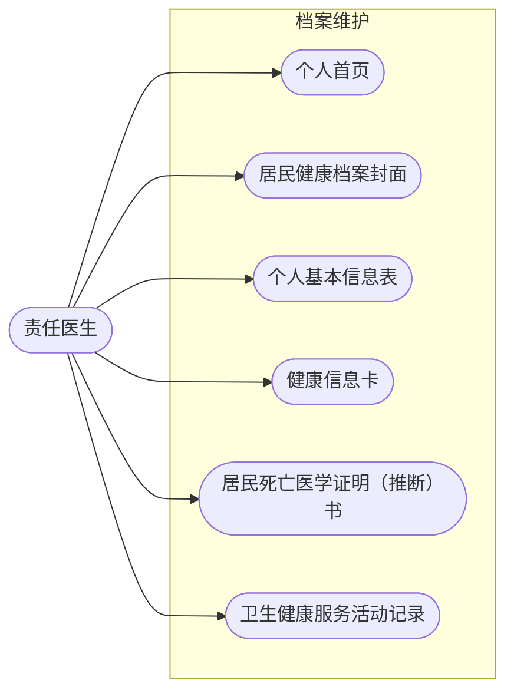

| 字段    | 内容                                                                                                                                                                                                                                                                                                                                                                                                                                                                                                                                                                                                                                                                                                                                                                                                                                                                                                     |
| ----- | ------------------------------------------------------------------------------------------------------------------------------------------------------------------------------------------------------------------------------------------------------------------------------------------------------------------------------------------------------------------------------------------------------------------------------------------------------------------------------------------------------------------------------------------------------------------------------------------------------------------------------------------------------------------------------------------------------------------------------------------------------------------------------------------------------------------------------------------------------------------------------------------------------ |
| 功能名称  | 居民健康档案（档案维护）                                                                                                                                                                                                                                                                                                                                                                                                                                                                                                                                                                                                                                                                                                                                                                                                                                                                                           |
| 所属模块  | 档案管理                                                                                                                                                                                                                                                                                                                                                                                                                                                                                                                                                                                                                                                                                                                                                                                                                                                                                                   |
| 功能描述  | 以「个人首页」汇总展示居民健康信息、病史摘要、健康轨迹与健康数据趋势；通过左侧「个人档案」分组维护居民健康档案封面、个人基本信息表、健康信息卡、居民死亡医学证明（推断）书与卫生健康服务活动记录。封面「下一步」将数据回填个人基本信息表，保证两处口径一致；各表单保存时校验必填项并归档。任一业务模块新增数据保存成功时，系统应自动向该居民卫生健康服务活动记录追加 1 条并按业务模块归类服务类型；业务数据修改不更新已生成记录；服务类型为「医疗服务」的记录取自数据中心 SY_JZSJ 表。                                                                                                                                                                                                                                                                                                                                                                                                                                                                                                                                                                                                                                                      |
| 前提条件  | 居民档案已建立；用户具备档案维护权限；档案未注销、未锁定。                                                                                                                                                                                                                                                                                                                                                                                                                                                                                                                                                                                                                                                                                                                                                                                                                                                                          |
| 入口    | 「居民档案」列表 → 行内「查看／编辑」→ 档案维护页                                                                                                                                                                                                                                                                                                                                                                                                                                                                                                                                                                                                                                                                                                                                                                                                                                                                            |
| 基本事件流 | 当用户进入档案维护，系统应默认展示「个人首页」，渲染健康信息、健康轨迹与健康数据。<br />当用户点击左侧「个人首页」，系统应展示健康信息环形指标、病史信息摘要、健康轨迹三维视图与健康数据趋势图。<br />当用户点击「生命树」或「家系图」，系统应切换至对应视图。<br />当用户点击「个人档案 → 封面」，系统应加载封面表单并展示个人档案编号。<br />当用户填写封面并点击「下一步」，系统应校验 13 项必填；通过后将姓名、联系电话、建档单位、建档日期、现住址、户籍地址与村（居）委会名称回填个人基本信息表并跳转。<br />当用户进入「个人基本信息表」，系统应展示档案编号、建档单位、健康档案管理状态与完整度，并按分段加载已保存数据。<br />当用户点击页面右上角「保存」，系统应校验姓名、证件号、出生日期，通过后归档并将完整度置为 100%。<br />当用户点击「健康信息卡」，系统应加载正反面字段并呈现只读项。<br />当用户修改血型、慢性病、过敏史及反面联系电话并点击「保存」，系统应校验家庭电话、建档机构联系人电话与责任医生或护士联系电话。<br />当用户点击「死亡登记表」，系统应加载居民死亡医学证明（推断）书；选择出生日期后自动计算年龄。<br />当用户填写死亡信息并点击「保存」，系统应校验个人身份、死亡日期与死亡调查记录等必填项。<br />当用户点击「卫生健康服务活动」，系统应展示服务活动记录表。<br />当任一业务模块新增数据并保存成功，系统应自动向该居民卫生健康服务活动记录追加 1 条，并按业务模块归类服务类型。<br />当用户修改已生成记录对应的业务数据，系统应不更新该服务活动记录。<br />当用户进入卫生健康服务活动记录，系统应合并展示自动生成记录、手工补录记录与 SY_JZSJ 医疗服务记录。<br />当用户点击行内「新增」，系统应追加一行空白记录；点击「重置」应清空当前行。<br />当用户点击「保存」，系统应逐行校验服务时间、服务机构与服务类型，并校验服务费用为数字。 |
| 后置条件  | 表单内容写入档案并关联居民主档案；封面与个人基本信息表数据保持一致；全部保存操作写入操作日志。                                                                                                                                                                                                                                                                                                                                                                                                                                                                                                                                                                                                                                                                                                                                                                                                                                                        |
| 异常流程  | 若封面任一带 * 项缺失，则系统应提示「请完善封面必填项：…」并阻止跳转。<br />若个人基本信息表的姓名、证件号或出生日期为空，则系统应提示「请完善必填项：…」并阻止保存。<br />若健康信息卡的家庭电话、建档机构联系人电话或责任医生或护士联系电话为空，则系统应阻止保存并提示。<br />若死亡登记表的个人身份、死亡日期、死者生前病史及症状特征、被调查者姓名、联系电话、与死者关系、联系地址或工作单位、死因推断、被调查者签名缺失，则系统应阻止保存并提示。<br />若卫生健康服务活动的已填记录缺少服务时间、服务机构或服务类型，则系统应提示对应行补全。<br />若服务费用填写非数字，则系统应提示对应行「服务费用请填写数字」。<br />若未填写任何服务活动记录，则系统应提示至少填写一条。<br />若档案已注销或锁定，则系统应禁用编辑类操作并提示档案状态。                                                                                                                                                                                                                                                                                                                                                                                                                                                                                                      |
| 输入    | 封面字段；个人基本信息表分段字段；健康信息卡正反面字段；死亡登记表字段与致死疾病诊断链；卫生健康服务活动记录行；健康数据日期范围。                                                                                                                                                                                                                                                                                                                                                                                                                                                                                                                                                                                                                                                                                                                                                                                                                                      |
| 处理    | 表单加载与只读项渲染；分段必填校验；封面数据回填个人基本信息表；完整度按 12 个分段计算；保存归档；健康指标与趋势图聚合渲染；业务模块新增触发自动记录并按模块归类服务类型；SY_JZSJ 医疗服务数据合并展示；已生成记录只读。                                                                                                                                                                                                                                                                                                                                                                                                                                                                                                                                                                                                                                                                                                                                                                                     |
| 输出    | 档案封面、个人基本信息表、健康信息卡、死亡医学证明（推断）书、卫生健康服务活动记录、保存结果提示与完整度。                                                                                                                                                                                                                                                                                                                                                                                                                                                                                                                                                                                                                                                                                                                                                                                                                                                  |
| 页面内交互 | 左侧导航「个人首页」为独立节点，「个人档案」为可折叠分组；封面右上角提供「下一步」；个人基本信息表在页面右上角提供「保存」，表头展示健康档案管理状态、档案编号、建档单位、已保存归档标识与完整度环形图；健康信息卡、死亡登记表、卫生健康服务活动记录在卡片头部提供「保存」；健康信息卡按「正面／反面」分区；死亡登记表按「基本信息—致死主要疾病诊断—诊断依据—死亡调查记录」分区；服务活动表行内提供「新增／重置」。                                                                                                                                                                                                                                                                                                                                                                                                                                                                                                                                                                                                                                                                                            |
| 验收标准  | 进入档案维护默认展示个人首页，健康信息、健康轨迹、健康数据三块均渲染。<br />个人首页健康信息环形区展示空腹血糖、血压、身高、心率、体重、血型、体质指数（BMI），病史信息展示疾病史、遗传病史、药物过敏史、手术史、残疾情况、外伤史、输血史、家族史 8 类摘要。<br />健康轨迹支持拖动旋转、滚轮缩放与悬停提示。<br />健康数据支持选择日期范围并展示空腹血糖、血压趋势图。<br />封面 13 项必填校验生效，缺失时提示具体字段。<br />封面「下一步」通过后跳转个人基本信息表，姓名、联系电话、建档单位、建档日期、现住址、户籍地址、村（居）委会名称已回填。<br />个人基本信息表保存时校验姓名、证件号、出生日期；保存后完整度显示 100%。<br />健康信息卡保存时校验家庭电话、建档机构联系人电话、责任医生或护士联系电话 3 项。<br />死亡登记表选择出生日期后年龄自动计算；保存时校验 9 项必填。<br />卫生健康服务活动页面至少存在 1 条记录（含自动生成、手工补录与 SY_JZSJ 医疗服务记录），服务费用非数字被拦截。<br />业务模块新增保存成功后，自动追加 1 条服务活动记录，服务类型按「业务模块与服务类型归类」带入。<br />对业务数据的修改不更新已生成的服务活动记录。<br />医疗服务记录按居民从 SY_JZSJ 表读取并合并展示，且不可在本页编辑或删除。<br />已注销或锁定档案的编辑入口被禁用。                                                                                                                                                                                                                                                |
| 原型图   | 档案管理 › 居民档案 › 档案维护（原型页：档案维护.html）                                                                                                                                                                                                                                                                                                                                                                                                                                                                                                                                                                                                                                                                                                                                                                                                                                                                      |
| 流程图   | 见下方 Mermaid 流程图                                                                                                                                                                                                                                                                                                                                                                                                                                                                                                                                                                                                                                                                                                                                                                                                                                                                                        |
| 时序图   |                                                                                                                                                                                                                                                                                                                                                                                                                                                                                                                                                                                                                                                                                                                                                                                                                                                                                                        |
| 活动图   | 无                                                                                                                                                                                                                                                                                                                                                                                                                                                                                                                                                                                                                                                                                                                                                                                                                                                                                                      |

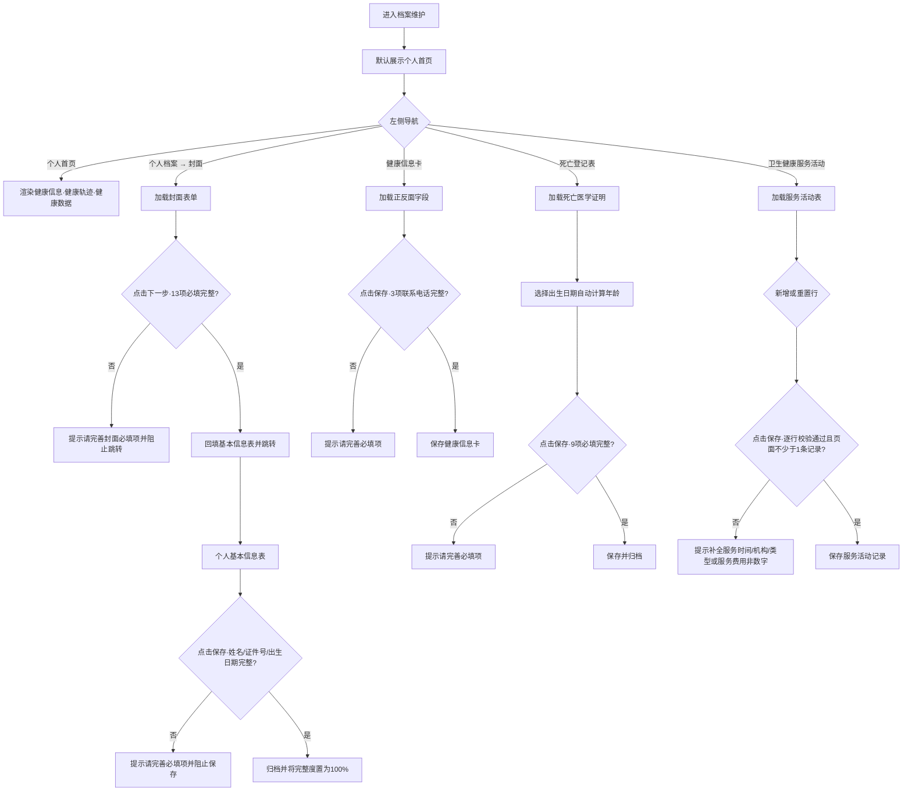

#### 7.2.2.1 个人首页

| 字段    | 内容                                                                                                                                                                                                                                                                                                 |
| ----- | -------------------------------------------------------------------------------------------------------------------------------------------------------------------------------------------------------------------------------------------------------------------------------------------------- |
| 功能名称  | 个人首页                                                                                                                                                                                                                                                                                               |
| 所属模块  | 档案管理 › 居民健康档案（档案维护）（子功能）                                                                                                                                                                                                                                                                           |
| 功能描述  | 以健康概览方式汇总展示居民健康信息指标、病史摘要、健康轨迹与健康数据趋势，作为档案维护的默认首页；本页只做展示，不承担录入。                                                                                                                                                                                                                                     |
| 前提条件  | 居民档案已建立并进入档案维护页；档案未注销、未锁定。                                                                                                                                                                                                                                                                         |
| 入口    | 档案维护页 → 左侧导航「个人首页」                                                                                                                                                                                                                                                                                 |
| 基本事件流 | 当用户进入档案维护，系统应默认展示个人首页。<br />当用户查看健康信息，系统应展示空腹血糖、血压、身高、心率、体重、血型、体质指数（BMI）7 项环形指标与中心头像。<br />当用户查看病史信息，系统应展示疾病史、遗传病史、药物过敏史、手术史、残疾情况、外伤史、输血史、家族史 8 项摘要。<br />当用户点击「生命树」，系统应切换至生命树视图。<br />当用户点击「家系图」，系统应切换至家系图视图。<br />当用户拖动健康轨迹，系统应旋转三维视图；滚动滚轮应缩放；悬停节点应展示具体服务信息。<br />当用户调整健康数据日期范围，系统应刷新空腹血糖与血压趋势图。 |
| 后置条件  | 仅展示，不写入数据。                                                                                                                                                                                                                                                                                         |
| 异常流程  | 若某项指标无数据，则系统应展示「--」或「不详」占位。<br />若健康数据所选区间无记录，则系统应展示空图表状态。<br />若档案已注销或锁定，则系统应保持概览只读，不提供编辑入口。                                                                                                                                                                                                      |
| 输入    | 健康数据日期范围。                                                                                                                                                                                                                                                                                          |
| 处理    | 指标聚合展示；三维轨迹渲染与旋转、缩放、悬停交互；趋势图渲染与日期过滤。                                                                                                                                                                                                                                                               |
| 输出    | 健康信息指标、病史摘要、健康轨迹三维视图、健康数据趋势图。                                                                                                                                                                                                                                                                      |
| 页面内交互 | 顶部面包屑「健康首页」；右上角提供「生命树」「家系图」；中部为健康信息左卡与健康轨迹右卡；底部健康数据卡支持日期范围选择。                                                                                                                                                                                                                                      |
| 验收标准  | 进入档案维护默认展示个人首页。<br />健康信息环形区 7 项指标与病史信息 8 类摘要均展示。<br />健康轨迹可拖动旋转、滚轮缩放并显示悬停提示。<br />健康数据可按日期范围切换并展示空腹血糖、血压趋势。<br />点击「生命树」「家系图」可分别切换至对应视图。                                                                                                                                                          |
| 原型图   | 档案管理 › 居民档案 › 档案维护 › 个人首页（原型页：档案维护.html）                                                                                                                                                                                                                                                           |
| 流程图   | 见下方 Mermaid 流程图                                                                                                                                                                                                                                                                                    |
| 时序图   |                                                                                                                                                                                                                                                                                                    |
| 活动图   | 无                                                                                                                                                                                                                                                                                                  |

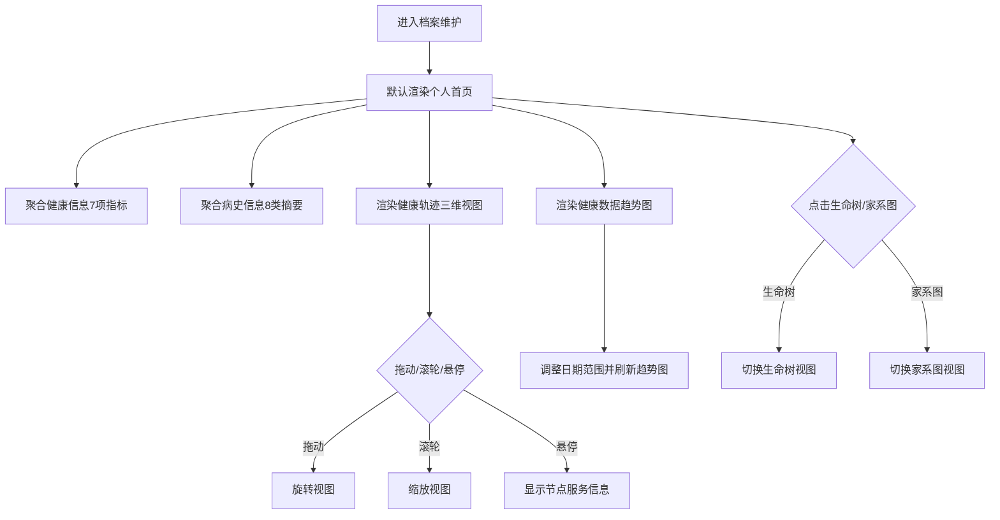

**表单字段与输入规则**（取自原型页：档案维护.html，个人首页）

| 类别   | 字段                                  | 必填 | 长度上限 | 取值 ／ 校验                                 |
| ---- | ----------------------------------- | -- | ---- | --------------------------------------- |
| 健康信息 | 空腹血糖                                | —  | —    | 环形指标展示；无数据展示「--」                        |
| 健康信息 | 血压                                  | —  | —    | 环形指标展示；无数据展示「--」                        |
| 健康信息 | 身高                                  | —  | —    | 环形指标展示；无数据展示「--」                        |
| 健康信息 | 心率                                  | —  | —    | 环形指标展示；无数据展示「--」                        |
| 健康信息 | 体重                                  | —  | —    | 环形指标展示；无数据展示「--」                        |
| 健康信息 | 血型                                  | —  | —    | 展示 ABO／RH 血型；无数据展示「不详」                  |
| 健康信息 | 体质指数（BMI）                           | —  | —    | 环形指标展示；无数据展示「--」                        |
| 病史信息 | 疾病史、遗传病史、药物过敏史、手术史、残疾情况、外伤史、输血史、家族史 | —  | —    | 摘要展示；无数据展示「-」                           |
| 健康轨迹 | 三维全生命周期视图                           | —  | —    | X=生命周期、Y=档案业务、Z=具体服务信息；支持拖动旋转、滚轮缩放、悬停提示 |
| 健康数据 | 日期范围                                | 否  | —    | 选择起止日期后刷新趋势图                            |
| 健康数据 | 空腹血糖、血压趋势图                          | —  | —    | 单位分别为 mmol/L、mmHg；血压含收缩压／舒张压双折线         |

#### 7.2.2.2 居民健康档案封面

| 字段    | 内容                                                                                                                                                                                                                                                             |
| ----- | -------------------------------------------------------------------------------------------------------------------------------------------------------------------------------------------------------------------------------------------------------------- |
| 功能名称  | 居民健康档案封面                                                                                                                                                                                                                                                       |
| 所属模块  | 档案管理 › 居民健康档案（档案维护）（子功能）                                                                                                                                                                                                                                       |
| 功能描述  | 维护居民健康档案封面的 13 项基本信息；点击「下一步」校验后进入个人基本信息表，并将封面数据回填至基本信息表对应字段，保证两处口径一致。                                                                                                                                                                                          |
| 前提条件  | 居民档案已建立；用户具备档案维护权限；档案未注销、未锁定。                                                                                                                                                                                                                                  |
| 入口    | 档案维护页 → 左侧导航「个人档案」→「封面」                                                                                                                                                                                                                                        |
| 基本事件流 | 当用户点击「个人档案 → 封面」，系统应加载封面表单并展示个人档案编号。<br />当用户选择现住址，系统应自动带出乡镇（街道）名称与村（居）委会名称。<br />当用户点击「下一步」，系统应校验 13 项必填；缺失时提示具体字段并阻止跳转。<br />当校验通过，系统应将姓名、联系电话、建档单位、建档日期、现住址（含详细地址）、户籍地址（含详细地址）、村（居）委会名称回填至个人基本信息表对应字段。<br />当回填完成，系统应切换至「个人基本信息表」并提示「封面信息已暂存，请继续填写个人基本信息表」。 |
| 后置条件  | 封面数据暂存并回填个人基本信息表；个人档案编号保持不变。                                                                                                                                                                                                                                   |
| 异常流程  | 若姓名为空，则系统应提示「请完善封面必填项：姓名」。<br />若现住址或户籍地址未选到村（居）社区，则系统应提示对应地址需选到村（居）社区一级。<br />若联系电话为空或非 11 位，则系统应阻止跳转并提示（格式规则见 13.1）。<br />若建档单位、建档人、责任医生或建档日期为空，则系统应提示对应字段并阻止跳转。<br />若档案已注销或锁定，则系统应禁用「下一步」并提示档案状态。                                                          |
| 输入    | 姓名、现住址、管辖网格、住址详细地址、户籍地址、户籍详细地址、联系电话、乡镇（街道）名称、村（居）委会名称、建档单位、建档人、责任医生、建档日期。                                                                                                                                                                                      |
| 处理    | 封面表单加载；五级级联地址选择与乡镇／村委会联动带出；13 项必填校验；封面数据回填个人基本信息表；视图切换。                                                                                                                                                                                                        |
| 输出    | 封面数据、回填结果、切换至个人基本信息表的提示。                                                                                                                                                                                                                                       |
| 页面内交互 | 标题为「居民健康档案」，标题下方展示个人档案编号；右上角仅提供「下一步」；现住址与户籍地址为五级级联；乡镇（街道）名称与村（居）委会名称为只读，随现住址自动带出；带 * 字段为必填。                                                                                                                                                                    |
| 验收标准  | 封面加载后展示个人档案编号与已保存数据。<br />现住址选择完成后乡镇（街道）名称、村（居）委会名称自动带出且不可编辑。<br />13 项必填校验生效，缺失时提示具体字段并阻止跳转。<br />校验通过后跳转个人基本信息表，姓名、联系电话、建档单位、建档日期、现住址、户籍地址、村（居）委会名称已回填。                                                                                                      |
| 原型图   | 档案管理 › 居民档案 › 档案维护 › 封面（原型页：档案维护.html）                                                                                                                                                                                                                         |
| 流程图   | 见下方 Mermaid 流程图                                                                                                                                                                                                                                                |
| 时序图   |                                                                                                                                                                                                                                                                |
| 活动图   | 无                                                                                                                                                                                                                                                              |

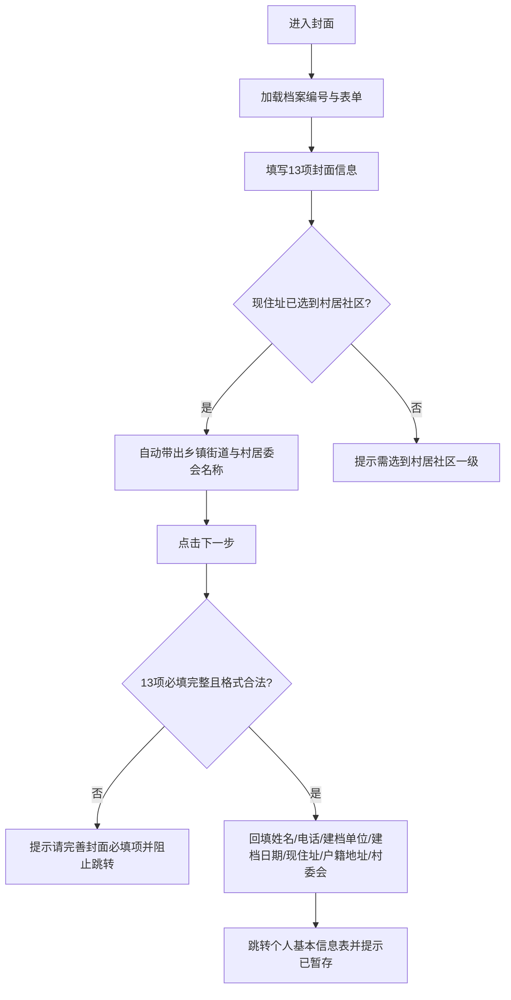

**表单字段与输入规则**（取自原型页：档案维护.html，封面）

| 类别   | 字段       | 必填 | 长度上限  | 取值 ／ 校验                           |
| ---- | -------- | -- | ----- | --------------------------------- |
| 封面表单 | 姓名       | 是  | 8 字符  | 非空；右侧实时字数计数                       |
| 封面表单 | 现住址      | 是  | —     | 五级级联（省／市／区县／乡镇街道／村居社区），须选到村（居）社区  |
| 封面表单 | 管辖网格     | 是  | —     | 下拉选择；决定档案数据归属与可见范围                |
| 封面表单 | 住址详细地址   | 是  | 50 字符 | 非空；与现住址合并构成完整住址；右侧字数计数            |
| 封面表单 | 户籍地址     | 是  | —     | 五级级联，须选到村（居）社区                    |
| 封面表单 | 户籍详细地址   | 是  | 50 字符 | 非空；与户籍地址合并构成完整户籍住址；右侧字数计数         |
| 封面表单 | 联系电话     | 是  | 11 位  | 11 位数字（见 13.1）                    |
| 封面表单 | 乡镇（街道）名称 | 是  | —     | 只读；选择现住址后自动带出                     |
| 封面表单 | 村（居）委会名称 | 是  | —     | 只读；选择现住址后自动带出                     |
| 封面表单 | 建档单位     | 是  | —     | 下拉选择；默认取当前登录用户所属机构                |
| 封面表单 | 建档人      | 是  | —     | 下拉选择；默认取当前登录用户                    |
| 封面表单 | 责任医生     | 是  | —     | 下拉选择；默认取当前登录用户                    |
| 封面表单 | 建档日期     | 是  | —     | 日期，默认当前日期                         |
| 页面操作 | 下一步      | —  | —     | 点击校验 13 项必填；缺失提示「请完善封面必填项：…」并阻止跳转 |

> 回填字段：姓名、联系电话、建档单位、建档日期、现住址（含详细地址）、户籍地址（含详细地址）、村（居）委会名称。

#### 7.2.2.3 个人基本信息表

| 字段    | 内容                                                                                                                                                                                                                                                                                                                                                                           |
| ----- | ---------------------------------------------------------------------------------------------------------------------------------------------------------------------------------------------------------------------------------------------------------------------------------------------------------------------------------------------------------------------------- |
| 功能名称  | 个人基本信息表                                                                                                                                                                                                                                                                                                                                                                      |
| 所属模块  | 档案管理 › 居民健康档案（档案维护）（子功能）                                                                                                                                                                                                                                                                                                                                                     |
| 功能描述  | 按分段维护居民个人基本信息，覆盖个人健康标识、基本信息与管理信息、紧急联系人、住址信息、文化程度／职业／婚姻状况、医疗费用支付方式、个人健康凭证、药物过敏史、暴露史、既往史、家族史、遗传病史、残疾情况、村委会／人群性质与建档信息；保存后归档并按 12 个分段重算完整度。                                                                                                                                                                                                                                      |
| 前提条件  | 已进入档案维护页；已完成封面填报（或已有档案数据）；档案未注销、未锁定。                                                                                                                                                                                                                                                                                                                                         |
| 入口    | 档案维护页 → 左侧导航「个人档案」→「个人基本信息」                                                                                                                                                                                                                                                                                                                                                  |
| 基本事件流 | 当用户进入个人基本信息表，系统应展示档案编号、建档单位、健康档案管理状态、已保存归档标识与完整度。<br />当用户选择人群标识、慢病／重点疾病、法定传染病、体重情况、ABO／RH 血型，系统应记录个人健康标识。<br />当用户填写基本信息与管理信息、紧急联系人、住址信息、文化程度、职业、婚姻状况与支付方式，系统应记录对应分段内容。<br />当用户点击「添加凭证」，系统应追加一行健康凭证；点击行内「删除」应移除该行。<br />当用户选择手术／外伤／输血／预防接种史为「有」，系统应展开明细表；点击「＋」增行、「×」删行。<br />当用户点击页面右上角「保存」，系统应校验姓名、证件号、出生日期；通过后归档并将完整度置为 100%。<br />当用户再次点击「保存」，系统应提示「档案已是最新保存状态，无需重复保存」。 |
| 后置条件  | 个人基本信息表归档并关联居民主档案；完整度按 12 个分段重算；表头展示「已保存归档」。                                                                                                                                                                                                                                                                                                                                 |
| 异常流程  | 若姓名、证件号或出生日期为空，则系统应提示「请完善必填项：…」并阻止保存。<br />若证件号超过 18 位或校验位不合法，则系统应阻止保存并定位该字段（见 13.1）。<br />若出生日期晚于当前日期，则系统应阻止保存并提示。<br />若法定传染病、药物过敏史、遗传病史、残疾情况选择「其他」而未填补充说明，则系统应提示补全。<br />若医疗费用支付方式选择「其他」而未填说明，则系统应提示补全。<br />若紧急联系人 1 的姓名、关系或电话缺失，则系统应提示补全。<br />若暴露史、残疾情况或既往史「疾病」未选择，则系统应提示按必填要求选择。<br />若档案已注销或锁定，则系统应禁用保存并提示档案状态。                                                      |
| 输入    | 个人健康标识；基本信息与管理信息；紧急联系人；住址信息；文化程度、职业、婚姻状况；医疗费用支付方式；个人健康凭证；药物过敏史；暴露史；既往史；家族史；遗传病史；残疾情况；村委会、人群性质；建档信息。                                                                                                                                                                                                                                                                          |
| 处理    | 表单加载与只读项渲染；分段必填提示；健康凭证与既往史明细增删行；完整度按 12 个分段计算；保存归档与重复保存拦截。                                                                                                                                                                                                                                                                                                                   |
| 输出    | 归档后的个人基本信息表、完整度百分比、保存结果提示。                                                                                                                                                                                                                                                                                                                                                   |
| 页面内交互 | 表头展示「个人基本信息表」、健康档案管理状态、档案编号、建档单位、已保存归档标识与完整度环形图；页面右上角提供「保存」；健康凭证支持「添加凭证」与行内「删除」；手术／外伤／输血／预防接种史选「有」时展开明细表并支持「＋」增行、「×」删行；带 * 字段为必填。                                                                                                                                                                                                                                            |
| 验收标准  | 表头档案编号、建档单位、管理状态与完整度正确展示。<br />健康凭证可添加、删除行；既往史明细可增删行。<br />保存时校验姓名、证件号、出生日期；缺失时提示「请完善必填项：…」。<br />保存成功后表头显示「已保存归档」，完整度显示 100%。<br />已保存状态下重复保存提示「档案已是最新保存状态，无需重复保存」。<br />完整度按 12 个分段计算，全部有值时显示 100%。                                                                                                                                                                        |
| 原型图   | 档案管理 › 居民档案 › 档案维护 › 个人基本信息（原型页：档案维护.html）                                                                                                                                                                                                                                                                                                                                   |
| 流程图   | 见下方 Mermaid 流程图                                                                                                                                                                                                                                                                                                                                                              |
| 时序图   |                                                                                                                                                                                                                                                                                                                                                                              |
| 活动图   | 无                                                                                                                                                                                                                                                                                                                                                                            |

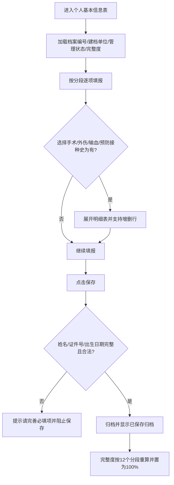

**表单字段与输入规则**（取自原型页：档案维护.html，个人基本信息）

| 类别        | 字段             | 必填 | 长度上限  | 取值 ／ 校验                                                                                                                         |
| --------- | -------------- | -- | ----- | ------------------------------------------------------------------------------------------------------------------------------- |
| 个人健康标识    | 人群标识           | 否  | —     | 单选：0-6 岁儿童、65 岁及以上老年人、孕产妇                                                                                                       |
| 个人健康标识    | 慢病／重点疾病        | 是  | —     | 多选：高血压、2 型糖尿病、脑卒中、冠心病、脑血管病后遗症、慢性阻塞性肺疾病、哮喘、尿毒症、恶性肿瘤、严重精神障碍、地方病、职业病、失智、先天畸形                                                       |
| 个人健康标识    | 法定传染病          | 否  | 30 字  | 多选：肺结核、肝炎、其他法定传染病；选「其他法定传染病」时启用补充输入                                                                                             |
| 个人健康标识    | 体重情况           | 否  | —     | 单选：低、正常、超重、肥胖                                                                                                                   |
| 个人健康标识    | ABO 血型         | 否  | —     | 单选：A 型、B 型、O 型、AB 型、不详                                                                                                          |
| 个人健康标识    | RH 血型          | 否  | —     | 单选：阴性、阳性、不详、未查                                                                                                                  |
| 基本信息与管理信息 | 姓名             | 是  | 8 字符  | 非空                                                                                                                              |
| 基本信息与管理信息 | 性别             | 是  | —     | 单选：男性、女性、未知的性别、未说明的性别                                                                                                           |
| 基本信息与管理信息 | 证件类型           | 是  | —     | 下拉：居民身份证、居民户口簿、护照、港澳居民来往内地通行证、台湾居民来往大陆通行证                                                                                       |
| 基本信息与管理信息 | 证件号            | 是  | 18 位  | 校验位规则见 13.1                                                                                                                     |
| 基本信息与管理信息 | 出生日期           | 是  | —     | 日期，不得晚于当前日期                                                                                                                     |
| 基本信息与管理信息 | 工作单位／学校        | 否  | 30 字符 | —                                                                                                                               |
| 基本信息与管理信息 | 籍贯             | 是  | —     | 五级级联选择                                                                                                                          |
| 基本信息与管理信息 | 出生地            | 是  | 30 字符 | —                                                                                                                               |
| 基本信息与管理信息 | 民族             | 否  | —     | 下拉选择                                                                                                                            |
| 基本信息与管理信息 | 管理机构           | 是  | —     | 下拉选择；决定档案归属                                                                                                                     |
| 基本信息与管理信息 | 档案管理机构电话       | 否  | 13 位  | —                                                                                                                               |
| 基本信息与管理信息 | 家庭医生是否签约       | 否  | —     | 单选：是、否；默认「是」                                                                                                                    |
| 基本信息与管理信息 | 家庭医生姓名         | 否  | 10 字符 | —                                                                                                                               |
| 基本信息与管理信息 | 家庭医生电话         | 否  | 11 位  | —                                                                                                                               |
| 基本信息与管理信息 | 本人电话           | 是  | 11 位  | 11 位数字（见 13.1）                                                                                                                  |
| 紧急联系人     | 联系人 1          | 是  | —     | 姓名（≤10 字符）、与本人关系（≤10 字符）、联系电话（≤11 位）三项均必填                                                                                       |
| 紧急联系人     | 联系人 2          | 否  | —     | 三项均可不填；填写时按联系人 1 的规则校验                                                                                                          |
| 住址信息      | 常住类型           | 否  | —     | 单选：户籍、非户籍；默认「户籍」                                                                                                                |
| 住址信息      | 常住地址           | 否  | —     | 只读；由封面现住址（含详细地址）带出；选择「户籍」时同时展示户籍地址                                                                                              |
| 文化程度      | 文化程度           | 是  | —     | 单选：研究生、大学本科、大学专科和专科学校、中等专业学校、技工学校、高中、初中、小学、文盲或半文盲、不详                                                                            |
| 职业        | 职业             | 是  | —     | 单选：国家机关、党群组织、企业、事业单位负责人；专业技术人员；办事人员和有关人员；商业、服务业人员；农林牧渔水利业生产人员；生产、运输设备操作人员及有关人员；军人；不便分类的其他从业人员；无职业                               |
| 婚姻状况      | 婚姻状况           | 是  | —     | 单选：未婚、已婚、初婚、再婚、复婚、丧偶、离婚、未说明的婚姻状况                                                                                                |
| 医疗费用支付方式  | 支付方式           | 是  | 20 字  | 多选：城镇职工基本医疗保险、城镇居民基本医疗保险、新型农村合作医疗、贫困救助、商业医疗保险、全公费、全自费、其他；选「其他」时填写补充说明                                                           |
| 个人健康凭证    | 凭证行            | 否  | —     | 列：名称（出生医学证明／预防接种证／其他健康凭证）、编号（≤20）、凭证签发机构（≤30）、凭证签发时间、凭证有效期、操作；支持「添加凭证」与行内「删除」                                                   |
| 药物过敏史     | 过敏史            | 否  | 30 字  | 多选：无、青霉素、磺胺、链霉素、其他；选「其他」时填写补充说明                                                                                                 |
| 暴露史       | 暴露史            | 是  | —     | 多选：无、化学品、毒物、射线                                                                                                                  |
| 既往史       | 疾病             | 是  | —     | 多选：无、糖尿病、慢性阻塞性肺疾病、脑卒中、结核病、其他法定传染病、其他、高血压、冠心病、恶性肿瘤、严重精神障碍、肝炎、职业病                                                                 |
| 既往史       | 手术／外伤／输血／预防接种史 | 否  | 30 字符 | 均为单选：无、有；选「有」时展开明细表（名称／原因 + 时间），支持「＋」增行、「×」删行                                                                                   |
| 家族史       | 家族成员           | 否  | —     | 按成员逐行登记；无数据时为空                                                                                                                  |
| 遗传病史      | 遗传病史           | 否  | 30 字  | 单选：无、有；选「有」时填写补充说明                                                                                                              |
| 残疾情况      | 残疾情况           | 是  | 30 字  | 多选：无残疾、视力残疾、听力残疾、言语残疾、肢体残疾、智力残疾、精神残疾、其他残疾；选「其他残疾」时填写补充说明                                                                        |
| 村委会       | 村委会            | 是  | —     | 下拉选择；随封面「村（居）委会名称」带出，无对应项时动态补充                                                                                                  |
| 人群性质      | 人群性质           | 否  | —     | 多选：普通人群、农村建档立卡贫困人口、城乡低保五保人口、计划生育特殊家庭人口、失能（失智）老年人、残疾人、0-6 岁儿童、高血压患者、糖尿病患者、65 以上常住居民、严重精神障碍患者、肺结核患者、离休干部、孕 13 周之前建册并进行第一次产前检查的孕产妇 |
| 建档信息      | 责任医生           | 是  | —     | 下拉选择                                                                                                                            |
| 建档信息      | 建档单位           | 否  | —     | 只读；取封面建档单位                                                                                                                      |
| 建档信息      | 建档人            | 是  | —     | 下拉选择                                                                                                                            |
| 建档信息      | 建档日期           | 是  | —     | 日期，取封面建档日期                                                                                                                      |

> 保存校验（原型口径）：仅校验姓名、证件号、出生日期 3 项；其余带 * 字段为前端必填标识。

> 完整度：按 12 个分段计算（人群标识、慢病／重点疾病、血型、基本信息、管理信息、紧急联系人、文化程度、支付方式、健康凭证、过敏史、既往史、人群性质），全部有值时为 100%。

#### 7.2.2.4 健康信息卡

| 字段    | 内容                                                                                                                                                                                                                                                                                           |
| ----- | -------------------------------------------------------------------------------------------------------------------------------------------------------------------------------------------------------------------------------------------------------------------------------------------- |
| 功能名称  | 健康信息卡                                                                                                                                                                                                                                                                                        |
| 所属模块  | 档案管理 › 居民健康档案（档案维护）（子功能）                                                                                                                                                                                                                                                                     |
| 功能描述  | 以「正面／反面」两段维护居民健康信息卡，记录血型、慢性病患病情况、过敏史与紧急联系方式；身份类字段由档案带出且只读，保存时校验 3 项联系电话。                                                                                                                                                                                                                     |
| 前提条件  | 已进入档案维护页；个人基本信息表已建立；档案未注销、未锁定。                                                                                                                                                                                                                                                               |
| 入口    | 档案维护页 → 左侧导航「个人档案」→「健康信息卡」                                                                                                                                                                                                                                                                   |
| 基本事件流 | 当用户点击「健康信息卡」，系统应加载正面与反面字段，并将姓名、性别、出生日期、健康档案编号、家庭住址、建档机构名称、责任医生或护士置为只读。<br />当用户选择 ABO／RH 血型、慢性病患病情况，系统应记录对应内容。<br />当用户填写过敏史，系统应实时显示字数计数（n/200）。<br />当用户填写家庭电话、紧急情况联系人及其电话，系统应记录对应内容。<br />当用户填写建档机构联系人电话、责任医生或护士联系电话、其他说明，系统应记录对应内容。<br />当用户点击「保存」，系统应校验家庭电话、建档机构联系人电话与责任医生或护士联系电话；通过后归档。 |
| 后置条件  | 健康信息卡写入档案并关联居民主档案；操作写入操作日志。                                                                                                                                                                                                                                                                  |
| 异常流程  | 若家庭电话为空或非 11 位，则系统应提示「请完善必填项：家庭电话」并阻止保存。<br />若建档机构联系人电话为空或非 11 位，则系统应提示「请完善必填项：建档机构联系人电话」并阻止保存。<br />若责任医生或护士联系电话为空或非 11 位，则系统应提示「请完善必填项：责任医生或护士联系电话」并阻止保存。<br />若档案已注销或锁定，则系统应禁用保存并提示档案状态。                                                                                                 |
| 输入    | 正面：ABO 血型、RH 血型、慢性病患病情况、过敏史；反面：家庭电话、紧急情况联系人、联系人电话、建档机构联系人电话、责任医生或护士联系电话、其他说明。                                                                                                                                                                                                                |
| 处理    | 正反面字段加载；只读项渲染；字数计数；3 项联系电话必填校验；保存归档。                                                                                                                                                                                                                                                         |
| 输出    | 健康信息卡内容、保存结果提示。                                                                                                                                                                                                                                                                              |
| 页面内交互 | 卡片头部提供「保存」；按「正面」「反面」两段分区；姓名、性别、出生日期、健康档案编号、家庭住址、建档机构名称、责任医生或护士为只读；过敏史与其他说明为文本域，右侧实时字数计数。                                                                                                                                                                                                     |
| 验收标准  | 正反面字段完整展示，只读项不可编辑。<br />过敏史、其他说明字数计数正确。<br />保存时家庭电话、建档机构联系人电话、责任医生或护士联系电话缺失或格式不合法均被拦截并提示。<br />保存成功提示「保存成功：健康信息卡已归档」。                                                                                                                                                                       |
| 原型图   | 档案管理 › 居民档案 › 档案维护 › 健康信息卡（原型页：档案维护.html）                                                                                                                                                                                                                                                    |
| 流程图   | 见下方 Mermaid 流程图                                                                                                                                                                                                                                                                              |
| 时序图   |                                                                                                                                                                                                                                                                                              |
| 活动图   | 无                                                                                                                                                                                                                                                                                            |

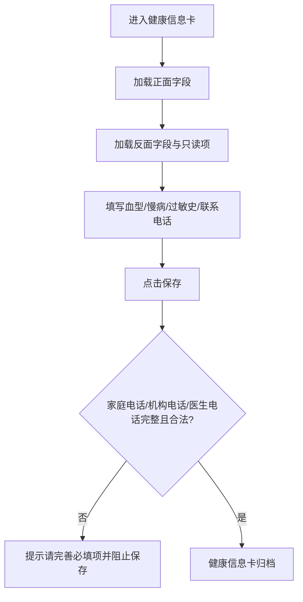

**表单字段与输入规则**（取自原型页：档案维护.html，健康信息卡）

| 类别 | 字段             | 必填 | 长度上限   | 取值 ／ 校验                          |
| -- | -------------- | -- | ------ | -------------------------------- |
| 正面 | 姓名             | —  | —      | 只读；由个人基本信息表带出                    |
| 正面 | 性别             | —  | —      | 只读；由个人基本信息表带出                    |
| 正面 | 出生日期           | —  | —      | 只读；由个人基本信息表带出                    |
| 正面 | 健康档案编号         | —  | —      | 只读；由档案带出                         |
| 正面 | ABO 血型         | 否  | —      | 单选：A 型、B 型、O 型、AB 型、不详           |
| 正面 | RH 血型          | 否  | —      | 单选：阳性、阴性、不详、未查                   |
| 正面 | 慢性病患病情况        | 否  | —      | 多选：无、高血压、糖尿病、脑卒中、冠心病、哮喘、职业病、其他疾病 |
| 正面 | 过敏史            | 否  | 200 字符 | 文本域；右侧实时字数计数                     |
| 反面 | 家庭住址           | —  | —      | 只读；由档案带出                         |
| 反面 | 家庭电话           | 是  | 11 位   | 11 位数字（见 13.1）                   |
| 反面 | 紧急情况联系人        | 否  | —      | —                                |
| 反面 | 联系人电话          | 否  | 11 位   | 紧急情况联系人电话                        |
| 反面 | 建档机构名称         | —  | —      | 只读；由档案带出                         |
| 反面 | 联系人电话（建档机构）    | 是  | 11 位   | 建档机构联系人电话                        |
| 反面 | 责任医生或护士        | —  | —      | 只读；由档案带出                         |
| 反面 | 联系人电话（责任医生或护士） | 是  | 11 位   | 责任医生或护士联系电话                      |
| 反面 | 其他说明           | 否  | 200 字符 | 文本域；右侧实时字数计数                     |

> 保存校验：家庭电话、建档机构联系人电话、责任医生或护士联系电话 3 项必填，缺失时提示「请完善必填项：…」。

> 只读项：姓名、性别、出生日期、健康档案编号、家庭住址、建档机构名称、责任医生或护士。

#### 7.2.2.5 居民死亡医学证明（推断）书

| 字段    | 内容                                                                                                                                                                                                                                                                                                                                                |
| ----- | ------------------------------------------------------------------------------------------------------------------------------------------------------------------------------------------------------------------------------------------------------------------------------------------------------------------------------------------------- |
| 功能名称  | 居民死亡医学证明（推断）书                                                                                                                                                                                                                                                                                                                                     |
| 所属模块  | 档案管理 › 居民健康档案（档案维护）（子功能）                                                                                                                                                                                                                                                                                                                          |
| 功能描述  | 按「基本信息—致死主要疾病诊断—诊断依据—死亡调查记录」四段填报居民死亡医学证明（推断）书；出生日期联动年龄，保存时校验个人身份、死亡日期与死亡调查记录等必填项。                                                                                                                                                                                                                                                                 |
| 前提条件  | 已进入档案维护页；居民档案已建立；档案未注销、未锁定。                                                                                                                                                                                                                                                                                                                       |
| 入口    | 档案维护页 → 左侧导航「个人档案」→「死亡登记表」                                                                                                                                                                                                                                                                                                                        |
| 基本事件流 | 当用户点击「死亡登记表」，系统应加载居民死亡医学证明（推断）书表单并展示行政区代码。<br />当用户选择出生日期，系统应按当前日期自动计算并回填年龄。<br />当用户填写基本信息，系统应记录姓名、性别、证件、死亡日期、死亡地点等信息。<br />当用户填写致死主要疾病诊断链，系统应记录 Ⅰ.(a) 至 Ⅰ.(d) 及 Ⅱ 的疾病名称、直接死亡原因与发病至死亡大概间隔时间。<br />当用户填写最高诊断单位、最高诊断依据、根本死亡原因与 ICD 编码，系统应记录诊断依据。<br />当用户填写死亡调查记录，系统应记录死者生前病史及症状特征、被调查者信息、死因推断与签名。<br />当用户点击「保存」，系统应校验个人身份、死亡日期与死亡调查记录等必填项；通过后归档。 |
| 后置条件  | 死亡医学证明（推断）书写入档案并关联居民主档案；操作写入操作日志。                                                                                                                                                                                                                                                                                                                 |
| 异常流程  | 若个人身份未选择，则系统应提示「请完善必填项：个人身份」并阻止保存。<br />若死亡日期为空，则系统应提示「请完善必填项：死亡日期」并阻止保存。<br />若死者生前病史及症状特征、被调查者姓名、联系电话、与死者关系、联系地址或工作单位、死因推断、被调查者签名缺失，则系统应提示对应字段并阻止保存。<br />若 Ⅰ.(a) 直接死亡原因未填写，则系统应提示补全。<br />若档案已注销或锁定，则系统应禁用保存并提示档案状态。                                                                                                                           |
| 输入    | 行政区代码、编号、地址、姓名、性别、国家或地区、民族、有效证件、证件号码、年龄、出生日期、文化程度、婚姻状况、个人身份、死亡日期、死亡地点、妊娠情况、生前工作单位、户籍地址、常住地址、家属信息、致死主要疾病诊断链、最高诊断单位、最高诊断依据、根本死亡原因、ICD 编码、医师、医疗卫生机构、填表日期、死亡调查记录。                                                                                                                                                                                     |
| 处理    | 表单加载；出生日期联动年龄；四段内容录入；9 项必填校验；保存归档。                                                                                                                                                                                                                                                                                                                |
| 输出    | 居民死亡医学证明（推断）书、保存结果提示。                                                                                                                                                                                                                                                                                                                             |
| 页面内交互 | 卡片头部提供「保存」；按「基本信息—致死主要疾病诊断—诊断依据—死亡调查记录」四段分区；致死主要疾病诊断以表格呈现 Ⅰ.(a)～(d) 与 Ⅱ 五行；个人身份、与死者关系为单选；死者生前病史及症状特征、死因推断为文本域并实时字数计数。                                                                                                                                                                                                                             |
| 验收标准  | 四段字段完整展示；行政区代码为只读。<br />选择出生日期后年龄自动计算并回填。<br />致死主要疾病诊断链 Ⅰ.(a)～(d) 与 Ⅱ 均可填写。<br />保存时 9 项必填缺失被拦截并提示对应字段。<br />保存成功提示「保存成功：居民死亡医学证明（推断）书已归档」。                                                                                                                                                                                                      |
| 原型图   | 档案管理 › 居民档案 › 档案维护 › 死亡登记表（原型页：档案维护.html）                                                                                                                                                                                                                                                                                                         |
| 流程图   | 见下方 Mermaid 流程图                                                                                                                                                                                                                                                                                                                                   |
| 时序图   |                                                                                                                                                                                                                                                                                                                                                   |
| 活动图   | 无                                                                                                                                                                                                                                                                                                                                                 |

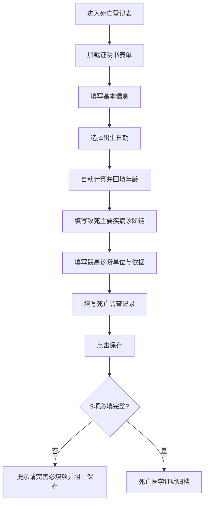

**表单字段与输入规则**（取自原型页：档案维护.html，死亡登记表）

| 类别       | 字段                     | 必填 | 长度上限   | 取值 ／ 校验                                                        |
| -------- | ---------------------- | -- | ------ | -------------------------------------------------------------- |
| 抬头       | 行政区代码                  | —  | —      | 只读；由系统带出                                                       |
| 抬头       | 编号                     | 否  | 20 字符  | —                                                              |
| 基本信息     | 地址                     | 否  | —      | 省（自治区、直辖市）、市（地区、州、盟）、县（区、旗）三段                                  |
| 基本信息     | 姓名                     | 否  | —      | —                                                              |
| 基本信息     | 性别                     | 否  | —      | —                                                              |
| 基本信息     | 国家或地区                  | 否  | —      | —                                                              |
| 基本信息     | 民族                     | 否  | —      | —                                                              |
| 基本信息     | 有效证件                   | 否  | —      | 下拉：居民身份证、居民户口簿、护照、港澳居民来往内地通行证、台湾居民来往大陆通行证                      |
| 基本信息     | 证件号码                   | 否  | 18 位   | —                                                              |
| 基本信息     | 年龄                     | 否  | 3 位    | 选择出生日期后自动计算                                                    |
| 基本信息     | 出生日期                   | 否  | —      | 日期；变更后联动年龄                                                     |
| 基本信息     | 文化程度                   | 否  | —      | 下拉：研究生至文盲或半文盲、不详                                               |
| 基本信息     | 婚姻状况                   | 否  | —      | 下拉：未婚、已婚、初婚、再婚、离婚、丧偶、未说明的婚姻状况                                  |
| 基本信息     | 个人身份                   | 是  | —      | 单选：公务员、专业技术人员、职员、企业管理者、工人、农民、学生、现役军人、自由职业者、个体经营者、无业人员、离退休人员、其他 |
| 基本信息     | 死亡日期                   | 是  | —      | 日期，YYYY-MM-DD                                                  |
| 基本信息     | 死亡地点                   | 否  | —      | 单选：医疗卫生机构、来院途中、家中、养老服务机构、其他场所、不详                               |
| 基本信息     | 死亡时是否处于妊娠期或妊娠终止后 42 天内 | 否  | —      | 单选：是、否                                                         |
| 基本信息     | 生前工作单位                 | 否  | —      | —                                                              |
| 基本信息     | 户籍地址                   | 否  | —      | —                                                              |
| 基本信息     | 常住地址                   | 否  | —      | —                                                              |
| 基本信息     | 可联系的家属姓名               | 否  | —      | —                                                              |
| 基本信息     | 联系电话                   | 否  | 11 位   | —                                                              |
| 基本信息     | 家属住址或工作单位              | 否  | 100 字符 | 文本域；右侧字数计数                                                     |
| 致死主要疾病诊断 | Ⅰ.(a) 直接死亡原因           | 是  | —      | 行：疾病名称（ICD 下拉）、直接死亡原因、发病至死亡大概间隔时间                              |
| 致死主要疾病诊断 | Ⅰ.(b) 引起 (a) 的疾病或情况    | 否  | —      | 同上                                                             |
| 致死主要疾病诊断 | Ⅰ.(c) 引起 (b) 的疾病或情况    | 否  | —      | 同上                                                             |
| 致死主要疾病诊断 | Ⅰ.(d) 引起 (c) 的疾病或情况    | 否  | —      | 同上                                                             |
| 致死主要疾病诊断 | Ⅱ 其他疾病诊断               | 否  | —      | 促进死亡但与导致死亡无关的其他重要情况                                            |
| 诊断依据     | 生前主要疾病最高诊断单位           | 否  | —      | 单选：三级医院、二级医院、乡镇卫生院／社区卫生服务机构、村卫生室、其他医疗卫生机构、未就诊                  |
| 诊断依据     | 生前主要疾病最高诊断依据           | 否  | —      | 单选：尸检、病理、手术、临床+理化、临床、死后推断、不详                                   |
| 诊断依据     | 根本死亡原因                 | 否  | —      | —                                                              |
| 诊断依据     | ICD 编码                 | 否  | —      | 下拉选择                                                           |
| 诊断依据     | 医师                     | 否  | —      | —                                                              |
| 诊断依据     | 医疗卫生机构                 | 否  | —      | —                                                              |
| 诊断依据     | 填表日期                   | 否  | —      | 日期                                                             |
| 死亡调查记录   | 死者生前病史及症状特征            | 是  | 300 字符 | 文本域；右侧实时字数计数                                                   |
| 死亡调查记录   | 被调查者姓名                 | 是  | —      | —                                                              |
| 死亡调查记录   | 联系电话                   | 是  | 11 位   | 11 位数字（见 13.1）                                                 |
| 死亡调查记录   | 与死者关系                  | 是  | —      | 单选：本人或户主、配偶、子、女、孙子孙女或外孙子女、父母、祖父母或外祖父母、兄弟姐妹、其他                  |
| 死亡调查记录   | 联系地址或工作单位              | 是  | —      | —                                                              |
| 死亡调查记录   | 死因推断                   | 是  | 50 字符  | 文本域；右侧实时字数计数                                                   |
| 死亡调查记录   | 被调查者签名                 | 是  | —      | —                                                              |
| 死亡调查记录   | 调查时间                   | 否  | —      | 日期                                                             |

> 年龄联动：选择出生日期后按当前日期自动计算年龄并回填。

> 保存校验：个人身份、死亡日期、死者生前病史及症状特征、被调查者姓名、联系电话、与死者关系、联系地址或工作单位、死因推断、被调查者签名 9 项必填。

#### 7.2.2.6 卫生健康服务活动记录

| 字段    | 内容                                                                                                                                                                                                                                                                                                                   |
| ----- | -------------------------------------------------------------------------------------------------------------------------------------------------------------------------------------------------------------------------------------------------------------------------------------------------------------------- |
| 功能名称  | 卫生健康服务活动记录                                                                                                                                                                                                                                                                                                           |
| 所属模块  | 档案管理 › 居民健康档案（档案维护）（子功能）                                                                                                                                                                                                                                                                                             |
| 功能描述  | 按行登记居民卫生健康服务活动，合并展示业务模块新增自动生成的记录、本页手工补录的记录与数据中心 SY_JZSJ 医疗服务记录；业务模块仅在「新增」时自动追加记录，修改业务数据不同步更新；「医疗服务」记录取自数据中心 SY_JZSJ 表。                                                                                                                                                                                               |
| 前提条件  | 已进入档案维护页；居民档案已建立；档案未注销、未锁定。                                                                                                                                                                                                                                                                                          |
| 入口    | 档案维护页 → 左侧导航「个人档案」→「卫生健康服务活动」                                                                                                                                                                                                                                                                                        |
| 基本事件流 | 当用户进入卫生健康服务活动记录，系统应合并展示自动生成记录、手工补录记录与 SY_JZSJ 医疗服务记录。<br />当任一业务模块新增数据并保存成功，系统应自动向该居民卫生健康服务活动记录追加 1 条，并按业务模块归类服务类型。<br />当用户修改已生成记录对应的业务数据，系统应不更新该服务活动记录。<br />当用户点击行内「新增」，系统应追加一行空白记录；点击「重置」应清空当前行。<br />当用户填写服务时间、服务机构、服务类型、主要健康和疾病问题、医学报告与服务费用，系统应记录对应内容。<br />当用户点击「保存」，系统应逐行校验手工补录记录的服务时间、服务机构与服务类型，并校验服务费用为数字。 |
| 后置条件  | 手工补录记录写入档案；自动生成记录与 SY_JZSJ 医疗服务记录保持只读；操作写入操作日志。                                                                                                                                                                                                                                                                      |
| 异常流程  | 若手工补录记录缺少服务时间、服务机构或服务类型，则系统应提示「请完善第 N 行的服务时间、服务机构、服务类型」。<br />若服务费用填写非数字，则系统应提示「第 N 行服务费用请填写数字」。<br />若页面无任何记录，则系统应提示「请至少填写一条卫生健康服务活动记录」。<br />若用户尝试编辑或删除自动生成记录或 SY_JZSJ 医疗服务记录，则系统应保持只读不响应。<br />若档案已注销或锁定，则系统应禁用保存并提示档案状态。                                                                                         |
| 输入    | 手工补录：服务时间、服务机构、服务类型、主要健康和疾病问题、医学报告、服务费用。                                                                                                                                                                                                                                                                             |
| 处理    | 三类记录合并展示；业务模块新增触发自动记录并按模块归类服务类型；SY_JZSJ 医疗服务数据读取；手工补录记录逐行校验；保存。                                                                                                                                                                                                                                                      |
| 输出    | 卫生健康服务活动记录列表、保存结果提示。                                                                                                                                                                                                                                                                                                 |
| 页面内交互 | 卡片头部提供「保存」；表格列为序号、服务时间、服务机构、服务类型、主要健康和疾病问题、医学报告、服务费用、操作；手工补录行提供「新增／重置」；自动生成记录与 SY_JZSJ 医疗服务记录为只读。                                                                                                                                                                                                                    |
| 验收标准  | 页面合并展示自动生成、手工补录与 SY_JZSJ 医疗服务三类记录。<br />业务模块新增保存成功后自动追加 1 条记录，服务类型按归类表带入。<br />业务数据修改不更新已生成记录。<br />手工补录记录逐行校验服务时间、服务机构、服务类型，服务费用非数字被拦截。<br />自动生成记录与 SY_JZSJ 医疗服务记录不可编辑或删除。                                                                                                                                         |
| 原型图   | 档案管理 › 居民档案 › 档案维护 › 卫生健康服务活动（原型页：档案维护.html）                                                                                                                                                                                                                                                                         |
| 流程图   | 见下方 Mermaid 流程图                                                                                                                                                                                                                                                                                                      |
| 时序图   |                                                                                                                                                                                                                                                                                                                      |
| 活动图   | 无                                                                                                                                                                                                                                                                                                                    |

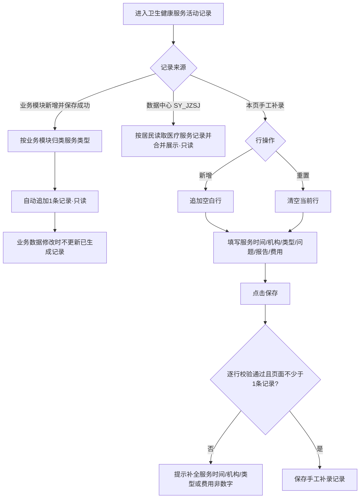

**表单字段与输入规则**（取自原型页：档案维护.html，卫生健康服务活动）

| 类别  | 字段        | 必填 | 长度上限 | 取值 ／ 校验                                                                                |
| --- | --------- | -- | ---- | -------------------------------------------------------------------------------------- |
| 表格列 | 序号        | —  | —    | 按行顺序自动生成                                                                               |
| 表格列 | 服务时间      | 是  | —    | 日期；点击后切换日期控件并唤起选择器                                                                     |
| 表格列 | 服务机构      | 是  | —    | 下拉：山东大学齐鲁医院、武坚镇周西社区卫生室、武坚镇卫生院、江都区疾病预防控制中心、江都区妇幼保健院、江都区中医院、其他医疗卫生机构                     |
| 表格列 | 服务类型      | 是  | —    | 下拉：居民健康档案管理服务、疾病管理服务、疾病控制服务、妇女保健服务、儿童保健服务、中医药服务、健康咨询服务、医疗服务；「医疗服务」由 SY_JZSJ 数据生成，不手工选择 |
| 表格列 | 主要健康和疾病问题 | 否  | —    | —                                                                                      |
| 表格列 | 医学报告      | 否  | —    | —                                                                                      |
| 表格列 | 服务费用      | 否  | —    | 可不填；填写时必须为数字                                                                           |
| 表格列 | 操作        | —  | —    | 手工补录行提供「新增」追加行、「重置」清空当前行                                                               |

**业务模块与服务类型归类**（自动记录口径）

| 业务模块                               | 服务类型       | 触发自动记录的业务新增动作                                                    |
| ---------------------------------- | ---------- | ---------------------------------------------------------------- |
| 个人档案（封面、个人基本信息、健康信息卡、死亡登记表）        | 居民健康档案管理服务 | 新增或补充个人档案类数据并保存成功                                                |
| 慢病管理（高血压、糖尿病、慢阻肺、高血脂、心脑血管、肿瘤、高危人群） | 疾病管理服务     | 新建专项档案、新建随访、新建评估记录                                               |
| 重精管理                               | 疾病控制服务     | 新建个人信息补充表、新建重精随访                                                 |
| 结核病管理（肺结核）                         | 疾病控制服务     | 新建第一次入户随访、新建肺结核随访                                                |
| 妇女管理                               | 妇女保健服务     | 新建妇女档案、婚前医学检查、叶酸登记、孕前医学检查、常见妇女病检查                                |
| 孕产妇管理                              | 妇女保健服务     | 新建孕产妇档案、第一次产前检查、产前访视、分娩记录、产后访视、产后 42 天、妊娠风险筛查、妊娠风险评估             |
| 儿童管理                               | 儿童保健服务     | 新建儿童档案、出生医学证明、新生儿访视、各月龄／年龄健康检查、视力／听力／疾病筛查、眼保健检查、生长发育监测、5 岁以下死亡登记 |
| 中医管理                               | 中医药服务      | 新建老年人／儿童中医药健康管理服务、中医健康指导、中医体质辨识                                  |
| 健教管理（健康教育）                         | 健康咨询服务     | 新建健康教育活动、宣传栏、音像资料、广播、个体化健康教育、年度计划                                |
| 医疗服务                               | 医疗服务       | 不从本页新增，按居民从数据中心 SY_JZSJ 表读取                                      |

**自动记录规则**

| 规则        | 说明                                                                 |
| --------- | ------------------------------------------------------------------ |
| 触发条件      | 上述业务模块发生「新增」并保存成功时，系统应自动向该居民的卫生健康服务活动记录追加 1 条；仅「新增」触发，修改、编辑、删除均不触发 |
| 记录条数      | 一次业务新增对应 1 条服务活动记录；同一业务记录重复保存不重复生成                                 |
| 服务时间      | 取该业务记录的保存时间                                                        |
| 服务机构      | 取该业务记录所属机构（建档机构／服务机构）                                              |
| 服务类型      | 按上表「业务模块与服务类型归类」自动带入                                               |
| 主要健康和疾病问题 | 取该业务记录的名称或主要诊断，如「高血压专项」「高血压随访」「重精随访」「肺结核随访」等                       |
| 医学报告      | 取该业务记录对应的报告或结论；无则为空                                                |
| 服务费用      | 取该业务记录产生的费用；无则为空                                                   |
| 修改不同步     | 对已生成记录对应的业务数据进行修改时，系统不更新、不重算已生成的服务活动记录，历史记录保持首次生成时的内容              |
| 只读控制      | 自动生成的记录与 SY_JZSJ 医疗服务记录均为只读，不允许在本页编辑或删除                            |
| 医疗服务数据    | 服务类型为「医疗服务」的记录不由本页手工新增，系统按居民从数据中心 SY_JZSJ 表读取后合并展示；表字段映射以数据中心表结构为准 |

> 保存校验：手工补录记录须同时具备服务时间、服务机构、服务类型；服务费用须为数字；页面至少存在 1 条记录（含自动生成、手工补录与 SY_JZSJ 医疗服务记录）。

#### 7.2.3 家庭档案

| 字段    | 内容                                                                                                                                                                                                                                                                                                                                                                                                                                                                                                                                                                                                                                                                                                                                                                                                                                                                                                                                                                                                                                                                                                                                                                                                                                                                 |
| ----- | ------------------------------------------------------------------------------------------------------------------------------------------------------------------------------------------------------------------------------------------------------------------------------------------------------------------------------------------------------------------------------------------------------------------------------------------------------------------------------------------------------------------------------------------------------------------------------------------------------------------------------------------------------------------------------------------------------------------------------------------------------------------------------------------------------------------------------------------------------------------------------------------------------------------------------------------------------------------------------------------------------------------------------------------------------------------------------------------------------------------------------------------------------------------------------------------------------------------------------------------------------------------ |
| 功能名称  | 家庭档案                                                                                                                                                                                                                                                                                                                                                                                                                                                                                                                                                                                                                                                                                                                                                                                                                                                                                                                                                                                                                                                                                                                                                                                                                                                               |
| 所属模块  | 档案管理                                                                                                                                                                                                                                                                                                                                                                                                                                                                                                                                                                                                                                                                                                                                                                                                                                                                                                                                                                                                                                                                                                                                                                                                                                                               |
| 功能描述  | 以「列表 + 详情」两视图管理家庭档案：列表支持条件查询、行内编辑／查看／删除与成员抽屉；详情以「家庭基本信息／家庭成员／精准扶贫」三 Tab 维护户主与家庭信息、家庭社会经济情况、成员关系及扶贫帮扶信息；**建档基础信息（档案编号、户主信息、建档信息）在编辑态锁定不可修改**。                                                                                                                                                                                                                                                                                                                                                                                                                                                                                                                                                                                                                                                                                                                                                                                                                                                                                                                                                                                                                                                                                                                       |
| 前提条件  | 用户具备家庭档案管理权限；新增家庭成员须先保存家庭基本信息。                                                                                                                                                                                                                                                                                                                                                                                                                                                                                                                                                                                                                                                                                                                                                                                                                                                                                                                                                                                                                                                                                                                                                                                                                                     |
| 入口    | 左侧菜单「档案管理」→「家庭档案」                                                                                                                                                                                                                                                                                                                                                                                                                                                                                                                                                                                                                                                                                                                                                                                                                                                                                                                                                                                                                                                                                                                                                                                                                                                  |
| 基本事件流 | 当用户进入家庭档案列表，系统应展示管辖范围内的家庭档案列表与总记录数。<br />当用户设置查询条件并点击「查询」，系统应按条件过滤并刷新列表。<br />当用户点击「重置」，系统应清空全部查询条件并恢复默认列表。<br />当用户点击「展开」，系统应追加展示「扶贫状态」与「只看个人管理档案」两项条件。<br />当用户点击「新建」，系统应进入家庭档案信息视图并定位至「家庭基本信息」Tab。<br />当用户点击行内「编辑」或「查看」，系统应分别以编辑态或查看态进入家庭档案信息视图。<br />当用户以编辑态进入家庭档案信息视图，系统应将家庭档案编号、户主姓名、证件类型、证件号码、性别、出生日期、建档时间、建档负责人、建档机构置为只读，并在「家庭基本信息」标题旁展示「建档后不可修改：家庭档案编号、户主信息、建档信息」。<br />当用户以新建态进入家庭档案信息视图，系统应仅将家庭档案编号与建档负责人置为只读。<br />当用户点击家庭行，系统应弹出底部「家庭成员列表」抽屉并展示该户全部成员。<br />当用户点击抽屉内「收起」或「关闭」，系统应折叠或关闭抽屉。<br />当用户点击抽屉内成员「查看」或「编辑」，系统应携带该成员信息跳转至档案维护界面。<br />当用户点击行内「删除家庭档案」或「更多▾→删除家庭档案」，系统应打开删除家庭档案弹框。<br />当用户在删除家庭档案弹框点击「确定」，系统应校验删除原因并删除该家庭档案、将家庭成员移出家庭。<br />当用户点击行内「更多▾→删除家庭扶贫」，系统应打开删除家庭扶贫弹框。<br />当用户在删除家庭扶贫弹框点击「确定」，系统应校验删除原因并将该家庭恢复为「未扶贫」。<br />当用户在「家庭基本信息」Tab 点击「保存」，系统应校验户主姓名并保存家庭基本信息。<br />当家庭基本信息保存成功，系统应弹出「家庭档案建立成功！」提示并提供「添加家庭成员」入口。<br />当家庭基本信息保存成功，系统应将户主自动同步为家庭成员首行。<br />当用户点击「添加家庭成员」，系统应打开成员选择弹框。<br />当用户在成员选择弹框中选定居民并保存成员信息，系统应向成员表新增一行成员。<br />当用户点击成员行内「编辑」，系统应在行内编辑「与户主关系」与「血缘关系」。<br />当用户点击成员行内「注销」并确认，系统应将该成员从家庭档案中移除。<br />当用户在「精准扶贫」Tab 点击「保存」，系统应校验必填项并保存扶贫信息。<br />当用户点击「新增」或「×」，系统应对收入情况、帮扶负责人、帮扶计划、帮扶成效子表增行或删行。<br />当用户勾选「无炊用行为」，系统应清空燃料类型的其他勾选。<br />当用户勾选燃料类型超过 3 项，系统应取消本次勾选并提示「燃料类型最多选择3种」。<br />当用户点击「导出」，系统应导出家庭档案列表。 |
| 后置条件  | 家庭档案、家庭成员与扶贫信息入库并可被居民档案反向引用；删除家庭档案后成员移出家庭、家庭状态置为「删除」；删除家庭扶贫后该户恢复为「未扶贫」。                                                                                                                                                                                                                                                                                                                                                                                                                                                                                                                                                                                                                                                                                                                                                                                                                                                                                                                                                                                                                                                                                                                                                                                            |
| 异常流程  | 若查询条件无匹配记录，则系统应展示空态「暂无符合条件的家庭档案」。<br />若户主姓名为空即点击「保存」，则系统应提示「请填写或选择户主姓名」并阻止保存。<br />若用户在编辑态尝试修改锁定字段，则系统应保持只读不响应，并以悬浮提示「此信息不允许修改」。<br />若家庭基本信息未保存即进入「家庭成员」Tab，则系统应展示「请先完善并保存家庭基本信息后再添加家庭成员」并隐藏「添加家庭成员」按钮。<br />若家庭基本信息未保存即进入「精准扶贫」Tab，则系统应展示「请先完善并保存家庭基本信息后再维护精准扶贫信息」。<br />若「与户主关系」或「血缘关系」未选择，则系统应提示「请选择与户主关系、血缘关系」并阻止保存。<br />若对户主行点击「注销」或「删除」，则系统应提示「户主不可注销」「户主不可删除」并阻止操作。<br />若精准扶贫必填项缺失，则系统应以「请完善必填项：…」提示并阻止保存。<br />若删除原因为空，则系统应提示「请填写删除原因」并阻止提交。<br />若勾选燃料类型超过 3 项，则系统应取消本次勾选并提示「燃料类型最多选择3种」。                                                                                                                                                                                                                                                                                                                                                                                                                                                                                                                                                                                                                                                                                                                                                             |
| 输入    | 家庭基本信息与经济情况、家庭成员关系、精准扶贫（银行信息／收入情况／生产生活条件／致贫原因／帮扶信息／脱贫评估）、删除原因。                                                                                                                                                                                                                                                                                                                                                                                                                                                                                                                                                                                                                                                                                                                                                                                                                                                                                                                                                                                                                                                                                                                                                                                                     |
| 处理    | 列表条件过滤与分页；行内操作路由；成员抽屉渲染；三 Tab 切换与前置态控制；户主同步为成员首行；成员增删与关系行内编辑；扶贫子表增删行；各弹框必填校验与字数计数；导出。                                                                                                                                                                                                                                                                                                                                                                                                                                                                                                                                                                                                                                                                                                                                                                                                                                                                                                                                                                                                                                                                                                                                                                              |
| 输出    | 家庭档案列表、家庭成员抽屉、家庭基本信息与经济情况、家庭成员关系、扶贫信息、删除结果、导出文件。                                                                                                                                                                                                                                                                                                                                                                                                                                                                                                                                                                                                                                                                                                                                                                                                                                                                                                                                                                                                                                                                                                                                                                                                                   |
| 页面内交互 | 列表 13 列，横向滚动时左 3 列（序号／管理机构／户主姓名）与右侧操作列冻结；操作列随扶贫状态变化（已精准扶贫 → 编辑／查看／更多▾；未扶贫 → 编辑／查看／删除家庭档案）；点击家庭行弹出底部成员抽屉（可收起／关闭）；详情页统一页头「家庭档案信息」+「返回」，三 Tab 切换；**编辑态下**建档基础信息（家庭档案编号／户主姓名／证件类型／证件号码／性别／出生日期／建档时间／建档负责人／建档机构）置灰只读、光标呈 not-allowed，户主姓名旁的选人／清除图标隐藏，「家庭基本信息」标题旁展示锁定提示；查看模式下控件呈纯文本并隐藏保存／新增／上传／字数统计；户主姓名支持手输或点放大镜从居民档案列表选择；新建时「建档时间／建档负责人／建档机构」按当前登录信息自动填充。                                                                                                                                                                                                                                                                                                                                                                                                                                                                                                                                                                                                                                                                                                                                                                                                                                                                                                              |
| 验收标准  | 列表为 13 列，左 3 列与操作列冻结，家庭状态默认「正常」。<br />操作列随扶贫状态呈现两种形态（更多▾／平铺删除家庭档案）。<br />点击家庭行弹出成员抽屉，成员数与实际一致；成员「查看／编辑」可跳转档案维护界面。<br />详情页三 Tab 结构正确；家庭基本信息未保存时「家庭成员」「精准扶贫」展示对应空态并隐藏新增入口。<br />户主自动同步为成员首行，且注销／删除为禁用态并给出提示。<br />家庭基本信息保存仅校验户主姓名（其余带 * 字段为前端必填标识）。<br />编辑态下 9 个建档基础字段置灰只读且悬浮提示「此信息不允许修改」；新建态下仅家庭档案编号与建档负责人只读。<br />编辑保存后仅详细地址与管辖行政区变更，锁定字段保持原值。<br />精准扶贫必填 10 项校验提示为「请完善必填项：…」，与实际缺失项一致。<br />删除家庭档案与删除家庭扶贫的删除原因均为必填。<br />燃料类型最多可选 3 项；勾选「无炊用行为」自动清空其他燃料勾选。<br />「与户主关系」16 项、「血缘关系」6 项字典与原型一致。                                                                                                                                                                                                                                                                                                                                                                                                                                                                                                                                                                                                                                                                                                                                                                  |
| 原型图   | 档案管理 › 家庭档案（原型页：家庭档案.html）                                                                                                                                                                                                                                                                                                                                                                                                                                                                                                                                                                                                                                                                                                                                                                                                                                                                                                                                                                                                                                                                                                                                                                                                                                         |
| 流程图   | 见下方 Mermaid 流程图                                                                                                                                                                                                                                                                                                                                                                                                                                                                                                                                                                                                                                                                                                                                                                                                                                                                                                                                                                                                                                                                                                                                                                                                                                                    |
| 时序图   |                                                                                                                                                                                                                                                                                                                                                                                                                                                                                                                                                                                                                                                                                                                                                                                                                                                                                                                                                                                                                                                                                                                                                                                                                                                                    |
| 活动图   | 无                                                                                                                                                                                                                                                                                                                                                                                                                                                                                                                                                                                                                                                                                                                                                                                                                                                                                                                                                                                                                                                                                                                                                                                                                                                                  |

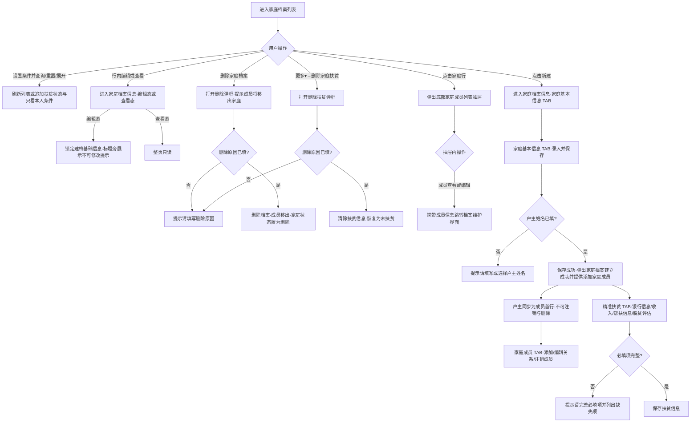

**表单字段与输入规则**（取自原型页：家庭档案.html）

> 页面结构：列表视图（筛选区 + 13 列表格 + 分页 + 成员抽屉）／详情视图（家庭档案信息，三 Tab）／6 个弹框。

**① 列表查询条件——收起状态（9 项）**

| 字段     | 控件             | 必填 | 取值 ／ 说明          |
| ------ | -------------- | -- | ---------------- |
| 管理机构   | 多选下拉           | 否  | 回显已选标签，支持清空      |
| 户主姓名   | 文本             | 否  | —                |
| 证件号    | 文本             | 否  | —                |
| 家庭档案编号 | 文本             | 否  | —                |
| 建档日期   | 日期区间           | 否  | 开始日期 — 结束日期      |
| 详细地址   | 文本             | 否  | —                |
| 管辖行政区  | 四级级联（省／市／区县／镇） | 否  | 支持清空             |
| 家庭状态   | 下拉（可清除）        | 否  | 全部、**正常（默认）**、删除 |
| 操作按钮区  | 重置／查询／展开▾      | —  | 展开后按钮文案变「收起 ▴」   |

**② 列表查询条件——展开后追加（2 项）**

| 字段       | 控件  | 必填 | 取值 ／ 说明          |
| -------- | --- | -- | ---------------- |
| 扶贫状态     | 下拉  | 否  | 已精准扶贫、未扶贫、全部（默认） |
| 只看个人管理档案 | 复选框 | 否  | 勾选后仅展示本人管理的家庭    |

**③ 列表字段（13 列；横向滚动时左 3 列与右侧操作列冻结）**

| 列      | 说明           | 列    | 说明       |
| ------ | ------------ | ---- | -------- |
| 序号     | 居中           | 详细地址 | 文本（超长省略） |
| 管理机构   | 文本（冻结）       | 建档医生 | 文本       |
| 户主姓名   | 文本（冻结）       | 建档日期 | 居中       |
| 家庭档案编号 | 文本           | 建档机构 | 文本       |
| 户主证件类型 | 文本           | 操作   | 冻结于右侧    |
| 户主证件号码 | 文本           |      |          |
| 户主出生日期 | 居中           |      |          |
| 扶贫情况   | 文本：已精准扶贫／未扶贫 |      |          |

**④ 行内操作**

| 前置状态  | 操作                                             |
| ----- | ---------------------------------------------- |
| 已精准扶贫 | 编辑 ／ 查看 ／ 更多▾（删除家庭扶贫、删除家庭档案）                   |
| 未扶贫   | 编辑 ／ 查看 ／ 删除家庭档案                               |
| 点击家庭行 | 弹出底部「家庭成员列表（N 人）· 户主：X」抽屉；抽屉内成员「查看／编辑」跳转档案维护界面 |

**⑤ 家庭基本信息 Tab**

| 字段     | 控件      | 必填 | 新建          | 编辑     | 查看 | 取值 ／ 校验                                                |
| ------ | ------- | -- | ----------- | ------ | -- | ------------------------------------------------------ |
| 家庭档案编号 | 只读      | —  | 只读          | **只读** | 只读 | 新建时为空，保存后生成                                            |
| 户主姓名   | 文本 + 选人 | 是  | 可编辑         | **只读** | 只读 | 可手工输入；点放大镜从居民档案列表选择并带出证件号等信息；**保存时唯一校验项**；编辑态隐藏选人／清除图标 |
| 证件类型   | 下拉      | 是  | 可编辑         | **锁定** | 只读 | 居民身份证、居民户口簿、护照                                         |
| 证件号码   | 文本      | 是  | 可编辑         | **只读** | 只读 | 选户主后自动带出                                               |
| 性别     | 下拉      | 是  | 可编辑         | **锁定** | 只读 | 男性、女性                                                  |
| 出生日期   | 日期      | 是  | 可编辑         | **只读** | 只读 | —                                                      |
| 家庭电话   | 文本      | 否  | 可编辑         | 可编辑    | 只读 | —                                                      |
| 家庭总人口数 | 数值      | 否  | 可编辑         | 可编辑    | 只读 | —                                                      |
| 现住人口数  | 数值      | 否  | 可编辑         | 可编辑    | 只读 | —                                                      |
| 家庭地址   | 级联      | 是  | 可编辑         | 可编辑    | 只读 | 省／市／区县／镇                                               |
| 详细地址   | 文本      | 是  | 可编辑         | 可编辑    | 只读 | —                                                      |
| 建档时间   | 日期      | 是  | 可编辑（默认当天）   | **只读** | 只读 | —                                                      |
| 建档负责人  | 文本（只读）  | 是  | 只读          | 只读     | 只读 | 按当前登录人自动填充                                             |
| 建档机构   | 下拉      | 是  | 可编辑（默认登录机构） | **锁定** | 只读 | —                                                      |

> **编辑态锁定规则**：进入编辑态时，「家庭档案编号、户主姓名、证件类型、证件号码、性别、出生日期、建档时间、建档负责人、建档机构」共 9 个字段置灰只读（下拉为 `disabled`、文本框为 `readonly`，光标呈 not-allowed），并为每个字段设置悬浮提示「此信息不允许修改」；「家庭基本信息」标题旁显示「建档后不可修改：家庭档案编号、户主信息、建档信息」。
>
> ⚠️ **口径说明 1**：上述带 * 字段共 12 项，但 `saveFamily` 仅校验「户主姓名」；其余必填校验需在正式实现中补齐（本项目按原型现状描述，待需求方确认后补全）。
>
> ⚠️ **口径说明 2**：原型编辑保存**仅回写「详细地址」与「管辖行政区」**，家庭电话、人口数、社会经济情况、备注等虽可编辑但未回写；正式实现需补齐保存范围（待需求方确认）。

**⑥ 家庭社会经济情况（家庭基本信息 Tab 内）**

| 字段     | 控件     | 取值 ／ 校验                                                        |
| ------ | ------ | -------------------------------------------------------------- |
| 家庭月收入  | 单选     | 小于 1000 元、1000-1999 元、2000-3999 元、4000-7999 元、8000 元以上、其它、拒绝回答 |
| 家庭居住面积 | 数值 + ㎡ | —                                                              |
| 房屋类型   | 单选     | 无、自建房、电梯房、非电梯房、平房、简易棚房、收容站所、其他                                 |
| 厨房排风设施 | 单选     | 无（默认）、抽油烟机、换气扇、烟囱                                              |
| 燃料类型   | 单选     | 液化气、煤、天然气、沼气、柴火、其他                                             |
| 饮水     | 单选     | 自来水（默认）、经净化过滤的水、井水、河水、塘水、其他                                    |
| 厕所     | 单选     | 卫生厕所（默认）、一格或二格粪池式、马桶、露天粪坑、简易棚厕                                 |
| 禽畜栏    | 单选     | 单设、室内、室外、无                                                     |
| 备注     | 多行文本   | ≤100 字，实时计数（n/100）                                             |

**⑦ 家庭成员 Tab**

| 项             | 内容                                                                                      |
| ------------- | --------------------------------------------------------------------------------------- |
| 前置约束          | 家庭基本信息未保存时，展示空态「请先完善并保存家庭基本信息后再添加家庭成员」，且不显示「添加家庭成员」按钮                                   |
| 成员表（12 列）     | 序号、姓名、档案编号、与户主关系、身份证号、性别、年龄、联系电话、血缘关系、常驻住址、掌握、操作                                        |
| 户主首行          | 保存家庭基本信息后自动生成；与户主关系＝「本人或户主」、血缘关系＝「无血缘关系」；注销／删除为禁用态（点击提示「户主不可注销」「户主不可删除」）                |
| 行内编辑          | 仅可编辑「与户主关系」「血缘关系」（下拉）                                                                   |
| 行内注销          | 二次确认「确认注销家庭成员「X」吗？注销后该成员将从本家庭档案中移除」→ 确定后移除该行并重排序号                                       |
| 添加成员弹框        | 筛选：姓名、身份证号、管辖网格、档案编号（重置／查询）；结果表 9 列：序号、档案编号、姓名、身份证号、性别、年龄、联系电话、出生日期、村(居)委会；分页 20／50 条每页 |
| 成员信息录入区       | 点选结果行后展开：性别／联系电话／身份证号／家庭地址只读回显；与户主关系、血缘关系为下拉必填；保存／取消                                    |
| 与户主关系字典（16 项） | 本人或户主、配偶、之子、之女、之父、之母、之祖父、之祖母、之孙子、之孙女、兄弟、姐妹、儿媳、女婿、其他亲属、非亲属（GB/T 4761-2008）               |
| 血缘关系字典（6 项）   | 无血缘关系、直系血缘关系、三代以内的旁系血缘关系、三代以外的旁系血缘关系、不详、其他（WS 364.3 CV02.01.201）                        |

**⑧ 精准扶贫 Tab**

| 分区           | 字段                                                                                                                                           | 必填标识                          |
| ------------ | -------------------------------------------------------------------------------------------------------------------------------------------- | ----------------------------- |
| 前置约束         | 家庭基本信息未保存时展示空态「请先完善并保存家庭基本信息后再维护精准扶贫信息」                                                                                                      | —                             |
| 银行信息         | 开户银行、户名、银行账户、识别标准（国家标准／省定标准）、计划生育户（计生户／非计生户）                                                                                                 | 全部必填                          |
| 收入情况（可增行）    | 年度、家庭总收入、工资性收入、家庭经营性收入、转移性收入、财产性收入、生产经营费用总支出、家庭纯收入、家庭全部现金收入、家庭年人均纯收入、上年得到的项目扶持补贴资金和捐赠物资折款；行操作：保存／取消                                          | 除「生产经营费用总支出」「上年…折款」外均必填       |
| 住房条件         | 建房时间、易地扶贫搬迁情况（已搬迁／需搬迁／其他）                                                                                                                    | 否                             |
| 生产条件情况       | 耕地面积（亩）、有效灌溉的耕地面积（亩）、水田（亩）、旱地（亩）、林地桑园茶园果园面积（亩）、牧草地面积（亩）、水面面积（亩）、商品用经济作物面积（亩）、牲畜数量（头）、生产用房面积（平方米）                                             | 水田、旱地必填                       |
| 参与组织和产业化情况   | 参加扶贫互助资金组织、投入互助资金金额、产业类型、产业组织类型（专业大户／家庭农场／农民专业合作社／龙头企业／其他）、从产业中收益（元）、龙头企业带动收益（元）                                                             | 否                             |
| 生活条件情况       | 通电情况（已通电／未通电）、距离最近乡镇市集距离（公里）、燃料类型（柴草／煤炭／灌装液化石油气／管道液化石油气／管道煤气／管道天然气／燃料用油／沼气／其他／无炊用行为）、饮水情况（6 项）、获取饮用水存在的主要困难（5 项）、厕所类型（5 项）、拥有耐用消费品情况（14 项复选） | 通电情况、距离、燃料类型、饮水情况、主要困难、厕所类型必填 |
| 致贫原因         | 因灾、因病、因残、因学、缺技术、缺劳力、缺资金、缺土地、交通条件落后、自身发展动力不足、其他                                                                                               | 必填（多选）                        |
| 帮扶负责人（子表可增行） | 姓名、单位名称、职务、单位隶属关系、单位性质、联系电话、开始帮扶时间、结束帮扶时间                                                                                                    | 姓名、联系电话、开始帮扶时间、结束帮扶时间必填       |
| 帮扶计划（子表可增行）  | 项目类别、项目名称、项目内容、计量单位、项目规模、计划资金总额                                                                                                              | 除计量单位外均必填                     |
| 帮扶成效（子表可增行）  | 项目类别、项目名称、项目效果、项目收益（元）、帮扶前照片、帮扶后照片                                                                                                           | 除照片外均必填                       |
| 脱贫评估         | 年人均纯收入（元）、经营性收入（元）、工资性收入（元）                                                                                                                  | 否                             |
| 备注           | 多行文本                                                                                                                                         | ≤200 字，实时计数（n/200）            |

**⑨ 弹框**

| 弹框                   | 内容                                         | 必填 ／ 校验                        |
| -------------------- | ------------------------------------------ | ------------------------------ |
| 保存成功提示               | 「家庭档案建立成功！」+「添加家庭成员」「取消」                   | —                              |
| 注销家庭成员               | 「确认注销家庭成员「X」吗？注销后该成员将从本家庭档案中移除」+「确定注销」「取消」 | —                              |
| 删除家庭档案               | 「如果删除此家庭档案，家庭成员都将移出家庭，你确定要删除吗？」+ 删除原因      | 删除原因必填（≤50 字，计数）；为空提示「请填写删除原因」 |
| 删除家庭扶贫               | 「是否删除该家庭的扶贫信息」+ 删除原因                       | 删除原因必填（≤50 字，计数）；为空提示「请填写删除原因」 |
| 添加家庭成员 ／ 从居民档案列表选择户主 | 同一弹框，标题随入口切换；筛选 + 结果表 + 分页 + 成员信息录入区       | 与户主关系、血缘关系必填                   |

#### 7.2.4 体检登记

| 字段    | 内容                                                                                                                                                                                                                |
| ----- | ----------------------------------------------------------------------------------------------------------------------------------------------------------------------------------------------------------------- |
| 功能名称  | 体检登记                                                                                                                                                                                                              |
| 所属模块  | 档案管理                                                                                                                                                                                                              |
| 功能描述  | 查询与展示居民体检登记记录，支持身份证读卡、列表行展开查看明细与按条件导出；**原型本页未提供「新建」登记入口**（登记发起方式待确认）。                                                                                                                                             |
| 前提条件  | 居民已建档；用户具备体检登记权限。                                                                                                                                                                                                 |
| 入口    | 左侧菜单「档案管理」→「体检登记」                                                                                                                                                                                                 |
| 基本事件流 | 当用户输入机构、姓名、证件号、体检日期等条件并点击「查询」，系统应返回匹配的体检登记记录。<br />当用户点击「重置」，系统应清空查询条件并恢复默认列表。<br />当用户点击「展开」，系统应追加展示扩展筛选条件。<br />当用户点击「身份证读卡」，系统应提示连接读卡器并回填居民基本信息。<br />当用户点击行展开，系统应展示该条体检明细。<br />当用户点击「导出」，系统应按当前筛选条件导出体检登记数据。 |
| 后置条件  | 体检登记记录入库并可在体检管理中查询。                                                                                                                                                                                               |
| 异常流程  | 若查询条件无匹配记录，则系统应展示空态提示。<br />若读卡器未连接或读取失败，则系统应提示检查设备并保留手工录入能力。                                                                                                                                                     |
| 输入    | 机构、姓名、证件号、体检日期等查询条件；体检登记信息。                                                                                                                                                                                       |
| 处理    | 体检登记新增与居民档案关联；读卡回填；分页展示与行展开；条件导出。                                                                                                                                                                                 |
| 输出    | 体检登记列表与明细、导出文件。                                                                                                                                                                                                   |
| 页面内交互 | 筛选区支持重置、查询与展开更多条件；行展开查看明细；页头仅提供导出／身份证读卡／重置／查询／展开，**无「新建」按钮**。                                                                                                                                                     |
| 验收标准  | 查询结果与筛选条件一致，重置后回到默认列表。<br />行展开可查看该条体检明细。<br />导出内容与当前筛选条件一致。<br />页头不展示「新建」按钮（按原型现状）。                                                                                                                            |
| 原型图   | 档案管理 › 体检登记（原型页：体检登记.html）                                                                                                                                                                                        |
| 流程图   | 见下方 Mermaid 流程图                                                                                                                                                                                                   |
| 时序图   |                                                                                                                                                                                                                   |
| 活动图   | 无                                                                                                                                                                                                                 |

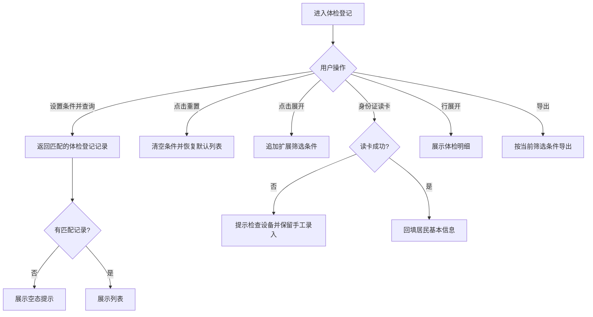

**表单字段与输入规则**（取自原型页：体检登记.html）

| 类别         | 字段                                                                                           | 必填 | 说明               |
| ---------- | -------------------------------------------------------------------------------------------- | -- | ---------------- |
| 查询条件 / 列表列 | 管理机构、姓名、证件号、责任医生、锁定状态、居民状态、重点人群类型、管辖行政区、体检次数、体检日期、体检类型、数据来源、建档日期、人群性质、电话号码、性别、管辖网格、档案编号、详细地址 | 否  | 筛选区与列表列共用同一组字段标签 |

#### 7.2.5 体检管理

| 字段    | 内容                                                                                                                                                                                                     |
| ----- | ------------------------------------------------------------------------------------------------------------------------------------------------------------------------------------------------------ |
| 功能名称  | 体检管理                                                                                                                                                                                                   |
| 所属模块  | 档案管理                                                                                                                                                                                                   |
| 功能描述  | 对已登记的体检记录进行结果录入、编辑与删除，支持行展开查看明细、条件查询与导出；页头不提供「新建」入口。                                                                                                                                                   |
| 前提条件  | 存在体检登记记录；用户具备体检管理权限。                                                                                                                                                                                   |
| 入口    | 左侧菜单「档案管理」→「体检管理」                                                                                                                                                                                      |
| 基本事件流 | 当用户设置查询条件并点击「查询」，系统应返回匹配的体检记录。<br />当用户选择体检记录并录入体检结果，系统应保存结果并关联居民档案。<br />当用户点击行展开，系统应展示体检明细。<br />当用户点击行内「删除」，系统应打开「删除体检记录」确认弹框。<br />当用户在删除体检记录弹框中点击「确定」，系统应删除该条体检记录。<br />当用户点击「导出」，系统应按当前条件导出体检数据。 |
| 后置条件  | 体检结果写入系统并关联居民主档案。                                                                                                                                                                                      |
| 异常流程  | 若必填体检项缺失，则系统应阻止保存并标红定位。<br />若数值超出合理区间（如体重 0～300kg、体温 30～45℃），则系统应阻止保存并提示。<br />若提交或删除时该记录已被他人修改，则系统应提示刷新后重试。                                                                                          |
| 输入    | 体检结果数据；查询条件；导出指令。                                                                                                                                                                                      |
| 处理    | 体检结果录入与编辑；必填与数值区间校验；条件查询与分页；导出。                                                                                                                                                                        |
| 输出    | 体检结果记录、导出文件。                                                                                                                                                                                           |
| 页面内交互 | 编辑行内展开，支持取消与确定；读卡按钮可回填居民信息；删除需在「删除体检记录」弹框中二次确认；页头仅提供导出／身份证读卡／重置／查询／展开，无「新建」按钮。                                                                                                                         |
| 验收标准  | 结果保存后可在档案详情中查看。<br />越界数值被拦截且给出提示。<br />并发修改有冲突提示，不发生静默覆盖。<br />删除体检记录需二次确认，删除后该记录不再出现在列表。<br />页头不展示「新建」按钮。                                                                                           |
| 原型图   | 档案管理 › 体检管理（原型页：体检管理.html）                                                                                                                                                                             |
| 流程图   | 见下方 Mermaid 流程图                                                                                                                                                                                        |
| 时序图   |                                                                                                                                                                                                        |
| 活动图   | 无                                                                                                                                                                                                      |

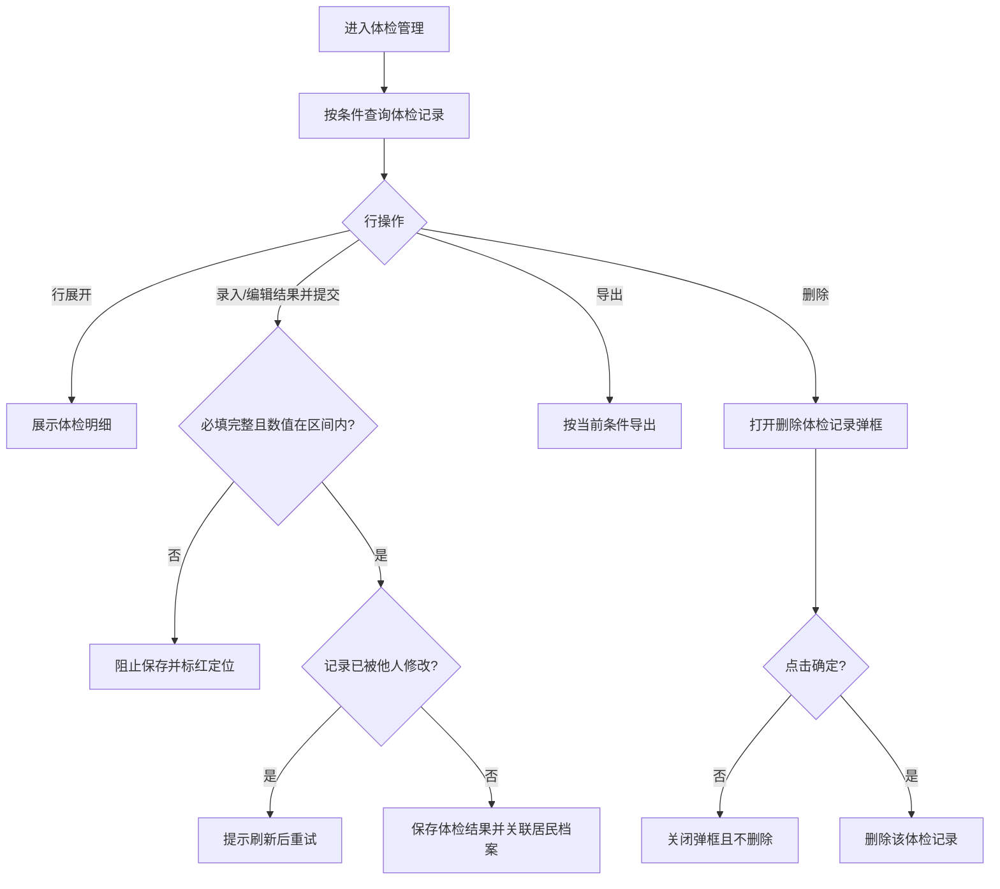

**表单字段与输入规则**（取自原型页：体检管理.html）

| 类别         | 字段                                                                         | 必填 | 说明               |
| ---------- | -------------------------------------------------------------------------- | -- | ---------------- |
| 查询条件 / 列表列 | 管理机构、姓名、证件号、数据来源、锁定状态、居民状态、体检类型、体检日期、体检机构、主检医师、性别、出生日期、建档日期、档案编号、电话号码、详细地址 | 否  | 筛选区与列表列共用同一组字段标签 |

#### 7.2.6 残疾档案

| 字段    | 内容                                                                                                       |
| ----- | -------------------------------------------------------------------------------------------------------- |
| 功能名称  | 残疾档案                                                                                                     |
| 所属模块  | 档案管理                                                                                                     |
| 功能描述  | 建立与维护残疾人专项档案，记录残疾类别与等级，支持条件查询、行内查看编辑与导出。                                                                 |
| 前提条件  | 居民已建档；用户具备残疾档案管理权限。                                                                                      |
| 入口    | 左侧菜单「档案管理」→「残疾档案」                                                                                        |
| 基本事件流 | 当用户点击「新建」并保存，系统应创建残疾档案并记录残疾类别与等级。<br />当用户点击行内「查看／编辑」，系统应打开残疾档案详情或编辑表单。<br />当用户点击「导出」，系统应按当前条件导出残疾档案数据。 |
| 后置条件  | 残疾档案入库并关联居民主档案。                                                                                          |
| 异常流程  | 若居民未建档，则系统应提示先建档。<br />若残疾类别或等级未选择，则系统应阻止保存。                                                             |
| 输入    | 居民基本信息、残疾类别、残疾等级、残疾证信息。                                                                                  |
| 处理    | 残疾档案新增与维护；关联居民档案；条件查询与分页；导出。                                                                             |
| 输出    | 残疾档案列表与详情、导出文件。                                                                                          |
| 页面内交互 | 新建表单支持保存与取消；列表行内支持查看与编辑。                                                                                 |
| 验收标准  | 残疾档案可查询并正确关联居民档案。<br />残疾类别或等级未选时保存被拦截。<br />导出与当前筛选一致。                                                  |
| 原型图   | 档案管理 › 残疾档案（原型页：残疾档案.html）                                                                               |
| 流程图   | 见下方 Mermaid 流程图                                                                                          |
| 时序图   |                                                                                                          |
| 活动图   | 无                                                                                                        |

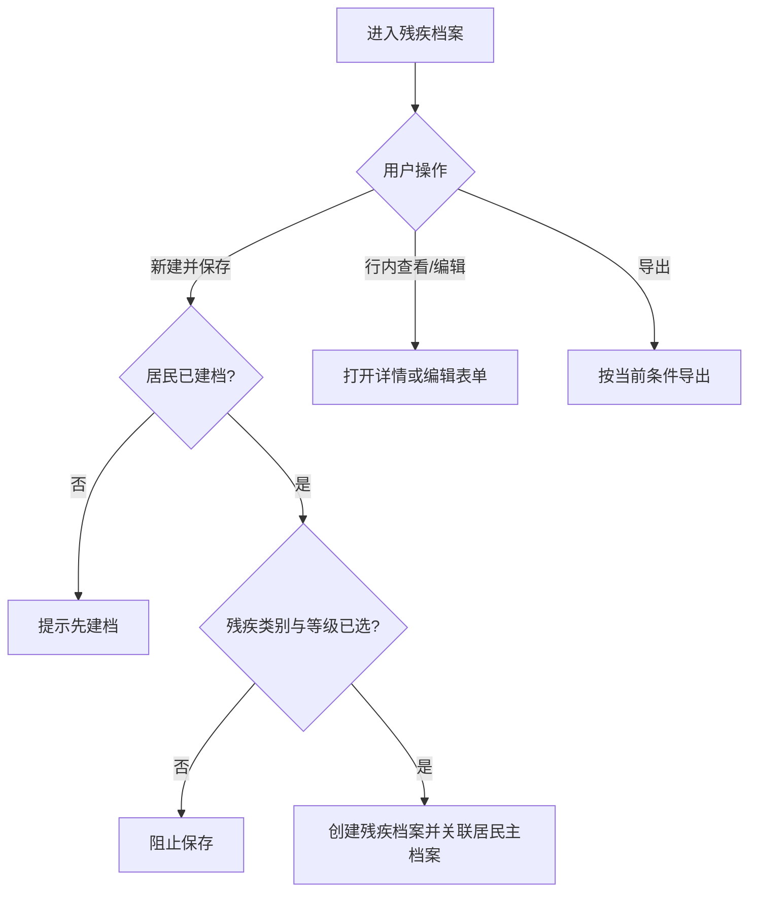

**表单字段与输入规则**（取自原型页：残疾档案.html）

| 类别         | 字段                                   | 必填 | 说明      |
| ---------- | ------------------------------------ | -- | ------- |
| 查询条件 / 列表列 | 管理机构、姓名、性别、证件号、筛查结果、是否领取低保、建档日期、锁定状态 | 否  | 筛选区与列表列 |
| 残疾登记弹窗     | 证件类型、姓名、证件号                          | 是  | 带 * 必填  |
| 残疾登记弹窗     | 管理机构、管理网格、档案编号                       | 否  | 无 * 标识  |

#### 7.2.7 档案迁移

| 字段    | 内容                                                                                                                                                                                            |
| ----- | --------------------------------------------------------------------------------------------------------------------------------------------------------------------------------------------- |
| 功能名称  | 档案迁移                                                                                                                                                                                          |
| 所属模块  | 档案管理                                                                                                                                                                                          |
| 功能描述  | 支持申请个人档案迁移、申请儿童档案迁移与导入迁移申请，以分步方式生成迁移单并进入两级审核流转。                                                                                                                                               |
| 前提条件  | 居民档案存在、未锁定且无在办迁移单；用户具备迁移申请权限。                                                                                                                                                                 |
| 入口    | 左侧菜单「档案管理」→「档案迁移」                                                                                                                                                                             |
| 基本事件流 | 当用户点击「申请档案迁移」并提交，系统应生成迁移单并将状态置为「待审核」。<br />当用户点击「申请儿童档案迁移」，系统应按儿童档案口径生成迁移单。<br />当用户点击「导入迁移申请」，系统应解析导入文件并批量生成待审核迁移单。<br />当用户点击「下一步／上一步」，系统应在分步表单间前进或后退并保留已填内容。<br />当用户点击「导出」，系统应按当前条件导出迁移单。 |
| 后置条件  | 迁移单进入「待审核」，档案归属在迁入、迁出两级审核通过前保持不变。                                                                                                                                                             |
| 异常流程  | 若档案已锁定或存在在办迁移单，则系统应阻止发起迁移并提示原因。<br />若导入文件格式不符或必填字段缺失，则系统应拒绝导入并返回错误行清单。<br />若必填项缺失，则系统应阻止提交。                                                                                                 |
| 输入    | 迁入机构与网格、迁移原因、居民或儿童档案标识、导入文件。                                                                                                                                                                  |
| 处理    | 迁移单生成（迁出单／迁入单）；分步表单校验；批量导入解析与校验；条件查询与导出。                                                                                                                                                      |
| 输出    | 待审核迁移单、导入结果（成功与失败明细）、导出文件。                                                                                                                                                                    |
| 页面内交互 | 视图切换（档案迁移／申请档案迁移）；分步表单上一步与下一步；导入进度与结果提示。                                                                                                                                                      |
| 验收标准  | 迁移单生成后状态为「待审核」。<br />两级审核通过前档案归属不变。<br />导入失败时返回可读的错误行清单。                                                                                                                                     |
| 原型图   | 档案管理 › 档案迁移（原型页：档案迁移.html）                                                                                                                                                                    |
| 流程图   | 见下方 Mermaid 流程图                                                                                                                                                                               |
| 时序图   |                                                                                                                                                                                               |
| 活动图   | 无                                                                                                                                                                                             |

```mermaid
flowchart TD
  A[进入档案迁移] --> B{申请方式}
  B -->|申请个人档案迁移| C{档案已锁定或在办迁移单?}
  C -->|是| D[阻止发起并提示原因]
  C -->|否| E[分步填写并提交]
  B -->|申请儿童档案迁移| F[按儿童档案口径分步填写并提交]
  B -->|导入迁移申请| G{文件格式与字段合法?}
  G -->|否| H[拒绝导入并返回错误行清单]
  G -->|是| I[批量生成待审核迁移单]
  E --> J{必填完整?}
  J -->|否| K[阻止提交]
  J -->|是| L[生成迁移单·状态置为待审核]
  F --> L
```

**表单字段与输入规则**（取自原型页：档案迁移.html）

| 类别        | 字段                                                                  | 必填 | 说明          |
| --------- | ------------------------------------------------------------------- | -- | ----------- |
| 列表列       | 姓名、证件号、状态、居民状态、电话号码、管辖行政区、申请人、申请日期、迁入/迁出机构                          | —  | 列表列         |
| 迁移申请表单    | 姓名、证件类型、性别、证件号、出生日期、联系电话、户籍地址、详细住址、现住址、建档人、建档机构、管理机构、建档日期、迁移类型、迁移原因 | 否  | 由前置步骤带入，可修改 |
| 迁移申请（必填项） | 迁往住址、详细住址、管理网格                                                      | 是  | 带 * 必填      |

#### 7.2.8 迁入审核

| 字段    | 内容                                                                                                                                                   |
| ----- | ---------------------------------------------------------------------------------------------------------------------------------------------------- |
| 功能名称  | 迁入审核                                                                                                                                                 |
| 所属模块  | 档案管理                                                                                                                                                 |
| 功能描述  | 迁入机构审核人对本机构待迁入的迁移单执行通过或驳回，支持单条与批量处理。                                                                                                                 |
| 前提条件  | 该迁移单的迁出审核已通过；用户为迁入机构审核人。                                                                                                                             |
| 入口    | 左侧菜单「档案管理」→「迁入审核」                                                                                                                                    |
| 基本事件流 | 当审核人点击「通过」，系统应将档案归属变更至迁入机构与网格。<br />当审核人点击「驳回」，系统应将迁移单置为「审核驳回」并退回发起机构。<br />当审核人勾选多条并点击「批量通过」或「批量驳回」，系统应批量执行并返回逐条结果。<br />当审核人点击「导出」，系统应按当前条件导出审核记录。 |
| 后置条件  | 审核通过后档案归属机构与网格同步变更，历史服务记录保留；审核结果写入操作日志。                                                                                                              |
| 异常流程  | 若迁出审核未通过，则系统应不允许该单进入迁入审核。<br />若迁移单已被他人处理，则系统应提示单据状态已变更并刷新列表。<br />若驳回时审核意见为空，则系统应阻止提交并提示录入意见。                                                       |
| 输入    | 迁入待审记录；审核动作（通过／驳回）；审核意见。                                                                                                                             |
| 处理    | 单条与批量审核的状态流转；档案归属变更；驳回退回；条件查询与导出。                                                                                                                    |
| 输出    | 审核结果、变更后的档案归属、导出文件、审核日志。                                                                                                                             |
| 页面内交互 | 列表多选支持批量操作；驳回弹出意见录入框；批量操作需二次确认。                                                                                                                      |
| 验收标准  | 迁入通过后档案归属与网格正确变更。<br />两级均通过前档案归属不变。<br />驳回时审核意见为必填。                                                                                                |
| 原型图   | 档案管理 › 迁入审核（原型页：迁入审核.html）                                                                                                                           |
| 流程图   | 见下方 Mermaid 流程图                                                                                                                                      |
| 时序图   |                                                                                                                                                      |
| 活动图   | 无                                                                                                                                                    |

```mermaid
flowchart TD
  A[进入迁入审核] --> B[查询待迁入记录]
  B --> C{审核动作}
  C -->|通过| D{单据已被他人处理?}
  D -->|是| E[提示状态已变更并刷新列表]
  D -->|否| F[档案归属变更至迁入机构与网格]
  C -->|驳回| G{审核意见已填?}
  G -->|否| H[阻止提交并提示录入意见]
  G -->|是| I[置为审核驳回并退回发起机构]
  C -->|批量通过/批量驳回| J[逐条执行并返回结果]
  C -->|导出| K[按当前条件导出审核记录]
```

**表单字段与输入规则**（取自原型页：迁入审核.html）

| 类别         | 字段                                         | 必填 | 说明      |
| ---------- | ------------------------------------------ | -- | ------- |
| 查询条件 / 列表列 | 姓名、证件号、居民状态、管辖行政区、档案类型、迁入机构、出生日期、申请日期、锁定状态 | 否  | 筛选区与列表列 |
| 审核操作       | 通过、驳回（驳回需录入审核意见）                           | —  | 审核意见为必填 |

#### 7.2.9 迁出审核

| 字段    | 内容                                                                                                                                                 |
| ----- | -------------------------------------------------------------------------------------------------------------------------------------------------- |
| 功能名称  | 迁出审核                                                                                                                                               |
| 所属模块  | 档案管理                                                                                                                                               |
| 功能描述  | 迁出机构审核人对本机构发起的迁出申请执行通过或驳回，支持单条与批量处理。                                                                                                               |
| 前提条件  | 迁移单已由发起人提交；用户为迁出机构审核人。                                                                                                                             |
| 入口    | 左侧菜单「档案管理」→「迁出审核」                                                                                                                                  |
| 基本事件流 | 当审核人点击「通过」，系统应将迁移单流转至「迁入审核」。<br />当审核人点击「驳回」，系统应将迁移单置为「审核驳回」并退回发起机构。<br />当审核人勾选多条并点击「批量通过」或「批量驳回」，系统应批量执行并返回逐条结果。<br />当审核人点击「导出」，系统应按当前条件导出审核记录。 |
| 后置条件  | 审核通过的迁移单进入迁入审核环节；档案归属在本环节保持不变。                                                                                                                     |
| 异常流程  | 若迁移单已被他人处理，则系统应提示单据状态已变更并刷新列表。<br />若驳回时审核意见为空，则系统应阻止提交并提示录入意见。                                                                                    |
| 输入    | 迁出待审记录；审核动作（通过／驳回）；审核意见。                                                                                                                           |
| 处理    | 单条与批量审核；状态流转至迁入审核或驳回退回；条件查询与导出。                                                                                                                    |
| 输出    | 审核结果、导出文件、审核日志。                                                                                                                                    |
| 页面内交互 | 列表多选支持批量操作；驳回需录入意见；关键操作二次确认。                                                                                                                       |
| 验收标准  | 迁出通过后单据出现在迁入审核列表。<br />驳回后档案归属不变且发起机构可见。<br />驳回时审核意见为必填。                                                                                          |
| 原型图   | 档案管理 › 迁出审核（原型页：迁出审核.html）                                                                                                                         |
| 流程图   | 见下方 Mermaid 流程图                                                                                                                                    |
| 时序图   |                                                                                                                                                    |
| 活动图   | 无                                                                                                                                                  |

```mermaid
flowchart TD
  A[进入迁出审核] --> B[查询待迁出记录]
  B --> C{审核动作}
  C -->|通过| D{单据已被他人处理?}
  D -->|是| E[提示状态已变更并刷新列表]
  D -->|否| F[流转至迁入审核·档案归属不变]
  C -->|驳回| G{审核意见已填?}
  G -->|否| H[阻止提交并提示录入意见]
  G -->|是| I[置为审核驳回并退回发起机构]
  C -->|批量通过/批量驳回| J[逐条执行并返回结果]
  C -->|导出| K[按当前条件导出审核记录]
```

**表单字段与输入规则**（取自原型页：迁出审核.html）

| 类别         | 字段                                           | 必填 | 说明      |
| ---------- | -------------------------------------------- | -- | ------- |
| 查询条件 / 列表列 | 姓名、证件号、居民状态、档案类型、迁入机构、管辖行政区、档案申请日期、出生日期、锁定状态 | 否  | 筛选区与列表列 |
| 审核操作       | 通过、驳回（驳回需录入审核意见）                             | —  | 审核意见为必填 |

#### 7.2.10 档案恢复

| 字段    | 内容                                                                                                                                                                                        |
| ----- | ----------------------------------------------------------------------------------------------------------------------------------------------------------------------------------------- |
| 功能名称  | 档案恢复                                                                                                                                                                                      |
| 所属模块  | 档案管理                                                                                                                                                                                      |
| 功能描述  | 对已注销或异常状态的档案执行恢复，恢复后档案可正常参与随访与专项管理，全过程留痕。                                                                                                                                                 |
| 前提条件  | 档案处于已注销或异常状态；用户具备档案恢复权限。                                                                                                                                                                  |
| 入口    | 左侧菜单「档案管理」→「档案恢复」                                                                                                                                                                         |
| 基本事件流 | 当用户输入条件查询待恢复档案，系统应按机构、姓名、证件号等条件返回待恢复档案列表。<br />当用户勾选一条或多条档案并点击「恢复」，系统应对已勾选档案执行恢复。<br />当用户点击「档案恢复-详情」，系统应进入明细视图并展示恢复记录。<br />当用户在明细视图设置条件并查询，系统应返回匹配的恢复明细。<br />当用户点击「导出」，系统应按当前条件导出恢复记录。 |
| 后置条件  | 档案恢复为可服务状态，历史查阅与操作留痕保留。                                                                                                                                                                   |
| 异常流程  | 若用户未勾选任何档案即点击「恢复」，则系统应提示「请先勾选需要恢复的档案」并阻止操作。<br />若档案处于锁定态，则系统应先要求解锁再执行恢复。<br />若恢复请求发生并发冲突，则系统应提示刷新后重试。                                                                                   |
| 输入    | 待恢复档案查询条件；勾选的待恢复档案；恢复操作指令。                                                                                                                                                                |
| 处理    | 待恢复档案条件查询；勾选项校验；档案状态还原；操作留痕；条件导出。                                                                                                                                                         |
| 输出    | 恢复后的档案、恢复记录、导出文件、操作日志。                                                                                                                                                                    |
| 页面内交互 | 视图切换（档案恢复／档案恢复-详情）；主列表每行带复选框，支持全选与多选；「恢复」为批量动作，作用于已勾选档案；明细视图提供独立的查询与重置。                                                                                                                   |
| 验收标准  | 勾选多条档案后点击「恢复」，所勾选档案均被恢复。<br />未勾选任何档案时点击「恢复」提示「请先勾选需要恢复的档案」。<br />恢复后档案可正常参与随访与专项管理。<br />恢复操作人、操作时间可追溯。<br />锁定态档案需先解锁方可恢复。                                                              |
| 原型图   | 档案管理 › 档案恢复（原型页：档案恢复.html）                                                                                                                                                                |
| 流程图   | 见下方 Mermaid 流程图                                                                                                                                                                           |
| 时序图   |                                                                                                                                                                                           |
| 活动图   | 无                                                                                                                                                                                         |

```mermaid
flowchart TD
  A[进入档案恢复] --> B[按条件查询待恢复档案]
  B --> C{勾选待恢复档案并点击恢复}
  C -->|未勾选| D[提示请先勾选需要恢复的档案]
  C -->|已勾选| E{档案处于锁定态?}
  E -->|是| F[要求先解锁再恢复]
  E -->|否| G{并发冲突?}
  G -->|是| H[提示刷新后重试]
  G -->|否| I[档案状态还原为在管并留痕]
  B --> J[查看档案恢复-详情]
  B --> K[按当前条件导出恢复记录]
```

**表单字段与输入规则**（取自原型页：档案恢复.html）

| 类别         | 字段                                                                   | 必填 | 说明                   |
| ---------- | -------------------------------------------------------------------- | -- | -------------------- |
| 查询条件 / 列表列 | 管理机构、姓名、证件号、电话号码、档案编号、责任医生、管辖行政区、出生日期、性别、证件类型、建档日期、建档人、锁定状态、删除日期、删除人 | 否  | 筛选区与列表列              |
| 处理信息       | 公卫机构、公卫医生                                                            | —  | 恢复处理人；恢复原因必填（见基本事件流） |

#### 7.2.11 档案查阅记录

| 字段    | 内容                                                                                                     |
| ----- | ------------------------------------------------------------------------------------------------------ |
| 功能名称  | 档案查阅记录                                                                                                 |
| 所属模块  | 档案管理                                                                                                   |
| 功能描述  | 记录并查询档案查阅明细（查阅人、查阅时间、查阅对象、查阅方式），实现查阅责任留痕与追溯。                                                           |
| 前提条件  | 系统已产生档案查阅行为；用户具备查阅记录查询权限。                                                                              |
| 入口    | 左侧菜单「档案管理」→「档案查阅记录」                                                                                    |
| 基本事件流 | 当档案被查阅，系统应自动记录查阅人、查阅时间、查阅对象与查阅方式。<br />当用户输入条件并点击「查询」，系统应返回符合条件的查阅明细列表。<br />当用户点击「导出」，系统应按当前条件导出查阅记录。 |
| 后置条件  | 查阅日志入库且不可篡改。                                                                                           |
| 异常流程  | 若查询条件无匹配记录，则系统应展示空态提示。<br />若用户无该档案查阅记录的查看权限，则系统应拒绝访问并提示数据范围。                                          |
| 输入    | 机构、姓名、证件号、查阅日期区间等查询条件。                                                                                 |
| 处理    | 查阅行为自动记入日志；条件查询与分页；导出。                                                                                 |
| 输出    | 档案查阅明细列表、导出文件。                                                                                         |
| 页面内交互 | 查询区支持重置；列表只读，不提供编辑入口。                                                                                  |
| 验收标准  | 查阅记录不可篡改，可按查阅人与时间筛选。<br />查阅行为与记录一一对应，无遗漏。                                                             |
| 原型图   | 档案管理 › 档案查阅记录（原型页：档案查阅记录.html）                                                                         |
| 流程图   | 见下方 Mermaid 流程图                                                                                        |
| 时序图   |                                                                                                        |
| 活动图   | 无                                                                                                      |

```mermaid
flowchart TD
  A[发生档案查阅行为] --> B[系统自动记录查阅人/时间/对象/方式]
  B --> C[写入不可篡改的查阅日志]
  C --> D[用户进入档案查阅记录]
  D --> E{用户操作}
  E -->|输入条件并查询| F{有匹配记录?}
  F -->|否| G[展示空态提示]
  F -->|是| H[返回查阅明细列表]
  E -->|导出| I[按当前条件导出查阅记录]
  D --> J{有查看权限?}
  J -->|否| K[拒绝访问并提示数据范围]
```

**表单字段与输入规则**（取自原型页：档案查阅记录.html）

| 类别   | 字段               | 必填 | 说明           |
| ---- | ---------------- | -- | ------------ |
| 查询条件 | 机构、姓名、证件号、查阅日期区间 | 否  | 筛选区；支持重置     |
| 列表列  | 姓名、证件号、档案编号、查阅人  | —  | 列表列；记录只读不可编辑 |

---


### 7.3 计划提醒

**功能用例图**（参与者：责任医生、公卫管理人员）

```mermaid
flowchart LR
  A1([责任医生])
  A2([公卫管理人员])
  subgraph 计划提醒
    U1([计划提醒])
    U2([随访不佳提醒])
    U3([提醒管理])
  end
  A1 --> U1
  A1 --> U2
  A1 --> U3
  A2 --> U1
  A2 --> U2
  A2 --> U3
```

#### 7.3.1 计划提醒

| 字段    | 内容                                                                                                        |
| ----- | --------------------------------------------------------------------------------------------------------- |
| 功能名称  | 计划提醒                                                                                                      |
| 所属模块  | 计划提醒                                                                                                      |
| 功能描述  | 按随访、体检、健康教育等计划类别展示到期、临近到期与超期任务，支持条件筛选与一键办理。                                                               |
| 前提条件  | 居民档案已建立并已配置随访／体检／健教计划。                                                                                    |
| 入口    | 左侧菜单「计划提醒」→「计划提醒」                                                                                         |
| 基本事件流 | 当随访或服务计划到期，系统应生成对应待办提醒。<br />当用户输入机构、网格、责任医生、日期区间与提醒类型并查询，系统应返回匹配的提醒清单。<br />当用户点击提醒记录，系统应跳转至对应居民的服务办理页面。 |
| 后置条件  | 无数据变更；跳转与导出行为写入操作日志。                                                                                      |
| 异常流程  | 若对应档案已注销，则系统应终止该条提醒并不再生成。<br />若无匹配提醒，则系统应展示空态提示。                                                         |
| 输入    | 机构、网格、责任医生、日期区间、提醒类型等筛选条件。                                                                                |
| 处理    | 按计划周期计算到期与超期；提醒清单按类别聚合展示；一键办理路由跳转；条件导出。                                                                   |
| 输出    | 提醒清单（含到期／临近到期／超期标识）、导出文件。                                                                                 |
| 页面内交互 | 提醒按状态分色标识；列表支持一键跳转办理；筛选区支持重置。                                                                             |
| 验收标准  | 到期提醒与计划周期计算一致。<br />已注销档案不再出现在提醒清单。<br />跳转后服务办理页面的居民与提醒对象一致。                                             |
| 原型图   | 计划提醒 › 计划提醒（原型页：计划提醒.html）                                                                                |
| 流程图   | 见下方 Mermaid 流程图                                                                                           |
| 时序图   |                                                                                                           |
| 活动图   | 无                                                                                                         |

```mermaid
flowchart TD
  A[随访/体检/健教计划到期] --> B{对应档案是否已注销?}
  B -->|是| C[终止该提醒·不再生成]
  B -->|否| D[生成待办提醒]
  D --> E[展示提醒清单·按到期/临近到期/超期标识]
  E --> F{用户操作}
  F -->|设置条件并查询| G{有匹配提醒?}
  G -->|否| H[展示空态提示]
  G -->|是| I[返回匹配提醒清单]
  F -->|点击提醒记录| J[跳转对应居民的服务办理页面]
  F -->|导出| K[按当前筛选条件导出]
```

**表单字段与输入规则**（取自原型页：计划提醒.html）

| 类别   | 字段                                    | 必填 | 说明                       |
| ---- | ------------------------------------- | -- | ------------------------ |
| 查询条件 | 提醒类型、服务项目、到期时段、村居/社区、责任医生、处理状态、姓名/档案号 | 否  | 筛选区；支持重置                 |
| 列表字段 | 未在原型检出独立列表表头标签                        | —  | 列表列为提醒清单字段，以原型为准         |
| 表单字段 | 无                                     | —  | 本页为提醒清单 + 一键办理跳转，无独立填报表单 |

#### 7.3.2 随访不佳提醒

| 字段    | 内容                                                                                                                                                  |
| ----- | --------------------------------------------------------------------------------------------------------------------------------------------------- |
| 功能名称  | 随访不佳提醒                                                                                                                                              |
| 所属模块  | 计划提醒                                                                                                                                                |
| 功能描述  | 自动识别血压／血糖控制不佳、指标异常、失访等随访质量不佳情形，支持确认转诊与关闭处理。                                                                                                         |
| 前提条件  | 已有随访记录且存在控制指标异常或超期未随访情形。                                                                                                                            |
| 入口    | 左侧菜单「计划提醒」→「不佳提醒」                                                                                                                                   |
| 基本事件流 | 当患者连续随访控制不满意或超期未随访，系统应生成不佳提醒。<br />当用户点击「确认转诊」并录入转诊去向，系统应记录转诊并更新提醒状态。<br />当用户点击「关闭」，系统应关闭提醒并将处理痕迹记入日志。<br />当用户输入机构、责任医生、预警类型与日期区间并查询，系统应返回匹配预警清单。 |
| 后置条件  | 提醒状态更新为「已转诊／已关闭」，处理结果写入操作日志。                                                                                                                        |
| 异常流程  | 若提醒长期未办结，则系统应升级至机构管理者。<br />若转诊去向未填，则系统应阻止提交并提示。                                                                                                    |
| 输入    | 预警类型、机构、责任医生、日期区间等查询条件；转诊去向与处理意见。                                                                                                                   |
| 处理    | 依据控制指标阈值与随访周期识别不佳情形；预警清单生成；转诊记录；关闭与留痕。                                                                                                              |
| 输出    | 不佳提醒清单、转诊记录、处理日志。                                                                                                                                   |
| 页面内交互 | 预警按类型分组；转诊需录入去向；关闭需二次确认。                                                                                                                            |
| 验收标准  | 不佳情形识别规则与规范阈值一致。<br />转诊去向必填方可提交。<br />提醒状态可跟踪（待处理／已转诊／已关闭）。                                                                                        |
| 原型图   | 计划提醒 › 不佳提醒（原型页：随访不佳提醒.html）                                                                                                                        |
| 流程图   | 见下方 Mermaid 流程图                                                                                                                                     |
| 时序图   |                                                                                                                                                     |
| 活动图   | 无                                                                                                                                                   |

```mermaid
flowchart TD
  A[随访记录控制不满意或超期未随访] --> B[识别为随访不佳·生成预警]
  B --> C{用户操作}
  C -->|确认转诊| D{转诊去向已填?}
  D -->|否| E[阻止提交并提示]
  D -->|是| F[记录转诊并更新提醒状态为已转诊]
  C -->|关闭| G[二次确认后关闭提醒并留痕]
  C -->|查询| H[按机构/责任医生/预警类型/日期返回清单]
  B --> I{长期未办结?}
  I -->|是| J[升级至机构管理者]
```

**表单字段与输入规则**（取自原型页：随访不佳提醒.html）

| 类别   | 字段                          | 必填 | 说明                                              |
| ---- | --------------------------- | -- | ----------------------------------------------- |
| 查询条件 | 随访类型、不佳类型、随访医生、村居/社区、姓名/档案号 | 否  | 筛选区；支持重置                                        |
| 表单字段 | 无                           | —  | 本页为预警清单；确认转诊、关闭等处理动作以弹窗完成，弹窗字段未在原型以字段标签暴露，待补充确认 |
|      |                             |    |                                                 |

#### 7.3.3 提醒管理

| 字段    | 内容                                                                                                                       |
| ----- | ------------------------------------------------------------------------------------------------------------------------ |
| 功能名称  | 提醒管理                                                                                                                     |
| 所属模块  | 计划提醒                                                                                                                     |
| 功能描述  | 对居民信息变更、建档缺失等情形生成提醒，支持确认建档、确认忽略与导出。                                                                                      |
| 前提条件  | 系统已识别到居民信息更新或建档缺失情形。                                                                                                     |
| 入口    | 左侧菜单「计划提醒」→「更新提醒」                                                                                                        |
| 基本事件流 | 当居民信息变更或发现建档缺失，系统应生成提醒。<br />当用户点击「确认建档」，系统应跳转至建档流程并关联该居民。<br />当用户点击「确认忽略」并录入忽略原因，系统应关闭该提醒。<br />当用户点击「导出」，系统应导出提醒处理明细。 |
| 后置条件  | 提醒状态更新（已建档／已忽略），处理明细入库。                                                                                                  |
| 异常流程  | 若忽略原因为空，则系统应阻止关闭并提示。<br />若无匹配提醒，则系统应展示空态提示。                                                                             |
| 输入    | 提醒类型与查询条件；建档发起指令；忽略原因。                                                                                                   |
| 处理    | 信息变更与建档缺失识别；提醒生成；确认建档路由；忽略留痕；导出。                                                                                         |
| 输出    | 提醒处理明细、建档结果、导出文件。                                                                                                        |
| 页面内交互 | 确认建档跳转建档流程；忽略需录入原因；列表支持筛选与重置。                                                                                            |
| 验收标准  | 确认建档后居民档案建立并与提醒关联。<br />忽略原因为必填。<br />导出内容与当前筛选一致。                                                                       |
| 原型图   | 计划提醒 › 更新提醒（原型页：提醒管理.html）                                                                                               |
| 流程图   | 见下方 Mermaid 流程图                                                                                                          |
| 时序图   |                                                                                                                          |
| 活动图   | 无                                                                                                                        |

```mermaid
flowchart TD
  A[居民信息变更或建档缺失] --> B[生成提醒]
  B --> C{用户操作}
  C -->|确认建档| D[跳转建档流程并关联该居民]
  D --> E[建档完成后提醒状态置为已建档]
  C -->|确认忽略| F{忽略原因已填?}
  F -->|否| G[阻止关闭并提示]
  F -->|是| H[关闭提醒并留痕]
  C -->|导出| I[导出提醒处理明细]
```

**表单字段与输入规则**（取自原型页：提醒管理.html）

| 类别         | 字段                                      | 必填 | 说明       |
| ---------- | --------------------------------------- | -- | -------- |
| 查询条件       | 管理机构、姓名、证件号、性别、慢病类型、出生日期、诊疗日期、诊疗医生、诊疗医院 | 否  | 筛选区；支持重置 |
| 弹窗表单（确认建档） | 姓名、证件类型、证件号                             | 是  | 带 * 必填   |
| 弹窗表单（确认建档） | 性别、出生日期、联系电话、管理机构、责任医生、诊疗医院             | 否  | 无 * 标识   |

---


### 7.4 慢病管理

**功能用例图**（参与者：慢病管理医生、责任医生）

```mermaid
flowchart LR
  A1([慢病管理医生])
  A2([责任医生])
  subgraph 慢病管理
    U1([高血压管理])
    U2([糖尿病管理])
    U3([慢阻肺管理])
    U4([高血脂管理])
    U5([心脑血管管理])
    U6([肿瘤管理])
    U7([高危人群管理])
  end
  A1 --> U1
  A1 --> U2
  A1 --> U3
  A1 --> U4
  A1 --> U5
  A1 --> U6
  A1 --> U7
  A2 --> U1
  A2 --> U2
  A2 --> U3
  A2 --> U4
  A2 --> U5
  A2 --> U6
  A2 --> U7
```

> **同构说明**：7.4.1～7.4.7 七类专项管理以「专项建档 → 查看／注销 → 列表与导出」为公共骨架，差异在于病种专有字段与筛选条件。七者均拆出子功能点，均落在档案维护界面，共 16 个：高血压 3 个（专项／随访／评估）、糖尿病 3 个、慢阻肺 2 个、高血脂 2 个、心脑血管 2 个（评估／随访）、肿瘤 2 个、高危人群 2 个。其中仅高血压、糖尿病、慢阻肺的列表页提供「暂不管理／新建随访（／分层评估）」菜单，其余 4 个按原型仅提供「查看／注销」。

#### 7.4.1 高血压管理

| 字段 | 内容 |
| -- | -- |

> **功能级说明**：高血压管理由以下 3 个子功能点承载专项、随访与评估业务。

| 子功能编号   | 子功能   | 说明                                 |
| ------- | ----- | ---------------------------------- |
| 7.4.1.1 | 高血压专项 | 档案维护界面「高血压专项表」：专项信息维护、复制本年度体检      |
| 7.4.1.2 | 高血压随访 | 档案维护界面「高血压随访表」：新建随访、复制复用、健康教育、失访处理 |
| 7.4.1.3 | 高血压评估 | 档案维护界面「高血压评估记录表」：新建评估、血压分级与危险分层记录  |

**功能用例图**（参与者：慢病管理医生、责任医生）

```mermaid
flowchart LR
  A1([慢病管理医生])
  A2([责任医生])
  subgraph 高血压管理
    U1([高血压专项])
    U2([高血压随访])
    U3([高血压评估])
  end
  A1 --> U1
  A1 --> U2
  A1 --> U3
  A2 --> U1
  A2 --> U2
  A2 --> U3
```

| 字段    | 内容                                                                                                                                                                                                                                                                                                                                                                                                                                                                                                                                                                                                                                                                                                                                                                                                             |
| ----- | -------------------------------------------------------------------------------------------------------------------------------------------------------------------------------------------------------------------------------------------------------------------------------------------------------------------------------------------------------------------------------------------------------------------------------------------------------------------------------------------------------------------------------------------------------------------------------------------------------------------------------------------------------------------------------------------------------------------------------------------------------------------------------------------------------------- |
| 功能名称  | 高血压管理                                                                                                                                                                                                                                                                                                                                                                                                                                                                                                                                                                                                                                                                                                                                                                                                          |
| 所属模块  | 慢病管理                                                                                                                                                                                                                                                                                                                                                                                                                                                                                                                                                                                                                                                                                                                                                                                                           |
| 功能描述  | 查询与维护高血压专项档案列表，支持新建专项档案、编辑专项档案、查看专项档案、暂不管理（管理状态变更）、新建随访、分层评估、注销档案（一并注销随访记录）、血压项目条件筛选与导出。                                                                                                                                                                                                                                                                                                                                                                                                                                                                                                                                                                                                                                                                                                                       |
| 前提条件  | 居民已完成建档；用户具备慢病管理权限。                                                                                                                                                                                                                                                                                                                                                                                                                                                                                                                                                                                                                                                                                                                                                                                            |
| 入口    | 左侧菜单「慢病管理」→「高血压管理」                                                                                                                                                                                                                                                                                                                                                                                                                                                                                                                                                                                                                                                                                                                                                                                             |
| 基本事件流 | 当用户进入高血压管理，系统应展示管辖范围内的高血压专项档案列表与总记录数。<br />当用户设置查询条件并点击「查询」，系统应按条件过滤并刷新列表。<br />当用户点击「重置」，系统应清空查询条件并恢复默认列表。<br />当用户点击「展开」，系统应追加展示扩展筛选条件。<br />当用户在筛选区点击「血压项目」，系统应打开「体检项目」条件面板。<br />当用户配置条件行（逻辑／项目／存在／比较符／数值）并点击「确定」，系统应按血压条件过滤列表。<br />当用户点击「重置」或「取消」，系统应清空血压条件行。<br />当用户点击「新建专项」，系统应打开居民选择弹框。<br />当用户在居民选择弹框中查询并选定居民，系统应进入居民档案维护界面维护「高血压专项档案」。<br />当用户填写专项档案并点击「保存」，系统应校验必填项并建立高血压专项档案、关联居民主档案。<br />当用户点击行内「更多 ▾」，系统应开放「编辑专项档案／查看专项档案／暂不管理／新建随访／分层评估／注销档案」业务维护菜单。<br />当用户点击「编辑专项档案」或「查看专项档案」，系统应分别以编辑态或只读态进入档案维护界面的「高血压专项表」。<br />当用户点击「新建随访」，系统应进入档案维护界面的「高血压随访表」并开启新建随访。<br />当用户点击「分层评估」，系统应进入档案维护界面的「高血压评估记录表」。<br />当用户点击「暂不管理」，系统应打开管理状态弹框。<br />当用户提交管理状态，系统应校验暂不管理原因、变更医生与变更日期并更新管理状态。<br />当用户点击「注销档案」，系统应打开注销确认弹框。<br />当用户确认注销，系统应校验注销原因并将该专项档案及其随访记录一并注销。<br />当用户点击「导出」，系统应按当前条件导出专项档案列表。 |
| 后置条件  | 专项档案、管理状态与注销结果写入系统并关联居民主档案；注销后该专项档案及其随访记录一并失效。                                                                                                                                                                                                                                                                                                                                                                                                                                                                                                                                                                                                                                                                                                                                                                 |
| 异常流程  | 若居民未建档，则系统应提示先建档。<br />若专项档案必填项缺失，则系统应阻止保存并提示缺失项。<br />若血压条件行未选择体检项目，则系统应提示「第 N 行请选择体检项目」。<br />若条件行已填数值但未选比较符，则系统应提示「第 N 行请选择比较符」。<br />若暂不管理原因为空，则系统应提示「请选择暂不管理原因」。<br />若变更医生未选择，则系统应提示「请选择变更医生」。<br />若变更日期为空，则系统应提示「请选择变更日期」。<br />若注销原因为空，则系统应阻止注销并提示。                                                                                                                                                                                                                                                                                                                                                                                                                                                                                                                                                   |
| 输入    | 查询条件；血压条件行；居民选择条件；专项建档信息（证件类型、姓名、性别、出生日期、联系电话、高血压类型、当前分级、确诊日期、证件号）；暂不管理信息（原因、变更医生、变更日期、说明）；注销原因。                                                                                                                                                                                                                                                                                                                                                                                                                                                                                                                                                                                                                                                                                                               |
| 处理    | 列表条件过滤与分页；居民选择与专项建档；编辑／查看专项档案；新建随访；分层评估；管理状态变更；注销专项档案并级联注销随访记录；血压条件行校验与过滤；导出。                                                                                                                                                                                                                                                                                                                                                                                                                                                                                                                                                                                                                                                                                                                                  |
| 输出    | 高血压专项档案列表、专项建档结果、管理状态、注销结果、导出文件。                                                                                                                                                                                                                                                                                                                                                                                                                                                                                                                                                                                                                                                                                                                                                                               |
| 页面内交互 | 页头提供导出／身份证读卡／新建专项／重置／查询／展开；「血压项目」为复合筛选控件，点击弹出「体检项目」面板，每行含逻辑（与／或）、项目（收缩压／舒张压）、存在（不为空／为空）、比较符（= > < ≥ ≤）与数值，支持增删行，底部「确定／重置／取消」；行内「更多 ▾」为下拉菜单，含编辑专项档案／查看专项档案／暂不管理／新建随访／分层评估／注销档案。                                                                                                                                                                                                                                                                                                                                                                                                                                                                                                                                                                                                                                 |
| 验收标准  | 列表查询结果与筛选条件一致，重置后回到默认列表。<br />血压条件面板可增删条件行，未选项目或未选比较符时给出对应提示。<br />新建专项须先经居民选择弹框选定居民，选定后进入居民档案维护界面维护「高血压专项档案」，保存时 9 项必填校验生效。<br />行内「更多 ▾」开放编辑专项档案／查看专项档案／暂不管理／新建随访／分层评估／注销档案 6 项业务菜单。<br />「编辑专项档案」「查看专项档案」分别进入高血压专项表的编辑态与只读态。<br />「新建随访」进入高血压随访表并开启新建随访；「分层评估」进入高血压评估记录表。<br />「暂不管理」提交时校验原因、变更医生与变更日期。<br />注销档案弹框提示「注销此人的高血压专项档案，所有的随访记录档案将一并注销」，注销原因必填。<br />「跳转档案」可进入该居民档案维护界面。<br />导出范围与当前筛选条件一致。                                                                                                                                                                                                                                                                                                                                                                                                     |
| 原型图   | 慢病管理 › 高血压管理（原型页：高血压管理.html）                                                                                                                                                                                                                                                                                                                                                                                                                                                                                                                                                                                                                                                                                                                                                                                   |
| 流程图   | 见下方 Mermaid 流程图                                                                                                                                                                                                                                                                                                                                                                                                                                                                                                                                                                                                                                                                                                                                                                                                |
| 时序图   |                                                                                                                                                                                                                                                                                                                                                                                                                                                                                                                                                                                                                                                                                                                                                                                                                |
| 活动图   | 无                                                                                                                                                                                                                                                                                                                                                                                                                                                                                                                                                                                                                                                                                                                                                                                                              |

```mermaid
flowchart TD
  A[进入高血压管理] --> B{用户操作}
  B -->|设置条件并查询/重置/展开| C[刷新或追加筛选条件]
  B -->|点击血压项目| D[打开体检项目条件面板]
  D --> E{条件行校验}
  E -->|未选项目| F[提示第N行请选择体检项目]
  E -->|有值未选比较符| G[提示第N行请选择比较符]
  E -->|通过| H[按血压条件过滤列表]
  B -->|点击新建专项| I[打开居民选择弹框]
  I -->|选定居民| J[打开新建高血压专项档案弹框]
  J --> K{必填项完整?}
  K -->|否| L[提示缺失项并阻止保存]
  K -->|是| M[建立专项档案并关联居民主档案]
  B -->|点击更多▾| N{菜单项}
  N -->|暂不管理| O[打开管理状态弹框]
  O --> P{原因/变更医生/变更日期已填?}
  P -->|否| Q[分别提示请选择暂不管理原因/变更医生/变更日期]
  P -->|是| R[更新管理状态]
  N -->|编辑专项档案| S1[进入档案维护·高血压专项表·编辑态]
  N -->|查看专项档案| S2[进入档案维护·高血压专项表·只读态]
  N -->|新建随访| S3[进入档案维护·高血压随访表·新建随访]
  N -->|分层评估| S4[进入档案维护·高血压评估记录表]
  N -->|注销档案| T[打开注销确认弹框]
  T --> U{注销原因已填?}
  U -->|否| V[阻止注销并提示]
  U -->|是| W[注销专项档案并级联注销随访记录]
  B -->|点击导出| X[按当前条件导出列表]
```

**表单字段与输入规则**（取自原型页：高血压管理.html）

| 类别           | 字段                                                                                                                                                             | 必填 | 说明                                                          |
| ------------ | -------------------------------------------------------------------------------------------------------------------------------------------------------------- | -- | ----------------------------------------------------------- |
| 查询条件         | 管理机构、姓名、证件号、管辖行政区、锁定状态、居民状态、管理状态、当前分级、高血压类型、管辖网格、随访次数、体检次数、业务日期、随访类型、血压项目、档案完整度、年度评估、使用降压药、专项建档机构、专项建档医生、专项建档日期、居民建档日期、居民建档医生、居民类型、出生日期、性别、电话号码、居住类型、档案编号、详细地址 | 否  | 筛选区；支持重置与展开                                                 |
| 血压项目条件面板     | 逻辑（与／或）＋项目（收缩压／舒张压）＋存在（不为空／为空）＋比较符（= > < ≥ ≤）＋数值                                                                                                               | —  | 多行条件，行间按「与／或」组合；未选项目提示「第 N 行请选择体检项目」；有值未选比较符提示「第 N 行请选择比较符」 |
| 列表字段         | 序号、管理机构、姓名、证件号、当前分级、血压、高血压类型、性别、年龄、电话号码、出生日期、详细地址、档案编号、管辖行政区、专项建档时间、专项建档医生、专项档案完整度(%)、居民状态、管理状态、锁定状态、操作                                                        | —  | 21 列                                                        |
| 居民选择弹框       | 姓名、证件类型、证件号、管理机构、管辖网格、性别、年龄、人群类型、管辖行政区                                                                                                                         | 否  | 筛选区，支持展开；选中居民后进入专项建档                                        |
| 专项建档弹框       | 证件类型、姓名、性别、出生日期、联系电话、高血压类型（原发性高血压／继发性高血压／不详）、当前分级、确诊日期、证件号                                                                                                     | 是  | 带 * 必填                                                      |
| 管理状态弹框（暂不管理） | 暂不管理原因、变更医生、变更日期                                                                                                                                               | 是  | 为空分别提示「请选择暂不管理原因」「请选择变更医生」「请选择变更日期」                         |
| 管理状态弹框（暂不管理） | 说明                                                                                                                                                             | 否  | 无 * 标识                                                      |
| 注销档案弹框       | 注销原因                                                                                                                                                           | 是  | ≤50 字；提示「注销此人的高血压专项档案，所有的随访记录档案将一并注销，确定要注销吗？」               |

#### 7.4.1.1 高血压专项

| 字段    | 内容                                                                                                                                            |
| ----- | --------------------------------------------------------------------------------------------------------------------------------------------- |
| 功能名称  | 高血压专项                                                                                                                                         |
| 所属模块  | 慢病管理 › 高血压管理（子功能）                                                                                                                             |
| 功能描述  | 在居民档案维护界面的「高血压专项表」中维护高血压专项档案，支持复制本年度体检带入数据。                                                                                                   |
| 前提条件  | 居民已建档；已从高血压管理选定居民或已建立专项档案。                                                                                                                    |
| 入口    | 高血压管理 →「新建专项」选定居民 ／ 行内「更多 ▾」→ 编辑专项档案、查看专项档案 → 档案维护界面「高血压专项表」                                                                                  |
| 基本事件流 | 当用户进入高血压专项表，系统应展示档案编号并加载该居民的专项信息。<br />当用户填写专项信息并点击「保存」，系统应校验必填项并保存高血压专项档案。<br />当用户点击「复制本年度体检」，系统应将本年度体检数据带入专项表。<br />当用户以查看态进入，系统应只读展示专项档案。 |
| 后置条件  | 专项档案写入系统并关联居民主档案。                                                                                                                             |
| 异常流程  | 若必填项缺失，则系统应阻止保存并提示缺失项。<br />若该居民尚未建档，则系统应提示先建档。                                                                                               |
| 输入    | 档案编号（只读）、姓名、身高、体重、BMI、收缩压、舒张压、高血压分级、高血压类型、来源、并发症、确诊机构、确诊日期、建档机构、建档医生、建档日期。                                                                    |
| 处理    | 专项表加载与回填；必填校验；复制本年度体检带入；保存；查看态只读渲染。                                                                                                           |
| 输出    | 高血压专项档案、保存结果提示。                                                                                                                               |
| 页面内交互 | 页头展示「高血压专项表」与档案编号；右上角提供「复制本年度体检」「保存」；查看态下控件呈只读。                                                                                               |
| 验收标准  | 专项档案保存后可回显。<br />「复制本年度体检」可带入本年度体检数据。<br />必填缺失时保存被阻止。<br />查看态下不可编辑。                                                                         |
| 原型图   | 档案管理 › 档案维护 › 高血压专项表（原型页：档案维护.html）                                                                                                           |
| 流程图   | 见下方 Mermaid 流程图                                                                                                                               |
| 时序图   |                                                                                                                                               |
| 活动图   | 无                                                                                                                                             |

```mermaid
flowchart TD
  A[进入高血压专项表] --> B[加载档案编号与专项信息]
  B --> C{用户操作}
  C -->|复制本年度体检| D[带入本年度体检数据]
  C -->|填写并保存| E{必填项完整?}
  E -->|否| F[阻止保存并提示缺失项]
  E -->|是| G[保存专项档案并关联居民主档案]
  C -->|查看态| H[只读展示专项档案]
```

#### 7.4.1.2 高血压随访

| 字段    | 内容                                                                                                                                                                                                                                          |
| ----- | ------------------------------------------------------------------------------------------------------------------------------------------------------------------------------------------------------------------------------------------- |
| 功能名称  | 高血压随访                                                                                                                                                                                                                                       |
| 所属模块  | 慢病管理 › 高血压管理（子功能）                                                                                                                                                                                                                           |
| 功能描述  | 在居民档案维护界面的「高血压随访表」中新建与维护随访记录，支持复制本年体检、复制上次随访、健康教育跳转与随访状态（失访）处理。                                                                                                                                                                             |
| 前提条件  | 已建立高血压专项档案。                                                                                                                                                                                                                                 |
| 入口    | 高血压管理 → 行内「更多 ▾」→「新建随访」→ 档案维护界面「高血压随访表」                                                                                                                                                                                                     |
| 基本事件流 | 当用户进入高血压随访业务，系统应展示档案编号与历史随访记录列表。<br />当用户点击「新建」，系统应清空表单并开启一条新的随访记录。<br />当用户填写随访信息并点击「保存」，系统应校验必填项并保存随访记录。<br />当用户点击「复制本年体检」，系统应带入本年度体检数据。<br />当用户点击「复制上次随访」，系统应带入上一次随访数据。<br />当用户点击「健康教育」，系统应跳转至健康教育记录。<br />当用户点击「历史记录」，系统应展示历史随访记录列表。 |
| 后置条件  | 随访记录写入专项档案并可在历史记录中查询。                                                                                                                                                                                                                       |
| 异常流程  | 若随访必填项缺失，则系统应阻止保存并提示。<br />若随访状态为「失访」而失访日期或失访原因为空，则系统应阻止保存。                                                                                                                                                                                 |
| 输入    | 随访日期、随访方式、症状、收缩压、舒张压、体重、目标体重、身高、BMI、目标 BMI、心率、其他、吸烟、目标吸烟、饮酒、目标饮酒、运动频次、运动时长、目标运动频次、目标运动时长、辅助检查、用药情况、是否转诊、转诊机构、转诊科室、下次随访日期、随访医生、随访状态、此次随访分类、随访类型、季度。                                                                                          |
| 处理    | 随访记录新建与编辑；复制本年体检／上次随访；辅助检查多行与计数；转诊与失访处理；保存；历史记录查询。                                                                                                                                                                                          |
| 输出    | 随访记录、历史随访列表、保存结果提示。                                                                                                                                                                                                                         |
| 页面内交互 | 页头展示「高血压随访表」与档案编号；操作区提供「新建」「复制本年体检」「复制上次随访」「健康教育」「历史记录」「保存」；随访状态选择「失访」时展开失访日期与失访原因。                                                                                                                                                         |
| 验收标准  | 「新建」可清空并开启新随访；保存后可在历史记录列表中查到。<br />保存时必填项不完整则阻止保存并提示。<br />复制本年体检／复制上次随访的数据与来源记录一致。<br />「健康教育」可跳转健康教育记录，「历史记录」可展示历史随访记录列表。<br />失访时失访日期与失访原因为必填。<br />辅助检查支持多行录入并显示计数。                                                                     |
| 原型图   | 档案管理 › 档案维护 › 高血压随访表（原型页：档案维护.html）                                                                                                                                                                                                         |
| 流程图   | 见下方 Mermaid 流程图                                                                                                                                                                                                                             |
| 时序图   |                                                                                                                                                                                                                                             |
| 活动图   | 无                                                                                                                                                                                                                                           |

```mermaid
flowchart TD
  S[进入高血压随访业务] --> A{用户操作}
  A -->|点击新建| B[清空表单并开启新随访]
  B --> C[填写随访信息并保存]
  C --> D{必填项完整?}
  D -->|否| E[阻止保存并提示]
  D -->|是| F[保存随访记录]
  F --> G[更新历史记录列表]
  A -->|复制本年体检| H[带入本年度体检数据]
  A -->|复制上次随访| I[带入上一次随访数据]
  A -->|健康教育| J[跳转健康教育记录]
  A -->|历史记录| K[展示历史记录列表]
```

#### 7.4.1.3 高血压评估

| 字段    | 内容                                                                                                                                       |
| ----- | ---------------------------------------------------------------------------------------------------------------------------------------- |
| 功能名称  | 高血压评估                                                                                                                                    |
| 所属模块  | 慢病管理 › 高血压管理（子功能）                                                                                                                        |
| 功能描述  | 在居民档案维护界面的「高血压评估记录表」中开展分层评估，记录血压分级结果与危险分层结果及心血管危险因素、靶器官损害与相关疾病。                                                                          |
| 前提条件  | 已建立高血压专项档案。                                                                                                                              |
| 入口    | 高血压管理 → 行内「更多 ▾」→「分层评估」→ 档案维护界面「高血压评估记录表」                                                                                                |
| 基本事件流 | 当用户进入高血压评估业务，系统应展示档案编号与历史评估记录。<br />当用户点击「新建」，系统应清空表单并开启一条新的评估记录。<br />当用户填写评估信息并点击「保存」，系统应校验必填项并保存评估记录。<br />当用户点击「历史记录」，系统应展示历史评估记录列表。 |
| 后置条件  | 评估记录写入专项档案，分层结果更新。                                                                                                                       |
| 异常流程  | 若必填项缺失，则系统应阻止保存并提示。<br />若该居民无高血压专项档案，则系统应提示先建立专项档案。                                                                                     |
| 输入    | 姓名、收缩压、舒张压、心血管病危险因素、靶器官损害、血糖、脑血管疾病、心脏疾病、肾脏疾病、血管疾病、视网膜病变、其他、评估医生、评估日期、血压分级结果、危险分层结果。                                                      |
| 处理    | 评估记录新建与保存；分层结果记录；历史评估记录查询。                                                                                                               |
| 输出    | 评估记录、血压分级结果、危险分层结果、历史评估列表。                                                                                                               |
| 页面内交互 | 页头展示「高血压评估记录表」与档案编号；操作区提供「新建」「历史记录」「保存」；血压分级结果与危险分层结果为单选项。                                                                               |
| 验收标准  | 「新建」可清空表单并开启新评估记录，保存后可在历史记录列表中查到。<br />血压分级结果与危险分层结果可记录并回显。<br />必填缺失时保存被阻止并提示。<br />「历史记录」可展示历史评估记录列表。                                  |
| 原型图   | 档案管理 › 档案维护 › 高血压评估记录表（原型页：档案维护.html）                                                                                                    |
| 流程图   | 见下方 Mermaid 流程图                                                                                                                          |
| 时序图   |                                                                                                                                          |
| 活动图   | 无                                                                                                                                        |

```mermaid
flowchart TD
  B[进入高血压评估业务] --> C{用户操作}
  C -->|点击新建| D[清空表单并开启新评估]
  C -->|历史记录| M[展示历史记录列表]
  D --> H[填写评估信息并保存]
  H --> I{必填项完整?}
  I -->|否| J[阻止保存并提示]
  I -->|是| K[保存评估记录]
  K --> L[更新历史记录列表]
```

#### 7.4.2 糖尿病管理

> **功能级说明**：糖尿病管理由以下 3 个子功能点承载专项、随访与评估业务。

| 子功能编号   | 子功能   | 说明                                 |
| ------- | ----- | ---------------------------------- |
| 7.4.2.1 | 糖尿病专项 | 档案维护界面「糖尿病专项表」：专项信息维护、复制本年度体检      |
| 7.4.2.2 | 糖尿病随访 | 档案维护界面「糖尿病随访表」：新建随访、复制复用、健康教育、失访处理 |
| 7.4.2.3 | 糖尿病评估 | 档案维护界面「糖尿病评估记录表」：新建评估与评估记录         |

| 字段    | 内容                                                                                                                                                                                                                                                                                                                                                                                                                                                                                                                                                                                                                                                     |
| ----- | ------------------------------------------------------------------------------------------------------------------------------------------------------------------------------------------------------------------------------------------------------------------------------------------------------------------------------------------------------------------------------------------------------------------------------------------------------------------------------------------------------------------------------------------------------------------------------------------------------------------------------------------------------ |
| 功能名称  | 糖尿病管理                                                                                                                                                                                                                                                                                                                                                                                                                                                                                                                                                                                                                                                  |
| 所属模块  | 慢病管理                                                                                                                                                                                                                                                                                                                                                                                                                                                                                                                                                                                                                                                   |
| 功能描述  | 查询与维护糖尿病专项档案列表，支持新建专项档案、编辑专项档案、查看专项档案、暂不管理（管理状态变更）、新建随访、分层评估、注销档案（一并注销随访记录）、筛选与导出。                                                                                                                                                                                                                                                                                                                                                                                                                                                                                                                                                                     |
| 前提条件  | 居民已完成建档；用户具备慢病管理权限。                                                                                                                                                                                                                                                                                                                                                                                                                                                                                                                                                                                                                                    |
| 入口    | 左侧菜单「慢病管理」→「糖尿病管理」                                                                                                                                                                                                                                                                                                                                                                                                                                                                                                                                                                                                                                     |
| 基本事件流 | 当用户进入糖尿病管理，系统应展示管辖范围内的糖尿病专项档案列表与总记录数。<br />当用户设置查询条件并点击「查询」，系统应按条件过滤并刷新列表。<br />当用户点击「重置」，系统应清空查询条件并恢复默认列表。<br />当用户点击「新建专项」，系统应打开居民选择弹框。<br />当用户在居民选择弹框中查询并选定居民，系统应进入居民档案维护界面维护「糖尿病专项档案」。<br />当用户填写专项档案并点击「保存」，系统应校验必填项并建立糖尿病专项档案、关联居民主档案。<br />当用户点击行内「更多 ▾」，系统应开放「编辑专项档案／查看专项档案／暂不管理／新建随访／分层评估／注销档案」业务维护菜单。<br />当用户点击「编辑专项档案」或「查看专项档案」，系统应分别以编辑态或只读态进入档案维护界面的「糖尿病专项表」。<br />当用户点击「新建随访」，系统应进入档案维护界面的「糖尿病随访表」并开启新建随访。<br />当用户点击「分层评估」，系统应进入档案维护界面的「糖尿病评估记录表」。<br />当用户点击「暂不管理」，系统应打开管理状态弹框。<br />当用户提交管理状态，系统应校验暂不管理原因、变更医生与变更日期并更新管理状态。<br />当用户点击「注销档案」，系统应打开注销确认弹框。<br />当用户确认注销，系统应校验注销原因并将该专项档案及其随访记录一并注销。<br />当用户点击「导出」，系统应按当前条件导出专项档案列表。 |
| 后置条件  | 专项档案、管理状态与注销结果写入系统并关联居民主档案；注销后该专项档案及其随访记录一并失效。                                                                                                                                                                                                                                                                                                                                                                                                                                                                                                                                                                                                         |
| 异常流程  | 若居民未建档，则系统应提示先建档。<br />若专项档案必填项缺失，则系统应阻止保存并提示缺失项。<br />若暂不管理原因为空，则系统应提示「请选择暂不管理原因」。<br />若变更医生未选择，则系统应提示「请选择变更医生」。<br />若变更日期为空，则系统应提示「请选择变更日期」。<br />若注销原因为空，则系统应阻止注销并提示。                                                                                                                                                                                                                                                                                                                                                                                                                                                                             |
| 输入    | 查询条件；居民选择条件；专项建档信息（证件类型、姓名、性别、出生日期、联系电话、糖尿病类型、当前分级、确诊日期、证件号）；暂不管理信息（原因、变更医生、变更日期、说明）；注销原因。                                                                                                                                                                                                                                                                                                                                                                                                                                                                                                                                                             |
| 处理    | 列表条件过滤与分页；居民选择与专项建档；编辑／查看专项档案；新建随访；分层评估；管理状态变更；注销专项档案并级联注销随访记录；导出。                                                                                                                                                                                                                                                                                                                                                                                                                                                                                                                                                                                     |
| 输出    | 糖尿病专项档案列表、专项建档结果、管理状态、注销结果、导出文件。                                                                                                                                                                                                                                                                                                                                                                                                                                                                                                                                                                                                                       |
| 页面内交互 | 页头提供导出／身份证读卡／新建专项／重置／查询／展开；行内「更多 ▾」为下拉菜单，含编辑专项档案／查看专项档案／暂不管理／新建随访／分层评估／注销档案。                                                                                                                                                                                                                                                                                                                                                                                                                                                                                                                                                                           |
| 验收标准  | 列表查询结果与筛选条件一致，重置后回到默认列表。<br />新建专项须先经居民选择弹框选定居民，选定后进入居民档案维护界面维护「糖尿病专项档案」，保存时 9 项必填校验生效。<br />行内「更多 ▾」开放 6 项业务菜单且落点正确。<br />「暂不管理」提交时校验原因、变更医生与变更日期。<br />注销档案弹框提示「注销此人的糖尿病专项档案，所有的随访记录档案将一并注销」，注销原因必填。<br />导出范围与当前筛选条件一致。                                                                                                                                                                                                                                                                                                                                                                                                                             |
| 原型图   | 慢病管理 › 糖尿病管理（原型页：糖尿病管理.html）                                                                                                                                                                                                                                                                                                                                                                                                                                                                                                                                                                                                                           |
| 流程图   | 见下方 Mermaid 流程图                                                                                                                                                                                                                                                                                                                                                                                                                                                                                                                                                                                                                                        |
| 时序图   |                                                                                                                                                                                                                                                                                                                                                                                                                                                                                                                                                                                                                                                        |
| 活动图   | 无                                                                                                                                                                                                                                                                                                                                                                                                                                                                                                                                                                                                                                                      |

```mermaid
flowchart TD
  A[进入糖尿病管理] --> B{用户操作}
  B -->|设置条件并查询/重置| C[刷新或恢复列表]
  B -->|点击新建专项| D[打开居民选择弹框]
  D -->|选定居民| E[进入档案维护·糖尿病专项表]
  E --> F[填写专项档案并保存]
  F --> G{必填项完整?}
  G -->|否| H[提示缺失项并阻止保存]
  G -->|是| I[建立专项档案并关联居民主档案]
  B -->|点击更多▾| J{菜单项}
  J -->|编辑/查看专项档案| K[进入糖尿病专项表·编辑态或只读态]
  J -->|暂不管理| L[打开管理状态弹框]
  L --> M{原因/变更医生/变更日期已填?}
  M -->|否| N[分别提示并阻止提交]
  M -->|是| O[更新管理状态]
  J -->|新建随访| P[进入糖尿病随访表·新建随访]
  J -->|分层评估| Q[进入糖尿病评估记录表]
  J -->|注销档案| R[打开注销确认弹框]
  R --> S{注销原因已填?}
  S -->|否| T[阻止注销并提示]
  S -->|是| U[注销专项档案并级联注销随访记录]
  B -->|点击导出| V[按当前条件导出列表]
```

**表单字段与输入规则**（取自原型页：糖尿病管理.html）

| 类别           | 字段                                                                                                                                                  | 必填 | 说明                                            |
| ------------ | --------------------------------------------------------------------------------------------------------------------------------------------------- | -- | --------------------------------------------- |
| 查询条件         | 管理机构、姓名、证件号、管辖行政区、锁定状态、居民状态、管理状态、当前分级、糖尿病类型、管辖网格、随访次数、体检次数、业务日期、随访类型、空腹血糖、档案完整度、专项建档机构、专项建档医生、专项建档日期、居民建档日期、居民建档医生、居民类型、居住类型、出生日期、性别、电话号码、档案编号、详细地址 | 否  | 筛选区；支持重置                                      |
| 列表字段         | 序号、管理机构、姓名、证件号、当前分级、空腹血糖、糖尿病类型、性别、年龄、电话号码、出生日期、详细地址、档案编号、管辖行政区、专项建档时间、专项建档医生、专项档案完整度(%)、居民状态、管理状态、锁定状态、操作                                           | —  | 21 列                                          |
| 居民选择弹框       | 姓名、证件类型、证件号、管理机构、管辖网格、性别、年龄、人群类型、管辖行政区                                                                                                              | 否  | 筛选区，支持展开；选中居民后进入专项建档                          |
| 专项建档弹框       | 证件类型、姓名、性别、出生日期、联系电话、糖尿病类型、当前分级、确诊日期、证件号                                                                                                            | 是  | 带 * 必填                                        |
| 管理状态弹框（暂不管理） | 暂不管理原因、变更医生、变更日期                                                                                                                                    | 是  | 为空分别提示「请选择暂不管理原因」「请选择变更医生」「请选择变更日期」           |
| 管理状态弹框（暂不管理） | 说明                                                                                                                                                  | 否  | 无 * 标识                                        |
| 注销档案弹框       | 注销原因                                                                                                                                                | 是  | ≤50 字；提示「注销此人的糖尿病专项档案，所有的随访记录档案将一并注销，确定要注销吗？」 |

#### 7.4.2.1 糖尿病专项

| 字段    | 内容                                                                                                                                            |
| ----- | --------------------------------------------------------------------------------------------------------------------------------------------- |
| 功能名称  | 糖尿病专项                                                                                                                                         |
| 所属模块  | 慢病管理 › 糖尿病管理（子功能）                                                                                                                             |
| 功能描述  | 在居民档案维护界面的「糖尿病专项表」中维护糖尿病专项档案，支持复制本年度体检带入数据。                                                                                                   |
| 前提条件  | 居民已建档；已从糖尿病管理选定居民或已建立专项档案。                                                                                                                    |
| 入口    | 糖尿病管理 →「新建专项」选定居民 ／ 行内「更多 ▾」→ 编辑专项档案、查看专项档案 → 档案维护界面「糖尿病专项表」                                                                                  |
| 基本事件流 | 当用户进入糖尿病专项表，系统应展示档案编号并加载该居民的专项信息。<br />当用户填写专项信息并点击「保存」，系统应校验必填项并保存糖尿病专项档案。<br />当用户点击「复制本年度体检」，系统应将本年度体检数据带入专项表。<br />当用户以查看态进入，系统应只读展示专项档案。 |
| 后置条件  | 专项档案写入系统并关联居民主档案。                                                                                                                             |
| 异常流程  | 若必填项缺失，则系统应阻止保存并提示缺失项。<br />若该居民尚未建档，则系统应提示先建档。                                                                                               |
| 输入    | 档案编号（只读）、姓名、糖尿病类型、确诊机构、确诊日期、来源、身高、体重、BMI、空腹血糖（FBG）、随机血糖（RBG）、餐后血糖（PBG）、胰岛素类型、建档机构、建档医生、建档日期。                                                  |
| 处理    | 专项表加载与回填；必填校验；复制本年度体检带入；保存；查看态只读渲染。                                                                                                           |
| 输出    | 糖尿病专项档案、保存结果提示。                                                                                                                               |
| 页面内交互 | 页头展示「糖尿病专项表」与档案编号；操作区提供「复制本年度体检」「保存」；查看态下控件呈只读。                                                                                               |
| 验收标准  | 专项档案保存后可回显。<br />「复制本年度体检」可带入本年度体检数据。<br />必填缺失时保存被阻止。                                                                                        |
| 原型图   | 档案管理 › 档案维护 › 糖尿病专项表（原型页：档案维护.html）                                                                                                           |
| 流程图   | 见下方 Mermaid 流程图                                                                                                                               |
| 时序图   |                                                                                                                                               |
| 活动图   | 无                                                                                                                                             |

```mermaid
flowchart TD
  A[进入糖尿病专项表] --> B[加载档案编号与专项信息]
  B --> C{用户操作}
  C -->|复制本年度体检| D[带入本年度体检数据]
  C -->|填写并保存| E{必填项完整?}
  E -->|否| F[阻止保存并提示缺失项]
  E -->|是| G[保存专项档案并关联居民主档案]
  C -->|查看态| H[只读展示专项档案]
```

#### 7.4.2.2 糖尿病随访

| 字段    | 内容                                                                                                                                                                                                                                          |
| ----- | ------------------------------------------------------------------------------------------------------------------------------------------------------------------------------------------------------------------------------------------- |
| 功能名称  | 糖尿病随访                                                                                                                                                                                                                                       |
| 所属模块  | 慢病管理 › 糖尿病管理（子功能）                                                                                                                                                                                                                           |
| 功能描述  | 在居民档案维护界面的「糖尿病随访表」中新建与维护随访记录，支持复制复用、健康教育跳转与随访状态（失访）处理。                                                                                                                                                                                      |
| 前提条件  | 已建立糖尿病专项档案。                                                                                                                                                                                                                                 |
| 入口    | 糖尿病管理 → 行内「更多 ▾」→「新建随访」→ 档案维护界面「糖尿病随访表」                                                                                                                                                                                                     |
| 基本事件流 | 当用户进入糖尿病随访业务，系统应展示档案编号与历史随访记录列表。<br />当用户点击「新建」，系统应清空表单并开启一条新的随访记录。<br />当用户填写随访信息并点击「保存」，系统应校验必填项并保存随访记录。<br />当用户点击「复制本年体检」，系统应带入本年度体检数据。<br />当用户点击「复制上次随访」，系统应带入上一次随访数据。<br />当用户点击「健康教育」，系统应跳转至健康教育记录。<br />当用户点击「历史记录」，系统应展示历史随访记录列表。 |
| 后置条件  | 随访记录写入专项档案并可在历史记录中查询。                                                                                                                                                                                                                       |
| 异常流程  | 若随访必填项缺失，则系统应阻止保存并提示。<br />若随访状态为「失访」而失访日期或失访原因为空，则系统应阻止保存。                                                                                                                                                                                 |
| 输入    | 随访日期、收缩压、舒张压、体重、目标体重、身高、BMI、目标 BMI、其他、吸烟、目标吸烟、饮酒、目标饮酒、运动频次、运动时长、目标运动频次、目标运动时长、主食量、目标主食量、空腹血糖、检查日期、检查结果、检查次数、用药情况、下次随访日期、随访医生、随访状态、随访类型、季度。                                                                                                  |
| 处理    | 随访记录新建与编辑；复制本年体检／上次随访；检查与用药记录；失访处理；保存；历史记录查询。                                                                                                                                                                                               |
| 输出    | 随访记录、历史随访列表、保存结果提示。                                                                                                                                                                                                                         |
| 页面内交互 | 页头展示「糖尿病随访表」与档案编号；操作区提供「新建」「复制本年体检」「复制上次随访」「健康教育」「历史记录」「保存」；随访状态选择「失访」时展开失访日期与失访原因。                                                                                                                                                         |
| 验收标准  | 「新建」可清空并开启新随访；保存后可在历史记录列表中查到。<br />保存时必填项不完整则阻止并提示。<br />复制本年体检／复制上次随访的数据与来源记录一致。<br />「健康教育」「历史记录」可正常跳转与展示。<br />失访时失访日期与失访原因为必填。                                                                                                          |
| 原型图   | 档案管理 › 档案维护 › 糖尿病随访表（原型页：档案维护.html）                                                                                                                                                                                                         |
| 流程图   | 见下方 Mermaid 流程图                                                                                                                                                                                                                             |
| 时序图   |                                                                                                                                                                                                                                             |
| 活动图   | 无                                                                                                                                                                                                                                           |

```mermaid
flowchart TD
  S[进入糖尿病随访业务] --> A{用户操作}
  A -->|点击新建| B[清空表单并开启新随访]
  B --> C[填写随访信息并保存]
  C --> D{必填项完整?}
  D -->|否| E[阻止保存并提示]
  D -->|是| F[保存随访记录]
  F --> G[更新历史记录列表]
  A -->|复制本年体检| H[带入本年度体检数据]
  A -->|复制上次随访| I[带入上一次随访数据]
  A -->|健康教育| J[跳转健康教育记录]
  A -->|历史记录| K[展示历史记录列表]
```

#### 7.4.2.3 糖尿病评估

| 字段    | 内容                                                                                                                                       |
| ----- | ---------------------------------------------------------------------------------------------------------------------------------------- |
| 功能名称  | 糖尿病评估                                                                                                                                    |
| 所属模块  | 慢病管理 › 糖尿病管理（子功能）                                                                                                                        |
| 功能描述  | 在居民档案维护界面的「糖尿病评估记录表」中新建与保存评估记录。                                                                                                          |
| 前提条件  | 已建立糖尿病专项档案。                                                                                                                              |
| 入口    | 糖尿病管理 → 行内「更多 ▾」→「分层评估」→ 档案维护界面「糖尿病评估记录表」                                                                                                |
| 基本事件流 | 当用户进入糖尿病评估业务，系统应展示档案编号与历史评估记录。<br />当用户点击「新建」，系统应清空表单并开启一条新的评估记录。<br />当用户填写评估信息并点击「保存」，系统应校验必填项并保存评估记录。<br />当用户点击「历史记录」，系统应展示历史评估记录列表。 |
| 后置条件  | 评估记录写入专项档案。                                                                                                                              |
| 异常流程  | 若必填项缺失，则系统应阻止保存并提示。<br />若该居民无糖尿病专项档案，则系统应提示先建立专项档案。                                                                                     |
| 输入    | 姓名、档案编号、评估医生、评估日期（其余评估项以原型「糖尿病评估记录表」为准）。                                                                                                 |
| 处理    | 评估记录新建与保存；历史评估记录查询。                                                                                                                      |
| 输出    | 评估记录、历史评估列表。                                                                                                                             |
| 页面内交互 | 页头展示「糖尿病评估记录表」与档案编号；操作区提供「新建」「历史记录」「保存」。                                                                                                 |
| 验收标准  | 「新建」可开启新评估并保存。<br />必填缺失时保存被阻止。<br />「历史记录」可展示历史评估记录列表。                                                                                  |
| 原型图   | 档案管理 › 档案维护 › 糖尿病评估记录表（原型页：档案维护.html）                                                                                                    |
| 流程图   | 见下方 Mermaid 流程图                                                                                                                          |
| 时序图   |                                                                                                                                          |
| 活动图   | 无                                                                                                                                        |

```mermaid
flowchart TD
  B[进入糖尿病评估业务] --> C{用户操作}
  C -->|点击新建| D[清空表单并开启新评估]
  C -->|历史记录| M[展示历史记录列表]
  D --> H[填写评估信息并保存]
  H --> I{必填项完整?}
  I -->|否| J[阻止保存并提示]
  I -->|是| K[保存评估记录]
  K --> L[更新历史记录列表]
```

#### 7.4.3 慢阻肺管理

> **功能级说明**：慢阻肺管理由以下 2 个子功能点承载专项与随访业务（原型无独立「评估」表，CAT／mMRC 评估在随访表内以「评估」按钮触发）。

| 子功能编号   | 子功能   | 说明                                                 |
| ------- | ----- | -------------------------------------------------- |
| 7.4.3.1 | 慢阻肺专项 | 档案维护界面「慢阻肺病人专项表」：专项信息维护                            |
| 7.4.3.2 | 慢阻肺随访 | 档案维护界面「慢阻肺患者随访表」：新建随访、复制复用、健康教育、CAT／mMRC 评估入口、失访处理 |

| 字段    | 内容                                                                                                                                                                                                                                                                                                                                                                                                                                                                                                                                                                                                           |
| ----- | ------------------------------------------------------------------------------------------------------------------------------------------------------------------------------------------------------------------------------------------------------------------------------------------------------------------------------------------------------------------------------------------------------------------------------------------------------------------------------------------------------------------------------------------------------------------------------------------------------------ |
| 功能名称  | 慢阻肺管理                                                                                                                                                                                                                                                                                                                                                                                                                                                                                                                                                                                                        |
| 所属模块  | 慢病管理                                                                                                                                                                                                                                                                                                                                                                                                                                                                                                                                                                                                         |
| 功能描述  | 查询与维护慢阻肺专项档案列表，支持新建专项档案、编辑专项档案、查看专项档案、暂不管理（管理状态变更）、新建随访、注销档案（一并注销随访记录）、筛选与导出。                                                                                                                                                                                                                                                                                                                                                                                                                                                                                                                                |
| 前提条件  | 居民已完成建档；用户具备慢病管理权限。                                                                                                                                                                                                                                                                                                                                                                                                                                                                                                                                                                                          |
| 入口    | 左侧菜单「慢病管理」→「慢阻肺管理」                                                                                                                                                                                                                                                                                                                                                                                                                                                                                                                                                                                           |
| 基本事件流 | 当用户进入慢阻肺管理，系统应展示管辖范围内的慢阻肺专项档案列表与总记录数。<br />当用户设置查询条件并点击「查询」，系统应按条件过滤并刷新列表。<br />当用户点击「重置」，系统应清空查询条件并恢复默认列表。<br />当用户点击「新建专项」，系统应打开居民选择弹框。<br />当用户在居民选择弹框中查询并选定居民，系统应进入居民档案维护界面维护「慢阻肺专项档案」。<br />当用户填写专项档案并点击「保存」，系统应校验必填项并建立慢阻肺专项档案、关联居民主档案。<br />当用户点击行内「更多 ▾」，系统应开放「编辑专项档案／查看专项档案／暂不管理／新建随访／注销档案」业务维护菜单。<br />当用户点击「编辑专项档案」或「查看专项档案」，系统应分别以编辑态或只读态进入档案维护界面的「慢阻肺病人专项表」。<br />当用户点击「新建随访」，系统应进入档案维护界面的「慢阻肺患者随访表」并开启新建随访。<br />当用户点击「暂不管理」，系统应打开管理状态弹框。<br />当用户提交管理状态，系统应校验暂不管理原因、变更医生与变更日期并更新管理状态。<br />当用户点击「注销档案」，系统应打开注销确认弹框。<br />当用户确认注销，系统应校验注销原因并将该专项档案及其随访记录一并注销。<br />当用户点击「导出」，系统应按当前条件导出专项档案列表。 |
| 后置条件  | 专项档案、管理状态与注销结果写入系统并关联居民主档案；注销后该专项档案及其随访记录一并失效。                                                                                                                                                                                                                                                                                                                                                                                                                                                                                                                                                               |
| 异常流程  | 若居民未建档，则系统应提示先建档。<br />若专项档案必填项缺失，则系统应阻止保存并提示缺失项。<br />若暂不管理原因为空，则系统应提示「请选择暂不管理原因」。<br />若变更医生未选择，则系统应提示「请选择变更医生」。<br />若变更日期为空，则系统应提示「请选择变更日期」。<br />若注销原因为空，则系统应阻止注销并提示。                                                                                                                                                                                                                                                                                                                                                                                                                                   |
| 输入    | 查询条件；居民选择条件；专项建档信息（证件类型、姓名、性别、出生日期、联系电话、当前分级、确诊日期、确诊依据、证件号）；暂不管理信息；注销原因。                                                                                                                                                                                                                                                                                                                                                                                                                                                                                                                                     |
| 处理    | 列表条件过滤与分页；居民选择与专项建档；编辑／查看专项档案；新建随访；管理状态变更；注销专项档案并级联注销随访记录；导出。                                                                                                                                                                                                                                                                                                                                                                                                                                                                                                                                                |
| 输出    | 慢阻肺专项档案列表、专项建档结果、管理状态、注销结果、导出文件。                                                                                                                                                                                                                                                                                                                                                                                                                                                                                                                                                                             |
| 页面内交互 | 页头提供导出／身份证读卡／新建专项／重置／查询／展开；行内「更多 ▾」为下拉菜单，含编辑专项档案／查看专项档案／暂不管理／新建随访／注销档案。                                                                                                                                                                                                                                                                                                                                                                                                                                                                                                                                      |
| 验收标准  | 列表查询结果与筛选条件一致，重置后回到默认列表。<br />新建专项须先经居民选择弹框选定居民，选定后进入居民档案维护界面维护「慢阻肺专项档案」，保存时必填校验生效。<br />行内「更多 ▾」开放 5 项业务菜单且落点正确。<br />「暂不管理」提交时校验原因、变更医生与变更日期。<br />注销档案弹框提示「注销此人的慢阻肺专项档案，所有的随访记录档案将一并注销」，注销原因必填。<br />导出范围与当前筛选条件一致。                                                                                                                                                                                                                                                                                                                                                                                       |
| 原型图   | 慢病管理 › 慢阻肺管理（原型页：慢阻肺管理.html）                                                                                                                                                                                                                                                                                                                                                                                                                                                                                                                                                                                 |
| 流程图   | 见下方 Mermaid 流程图                                                                                                                                                                                                                                                                                                                                                                                                                                                                                                                                                                                              |
| 时序图   |                                                                                                                                                                                                                                                                                                                                                                                                                                                                                                                                                                                                              |
| 活动图   | 无                                                                                                                                                                                                                                                                                                                                                                                                                                                                                                                                                                                                            |

```mermaid
flowchart TD
  A[进入慢阻肺管理] --> B{用户操作}
  B -->|设置条件并查询/重置| C[刷新或恢复列表]
  B -->|点击新建专项| D[打开居民选择弹框]
  D -->|选定居民| E[进入档案维护·慢阻肺病人专项表]
  E --> F[填写专项档案并保存]
  F --> G{必填项完整?}
  G -->|否| H[提示缺失项并阻止保存]
  G -->|是| I[建立专项档案并关联居民主档案]
  B -->|点击更多▾| J{菜单项}
  J -->|编辑/查看专项档案| K[进入慢阻肺病人专项表·编辑态或只读态]
  J -->|暂不管理| L[打开管理状态弹框]
  L --> M{原因/变更医生/变更日期已填?}
  M -->|否| N[分别提示并阻止提交]
  M -->|是| O[更新管理状态]
  J -->|新建随访| P[进入慢阻肺患者随访表·新建随访]
  J -->|注销档案| R[打开注销确认弹框]
  R --> S{注销原因已填?}
  S -->|否| T[阻止注销并提示]
  S -->|是| U[注销专项档案并级联注销随访记录]
  B -->|点击导出| V[按当前条件导出列表]
```

**表单字段与输入规则**（取自原型页：慢阻肺管理.html）

| 类别           | 字段                                                                                                                                       | 必填 | 说明                                      |
| ------------ | ---------------------------------------------------------------------------------------------------------------------------------------- | -- | --------------------------------------- |
| 查询条件         | 管理机构、姓名、证件号、管辖行政区、锁定状态、居民状态、管理状态、当前分级、管辖网格、随访次数、体检次数、业务日期、随访类型、档案完整度、专项建档机构、专项建档医生、专项建档日期、居民建档日期、居民建档医生、居民类型、出生日期、性别、电话号码、居住类型、档案编号、详细地址 | 否  | 筛选区；支持重置                                |
| 居民选择弹框       | 姓名、证件类型、证件号、管理机构、管辖网格、性别、年龄、人群类型、管辖行政区                                                                                                   | 否  | 筛选区，支持展开；选中居民后进入专项建档                    |
| 专项建档弹框       | 证件类型、姓名、性别、出生日期、联系电话、当前分级、确诊日期、确诊依据、证件号                                                                                                  | 是  | 带 * 必填                                  |
| 管理状态弹框（暂不管理） | 暂不管理原因、变更医生、变更日期                                                                                                                         | 是  | 为空分别提示「请选择暂不管理原因」「请选择变更医生」「请选择变更日期」     |
| 管理状态弹框（暂不管理） | 说明                                                                                                                                       | 否  | 无 * 标识                                  |
| 注销档案弹框       | 注销原因                                                                                                                                     | 是  | 提示「注销此人的慢阻肺专项档案，所有的随访记录档案将一并注销，确定要注销吗？」 |

#### 7.4.3.1 慢阻肺专项

| 字段    | 内容                                                                                                        |
| ----- | --------------------------------------------------------------------------------------------------------- |
| 功能名称  | 慢阻肺专项                                                                                                     |
| 所属模块  | 慢病管理 › 慢阻肺管理（子功能）                                                                                         |
| 功能描述  | 在居民档案维护界面的「慢阻肺病人专项表」中维护慢阻肺专项档案。                                                                           |
| 前提条件  | 居民已建档；已从慢阻肺管理选定居民或已建立专项档案。                                                                                |
| 入口    | 慢阻肺管理 →「新建专项」选定居民 ／ 行内「更多 ▾」→ 编辑专项档案、查看专项档案 → 档案维护界面「慢阻肺病人专项表」                                            |
| 基本事件流 | 当用户进入慢阻肺病人专项表，系统应展示档案编号并加载该居民的专项信息。<br />当用户填写专项信息并点击「保存」，系统应校验必填项并保存慢阻肺专项档案。<br />当用户以查看态进入，系统应只读展示专项档案。 |
| 后置条件  | 专项档案写入系统并关联居民主档案。                                                                                         |
| 异常流程  | 若必填项缺失，则系统应阻止保存并提示缺失项。<br />若该居民尚未建档，则系统应提示先建档。                                                           |
| 输入    | 档案编号（只读）、姓名、身高、体重、收缩压、舒张压、危险因素、确诊依据、确诊机构、确诊日期、建档机构、建档日期、当前分级。                                             |
| 处理    | 专项表加载与回填；必填校验；保存；查看态只读渲染。                                                                                 |
| 输出    | 慢阻肺专项档案、保存结果提示。                                                                                           |
| 页面内交互 | 页头展示「慢阻肺病人专项表」与档案编号；操作区提供「保存」；查看态下控件呈只读。                                                                  |
| 验收标准  | 专项档案保存后可回显。<br />必填缺失时保存被阻止。                                                                              |
| 原型图   | 档案管理 › 档案维护 › 慢阻肺病人专项表（原型页：档案维护.html）                                                                     |
| 流程图   | 见下方 Mermaid 流程图                                                                                           |
| 时序图   |                                                                                                           |
| 活动图   | 无                                                                                                         |

```mermaid
flowchart TD
  A[进入慢阻肺病人专项表] --> B[加载档案编号与专项信息]
  B --> C{用户操作}
  C -->|填写并保存| E{必填项完整?}
  E -->|否| F[阻止保存并提示缺失项]
  E -->|是| G[保存专项档案并关联居民主档案]
  C -->|查看态| H[只读展示专项档案]
```

#### 7.4.3.2 慢阻肺随访

| 字段    | 内容                                                                                                                                                                                                                                                                            |
| ----- | ----------------------------------------------------------------------------------------------------------------------------------------------------------------------------------------------------------------------------------------------------------------------------- |
| 功能名称  | 慢阻肺随访                                                                                                                                                                                                                                                                         |
| 所属模块  | 慢病管理 › 慢阻肺管理（子功能）                                                                                                                                                                                                                                                             |
| 功能描述  | 在居民档案维护界面的「慢阻肺患者随访表」中新建与维护随访记录，支持复制复用、健康教育跳转、CAT／mMRC 评估入口与随访状态（失访）处理。                                                                                                                                                                                                        |
| 前提条件  | 已建立慢阻肺专项档案。                                                                                                                                                                                                                                                                   |
| 入口    | 慢阻肺管理 → 行内「更多 ▾」→「新建随访」→ 档案维护界面「慢阻肺患者随访表」                                                                                                                                                                                                                                     |
| 基本事件流 | 当用户进入慢阻肺随访业务，系统应展示档案编号与历史随访记录列表。<br />当用户点击「新建」，系统应清空表单并开启一条新的随访记录。<br />当用户填写随访信息并点击「保存」，系统应校验必填项并保存随访记录。<br />当用户点击「复制本年体检」，系统应带入本年度体检数据。<br />当用户点击「复制上次随访」，系统应带入上一次随访数据。<br />当用户点击「健康教育」，系统应跳转至健康教育记录。<br />当用户点击「历史记录」，系统应展示历史随访记录列表。<br />当用户点击「评估」，系统应触发 CAT／mMRC 评估。 |
| 后置条件  | 随访记录写入专项档案并可在历史记录中查询。                                                                                                                                                                                                                                                         |
| 异常流程  | 若随访必填项缺失，则系统应阻止保存并提示。<br />若随访状态为「失访」而失访日期或失访原因为空，则系统应阻止保存。                                                                                                                                                                                                                   |
| 输入    | 随访日期、症状、急性加重情况、用药与康复情况、CAT／mMRC 评估结果、下次随访日期、随访医生、随访状态等（字段以原型「慢阻肺患者随访表」为准）。                                                                                                                                                                                                    |
| 处理    | 随访记录新建与编辑；复制复用；评估入口；失访处理；保存；历史记录查询。                                                                                                                                                                                                                                           |
| 输出    | 随访记录、历史随访列表、评估结果、保存结果提示。                                                                                                                                                                                                                                                      |
| 页面内交互 | 页头展示「慢阻肺患者随访表」与档案编号；操作区提供「新建」「复制本年体检」「复制上次随访」「健康教育」「历史记录」「保存」及 CAT／mMRC「评估」按钮；随访状态选择「失访」时展开失访日期与失访原因。                                                                                                                                                                         |
| 验收标准  | 「新建」可清空并开启新随访；保存后可在历史记录列表中查到。<br />保存时必填项不完整则阻止并提示。<br />复制本年体检／复制上次随访的数据与来源记录一致。<br />「评估」可触发 CAT／mMRC 评估。<br />失访时失访日期与失访原因为必填。                                                                                                                                             |
| 原型图   | 档案管理 › 档案维护 › 慢阻肺患者随访表（原型页：档案维护.html）                                                                                                                                                                                                                                         |
| 流程图   | 见下方 Mermaid 流程图                                                                                                                                                                                                                                                               |
| 时序图   |                                                                                                                                                                                                                                                                               |
| 活动图   | 无                                                                                                                                                                                                                                                                             |

```mermaid
flowchart TD
  S[进入慢阻肺随访业务] --> A{用户操作}
  A -->|点击新建| B[清空表单并开启新随访]
  B --> C[填写随访信息并保存]
  C --> D{必填项完整?}
  D -->|否| E[阻止保存并提示]
  D -->|是| F[保存随访记录]
  F --> G[更新历史记录列表]
  A -->|复制本年体检| H[带入本年度体检数据]
  A -->|复制上次随访| I[带入上一次随访数据]
  A -->|健康教育| J[跳转健康教育记录]
  A -->|历史记录| K[展示历史记录列表]
  A -->|评估| L[触发CAT／mMRC评估]
```

#### 7.4.4 高血脂管理

> **功能级说明**：高血脂管理由以下 2 个子功能点承载专项与随访业务（原型无独立「评估」表）。

| 子功能编号   | 子功能   | 说明                                   |
| ------- | ----- | ------------------------------------ |
| 7.4.4.1 | 高血脂专项 | 档案维护界面「高血脂专项表」：专项信息维护                |
| 7.4.4.2 | 高血脂随访 | 档案维护界面「高血脂患者随访表」：新建随访、复制复用、健康教育、失访处理 |

| 字段    | 内容                                                                                                                                                                                                                                                                                                                                                                                                                                      |
| ----- | --------------------------------------------------------------------------------------------------------------------------------------------------------------------------------------------------------------------------------------------------------------------------------------------------------------------------------------------------------------------------------------------------------------------------------------- |
| 功能名称  | 高血脂管理                                                                                                                                                                                                                                                                                                                                                                                                                                   |
| 所属模块  | 慢病管理                                                                                                                                                                                                                                                                                                                                                                                                                                    |
| 功能描述  | 查询与维护高血脂专项档案列表，支持新建专项档案、查看专项档案、注销档案（一并注销随访记录）、筛选与导出。                                                                                                                                                                                                                                                                                                                                                                                    |
| 前提条件  | 居民已完成建档；用户具备慢病管理权限。                                                                                                                                                                                                                                                                                                                                                                                                                     |
| 入口    | 左侧菜单「慢病管理」→「高血脂管理」                                                                                                                                                                                                                                                                                                                                                                                                                      |
| 基本事件流 | 当用户进入高血脂管理，系统应展示管辖范围内的高血脂专项档案列表与总记录数。<br />当用户设置查询条件并点击「查询」，系统应按条件过滤并刷新列表。<br />当用户点击「重置」，系统应清空查询条件并恢复默认列表。<br />当用户点击「新建专项」，系统应打开居民选择弹框。<br />当用户在居民选择弹框中查询并选定居民，系统应进入居民档案维护界面维护「高血脂专项档案」。<br />当用户填写专项档案并点击「保存」，系统应校验必填项并建立高血脂专项档案、关联居民主档案。<br />当用户点击行内「更多 ▾」，系统应开放「查看／注销」业务菜单。<br />当用户点击「查看」，系统应进入档案维护界面并展示该居民的高血脂专项表与随访表。<br />当用户点击「注销档案」，系统应打开注销确认弹框。<br />当用户确认注销，系统应校验注销原因并将该专项档案及其随访记录一并注销。<br />当用户点击「导出」，系统应按当前条件导出专项档案列表。 |
| 后置条件  | 专项档案、管理状态与注销结果写入系统并关联居民主档案；注销后该专项档案及其随访记录一并失效。                                                                                                                                                                                                                                                                                                                                                                                          |
| 异常流程  | 若居民未建档，则系统应提示先建档。<br />若专项档案必填项缺失，则系统应阻止保存并提示缺失项。<br />若暂不管理原因为空，则系统应提示「请选择暂不管理原因」。<br />若变更医生未选择，则系统应提示「请选择变更医生」。<br />若变更日期为空，则系统应提示「请选择变更日期」。<br />若注销原因为空，则系统应阻止注销并提示。                                                                                                                                                                                                                                                              |
| 输入    | 查询条件；居民选择条件；专项建档信息（证件类型、姓名、性别、出生日期、联系电话、高血脂类型、确诊日期、确诊依据、证件号）；暂不管理信息；注销原因。                                                                                                                                                                                                                                                                                                                                                               |
| 处理    | 列表条件过滤与分页；居民选择与专项建档；编辑／查看专项档案；新建随访；管理状态变更；注销专项档案并级联注销随访记录；导出。                                                                                                                                                                                                                                                                                                                                                                           |
| 输出    | 高血脂专项档案列表、专项建档结果、管理状态、注销结果、导出文件。                                                                                                                                                                                                                                                                                                                                                                                                        |
| 页面内交互 | 页头提供导出／身份证读卡／新建专项／重置／查询／展开；行内「更多 ▾」为下拉菜单，含查看／注销。                                                                                                                                                                                                                                                                                                                                                                                        |
| 验收标准  | 列表查询结果与筛选条件一致，重置后回到默认列表。<br />新建专项须先经居民选择弹框选定居民，选定后进入居民档案维护界面维护「高血脂专项档案」，保存时必填校验生效。<br />行内「更多 ▾」含查看／注销两项且落点正确。<br />注销档案弹框提示「注销此人的高血脂专项档案，所有的随访记录档案将一并注销」，注销原因必填。<br />导出范围与当前筛选条件一致。                                                                                                                                                                                                                                                  |
| 原型图   | 慢病管理 › 高血脂管理（原型页：高血脂管理.html）                                                                                                                                                                                                                                                                                                                                                                                                            |
| 流程图   | 见下方 Mermaid 流程图                                                                                                                                                                                                                                                                                                                                                                                                                         |
| 时序图   |                                                                                                                                                                                                                                                                                                                                                                                                                                         |
| 活动图   | 无                                                                                                                                                                                                                                                                                                                                                                                                                                       |

```mermaid
flowchart TD
  A[进入高血脂管理] --> B{用户操作}
  B -->|设置条件并查询/重置| C[刷新或恢复列表]
  B -->|点击新建专项| D[打开居民选择弹框]
  D -->|选定居民| E[进入档案维护·高血脂专项表]
  E --> F[填写专项档案并保存]
  F --> G{必填项完整?}
  G -->|否| H[提示缺失项并阻止保存]
  G -->|是| I[建立专项档案并关联居民主档案]
  B -->|点击更多▾| J{菜单项}
  J -->|查看| K[进入档案维护·高血脂专项表与随访表]
  J -->|注销档案| R[打开注销确认弹框]
  R --> S{注销原因已填?}
  S -->|否| T[阻止注销并提示]
  S -->|是| U[注销专项档案并级联注销随访记录]
  B -->|点击导出| V[按当前条件导出列表]
```

**表单字段与输入规则**（取自原型页：高血脂管理.html）

| 类别     | 字段                                       | 必填 | 说明                                      |
| ------ | ---------------------------------------- | -- | --------------------------------------- |
| 查询条件   | 管理机构、姓名、证件号、管辖行政区、高血脂类型、锁定状态             | 否  | 筛选区；支持重置                                |
| 居民选择弹框 | 姓名、证件类型、证件号、管理机构、管辖网格、性别、年龄、人群类型、管辖行政区   | 否  | 筛选区，支持展开；选中居民后进入专项建档                    |
| 专项建档弹框 | 证件类型、姓名、性别、出生日期、联系电话、高血脂类型、确诊日期、确诊依据、证件号 | 是  | 带 * 必填                                  |
| 注销档案弹框 | 注销原因                                     | 是  | 提示「注销此人的高血脂专项档案，所有的随访记录档案将一并注销，确定要注销吗？」 |

#### 7.4.4.1 高血脂专项

| 字段    | 内容                                                                                                      |
| ----- | ------------------------------------------------------------------------------------------------------- |
| 功能名称  | 高血脂专项                                                                                                   |
| 所属模块  | 慢病管理 › 高血脂管理（子功能）                                                                                       |
| 功能描述  | 在居民档案维护界面的「高血脂专项表」中维护高血脂专项档案。                                                                           |
| 前提条件  | 居民已建档；已从高血脂管理选定居民或已建立专项档案。                                                                              |
| 入口    | 高血脂管理 →「新建专项」选定居民 ／ 行内「更多 ▾」→「查看」→ 档案维护界面「高血脂专项表」                                                       |
| 基本事件流 | 当用户进入高血脂专项表，系统应展示档案编号并加载该居民的专项信息。<br />当用户填写专项信息并点击「保存」，系统应校验必填项并保存高血脂专项档案。<br />当用户以查看态进入，系统应只读展示专项档案。 |
| 后置条件  | 专项档案写入系统并关联居民主档案。                                                                                       |
| 异常流程  | 若必填项缺失，则系统应阻止保存并提示缺失项。<br />若该居民尚未建档，则系统应提示先建档。                                                         |
| 输入    | 档案编号（只读）、姓名、高血脂类型、确诊日期、确诊依据、建档机构、建档日期等（字段以原型「高血脂专项表」为准）。                                                |
| 处理    | 专项表加载与回填；必填校验；保存；查看态只读渲染。                                                                               |
| 输出    | 高血脂专项档案、保存结果提示。                                                                                         |
| 页面内交互 | 页头展示「高血脂专项表」与档案编号；操作区提供「保存」；查看态下控件呈只读。                                                                  |
| 验收标准  | 专项档案保存后可回显。<br />必填缺失时保存被阻止。                                                                            |
| 原型图   | 档案管理 › 档案维护 › 高血脂专项表（原型页：档案维护.html）                                                                     |
| 流程图   | 见下方 Mermaid 流程图                                                                                         |
| 时序图   |                                                                                                         |
| 活动图   | 无                                                                                                       |

```mermaid
flowchart TD
  A[进入高血脂专项表] --> B[加载档案编号与专项信息]
  B --> C{用户操作}
  C -->|填写并保存| E{必填项完整?}
  E -->|否| F[阻止保存并提示缺失项]
  E -->|是| G[保存专项档案并关联居民主档案]
  C -->|查看态| H[只读展示专项档案]
```

#### 7.4.4.2 高血脂随访

| 字段    | 内容                                                                                                                                                                                                                                          |
| ----- | ------------------------------------------------------------------------------------------------------------------------------------------------------------------------------------------------------------------------------------------- |
| 功能名称  | 高血脂随访                                                                                                                                                                                                                                       |
| 所属模块  | 慢病管理 › 高血脂管理（子功能）                                                                                                                                                                                                                           |
| 功能描述  | 在居民档案维护界面的「高血脂患者随访表」中新建与维护随访记录，支持复制复用、健康教育跳转与随访状态（失访）处理。                                                                                                                                                                                    |
| 前提条件  | 已建立高血脂专项档案。                                                                                                                                                                                                                                 |
| 入口    | 高血脂管理 → 行内「更多 ▾」→「查看」→ 档案维护界面「高血脂患者随访表」                                                                                                                                                                                                     |
| 基本事件流 | 当用户进入高血脂随访业务，系统应展示档案编号与历史随访记录列表。<br />当用户点击「新建」，系统应清空表单并开启一条新的随访记录。<br />当用户填写随访信息并点击「保存」，系统应校验必填项并保存随访记录。<br />当用户点击「复制本年体检」，系统应带入本年度体检数据。<br />当用户点击「复制上次随访」，系统应带入上一次随访数据。<br />当用户点击「健康教育」，系统应跳转至健康教育记录。<br />当用户点击「历史记录」，系统应展示历史随访记录列表。 |
| 后置条件  | 随访记录写入专项档案并可在历史记录中查询。                                                                                                                                                                                                                       |
| 异常流程  | 若随访必填项缺失，则系统应阻止保存并提示。<br />若随访状态为「失访」而失访日期或失访原因为空，则系统应阻止保存。                                                                                                                                                                                 |
| 输入    | 随访日期、血脂指标、生活方式干预、用药与复查结果、下次随访日期、随访医生、随访状态等（字段以原型「高血脂患者随访表」为准）。                                                                                                                                                                              |
| 处理    | 随访记录新建与编辑；复制复用；失访处理；保存；历史记录查询。                                                                                                                                                                                                              |
| 输出    | 随访记录、历史随访列表、保存结果提示。                                                                                                                                                                                                                         |
| 页面内交互 | 页头展示「高血脂患者随访表」与档案编号；操作区提供「新建」「复制本年体检」「复制上次随访」「健康教育」「历史记录」「保存」；随访状态选择「失访」时展开失访日期与失访原因。                                                                                                                                                       |
| 验收标准  | 「新建」可清空并开启新随访；保存后可在历史记录列表中查到。<br />保存时必填项不完整则阻止并提示。<br />复制本年体检／复制上次随访的数据与来源记录一致。<br />「健康教育」「历史记录」可正常跳转与展示。<br />失访时失访日期与失访原因为必填。                                                                                                          |
| 原型图   | 档案管理 › 档案维护 › 高血脂患者随访表（原型页：档案维护.html）                                                                                                                                                                                                       |
| 流程图   | 见下方 Mermaid 流程图                                                                                                                                                                                                                             |
| 时序图   |                                                                                                                                                                                                                                             |
| 活动图   | 无                                                                                                                                                                                                                                           |

```mermaid
flowchart TD
  S[进入高血脂随访业务] --> A{用户操作}
  A -->|点击新建| B[清空表单并开启新随访]
  B --> C[填写随访信息并保存]
  C --> D{必填项完整?}
  D -->|否| E[阻止保存并提示]
  D -->|是| F[保存随访记录]
  F --> G[更新历史记录列表]
  A -->|复制本年体检| H[带入本年度体检数据]
  A -->|复制上次随访| I[带入上一次随访数据]
  A -->|健康教育| J[跳转健康教育记录]
  A -->|历史记录| K[展示历史记录列表]
```

#### 7.4.5 心脑血管管理

> **功能级说明**：心脑血管管理由以下 2 个子功能点承载评估与随访业务（原型无独立「专项表」，专项信息在新建专项时建立）。

| 子功能编号   | 子功能    | 说明                                   |
| ------- | ------ | ------------------------------------ |
| 7.4.5.1 | 心脑血管评估 | 档案维护界面「心脑血管评估」表：危险因素、靶器官损害、血压分级与危险分层 |
| 7.4.5.2 | 心脑血管随访 | 档案维护界面「心脑血管高危人群随访」表：新建随访与随访记录        |

| 字段    | 内容                                                                                                                                                                                                                                                                                                                                                                                                                                                |
| ----- | ------------------------------------------------------------------------------------------------------------------------------------------------------------------------------------------------------------------------------------------------------------------------------------------------------------------------------------------------------------------------------------------------------------------------------------------------- |
| 功能名称  | 心脑血管管理                                                                                                                                                                                                                                                                                                                                                                                                                                            |
| 所属模块  | 慢病管理                                                                                                                                                                                                                                                                                                                                                                                                                                              |
| 功能描述  | 查询与维护心脑血管专项档案列表，支持新建专项档案、查看专项档案、注销档案（一并注销随访记录）、筛选与导出。                                                                                                                                                                                                                                                                                                                                                                                             |
| 前提条件  | 居民已完成建档；用户具备慢病管理权限。                                                                                                                                                                                                                                                                                                                                                                                                                               |
| 入口    | 左侧菜单「慢病管理」→「心脑血管管理」                                                                                                                                                                                                                                                                                                                                                                                                                               |
| 基本事件流 | 当用户进入心脑血管管理，系统应展示管辖范围内的专项档案列表与总记录数。<br />当用户设置查询条件并点击「查询」，系统应按条件过滤并刷新列表。<br />当用户点击「重置」，系统应清空查询条件并恢复默认列表。<br />当用户点击「新建专项」，系统应打开居民选择弹框。<br />当用户在居民选择弹框中查询并选定居民，系统应进入居民档案维护界面维护心脑血管专项信息。<br />当用户填写专项信息并点击「保存」，系统应校验必填项并建立心脑血管专项档案、关联居民主档案。<br />当用户点击行内「更多 ▾」，系统应开放「查看／注销」业务菜单。<br />当用户点击「查看」，系统应进入档案维护界面并展示该居民的「心脑血管评估」与「心脑血管高危人群随访」表。<br />当用户点击「注销档案」，系统应打开注销确认弹框。<br />当用户确认注销，系统应校验注销原因并将该专项档案及其随访记录一并注销。<br />当用户点击「导出」，系统应按当前条件导出专项档案列表。 |
| 后置条件  | 专项档案、评估与随访记录写入系统并关联居民主档案；注销后该专项档案及其随访记录一并失效。                                                                                                                                                                                                                                                                                                                                                                                                      |
| 异常流程  | 若居民未建档，则系统应提示先建档。<br />若专项档案必填项缺失，则系统应阻止保存并提示缺失项。<br />若注销原因为空，则系统应阻止注销并提示。                                                                                                                                                                                                                                                                                                                                                                       |
| 输入    | 查询条件；居民选择条件；专项建档信息（证件类型、姓名、性别、出生日期、联系电话、脑卒中风险、心脑血管疾病风险、证件号）；注销原因。                                                                                                                                                                                                                                                                                                                                                                                 |
| 处理    | 列表条件过滤与分页；居民选择与专项建档；查看专项档案；注销专项档案并级联注销随访记录；导出。                                                                                                                                                                                                                                                                                                                                                                                                    |
| 输出    | 心脑血管专项档案列表、专项建档结果、注销结果、导出文件。                                                                                                                                                                                                                                                                                                                                                                                                                      |
| 页面内交互 | 页头提供导出／身份证读卡／新建专项／重置／查询／展开；行内「更多 ▾」为下拉菜单，含查看／注销。                                                                                                                                                                                                                                                                                                                                                                                                  |
| 验收标准  | 列表查询结果与筛选条件一致，重置后回到默认列表。<br />新建专项须先经居民选择弹框选定居民，选定后进入居民档案维护界面维护专项信息，保存时必填校验生效。<br />行内「更多 ▾」含查看／注销两项且落点正确。<br />注销档案弹框提示「注销此人的心脑血管专项档案，所有的随访记录档案将一并注销」，注销原因必填。<br />导出范围与当前筛选条件一致。                                                                                                                                                                                                                                                                |
| 原型图   | 慢病管理 › 心脑血管管理（原型页：心脑血管管理.html）                                                                                                                                                                                                                                                                                                                                                                                                                    |
| 流程图   | 见下方 Mermaid 流程图                                                                                                                                                                                                                                                                                                                                                                                                                                   |
| 时序图   |                                                                                                                                                                                                                                                                                                                                                                                                                                                   |
| 活动图   | 无                                                                                                                                                                                                                                                                                                                                                                                                                                                 |

```mermaid
flowchart TD
  A[进入心脑血管管理] --> B{用户操作}
  B -->|设置条件并查询/重置| C[刷新或恢复列表]
  B -->|点击新建专项| D[打开居民选择弹框]
  D -->|选定居民| E[进入档案维护维护心脑血管专项信息]
  E --> F[填写并保存]
  F --> G{必填项完整?}
  G -->|否| H[提示缺失项并阻止保存]
  G -->|是| I[建立专项档案并关联居民主档案]
  B -->|点击更多▾| J{菜单项}
  J -->|查看| K[进入档案维护·心脑血管评估与高危人群随访表]
  J -->|注销档案| R[打开注销确认弹框]
  R --> S{注销原因已填?}
  S -->|否| T[阻止注销并提示]
  S -->|是| U[注销专项档案并级联注销随访记录]
  B -->|点击导出| V[按当前条件导出列表]
```

**表单字段与输入规则**（取自原型页：心脑血管管理.html）

| 类别     | 字段                                               | 必填 | 说明                                       |
| ------ | ------------------------------------------------ | -- | ---------------------------------------- |
| 查询条件   | 管理机构、姓名、性别、证件号、转诊结论、脑卒中风险、管辖行政区、心脑血管风险、评估日期、锁定状态 | 否  | 筛选区；支持重置                                 |
| 居民选择弹框 | 姓名、证件类型、证件号、管理机构、管辖网格、性别、年龄、人群类型、管辖行政区           | 否  | 筛选区，支持展开                                 |
| 专项建档弹框 | 证件类型、姓名、性别、出生日期、联系电话、脑卒中风险、心脑血管疾病风险、证件号          | 是  | 带 * 必填                                   |
| 注销档案弹框 | 注销原因                                             | 是  | 提示「注销此人的心脑血管专项档案，所有的随访记录档案将一并注销，确定要注销吗？」 |

#### 7.4.5.1 心脑血管评估

| 字段    | 内容                                                                 |
| ----- | ------------------------------------------------------------------ |
| 功能名称  | 心脑血管评估                                                             |
| 所属模块  | 慢病管理 › 心脑血管管理（子功能）                                                 |
| 功能描述  | 在居民档案维护界面的「心脑血管评估」表中记录评估信息。                                        |
| 前提条件  | 已建立心脑血管专项档案。                                                       |
| 入口    | 心脑血管管理 → 行内「更多 ▾」→「查看」→ 档案维护界面「心脑血管评估」                             |
| 基本事件流 | 当用户进入心脑血管评估表，系统应加载该居民的评估信息。<br />当用户填写评估信息并点击「保存」，系统应校验必填项并保存评估记录。 |
| 后置条件  | 评估记录写入专项档案。                                                        |
| 异常流程  | 若必填项缺失，则系统应阻止保存并提示。                                                |
| 输入    | 评估信息（心血管病危险因素、靶器官损害、血压分级、危险分层等，字段以原型「心脑血管评估」为准）。                   |
| 处理    | 评估表加载与回填；必填校验；保存。                                                  |
| 输出    | 心脑血管评估记录、保存结果提示。                                                   |
| 页面内交互 | 页头展示「心脑血管评估」；操作区提供「保存」。                                            |
| 验收标准  | 评估记录可保存并回显。<br />必填缺失时保存被阻止。                                       |
| 原型图   | 档案管理 › 档案维护 › 心脑血管评估（原型页：档案维护.html）                                |
| 流程图   | 见下方 Mermaid 流程图                                                    |
| 时序图   |                                                                    |
| 活动图   | 无                                                                  |

```mermaid
flowchart TD
  A[进入心脑血管评估] --> B[加载评估信息]
  B --> C[填写评估信息并保存]
  C --> D{必填项完整?}
  D -->|否| E[阻止保存并提示]
  D -->|是| F[保存评估记录]
```

#### 7.4.5.2 心脑血管随访

| 字段    | 内容                                                                                                                                             |
| ----- | ---------------------------------------------------------------------------------------------------------------------------------------------- |
| 功能名称  | 心脑血管随访                                                                                                                                         |
| 所属模块  | 慢病管理 › 心脑血管管理（子功能）                                                                                                                             |
| 功能描述  | 在居民档案维护界面的「心脑血管高危人群随访」表中新建与维护随访记录。                                                                                                             |
| 前提条件  | 已建立心脑血管专项档案。                                                                                                                                   |
| 入口    | 心脑血管管理 → 行内「更多 ▾」→「查看」→ 档案维护界面「心脑血管高危人群随访」                                                                                                     |
| 基本事件流 | 当用户进入心脑血管高危人群随访表，系统应展示档案编号与历史随访记录列表。<br />当用户点击「新建」，系统应清空表单并开启一条新的随访记录。<br />当用户填写随访信息并点击「保存」，系统应校验必填项并保存随访记录。<br />当用户点击「历史记录」，系统应展示历史随访记录列表。 |
| 后置条件  | 随访记录写入专项档案。                                                                                                                                    |
| 异常流程  | 若随访必填项缺失，则系统应阻止保存并提示。                                                                                                                          |
| 输入    | 随访日期、症状、体征、用药与康复情况、下次随访日期、随访医生等（字段以原型「心脑血管高危人群随访」为准）。                                                                                          |
| 处理    | 随访记录新建与编辑；保存；历史记录查询。                                                                                                                           |
| 输出    | 随访记录、历史随访列表。                                                                                                                                   |
| 页面内交互 | 页头展示「心脑血管高危人群随访」与档案编号；操作区提供「新建」「历史记录」「保存」。                                                                                                     |
| 验收标准  | 「新建」可开启新随访并保存。<br />必填缺失时保存被阻止。<br />「历史记录」可展示历史随访记录列表。                                                                                        |
| 原型图   | 档案管理 › 档案维护 › 心脑血管高危人群随访（原型页：档案维护.html）                                                                                                        |
| 流程图   | 见下方 Mermaid 流程图                                                                                                                                |
| 时序图   |                                                                                                                                                |
| 活动图   | 无                                                                                                                                              |

```mermaid
flowchart TD
  S[进入心脑血管随访业务] --> A{用户操作}
  A -->|点击新建| B[清空表单并开启新随访]
  B --> C[填写随访信息并保存]
  C --> D{必填项完整?}
  D -->|否| E[阻止保存并提示]
  D -->|是| F[保存随访记录]
  F --> G[更新历史记录列表]
  A -->|历史记录| K[展示历史记录列表]
```

#### 7.4.6 肿瘤管理

> **功能级说明**：肿瘤管理由以下 2 个子功能点承载专项与随访业务。

| 子功能编号   | 子功能  | 说明                        |
| ------- | ---- | ------------------------- |
| 7.4.6.1 | 肿瘤专项 | 档案维护界面「恶性肿瘤病例专项表」：专项信息维护  |
| 7.4.6.2 | 肿瘤随访 | 档案维护界面「恶性肿瘤随访表」：新建随访与随访记录 |

| 字段    | 内容                                                                                                                                                                                                                                                                                                                                                                                                                                              |
| ----- | ----------------------------------------------------------------------------------------------------------------------------------------------------------------------------------------------------------------------------------------------------------------------------------------------------------------------------------------------------------------------------------------------------------------------------------------------- |
| 功能名称  | 肿瘤管理                                                                                                                                                                                                                                                                                                                                                                                                                                            |
| 所属模块  | 慢病管理                                                                                                                                                                                                                                                                                                                                                                                                                                            |
| 功能描述  | 查询与维护肿瘤专项档案列表，支持新建专项档案、查看专项档案、注销档案（一并注销随访记录）、筛选与导出。                                                                                                                                                                                                                                                                                                                                                                                             |
| 前提条件  | 居民已完成建档；用户具备慢病管理权限。                                                                                                                                                                                                                                                                                                                                                                                                                             |
| 入口    | 左侧菜单「慢病管理」→「肿瘤管理」                                                                                                                                                                                                                                                                                                                                                                                                                               |
| 基本事件流 | 当用户进入肿瘤管理，系统应展示管辖范围内的专项档案列表与总记录数。<br />当用户设置查询条件并点击「查询」，系统应按条件过滤并刷新列表。<br />当用户点击「重置」，系统应清空查询条件并恢复默认列表。<br />当用户点击「新建专项」，系统应打开居民选择弹框。<br />当用户在居民选择弹框中查询并选定居民，系统应进入居民档案维护界面维护「恶性肿瘤病例专项表」。<br />当用户填写专项信息并点击「保存」，系统应校验必填项并建立肿瘤专项档案、关联居民主档案。<br />当用户点击行内「更多 ▾」，系统应开放「查看／注销」业务菜单。<br />当用户点击「查看」，系统应进入档案维护界面并展示该居民的「恶性肿瘤病例专项表」与「恶性肿瘤随访表」。<br />当用户点击「注销档案」，系统应打开注销确认弹框。<br />当用户确认注销，系统应校验注销原因并将该专项档案及其随访记录一并注销。<br />当用户点击「导出」，系统应按当前条件导出专项档案列表。 |
| 后置条件  | 专项档案与随访记录写入系统并关联居民主档案；注销后该专项档案及其随访记录一并失效。                                                                                                                                                                                                                                                                                                                                                                                                       |
| 异常流程  | 若居民未建档，则系统应提示先建档。<br />若专项档案必填项缺失，则系统应阻止保存并提示缺失项。<br />若注销原因为空，则系统应阻止注销并提示。                                                                                                                                                                                                                                                                                                                                                                     |
| 输入    | 查询条件；居民选择条件；专项建档信息（证件类型、姓名、性别、出生日期、联系电话、诊断依据、肿瘤诊断名称、肿瘤 TNM 分期、肿瘤临床分期、证件号）；注销原因。                                                                                                                                                                                                                                                                                                                                                                 |
| 处理    | 列表条件过滤与分页；居民选择与专项建档；查看专项档案；注销专项档案并级联注销随访记录；导出。                                                                                                                                                                                                                                                                                                                                                                                                  |
| 输出    | 肿瘤专项档案列表、专项建档结果、注销结果、导出文件。                                                                                                                                                                                                                                                                                                                                                                                                                      |
| 页面内交互 | 页头提供导出／身份证读卡／新建专项／重置／查询／展开；行内「更多 ▾」为下拉菜单，含查看／注销。                                                                                                                                                                                                                                                                                                                                                                                                |
| 验收标准  | 列表查询结果与筛选条件一致，重置后回到默认列表。<br />新建专项须先经居民选择弹框选定居民，选定后进入居民档案维护界面维护「恶性肿瘤病例专项表」，保存时必填校验生效。<br />行内「更多 ▾」含查看／注销两项且落点正确。<br />注销档案弹框提示「注销此人的肿瘤专项档案，所有的随访记录档案将一并注销」，注销原因必填。<br />导出范围与当前筛选条件一致。                                                                                                                                                                                                                                                         |
| 原型图   | 慢病管理 › 肿瘤管理（原型页：肿瘤管理.html）                                                                                                                                                                                                                                                                                                                                                                                                                      |
| 流程图   | 见下方 Mermaid 流程图                                                                                                                                                                                                                                                                                                                                                                                                                                 |
| 时序图   |                                                                                                                                                                                                                                                                                                                                                                                                                                                 |
| 活动图   | 无                                                                                                                                                                                                                                                                                                                                                                                                                                               |

```mermaid
flowchart TD
  A[进入肿瘤管理] --> B{用户操作}
  B -->|设置条件并查询/重置| C[刷新或恢复列表]
  B -->|点击新建专项| D[打开居民选择弹框]
  D -->|选定居民| E[进入档案维护·恶性肿瘤病例专项表]
  E --> F[填写专项信息并保存]
  F --> G{必填项完整?}
  G -->|否| H[提示缺失项并阻止保存]
  G -->|是| I[建立专项档案并关联居民主档案]
  B -->|点击更多▾| J{菜单项}
  J -->|查看| K[进入档案维护·恶性肿瘤专项表与随访表]
  J -->|注销档案| R[打开注销确认弹框]
  R --> S{注销原因已填?}
  S -->|否| T[阻止注销并提示]
  S -->|是| U[注销专项档案并级联注销随访记录]
  B -->|点击导出| V[按当前条件导出列表]
```

**表单字段与输入规则**（取自原型页：肿瘤管理.html）

| 类别     | 字段                                                            | 必填 | 说明                                     |
| ------ | ------------------------------------------------------------- | -- | -------------------------------------- |
| 查询条件   | 管理机构、姓名、证件号、性别、管辖行政区、家庭住址、诊断名称、居民类型、居住类型、出生日期、卡氏评分值、建档医生、锁定状态 | 否  | 筛选区；支持重置                               |
| 居民选择弹框 | 姓名、证件类型、证件号、管理机构、管辖网格、性别、年龄、人群类型、管辖行政区                        | 否  | 筛选区，支持展开                               |
| 专项建档弹框 | 证件类型、姓名、性别、出生日期、联系电话、诊断依据、肿瘤诊断名称、证件号                          | 是  | 带 * 必填                                 |
| 专项建档弹框 | 肿瘤 TNM 分期、肿瘤临床分期                                              | 否  | 无 * 标识                                 |
| 注销档案弹框 | 注销原因                                                          | 是  | 提示「注销此人的肿瘤专项档案，所有的随访记录档案将一并注销，确定要注销吗？」 |

#### 7.4.6.1 肿瘤专项

| 字段    | 内容                                                                            |
| ----- | ----------------------------------------------------------------------------- |
| 功能名称  | 肿瘤专项                                                                          |
| 所属模块  | 慢病管理 › 肿瘤管理（子功能）                                                              |
| 功能描述  | 在居民档案维护界面的「恶性肿瘤病例专项表」中维护肿瘤专项档案。                                               |
| 前提条件  | 居民已建档；已从肿瘤管理选定居民或已建立专项档案。                                                     |
| 入口    | 肿瘤管理 →「新建专项」选定居民 ／ 行内「更多 ▾」→「查看」→ 档案维护界面「恶性肿瘤病例专项表」                           |
| 基本事件流 | 当用户进入恶性肿瘤病例专项表，系统应展示档案编号并加载该居民的专项信息。<br />当用户填写专项信息并点击「保存」，系统应校验必填项并保存肿瘤专项档案。 |
| 后置条件  | 专项档案写入系统并关联居民主档案。                                                             |
| 异常流程  | 若必填项缺失，则系统应阻止保存并提示缺失项。                                                        |
| 输入    | 档案编号（只读）、姓名、诊断依据、肿瘤诊断名称、肿瘤 TNM 分期、肿瘤临床分期、建档机构、建档日期等（字段以原型「恶性肿瘤病例专项表」为准）。      |
| 处理    | 专项表加载与回填；必填校验；保存。                                                             |
| 输出    | 肿瘤专项档案、保存结果提示。                                                                |
| 页面内交互 | 页头展示「恶性肿瘤病例专项表」与档案编号；操作区提供「保存」。                                               |
| 验收标准  | 专项档案保存后可回显。<br />必填缺失时保存被阻止。                                                  |
| 原型图   | 档案管理 › 档案维护 › 恶性肿瘤病例专项表（原型页：档案维护.html）                                        |
| 流程图   | 见下方 Mermaid 流程图                                                               |
| 时序图   |                                                                               |
| 活动图   | 无                                                                             |

```mermaid
flowchart TD
  A[进入恶性肿瘤病例专项表] --> B[加载档案编号与专项信息]
  B --> C[填写专项信息并保存]
  C --> D{必填项完整?}
  D -->|否| E[阻止保存并提示缺失项]
  D -->|是| F[保存专项档案并关联居民主档案]
```

#### 7.4.6.2 肿瘤随访

| 字段    | 内容                                                                                                                                         |
| ----- | ------------------------------------------------------------------------------------------------------------------------------------------ |
| 功能名称  | 肿瘤随访                                                                                                                                       |
| 所属模块  | 慢病管理 › 肿瘤管理（子功能）                                                                                                                           |
| 功能描述  | 在居民档案维护界面的「恶性肿瘤随访表」中新建与维护随访记录。                                                                                                             |
| 前提条件  | 已建立肿瘤专项档案。                                                                                                                                 |
| 入口    | 肿瘤管理 → 行内「更多 ▾」→「查看」→ 档案维护界面「恶性肿瘤随访表」                                                                                                      |
| 基本事件流 | 当用户进入恶性肿瘤随访表，系统应展示档案编号与历史随访记录列表。<br />当用户点击「新建」，系统应清空表单并开启一条新的随访记录。<br />当用户填写随访信息并点击「保存」，系统应校验必填项并保存随访记录。<br />当用户点击「历史记录」，系统应展示历史随访记录列表。 |
| 后置条件  | 随访记录写入专项档案。                                                                                                                                |
| 异常流程  | 若随访必填项缺失，则系统应阻止保存并提示。                                                                                                                      |
| 输入    | 随访日期、治疗情况、复发转移、生存状态、下次随访日期、随访医生等（字段以原型「恶性肿瘤随访表」为准）。                                                                                        |
| 处理    | 随访记录新建与编辑；保存；历史记录查询。                                                                                                                       |
| 输出    | 随访记录、历史随访列表。                                                                                                                               |
| 页面内交互 | 页头展示「恶性肿瘤随访表」与档案编号；操作区提供「新建」「历史记录」「保存」。                                                                                                    |
| 验收标准  | 「新建」可开启新随访并保存。<br />必填缺失时保存被阻止。<br />「历史记录」可展示历史随访记录列表。                                                                                    |
| 原型图   | 档案管理 › 档案维护 › 恶性肿瘤随访表（原型页：档案维护.html）                                                                                                       |
| 流程图   | 见下方 Mermaid 流程图                                                                                                                            |
| 时序图   |                                                                                                                                            |
| 活动图   | 无                                                                                                                                          |

```mermaid
flowchart TD
  S[进入肿瘤随访业务] --> A{用户操作}
  A -->|点击新建| B[清空表单并开启新随访]
  B --> C[填写随访信息并保存]
  C --> D{必填项完整?}
  D -->|否| E[阻止保存并提示]
  D -->|是| F[保存随访记录]
  F --> G[更新历史记录列表]
  A -->|历史记录| K[展示历史记录列表]
```

#### 7.4.7 高危人群管理

> **功能级说明**：高危人群管理由以下 2 个子功能点承载专项与随访业务。

| 子功能编号   | 子功能    | 说明                          |
| ------- | ------ | --------------------------- |
| 7.4.7.1 | 高危人群专项 | 档案维护界面「高危人群专项表」：专项信息维护      |
| 7.4.7.2 | 高危人群随访 | 档案维护界面「高危人群随访记录表」：新建随访与随访记录 |

| 字段    | 内容                                                                                                                                                                                                                                                                                                                                                                                                                                                    |
| ----- | ----------------------------------------------------------------------------------------------------------------------------------------------------------------------------------------------------------------------------------------------------------------------------------------------------------------------------------------------------------------------------------------------------------------------------------------------------- |
| 功能名称  | 高危人群管理                                                                                                                                                                                                                                                                                                                                                                                                                                                |
| 所属模块  | 慢病管理                                                                                                                                                                                                                                                                                                                                                                                                                                                  |
| 功能描述  | 查询与维护高危人群专项档案列表，支持新建专项档案、查看专项档案、注销档案（一并注销随访记录）、筛选与导出。                                                                                                                                                                                                                                                                                                                                                                                                 |
| 前提条件  | 居民已完成建档且存在体检／筛查异常结果；用户具备慢病管理权限。                                                                                                                                                                                                                                                                                                                                                                                                                       |
| 入口    | 左侧菜单「慢病管理」→「高危人群管理」                                                                                                                                                                                                                                                                                                                                                                                                                                   |
| 基本事件流 | 当用户进入高危人群管理，系统应展示管辖范围内的高危人群专项档案列表与总记录数。<br />当用户设置查询条件并点击「查询」，系统应按条件过滤并刷新列表。<br />当用户点击「重置」，系统应清空查询条件并恢复默认列表。<br />当用户点击「新建专项」，系统应打开居民选择弹框。<br />当用户在居民选择弹框中查询并选定居民，系统应进入居民档案维护界面维护「高危人群专项表」。<br />当用户填写专项信息并点击「保存」，系统应校验必填项并建立高危人群专项档案、关联居民主档案。<br />当用户点击行内「更多 ▾」，系统应开放「查看／注销」业务菜单。<br />当用户点击「查看」，系统应进入档案维护界面并展示该居民的「高危人群专项表」与「高危人群随访记录表」。<br />当用户点击「注销档案」，系统应打开注销确认弹框。<br />当用户确认注销，系统应校验注销原因并将该专项档案及其随访记录一并注销。<br />当用户点击「导出」，系统应按当前条件导出专项档案列表。 |
| 后置条件  | 高危档案与随访记录写入系统并关联居民主档案；注销后该专项档案及其随访记录一并失效。                                                                                                                                                                                                                                                                                                                                                                                                             |
| 异常流程  | 若居民未建档，则系统应提示先建档。<br />若专项档案必填项缺失，则系统应阻止保存并提示缺失项。<br />若注销原因为空，则系统应阻止注销并提示。                                                                                                                                                                                                                                                                                                                                                                           |
| 输入    | 查询条件；居民选择条件；专项建档信息（证件类型、姓名、性别、出生日期、联系电话、高危类型、评估日期、建档医生、证件号）；注销原因。                                                                                                                                                                                                                                                                                                                                                                                     |
| 处理    | 列表条件过滤与分页；居民选择与专项建档；查看专项档案；注销专项档案并级联注销随访记录；导出。                                                                                                                                                                                                                                                                                                                                                                                                        |
| 输出    | 高危人群专项档案列表、专项建档结果、注销结果、导出文件。                                                                                                                                                                                                                                                                                                                                                                                                                          |
| 页面内交互 | 页头提供导出／身份证读卡／新建专项／重置／查询／展开；行内「更多 ▾」为下拉菜单，含查看／注销。                                                                                                                                                                                                                                                                                                                                                                                                      |
| 验收标准  | 高危人群可单独筛选查询，重置后回到默认列表。<br />新建专项须先经居民选择弹框选定居民，选定后进入居民档案维护界面维护「高危人群专项表」，保存时必填校验生效。<br />行内「更多 ▾」含查看／注销两项且落点正确。<br />注销档案弹框提示「注销此人的高危人群专项档案，所有的随访记录档案将一并注销」，注销原因必填。<br />导出范围与当前筛选条件一致。                                                                                                                                                                                                                                                                 |
| 原型图   | 慢病管理 › 高危人群管理（原型页：高危人群管理.html）                                                                                                                                                                                                                                                                                                                                                                                                                        |
| 流程图   | 见下方 Mermaid 流程图                                                                                                                                                                                                                                                                                                                                                                                                                                       |
| 时序图   |                                                                                                                                                                                                                                                                                                                                                                                                                                                       |
| 活动图   | 无                                                                                                                                                                                                                                                                                                                                                                                                                                                     |

```mermaid
flowchart TD
  A[进入高危人群管理] --> B{用户操作}
  B -->|设置条件并查询/重置| C[刷新或恢复列表]
  B -->|点击新建专项| D[打开居民选择弹框]
  D -->|选定居民| E[进入档案维护·高危人群专项表]
  E --> F[填写专项信息并保存]
  F --> G{必填项完整?}
  G -->|否| H[提示缺失项并阻止保存]
  G -->|是| I[建立专项档案并关联居民主档案]
  B -->|点击更多▾| J{菜单项}
  J -->|查看| K[进入档案维护·高危人群专项表与随访记录表]
  J -->|注销档案| R[打开注销确认弹框]
  R --> S{注销原因已填?}
  S -->|否| T[阻止注销并提示]
  S -->|是| U[注销专项档案并级联注销随访记录]
  B -->|点击导出| V[按当前条件导出列表]
```

**表单字段与输入规则**（取自原型页：高危人群管理.html）

| 类别     | 字段                                                                | 必填 | 说明                                       |
| ------ | ----------------------------------------------------------------- | -- | ---------------------------------------- |
| 查询条件   | 管理机构、姓名、性别、证件号、是否在管、居民类型、居住类型、建档医生、管辖行政区、电话号码、高危类型、档案编号、出生日期、锁定状态 | 否  | 筛选区；支持重置                                 |
| 居民选择弹框 | 姓名、证件类型、证件号、管理机构、管辖网格、性别、年龄、人群类型、管辖行政区                            | 否  | 筛选区，支持展开                                 |
| 专项建档弹框 | 证件类型、姓名、性别、出生日期、联系电话、高危类型、评估日期、建档医生、证件号                           | 是  | 带 * 必填                                   |
| 注销档案弹框 | 注销原因                                                              | 是  | 提示「注销此人的高危人群专项档案，所有的随访记录档案将一并注销，确定要注销吗？」 |

#### 7.4.7.1 高危人群专项

| 字段    | 内容                                                                            |
| ----- | ----------------------------------------------------------------------------- |
| 功能名称  | 高危人群专项                                                                        |
| 所属模块  | 慢病管理 › 高危人群管理（子功能）                                                            |
| 功能描述  | 在居民档案维护界面的「高危人群专项表」中维护高危人群专项档案。                                               |
| 前提条件  | 居民已建档；已从高危人群管理选定居民或已建立专项档案。                                                   |
| 入口    | 高危人群管理 →「新建专项」选定居民 ／ 行内「更多 ▾」→「查看」→ 档案维护界面「高危人群专项表」                           |
| 基本事件流 | 当用户进入高危人群专项表，系统应展示档案编号并加载该居民的专项信息。<br />当用户填写专项信息并点击「保存」，系统应校验必填项并保存高危人群专项档案。 |
| 后置条件  | 专项档案写入系统并关联居民主档案。                                                             |
| 异常流程  | 若必填项缺失，则系统应阻止保存并提示缺失项。                                                        |
| 输入    | 档案编号（只读）、姓名、高危类型、评估日期、建档医生、建档机构、建档日期等（字段以原型「高危人群专项表」为准）。                      |
| 处理    | 专项表加载与回填；必填校验；保存。                                                             |
| 输出    | 高危人群专项档案、保存结果提示。                                                              |
| 页面内交互 | 页头展示「高危人群专项表」与档案编号；操作区提供「保存」。                                                 |
| 验收标准  | 专项档案保存后可回显。<br />必填缺失时保存被阻止。                                                  |
| 原型图   | 档案管理 › 档案维护 › 高危人群专项表（原型页：档案维护.html）                                          |
| 流程图   | 见下方 Mermaid 流程图                                                               |
| 时序图   |                                                                               |
| 活动图   | 无                                                                             |

```mermaid
flowchart TD
  A[进入高危人群专项表] --> B[加载档案编号与专项信息]
  B --> C[填写专项信息并保存]
  C --> D{必填项完整?}
  D -->|否| E[阻止保存并提示缺失项]
  D -->|是| F[保存专项档案并关联居民主档案]
```

#### 7.4.7.2 高危人群随访

| 字段    | 内容                                                                                                                                          |
| ----- | ------------------------------------------------------------------------------------------------------------------------------------------- |
| 功能名称  | 高危人群随访                                                                                                                                      |
| 所属模块  | 慢病管理 › 高危人群管理（子功能）                                                                                                                          |
| 功能描述  | 在居民档案维护界面的「高危人群随访记录表」中新建与维护随访记录。                                                                                                            |
| 前提条件  | 已建立高危人群专项档案。                                                                                                                                |
| 入口    | 高危人群管理 → 行内「更多 ▾」→「查看」→ 档案维护界面「高危人群随访记录表」                                                                                                   |
| 基本事件流 | 当用户进入高危人群随访业务，系统应展示档案编号与历史随访记录列表。<br />当用户点击「新建」，系统应清空表单并开启一条新的随访记录。<br />当用户填写随访信息并点击「保存」，系统应校验必填项并保存随访记录。<br />当用户点击「历史记录」，系统应展示历史随访记录列表。 |
| 后置条件  | 随访记录写入专项档案。                                                                                                                                 |
| 异常流程  | 若随访必填项缺失，则系统应阻止保存并提示。                                                                                                                       |
| 输入    | 随访日期、生活方式干预、转归情况、下次随访日期、随访医生等（字段以原型「高危人群随访记录表」为准）。                                                                                          |
| 处理    | 随访记录新建与编辑；保存；历史记录查询。                                                                                                                        |
| 输出    | 随访记录、历史随访列表。                                                                                                                                |
| 页面内交互 | 页头展示「高危人群随访记录表」与档案编号；操作区提供「新建」「历史记录」「保存」。                                                                                                   |
| 验收标准  | 「新建」可开启新随访并保存。<br />必填缺失时保存被阻止。<br />「历史记录」可展示历史随访记录列表。                                                                                     |
| 原型图   | 档案管理 › 档案维护 › 高危人群随访记录表（原型页：档案维护.html）                                                                                                      |
| 流程图   | 见下方 Mermaid 流程图                                                                                                                             |
| 时序图   |                                                                                                                                             |
| 活动图   | 无                                                                                                                                           |

```mermaid
flowchart TD
  S[进入高危人群随访业务] --> A{用户操作}
  A -->|点击新建| B[清空表单并开启新随访]
  B --> C[填写随访信息并保存]
  C --> D{必填项完整?}
  D -->|否| E[阻止保存并提示]
  D -->|是| F[保存随访记录]
  F --> G[更新历史记录列表]
  A -->|历史记录| K[展示历史记录列表]
```

---

### 7.5 重精管理

**功能用例图**（参与者：精防医生）

```mermaid
flowchart LR
  A([精防医生])
  subgraph 重精管理
    U1([重精管理])
  end
  A --> U1
```

> **同构说明**：7.5 重精管理以「专项建档 → 编辑／查看 → 新建随访／注销 → 列表与导出」为公共骨架，差异在于重精专有字段与筛选条件。拆出 2 个子功能点，均落在档案维护界面：**7.5.1.1 个人信息补充表、7.5.1.2 重精随访**。列表行内提供「编辑」「新建随访」「更多▾（查看／注销）」，无「暂不管理」菜单。

#### 7.5.1 重精管理

> **功能级说明**：重精管理由列表页与档案维护页构成，列表页承载专项建档与列表管理，档案维护页承载以下 2 个子功能点。

| 子功能编号 | 子功能 | 说明 |
| --- | --- | --- |
| 7.5.1.1 | 个人信息补充表 | 档案维护界面「严重精神障碍患者个人信息补充表」：监护人、就业、户别、既往症状、治疗情况、诊断、危险行为与经济状况 |
| 7.5.1.2 | 重精随访 | 档案维护界面「严重精神障碍患者随访服务记录表」：随访、危险性评估、社会功能、用药与转诊 |

| 字段 | 内容 |
| --- | --- |
| 功能名称 | 重精管理 |
| 所属模块 | 重精管理 |
| 功能描述 | 查询与维护严重精神障碍患者档案列表，支持新建专项（经居民选择弹框选定居民后进入个人信息补充表建档）、编辑、查看、新建随访、注销与导出。 |
| 前提条件 | 患者已纳入严重精神障碍在册管理；用户具备重精管理权限。 |
| 入口 | 左侧菜单「重精管理」→「重精管理」 |
| 基本事件流 | 当用户进入重精管理，系统应展示管辖范围内的患者档案列表与总记录数。<br />当用户设置查询条件并点击「查询」，系统应按条件过滤并刷新列表。<br />当用户点击「重置」，系统应清空查询条件并恢复默认列表。<br />当用户点击「展开」，系统应追加展示扩展筛选条件。<br />当用户点击「新建专项」，系统应打开居民选择弹框。<br />当用户在居民选择弹框中查询并选定居民，系统应进入档案维护界面的「严重精神障碍患者个人信息补充表」。<br />当用户填写个人信息补充表并点击「保存」，系统应校验必填项并建立重精专项档案、关联居民主档案。<br />当用户点击行内「编辑」，系统应进入个人信息补充表并回填数据。<br />当用户点击行内「新建随访」，系统应进入「严重精神障碍患者随访服务记录表」并开启新建随访。<br />当用户点击行内「更多 ▾」，系统应开放「查看」「注销」两项菜单。<br />当用户点击「查看」，系统应只读展示个人信息补充表。<br />当用户点击「注销」，系统应打开注销档案弹框。<br />当用户确认注销，系统应校验注销原因并将该专项档案及其随访记录一并注销。<br />当用户点击「导出」，系统应按当前条件导出患者档案列表。 |
| 后置条件 | 专项档案、随访记录与管理状态写入系统并关联居民主档案；注销后该专项档案及其随访记录一并失效。 |
| 异常流程 | 若患者未纳入严重精神障碍在册管理或未建档，则系统应提示先建档并纳入在册管理。<br />若个人信息补充表必填项缺失，则系统应阻止保存并提示缺失项。<br />若该患者已存在未注销的重精档案，则系统应提示进入已有档案。<br />若注销原因为空，则系统应阻止注销并提示。 |
| 输入 | 查询条件；居民选择条件；个人信息补充表信息（见 7.5.1.1）；注销原因。 |
| 处理 | 列表条件过滤与分页；居民选择与专项建档；编辑／查看个人信息补充表；新建随访；注销专项档案并级联注销随访记录；导出。 |
| 输出 | 重精患者档案列表、专项建档结果、随访记录、注销结果、导出文件。 |
| 页面内交互 | 页头提供「导出」「新建专项」；筛选区支持查询、重置与展开；行内固定提供「编辑」「新建随访」，并以「更多 ▾」提供「查看」「注销」。 |
| 验收标准 | 列表查询结果与筛选条件一致，重置后回到默认列表。<br />新建专项须先经居民选择弹框选定居民，选定后进入个人信息补充表，保存时必填校验生效。<br />行内「编辑」「新建随访」落点正确。<br />「更多 ▾」仅含「查看」「注销」两项。<br />注销弹框提示「如果注销此人的重精专项档案，所有的随访记录档案将一并注销，确定要注销吗？」<br />导出范围与当前筛选条件一致。 |
| 原型图 | 重精管理 › 重精管理（原型页：重精管理.html） |
| 流程图 | 见下方 Mermaid 流程图 |
| 时序图 |  |
| 活动图 | 无 |

```mermaid
flowchart TD
  A[进入重精管理] --> B{用户操作}
  B -->|查询/重置/展开| C[刷新或恢复列表]
  B -->|新建专项| D[打开居民选择弹框]
  D -->|选定居民| E[进入个人信息补充表]
  E --> F[填写并保存]
  F --> G{必填项完整?}
  G -->|否| H[提示缺失项并阻止保存]
  G -->|是| I[建立重精专项档案并关联居民主档案]
  B -->|行内编辑| E
  B -->|行内新建随访| J[进入重精随访表·新建随访]
  B -->|更多▾| K{菜单项}
  K -->|查看| L[只读展示个人信息补充表]
  K -->|注销| M[打开注销档案弹框]
  M --> N{注销原因已填?}
  N -->|否| O[阻止注销并提示]
  N -->|是| P[注销专项档案并级联注销随访记录]
  B -->|导出| Q[按当前条件导出列表]
```

**表单字段与输入规则**（取自原型页：重精管理.html）

| 类别 | 字段 | 必填 | 说明 |
| --- | --- | --- | --- |
| 查询条件 | 管理机构、姓名、性别、证件号、档案编号、居民类型、居住类型、电话号码、管辖行政区、建档医生、管理状态、出生日期、锁定状态 | 否 | 筛选区；支持查询、重置与展开 |
| 列表字段 | 序号、管理机构、姓名、证件类型、证件号、性别、年龄、出生日期、电话号码、目前诊断情况、监护人姓名、既往主要症状、既往关锁情况、详细地址、档案编号、管辖行政区、填表日期、责任医生、锁定状态、操作 | — | 20 列；操作列为编辑／新建随访／更多▾（查看／注销） |
| 居民选择弹框 | 档案编号、姓名、性别、年龄、证件类型、证件号、人群类型、管辖行政村、管辖机构、居民状态、锁定状态、操作（新建专项） | — | 选定居民后进入个人信息补充表 |
| 更多 ▾ 菜单 | 查看、注销 | — | 原型菜单项 |
| 注销档案弹框 | 注销原因 | 是 | 提示「如果注销此人的重精专项档案，所有的随访记录档案将一并注销，确定要注销吗？」 |

#### 7.5.1.1 个人信息补充表

| 字段 | 内容 |
| --- | --- |
| 功能名称 | 个人信息补充表 |
| 所属模块 | 重精管理 › 重精管理（子功能） |
| 功能描述 | 在居民档案维护界面的「严重精神障碍患者个人信息补充表」中补充监护人、就业、户别、既往症状、治疗情况、诊断、危险行为与经济状况等信息。 |
| 前提条件 | 居民已建档并纳入严重精神障碍在册管理；已从重精管理选定居民或已建立专项档案。 |
| 入口 | 重精管理 →「新建专项」选定居民 ／ 行内「编辑」→ 档案维护界面「个人信息补充表」 |
| 基本事件流 | 当用户进入个人信息补充表，系统应展示档案编号并加载姓名与已保存信息。<br />当用户选择「综合医院精神专科」住院情况，系统应开放住院次数录入。<br />当用户填写专科医生意见，系统应实时显示字数计数（n/100）。<br />当用户填写并点击「保存」，系统应校验户别、签字、签字日期、医生签名与填表日期并保存。<br />当用户以查看态进入，系统应只读展示全部内容。 |
| 后置条件 | 个人信息补充表写入专项档案并关联居民主档案；保存成功后左侧开放「重精随访」子表入口。 |
| 异常流程 | 若户别、签字、签字日期、医生签名或填表日期缺失，则系统应提示「请完善必填项：…」并阻止保存。<br />若居民未建档，则系统应提示先建档。 |
| 输入 | 姓名（只读）、监护人姓名、与患者关系、监护人住址、监护人电话、填报信息联系人、联系电话、就业情况、户别、知情同意、签字、签字日期、初次发病日期、既往主要症状、既往关键情况、目前治疗情况、目前诊断情况、确诊医院、最近诊断日期、危险行为效果、危险行为、经济状况、专科医生意见、医生签名、填表日期。 |
| 处理 | 表单加载与回填；住院情况联动；字数计数；必填校验；保存；查看态只读渲染。 |
| 输出 | 个人信息补充表、保存结果提示、重精随访子表入口。 |
| 页面内交互 | 页头展示「严重精神障碍患者个人信息补充表」与档案编号；右上角提供「保存」；户别为单选，签字与日期带 *；专科医生意见为文本域并实时计数。 |
| 验收标准 | 表单保存后可回显。<br />5 项必填（户别、签字、签字日期、医生签名、填表日期）缺失时保存被阻止。<br />选择「综合医院精神专科」后可录入住院次数，切换其他选项时次数清空。<br />保存成功后「重精随访」入口开放。 |
| 原型图 | 档案管理 › 档案维护 › 严重精神障碍患者个人信息补充表（原型页：档案维护.html） |
| 流程图 | 见下方 Mermaid 流程图 |
| 时序图 |  |
| 活动图 | 无 |

```mermaid
flowchart TD
  A[进入个人信息补充表] --> B[加载档案编号与姓名]
  B --> C[填写监护人/就业/户别/既往症状/治疗与诊断等信息]
  C --> D{住院选择综合医院精神专科?}
  D -->|是| D1[开放住院次数录入]
  D -->|否| D2[住院次数禁用并清空]
  D1 --> E[点击保存]
  D2 --> E
  E --> F{5项必填完整?}
  F -->|否| G[提示请完善必填项并阻止保存]
  F -->|是| H[保存补充表并开放重精随访入口]
```

**表单字段与输入规则**（取自原型页：档案维护.html，个人信息补充表）

| 类别 | 字段 | 必填 | 说明 |
| --- | --- | --- | --- |
| 基本信息 | 姓名 | — | 只读，由居民档案带出 |
| 监护人信息 | 监护人姓名、与患者关系、监护人住址、监护人电话 | 否 | 关系：配偶／父母／子女／兄弟姐妹／其他；电话 11 位 |
| 填报信息 | 填报信息（联系）联系人、联系电话 | 否 | 电话 11 位 |
| 就业情况 | 就业情况 | 否 | 在职工人、在管理者、农民、下岗或无业、在校学生、退休、专业技术人员、其他、不详 |
| 户别与知情同意 | 户别 | 是 | 城市、农村 |
| 户别与知情同意 | 知情同意 | 否 | 同意参加管理（默认）、不同意参加管理 |
| 签字 | 签字 | 是 | — |
| 签字 | 签字日期 | 是 | 日期 |
| 发病情况 | 初次发病日期 | 否 | 日期 |
| 发病情况 | 既往主要症状 | 否 | 幻觉、交流困难、猜疑、喜怒无常、行为怪异、兴奋话多、伤人毁物、悲观厌世、无故外走、自语自笑、孤僻懒散、其他 |
| 发病情况 | 既往关键情况 | 否 | 无关锁、关锁、关锁已解除 |
| 目前治疗情况 | 门诊 | 否 | 未治、间断门诊治疗、连续门诊治疗 |
| 目前治疗情况 | 首次抗精神病治疗时间 | 否 | 日期 |
| 目前治疗情况 | 住院 | 否 | 曾住精神科医院、综合医院精神专科（选此项后填写次数） |
| 诊断情况 | 目前诊断情况 | 否 | 精神分裂症、分裂情感性障碍、偏执性精神病、双相情感障碍、癫痫所致精神障碍、精神发育迟滞伴发精神障碍、其他 |
| 诊断情况 | 确诊医院、最近诊断日期 | 否 | — |
| 危险行为 | 危险行为效果 | 否 | 无变化、加重、此项不适用、好转、临床痊愈 |
| 危险行为 | 危险行为 | 否 | 轻度滋事、肇事、肇祸、其他危险行为、自伤、自杀未遂、无 |
| 经济状况 | 经济状况 | 否 | 贫困、在当地贫困标准以下、非贫困 |
| 专科医生意见 | 专科医生意见 | 否 | ≤100 字，实时字数计数 |
| 签名 | 医生签名 | 是 | 下拉选择 |
| 签名 | 填表日期 | 是 | 日期 |

#### 7.5.1.2 重精随访

| 字段 | 内容 |
| --- | --- |
| 功能名称 | 重精随访 |
| 所属模块 | 重精管理 › 重精管理（子功能） |
| 功能描述 | 在「严重精神障碍患者随访服务记录表」中新建与维护随访记录，覆盖随访方式、危险性评估、症状与自知力、社会功能、用药、转诊与随访分类，支持复制体检／上次随访与历史记录查询。 |
| 前提条件 | 已建立重精专项档案。 |
| 入口 | 重精管理 → 行内「新建随访」→ 档案维护界面「严重精神障碍患者随访服务记录表」 |
| 基本事件流 | 当用户进入重精随访业务，系统应展示档案编号与历史随访记录列表。<br />当用户点击「新建」，系统应清空表单并开启一条新的随访记录。<br />当用户选择随访方式与危险性评估等级，系统应记录随访方式与 0～5 级评估结果。<br />当用户填写症状、自知力、社会功能与用药情况，系统应记录对应内容。<br />当用户填写转诊信息并选择本次随访分类，系统应记录转诊与分类结果。<br />当用户点击「复制本年体检」，系统应带入本年度体检数据；点击「复制上一次随访」，系统应带入上一次随访数据。<br />当用户点击「健康教育」，系统应跳转至健康教育记录。<br />当用户点击「保存」，系统应校验随访日期、随访方式、本次随访分类、随访医生与下次随访日期并保存随访记录。 |
| 后置条件 | 随访记录写入专项档案并可在随访记录列表中查询。 |
| 异常流程 | 若随访日期、随访方式、本次随访分类、随访医生或下次随访日期缺失，则系统应提示「请完善必填项：…」并阻止保存。<br />若随访方式或随访分类未选择，则系统应阻止保存。<br />若已选择失访原因，则系统应按失访处理并提示。 |
| 输入 | 随访日期、随访方式、失访原因、死亡信息、危险性评估、症状、自知力、睡眠与饮食、社会功能、危险行为、关锁与住院情况、实验室检查、用药依从性、药物不良反应、治疗效果、转诊信息、用药情况与用药指导、康复措施、本次随访分类、随访医生、下次随访日期。 |
| 处理 | 随访记录新建与编辑；复制复用；危险性评估；社会功能与用药记录；转诊与失访处理；必填校验；保存；历史记录查询。 |
| 输出 | 随访记录、危险性评估结果、历史随访列表、保存结果提示。 |
| 页面内交互 | 页头展示「严重精神障碍患者随访服务记录表」与档案编号；操作区提供「健康教育」「新建」「复制本年体检」「复制上一次随访」「保存」与随访记录列表按钮；危险性评估为 0～5 级单选；用药情况与用药指导按药物名称／用法／用量三列录入。 |
| 验收标准 | 「新建」可清空并开启新随访，保存后可在随访记录列表中查到。<br />随访日期、随访方式、本次随访分类、随访医生、下次随访日期缺失时保存被阻止。<br />危险性评估支持 0～5 级选择并随随访记录保存。<br />复制本年体检／复制上一次随访的数据与来源记录一致。<br />失访原因、死亡信息可记录并追溯。 |
| 原型图 | 档案管理 › 档案维护 › 严重精神障碍患者随访服务记录表（原型页：档案维护.html） |
| 流程图 | 见下方 Mermaid 流程图 |
| 时序图 |  |
| 活动图 | 无 |

```mermaid
flowchart TD
  S[进入重精随访业务] --> A{用户操作}
  A -->|点击新建| B[清空表单并开启新随访]
  B --> C[填写随访信息]
  C --> D[选择危险性评估0~5级]
  D --> E[点击保存]
  E --> F{5项必填完整?}
  F -->|否| G[提示请完善必填项并阻止保存]
  F -->|是| H[保存随访记录]
  H --> I[更新随访记录列表]
  A -->|复制本年体检| J[带入本年度体检数据]
  A -->|复制上一次随访| K[带入上一次随访数据]
  A -->|健康教育| L[跳转健康教育记录]
  A -->|随访记录列表| M[展示历史随访记录]
```

**表单字段与输入规则**（取自原型页：档案维护.html，随访服务记录表）

| 类别 | 字段 | 必填 | 说明 |
| --- | --- | --- | --- |
| 基本信息 | 姓名 | — | 只读，由居民档案带出 |
| 随访信息 | 随访日期 | 是 | 日期 |
| 随访信息 | 随访方式 | 是 | 门诊、家庭、电话、短信、网络、其他 |
| 随访信息 | 失访原因 | 否 | 死亡、外出打工、迁居他处、走失、连续三次失访、其他 |
| 死亡信息 | 死亡日期、死亡原因 | 否 | 原因：脑血管病、肿瘤、心脏病、呼吸系统疾病、消化系统疾病、内分泌系统疾病、其他疾病、不详、自杀、他杀、意外、精神疾病相关并发症、其他 |
| 危险性评估 | 危险性评估 | 否 | 0 级、1 级、2 级、3 级、4 级、5 级 |
| 症状与自知力 | 症状 | 否 | 幻觉、交流困难、猜疑、喜怒无常、行为怪异、兴奋话多、伤人毁物、悲观厌世、无故外走、自语自笑、孤僻懒散、其他 |
| 症状与自知力 | 自知力 | 否 | 自知力完全、自知力不全、自知力缺失 |
| 生活情况 | 睡眠情况、饮食情况 | 否 | 良好、一般、差 |
| 社会功能 | 个人生活料理、家务劳动、学习能力、生产劳动及工作、社会人际交往 | 否 | 良好、一般、差；生产劳动及工作另有「较差」「此项不适用」 |
| 危险行为 | 危险行为 | 否 | 轻度滋事、肇事、肇祸、其他危险行为、自伤、自杀未遂、无 |
| 关锁与住院 | 两次随访期间关锁情况 | 否 | 无关锁、关锁、关锁已解除 |
| 关锁与住院 | 两次随访期间住院情况、末次出院时间 | 否 | 未住院、目前正在住院、曾住院现未住院 |
| 检查与用药 | 实验室检查 | 否 | 无、有 |
| 检查与用药 | 用药依从性 | 否 | 按医嘱规律用药、间断用药、不用药、医嘱勿需用药 |
| 检查与用药 | 药物不良反应 | 否 | 无、有、此项不适用 |
| 检查与用药 | 治疗效果 | 否 | 痊愈、好转、无变化、加重、此项不适用 |
| 转诊 | 是否转诊、转诊原因、转诊机构、转诊科室 | 否 | 是／否；科室：精神科、心理科、内科、外科、其他 |
| 用药情况 | 药物名称、用法、用量 | 否 | 三列明细，支持多行；药物含氯丙嗪、奋乃静、氯氮平、利培酮、喹硫平、阿立哌唑、其他 |
| 用药指导 | 药物名称、用法、用量 | 否 | 三列明细，支持多行 |
| 康复措施 | 康复措施 | 否 | 生活劳动能力、职业训练、学习能力、社会交往、心理康复、其他 |
| 随访分类 | 本次随访分类 | 是 | 不稳定、基本稳定、稳定 |
| 随访信息 | 随访医生 | 是 | 下拉选择 |
| 随访信息 | 下次随访日期 | 是 | 日期 |

---

### 7.6 结核病管理

**功能用例图**（参与者：结防医生）

```mermaid
flowchart LR
  A([结防医生])
  subgraph 结核病管理
    U1([结核病管理])
  end
  A --> U1
```

> **同构说明**：7.6 结核病管理以「专项建档 → 编辑／查看 → 新建随访／注销 → 列表与导出」为公共骨架，差异在于结核病专有字段与疗程节点。拆出 2 个子功能点，均落在档案维护界面：**7.6.1.1 第一次入户随访、7.6.1.2 肺结核随访**。列表行内提供「编辑」「新建随访」「更多▾（查看／注销）」。

#### 7.6.1 结核病管理

> **功能级说明**：结核病管理由列表页与档案维护页构成，列表页承载专项建档与列表管理，档案维护页承载以下 2 个子功能点。

| 子功能编号 | 子功能 | 说明 |
| --- | --- | --- |
| 7.6.1.1 | 第一次入户随访 | 档案维护界面「结核病第一次入户随访记录表」：随访、治愈类型、用药、居住环境、生活方式、健康教育 |
| 7.6.1.2 | 肺结核随访 | 档案维护界面「结核病患者随访服务记录表」：治疗月序、督导、症状、用药、转诊、停止治疗与全程管理 |

| 字段 | 内容 |
| --- | --- |
| 功能名称 | 结核病管理 |
| 所属模块 | 结核病管理 |
| 功能描述 | 查询与维护肺结核患者档案列表，支持新建专项（经居民选择弹框选定居民后进入第一次入户随访建档）、编辑、查看、新建随访、注销与导出。 |
| 前提条件 | 患者已完成肺结核报告登记；用户具备结核病管理权限。 |
| 入口 | 左侧菜单「结核病管理」→「结核病管理」 |
| 基本事件流 | 当用户进入结核病管理，系统应展示管辖范围内的患者档案列表与总记录数。<br />当用户设置查询条件并点击「查询」，系统应按条件过滤并刷新列表。<br />当用户点击「重置」，系统应清空查询条件并恢复默认列表。<br />当用户点击「新建专项」，系统应打开居民选择弹框。<br />当用户在居民选择弹框中查询并选定居民，系统应进入档案维护界面的「结核病第一次入户随访记录表」。<br />当用户填写第一次入户随访并点击「保存」，系统应校验必填项并建立结核病专项档案、关联居民主档案。<br />当用户点击行内「编辑」，系统应进入第一次入户随访并回填数据。<br />当用户点击行内「新建随访」，系统应进入「结核病患者随访服务记录表」并开启新建随访。<br />当用户点击行内「更多 ▾」，系统应开放「查看」「注销」两项菜单。<br />当用户点击「查看」，系统应只读展示专项档案。<br />当用户点击「注销」，系统应打开注销档案弹框。<br />当用户确认注销，系统应校验注销原因并将该专项档案及其随访记录一并注销。<br />当用户点击「导出」，系统应按当前条件导出患者档案列表。 |
| 后置条件 | 专项档案、随访记录与结案状态写入系统并关联居民主档案；注销后该专项档案及其随访记录一并失效。 |
| 异常流程 | 若患者未完成报告登记或未建档，则系统应提示先登记建档。<br />若第一次入户随访必填项缺失，则系统应阻止保存并提示缺失项。<br />若该患者已存在未注销的结核病档案，则系统应提示进入已有档案。<br />若注销原因为空，则系统应阻止注销并提示。 |
| 输入 | 查询条件；居民选择条件；第一次入户随访信息（见 7.6.1.1）；注销原因。 |
| 处理 | 列表条件过滤与分页；居民选择与专项建档；编辑／查看专项档案；新建随访；注销专项档案并级联注销随访记录；导出。 |
| 输出 | 结核病患者档案列表、专项建档结果、随访记录、注销结果、导出文件。 |
| 页面内交互 | 页头提供「导出」「新建专项」；筛选区支持查询、重置与展开；行内固定提供「编辑」「新建随访」，并以「更多 ▾」提供「查看」「注销」。 |
| 验收标准 | 列表查询结果与筛选条件一致，重置后回到默认列表。<br />新建专项须先经居民选择弹框选定居民，选定后进入第一次入户随访，保存时必填校验生效。<br />行内「编辑」「新建随访」落点正确。<br />「更多 ▾」仅含「查看」「注销」两项。<br />注销弹框提示「如果注销此人的结核病专项档案，所有的随访记录档案将一并注销，确定要注销吗？」<br />导出范围与当前筛选条件一致。 |
| 原型图 | 结核病管理 › 结核病管理（原型页：结核病管理.html） |
| 流程图 | 见下方 Mermaid 流程图 |
| 时序图 |  |
| 活动图 | 无 |

```mermaid
flowchart TD
  A[进入结核病管理] --> B{用户操作}
  B -->|查询/重置/展开| C[刷新或恢复列表]
  B -->|新建专项| D[打开居民选择弹框]
  D -->|选定居民| E[进入第一次入户随访记录表]
  E --> F[填写并保存]
  F --> G{必填项完整?}
  G -->|否| H[提示缺失项并阻止保存]
  G -->|是| I[建立结核病专项档案并关联居民主档案]
  B -->|行内编辑| E
  B -->|行内新建随访| J[进入肺结核随访表·新建随访]
  B -->|更多▾| K{菜单项}
  K -->|查看| L[只读展示专项档案]
  K -->|注销| M[打开注销档案弹框]
  M --> N{注销原因已填?}
  N -->|否| O[阻止注销并提示]
  N -->|是| P[注销专项档案并级联注销随访记录]
  B -->|导出| Q[按当前条件导出列表]
```

**表单字段与输入规则**（取自原型页：结核病管理.html）

| 类别 | 字段 | 必填 | 说明 |
| --- | --- | --- | --- |
| 查询条件 | 管理机构、姓名、性别、证件号、居住类型、结案情况、管辖行政区 | 否 | 筛选区；支持查询、重置与展开 |
| 列表字段 | 序号、管理机构、姓名、证件类型、证件号、性别、年龄、出生日期、电话号码、第一次入户随访日期、结案状态、患者类型、痰菌情况、详细地址、档案编号、管辖行政区、填表日期、责任医生、锁定状态、操作 | — | 20 列；操作列为编辑／新建随访／更多▾（查看／注销） |
| 居民选择弹框 | 档案编号、姓名、性别、年龄、证件类型、证件号、人群类型、管辖行政村、管辖机构、居民状态、锁定状态、操作（新建专项） | — | 选定居民后进入第一次入户随访 |
| 专项建档弹框 | 证件类型、姓名、性别、出生日期、联系电话、患者类型、痰菌情况、第一次入户随访日期、证件号 | 是 | 带 * 必填 |
| 更多 ▾ 菜单 | 查看、注销 | — | 原型菜单项 |
| 注销档案弹框 | 注销原因 | 是 | 提示「如果注销此人的结核病专项档案，所有的随访记录档案将一并注销，确定要注销吗？」 |

#### 7.6.1.1 第一次入户随访

| 字段 | 内容 |
| --- | --- |
| 功能名称 | 第一次入户随访 |
| 所属模块 | 结核病管理 › 结核病管理（子功能） |
| 功能描述 | 在「结核病第一次入户随访记录表」中记录首次随访时间、方式、治愈类型、症状体征、化疗方案、居住环境、生活方式与健康教育及培训情况。 |
| 前提条件 | 居民已建档并完成肺结核报告登记；已从结核病管理选定居民或已建立专项档案。 |
| 入口 | 结核病管理 →「新建专项」选定居民 ／ 行内「编辑」→ 档案维护界面「结核病第一次入户随访记录表」 |
| 基本事件流 | 当用户进入第一次入户随访，系统应展示档案编号与姓名。<br />当用户填写随访时间、随访方式、治愈类型与戒烟情况，系统应记录随访基础信息。<br />当用户选择症状及体征，系统应记录症状多选项。<br />当用户填写化疗方案、用法、药品类型与督导人员，系统应记录用药与督导信息。<br />当用户填写居住环境、生活方式与健康教育及培训情况，系统应记录对应内容。<br />当用户填写下次随访时间与随访医生签名并点击「保存」，系统应校验必填项并保存随访记录。 |
| 后置条件 | 第一次入户随访记录写入专项档案；保存成功后左侧开放「肺结核随访」子表入口。 |
| 异常流程 | 若随访时间、随访方式、治愈类型、戒烟情况、症状及体征、化疗方案、下次随访时间或随访医生签名缺失，则系统应提示「请完善必填项：…」并阻止保存。<br />若居民未建档，则系统应提示先建档。 |
| 输入 | 随访时间、随访方式、治愈类型、戒烟情况、症状及体征、化疗方案、用法、药品类型、督导人员、居住环境（单独卧室、通风情况）、生活方式（吸烟、饮酒、药物不良反应、取药地点）、健康教育及培训、下次随访时间、随访医生签名。 |
| 处理 | 表单加载；必填校验；保存；子表导航开放。 |
| 输出 | 第一次入户随访记录、保存结果提示、肺结核随访子表入口。 |
| 页面内交互 | 页头展示「结核病第一次入户随访记录表」与档案编号；右上角提供「保存」；症状及体征、健康教育及培训为多选；带 * 字段为必填。 |
| 验收标准 | 随访记录保存后可回显。<br />8 项必填缺失时保存被阻止并提示具体字段。<br />症状及体征、健康教育及培训多选可保存。<br />保存成功后「肺结核随访」入口开放。 |
| 原型图 | 档案管理 › 档案维护 › 结核病第一次入户随访记录表（原型页：档案维护.html） |
| 流程图 | 见下方 Mermaid 流程图 |
| 时序图 |  |
| 活动图 | 无 |

```mermaid
flowchart TD
  A[进入第一次入户随访] --> B[加载档案编号与姓名]
  B --> C[填写随访时间与随访方式]
  C --> D[选择治愈类型与戒烟情况]
  D --> E[选择症状及体征]
  E --> F[填写化疗方案与督导人员]
  F --> G[填写居住环境/生活方式/健康教育]
  G --> H[填写下次随访时间与随访医生签名]
  H --> I[点击保存]
  I --> J{8项必填完整?}
  J -->|否| K[提示请完善必填项并阻止保存]
  J -->|是| L[保存记录并开放肺结核随访入口]
```

**表单字段与输入规则**（取自原型页：档案维护.html，第一次入户随访记录表）

| 类别 | 字段 | 必填 | 说明 |
| --- | --- | --- | --- |
| 基本信息 | 姓名 | — | 只读，由居民档案带出 |
| 随访信息 | 随访时间 | 是 | 日期 |
| 随访信息 | 随访方式 | 是 | 门诊、家庭 |
| 随访信息 | 治愈类型 | 是 | 初治、复治 |
| 随访信息 | 戒烟情况 | 是 | 已戒烟、未戒烟、未吸烟 |
| 症状体征 | 症状及体征 | 是 | 没有症状、咳嗽咳痰、低热盗汗、咯血或血痰、胸痛消瘦、心慌气短、头晕头痛、视物模糊、皮肤瘙痒、皮疹、耳鸣、听力下降、其他 |
| 用药 | 化疗方案 | 是 | — |
| 用药 | 用法、药品类型 | 否 | — |
| 用药 | 督导人员 | 否 | 医生、家庭、自服药、其他 |
| 居住环境 | 单独的卧室、通风情况 | 否 | — |
| 生活方式 | 吸烟、饮酒、药物不良反应、取药地点 | 否 | — |
| 健康教育及培训 | 服药记录的填写、药品存放、规律服药和疗效、外出期间如何坚持服药、不规律服药危害、生活习惯及注意事项、定期复查、密切接触者检查 | 否 | 多选 |
| 随访信息 | 下次随访时间 | 是 | 日期 |
| 随访信息 | 随访医生签名 | 是 | 下拉选择 |

#### 7.6.1.2 肺结核随访

| 字段 | 内容 |
| --- | --- |
| 功能名称 | 肺结核随访 |
| 所属模块 | 结核病管理 › 结核病管理（子功能） |
| 功能描述 | 在「结核病患者随访服务记录表」中按疗程节点录入随访记录，覆盖治疗月序、督导人员、症状体征、用药、生活方式、转诊、停止治疗与全程管理情况。 |
| 前提条件 | 已完成第一次入户随访并建立结核病专项档案。 |
| 入口 | 结核病管理 → 行内「新建随访」→ 档案维护界面「结核病患者随访服务记录表」 |
| 基本事件流 | 当用户进入肺结核随访业务，系统应展示档案编号与历史随访记录列表。<br />当用户点击「新建」，系统应清空表单并开启一条新的随访记录。<br />当用户填写随访时间与治疗月序，系统应记录疗程节点。<br />当用户选择督导人员、症状及体征与随访方式，系统应记录督导与症状信息。<br />当用户填写用药、生活方式与转诊信息，系统应记录对应内容。<br />当用户填写停止治疗或失访／死亡信息，系统应记录治疗终止情况。<br />当用户点击「保存」，系统应校验治疗月序、督导人员、症状及体征、下次随访时间与随访医生签名并保存随访记录。 |
| 后置条件 | 随访记录写入专项档案并可在随访记录列表中查询；停止治疗或失访／死亡信息同步更新治疗状态。 |
| 异常流程 | 若治疗月序、督导人员、症状及体征、下次随访时间或随访医生签名缺失，则系统应提示「请完善必填项：…」并阻止保存。<br />若停止治疗但停止治疗时间或原因未填，则系统应提示补全。 |
| 输入 | 随访时间、治疗月序、随访方式、督导人员、症状及体征、化疗方案、用法、服药次数、药品类型、生活方式（吸烟、饮酒、药物不良反应、并发症或合并症）、转诊（科别、原因、2 周内抗结核效果、处置意见）、下次随访时间、随访医生签名、停止治疗时间与原因、全程管理情况、失访／死亡。 |
| 处理 | 随访记录新建与编辑；疗程节点记录；督导与用药录入；转诊与停止治疗处理；全程管理统计；必填校验；保存；历史记录查询。 |
| 输出 | 肺结核随访记录、全程管理统计、历史随访列表、保存结果提示。 |
| 页面内交互 | 页头展示「结核病患者随访服务记录表」与档案编号；操作区提供「新建」「复制本年体检」「复制上一次随访」「健康教育」「历史记录」「保存」；治疗月序、督导人员、症状及体征、下次随访时间、随访医生签名为必填。 |
| 验收标准 | 「新建」可清空并开启新随访，保存后可在历史记录中查到。<br />治疗月序、督导人员、症状及体征、下次随访时间、随访医生签名缺失时保存被阻止。<br />停药与失访／死亡信息可记录并追溯。<br />全程管理情况（应服药次数、实际服药次数、断药率等）可保存。 |
| 原型图 | 档案管理 › 档案维护 › 结核病患者随访服务记录表（原型页：档案维护.html） |
| 流程图 | 见下方 Mermaid 流程图 |
| 时序图 |  |
| 活动图 | 无 |

```mermaid
flowchart TD
  S[进入肺结核随访业务] --> A{用户操作}
  A -->|点击新建| B[清空表单并开启新随访]
  B --> C[填写随访时间与治疗月序]
  C --> D[选择督导人员与症状及体征]
  D --> E[填写用药/生活方式/转诊]
  E --> F{停止治疗或失访/死亡?}
  F -->|是| G[填写停止治疗或失访死亡信息]
  F -->|否| H[填写下次随访时间与随访医生签名]
  G --> H
  H --> I[点击保存]
  I --> J{5项必填完整?}
  J -->|否| K[提示请完善必填项并阻止保存]
  J -->|是| L[保存随访记录并更新历史列表]
  A -->|复制本年体检| M[带入本年度体检数据]
  A -->|复制上一次随访| N[带入上一次随访数据]
  A -->|健康教育| O[跳转健康教育记录]
  A -->|历史记录| P[展示历史随访记录]
```

**表单字段与输入规则**（取自原型页：档案维护.html，结核病患者随访服务记录表）

| 类别 | 字段 | 必填 | 说明 |
| --- | --- | --- | --- |
| 基本信息 | 姓名 | — | 只读，由居民档案带出 |
| 随访信息 | 随访时间 | 否 | 日期 |
| 随访信息 | 治疗月序 | 是 | — |
| 随访信息 | 随访方式 | 否 | — |
| 随访信息 | 督导人员 | 是 | 医生、家庭、自服药、其他 |
| 症状体征 | 症状及体征 | 是 | 没有症状、咳嗽咳痰、低热盗汗、咯血或血痰、胸痛消瘦、心慌气短、头晕头痛、视物模糊、皮肤瘙痒、皮疹、耳鸣、听力下降、其他 |
| 用药 | 化疗方案、用法、服药次数、药品类型 | 否 | — |
| 生活方式 | 吸烟、饮酒、药物不良反应、并发症或合并症 | 否 | — |
| 转诊 | 科别、原因、2 周内的抗结核效果、处置意见 | 否 | — |
| 随访信息 | 下次随访时间 | 是 | 日期 |
| 随访信息 | 随访医生签名 | 是 | 下拉选择 |
| 停止治疗 | 停止治疗时间、停止治疗原因 | 否 | — |
| 全程管理情况 | 应服药次数、实际服药次数、服中药、治疗过程中总停药次数、断药率、评估医生签名 | 否 | 断药率按公式计算 |
| 失访／死亡 | 失访／死亡 | 否 | — |

---

### 7.7 老年人管理

**功能用例图**（参与者：责任医生）

```mermaid
flowchart LR
  A([责任医生])
  subgraph 老年人管理
    U1([老年人管理])
  end
  A --> U1
```

> **同构说明**：7.7 老年人管理以「档案列表 → 查看／编辑 → 评估 → 导出」为公共骨架，差异在于老年人专有字段与自理能力量表。拆出 1 个子功能点：**7.7.1.1 自理能力评估**，落在档案维护界面。列表行内提供「查看」「编辑」「更多▾（评估／中医干预）」，其中「中医干预」跳转至 7.9 中医管理的「老年人中医药健康管理服务」。

#### 7.7.1 老年人管理

> **功能级说明**：老年人管理由列表页与档案维护页构成。评估入口位于列表行内「更多 ▾」，评估结果写入档案维护界面的「老年人自理能力评估表」，合计 1 个子功能点。

| 子功能编号 | 子功能 | 说明 |
| --- | --- | --- |
| 7.7.1.1 | 自理能力评估 | 档案维护界面「老年人自理能力评估表」：进食、梳洗、穿衣、如厕、活动 5 项量表评分 |

| 字段 | 内容 |
| --- | --- |
| 功能名称 | 老年人管理 |
| 所属模块 | 老年人管理 |
| 功能描述 | 查询与维护 65 岁及以上老年人健康管理档案，支持查看、编辑、评估（自理能力评估）、中医干预跳转与导出。 |
| 前提条件 | 居民已建档且年龄满 65 周岁；用户具备老年人管理权限。 |
| 入口 | 左侧菜单「老年人管理」→「老年人管理」 |
| 基本事件流 | 当用户进入老年人管理，系统应展示管辖范围内的老年人档案列表与总记录数。<br />当用户设置查询条件并点击「查询」，系统应按条件过滤并刷新列表。<br />当用户点击「重置」，系统应清空查询条件并恢复默认列表。<br />当用户点击「展开」，系统应追加展示扩展筛选条件。<br />当用户点击行内「查看」，系统应只读展示老年人档案。<br />当用户点击行内「编辑」，系统应以编辑态进入老年人档案。<br />当用户点击行内「更多 ▾ → 评估」，系统应进入档案维护界面的「老年人自理能力评估表」。<br />当用户点击行内「更多 ▾ → 中医干预」，系统应跳转至中医管理的「老年人中医药健康管理服务」。<br />当用户填写评估医师、评估日期并完成 5 项评估，系统应自动汇总得分并生成评估结果。<br />当用户点击「保存」，系统应校验评估医师、评估日期与 5 项评估完整性并保存评估结果。<br />当用户点击「导出」，系统应按当前条件导出老年人档案列表。 |
| 后置条件 | 自理能力评估结果写入专项档案；评估结果可用于健康指导与年度健康管理评价。 |
| 异常流程 | 若居民未建档或未满 65 周岁，则系统应提示不满足纳入条件。<br />若评估医师或评估日期缺失，则系统应提示「请完善必填项：…」并阻止保存。<br />若 5 项评估项存在未选项，则系统应提示「请完成以下评估项：…」并阻止保存。 |
| 输入 | 查询条件；评估医师、评估日期、5 项自理能力评估项。 |
| 处理 | 列表条件过滤与分页；查看／编辑档案；评估量表渲染与自动计分；必填与完整性校验；保存评估结果；中医干预跳转；导出。 |
| 输出 | 老年人档案列表、自理能力评估结果与合计得分、导出文件。 |
| 页面内交互 | 页头提供「导出」「身份证读卡」；筛选区支持查询、重置与展开；行内提供「查看」「编辑」，并以「更多 ▾」提供「评估」「中医干预」；评估表按 5 项 × 4 个程度等级（可自理／轻度依赖／中度依赖／不可自理）单选并自动汇总。 |
| 验收标准 | 列表查询结果与筛选条件一致，重置后回到默认列表。<br />行内「查看」「编辑」分别以只读态、编辑态进入老年人档案。<br />「更多 ▾」提供「评估」「中医干预」，落点正确。<br />评估医师、评估日期缺失或 5 项未全部完成时保存被阻止并提示。<br />5 项评分自动汇总为合计得分。<br />导出范围与当前筛选条件一致。 |
| 原型图 | 老年人管理 › 老年人管理（原型页：老年人管理.html） |
| 流程图 | 见下方 Mermaid 流程图 |
| 时序图 |  |
| 活动图 | 无 |

```mermaid
flowchart TD
  A[进入老年人管理] --> B{用户操作}
  B -->|查询/重置/展开| C[刷新或恢复列表]
  B -->|行内查看/编辑| D[进入老年人档案·只读或编辑态]
  B -->|更多▾→评估| E[进入老年人自理能力评估表]
  E --> F[填写评估医师与评估日期]
  F --> G[完成进食/梳洗/穿衣/如厕/活动5项]
  G --> H[自动汇总合计得分]
  H --> I[点击保存]
  I --> J{医师/日期完整且5项已完成?}
  J -->|否| K[提示缺失项或未完成项并阻止保存]
  J -->|是| L[保存评估结果并写入专项档案]
  B -->|更多▾→中医干预| M[跳转7.9老年人中医药健康管理服务]
  B -->|导出| N[按当前条件导出列表]
```

**表单字段与输入规则**（取自原型页：老年人管理.html）

| 类别 | 字段 | 必填 | 说明 |
| --- | --- | --- | --- |
| 查询条件 | 管理机构、姓名、证件号、管辖行政区、锁定状态、居民状态、当前分色、随访日期、随访次数、重点人群类型、档案类型、居民类型、居住类型、建档医生、档案编号、出生日期、建档日期 | 否 | 筛选区；支持查询、重置与展开 |
| 列表字段 | 序号、管理机构、姓名、证件号、证件类型、当前分色、随访次数、性别、年龄、出生日期、重点人群类型、电话号码、详细地址、档案编号、管辖行政区、责任医生、居民状态、锁定状态、操作 | — | 19 列；操作列为查看／编辑／更多▾（评估／中医干预） |
| 更多 ▾ 菜单 | 评估、中医干预 | — | 中医干预跳转至 7.9 中医管理 |
| 自理能力评估表 | 评估医师、评估日期、进食、梳洗、穿衣、如厕、活动、合计 | 是 | 5 项均须选择程度等级，合计自动计算 |

#### 7.7.1.1 自理能力评估

| 字段 | 内容 |
| --- | --- |
| 功能名称 | 自理能力评估 |
| 所属模块 | 老年人管理 › 老年人管理（子功能） |
| 功能描述 | 在「老年人自理能力评估表」中按进食、梳洗、穿衣、如厕、活动 5 项开展自理能力评估，按程度等级自动计分并汇总合计得分。 |
| 前提条件 | 居民已建档且年龄满 65 周岁；已从老年人管理进入评估入口。 |
| 入口 | 老年人管理 → 行内「更多 ▾」→「评估」→ 档案维护界面「老年人自理能力评估表」 |
| 基本事件流 | 当用户进入自理能力评估表，系统应展示姓名、档案编号并加载评估医师与评估日期。<br />当用户选择评估医师与评估日期，系统应记录评估基础信息。<br />当用户按进食、梳洗、穿衣、如厕、活动逐项选择程度等级，系统应自动写入该项判断评分。<br />当 5 项全部选择完成，系统应自动汇总合计得分。<br />当用户点击「保存」，系统应校验评估医师、评估日期与 5 项完整性并保存评估结果。 |
| 后置条件 | 评估结果与合计得分写入老年人专项档案，可用于健康指导与年度健康管理评价。 |
| 异常流程 | 若评估医师或评估日期缺失，则系统应提示「请完善必填项：…」并阻止保存。<br />若 5 项评估项存在未选项，则系统应提示「请完成以下评估项：…」并阻止保存。 |
| 输入 | 评估医师、评估日期、进食、梳洗、穿衣、如厕、活动。 |
| 处理 | 量表渲染；逐项计分；合计汇总；必填与完整性校验；保存。 |
| 输出 | 自理能力评估结果、合计得分、最高依赖程度、保存结果提示。 |
| 页面内交互 | 页头展示「老年人自理能力评估表」、姓名与档案编号；右上角提供「保存」；每项按可自理、轻度依赖、中度依赖、不可自理 4 个等级单选，右侧显示判断评分，表尾显示合计。 |
| 验收标准 | 评估表 5 项与 4 个程度等级完整展示。<br />逐项选择后判断评分与合计得分自动更新。<br />评估医师、评估日期缺失时保存被阻止。<br />任一项未选择时提示具体未完成项并阻止保存。<br />保存成功后合计得分与最高依赖程度可回显。 |
| 原型图 | 档案管理 › 档案维护 › 老年人自理能力评估表（原型页：档案维护.html） |
| 流程图 | 见下方 Mermaid 流程图 |
| 时序图 |  |
| 活动图 | 无 |

```mermaid
flowchart TD
  A[进入自理能力评估表] --> B[加载姓名/档案编号/评估医师/评估日期]
  B --> C[选择评估医师与评估日期]
  C --> D[逐项选择进食/梳洗/穿衣/如厕/活动]
  D --> E[写入各项判断评分]
  E --> F[自动汇总合计得分]
  F --> G[点击保存]
  G --> H{医师/日期完整且5项已完成?}
  H -->|否| I[提示缺失项或未完成项并阻止保存]
  H -->|是| J[保存评估结果与合计得分]
```

**表单字段与输入规则**（取自原型页：档案维护.html，老年人自理能力评估表）

| 类别 | 字段 | 必填 | 说明 |
| --- | --- | --- | --- |
| 基本信息 | 姓名、档案编号 | — | 只读，由居民档案带出 |
| 评估信息 | 评估医师 | 是 | 下拉选择 |
| 评估信息 | 评估日期 | 是 | 日期 |
| 评估项 | 进食 | 是 | 可自理(0)、轻度依赖(1)、中度依赖(3)、不可自理(5) |
| 评估项 | 梳洗 | 是 | 可自理(0)、轻度依赖(1)、中度依赖(3)、不可自理(7) |
| 评估项 | 穿衣 | 是 | 可自理(0)、轻度依赖(1)、中度依赖(3)、不可自理(5) |
| 评估项 | 如厕 | 是 | 可自理(0)、轻度依赖(1)、中度依赖(5)、不可自理(10) |
| 评估项 | 活动 | 是 | 可自理(0)、轻度依赖(1)、中度依赖(5)、不可自理(10) |
| 汇总 | 合计 | — | 5 项判断评分自动求和 |

---

### 7.8 妇幼管理

**功能用例图**（参与者：妇保医生、儿保医生）

```mermaid
flowchart LR
  A1([妇保医生])
  A2([儿保医生])
  subgraph 妇幼管理
    U1([妇女管理])
    U2([孕产妇管理])
    U3([儿童管理])
    U4([计免管理])
    subgraph 两癌筛查
      U5a([宫颈癌筛查])
      U5b([乳腺癌筛查])
    end
    subgraph 母婴阻断
      U6a([乙肝管理])
      U6b([梅毒管理])
      U6c([艾滋管理])
    end
    U7([儿童保健])
    U8([孕产妇保健])
  end
  A1 --> U1
  A1 --> U2
  A1 --> U5a
  A1 --> U5b
  A1 --> U6a
  A1 --> U6b
  A1 --> U6c
  A1 --> U8
  A2 --> U3
  A2 --> U4
  A2 --> U7
```

> **菜单结构说明**：原型左侧菜单「妇幼管理」下共 8 个一级节点，其中「两癌筛查」为分组节点，下挂宫颈癌筛查、乳腺癌筛查；「母婴阻断」为分组节点，下挂乙肝管理、梅毒管理、艾滋管理；其余节点（妇女管理、孕产妇管理、儿童管理、计免管理、儿童保健、孕产妇保健）为单页面节点。

#### 7.8.1 妇女管理

> **功能级说明**：妇女管理由列表页与档案维护页构成。建档成功后，档案维护页左侧展开婚前医学检查、叶酸登记、孕前医学检查、常见妇女病检查 4 个子表，与妇女档案合计 5 个子功能点。

| 子功能编号   | 子功能     | 说明                                |
| ------- | ------- | --------------------------------- |
| 7.8.1.1 | 妇女档案    | 档案维护界面「妇女档案信息」：一般情况、既往史、妇科检查、辅助检查 |
| 7.8.1.2 | 婚前医学检查  | 档案维护界面「婚前医学检查表」：婚前医学检查与指导意见       |
| 7.8.1.3 | 叶酸登记    | 档案维护界面「叶酸发放登记表」：叶酸发放与服用登记         |
| 7.8.1.4 | 孕前医学检查  | 档案维护界面「孕前医学检查表」：孕前检查、既往史与辅助检查     |
| 7.8.1.5 | 常见妇女病检查 | 档案维护界面「已婚妇女常见病免费检查表」：妇科检查与妇女病检出登记 |

**功能用例图**（参与者：妇保医生）

```mermaid
flowchart LR
  A([妇保医生])
  subgraph 妇女管理
    U1([妇女档案])
    U2([婚前医学检查])
    U3([叶酸登记])
    U4([孕前医学检查])
    U5([常见妇女病检查])
  end
  A --> U1
  A --> U2
  A --> U3
  A --> U4
  A --> U5
```

| 字段    | 内容                                                                                                                                                                                                                                                                                                                                                                                                                                                                                                                                                                                                                                                                                                                                                                                        |
| ----- | ----------------------------------------------------------------------------------------------------------------------------------------------------------------------------------------------------------------------------------------------------------------------------------------------------------------------------------------------------------------------------------------------------------------------------------------------------------------------------------------------------------------------------------------------------------------------------------------------------------------------------------------------------------------------------------------------------------------------------------------------------------------------------------------- |
| 功能名称  | 妇女管理                                                                                                                                                                                                                                                                                                                                                                                                                                                                                                                                                                                                                                                                                                                                                                                      |
| 所属模块  | 妇幼管理                                                                                                                                                                                                                                                                                                                                                                                                                                                                                                                                                                                                                                                                                                                                                                                      |
| 功能描述  | 查询与维护妇女档案列表，支持新建专项（在「新建妇女档案」弹框内录入居民基本信息与妇女档案数据，保存时判断居民档案是否已存在：已有则修改居民基本信息并获取个档标识符，无则组装居民基本信息保存个档信息并生成个档标识符，再保存妇女档案信息）、编辑、注销、进入专项、身份证读卡与导出；建档成功后档案维护页左侧展开婚前医学检查、叶酸登记、孕前医学检查、常见妇女病检查 4 个子表入口。                                                                                                                                                                                                                                                                                                                                                                                                                                                                                                                                                                                               |
| 前提条件  | 用户具备妇幼管理权限；居民性别为女；居民档案可不存在。                                                                                                                                                                                                                                                                                                                                                                                                                                                                                                                                                                                                                                                                                                                                                               |
| 入口    | 左侧菜单「妇幼管理」→「妇女管理」                                                                                                                                                                                                                                                                                                                                                                                                                                                                                                                                                                                                                                                                                                                                                                         |
| 基本事件流 | 当用户进入妇女管理，系统应展示管辖范围内的妇女档案列表与总记录数。<br />当用户设置查询条件并点击「查询」，系统应按条件过滤并刷新列表。<br />当用户点击「重置」，系统应清空查询条件并恢复默认列表。<br />当用户点击「新建专项」，系统应打开「新建妇女档案」弹框。<br />当用户在弹框中录入居民基本信息，系统应记录姓名、性别、证件类型、证件号码、出生日期、联系电话、户籍地址、户籍门牌号、现住址、现门牌号、居民类型、常住类型等。<br />当用户录入妇女档案数据，系统应记录一般情况、既往史、妇科检查、辅助检查等。<br />当用户点击「保存」，系统应校验居民基本信息与妇女档案数据的必填项；不完整时阻止保存并提示缺失字段。<br />当必填校验完整，系统应判断该居民是否已有居民档案。<br />当已有居民档案，系统应修改居民基本信息、获取个档标识符并保存档案数据，再保存妇女档案信息。<br />当无居民档案，系统应组装居民基本信息、保存个档信息并生成个档标识符，再保存妇女档案信息。<br />当妇女档案保存成功，系统应关闭弹框、刷新列表并展开左侧 4 个子表入口。<br />当用户点击行内「编辑」，系统应跳转档案维护页「妇女档案」并回填数据。<br />当用户点击行内「新建专项」（未建档行），系统应跳转档案维护页「妇女档案」视图并回填该居民信息。<br />当用户点击行内「进入专项」（已建档行），系统应跳转档案维护页并定位到妇女档案视图。<br />当用户点击行内「注销」，系统应打开注销确认弹框。<br />当用户确认注销，系统应校验注销原因并注销妇女档案。<br />当用户点击「导出」，系统应按当前条件导出妇女档案列表。<br />当用户点击「身份证读卡」，系统应调用读卡器回填证件信息。 |
| 后置条件  | 妇女档案保存并通过个档标识符关联居民档案信息表；居民档案已按存在性更新或新建；建档成功后左侧展开 4 个子表入口；注销后档案转为注销状态。                                                                                                                                                                                                                                                                                                                                                                                                                                                                                                                                                                                                                                                                                                                     |
| 异常流程  | 若居民基本信息或妇女档案数据的必填项不完整，则系统应阻止保存并提示缺失字段。<br />若居民性别非女，则系统应阻止保存并提示。<br />若该居民已存在未注销的妇女档案，则系统应提示进入已有档案。<br />若已有居民档案但更新居民基本信息失败，则系统应整体回滚并提示。<br />若居民档案不存在且保存个档信息或生成个档标识符失败，则系统应整体回滚并提示。<br />若妇女档案保存失败，则系统应回滚居民基本信息的更新或个档信息的保存。<br />若注销原因为空，则系统应阻止注销并提示。                                                                                                                                                                                                                                                                                                                                                                                                                                                                                                                                    |
| 输入    | 弹框内录入的居民基本信息与妇女档案数据（见 7.8.1.1）；注销原因。                                                                                                                                                                                                                                                                                                                                                                                                                                                                                                                                                                                                                                                                                                                                                      |
| 处理    | 列表过滤与分页；弹框录入居民基本信息与妇女档案数据；必填校验；按证件号判断居民档案是否存在；已有档案时修改居民基本信息并获取个档标识符；无档案时组装居民基本信息保存个档信息并生成个档标识符；保存妇女档案信息；刷新列表；编辑回填；注销；导出；身份证读卡。                                                                                                                                                                                                                                                                                                                                                                                                                                                                                                                                                                                                                                                            |
| 输出    | 妇女档案列表与总数、个档标识符、妇女档案保存结果、左侧 4 个子表入口、注销结果、导出文件。                                                                                                                                                                                                                                                                                                                                                                                                                                                                                                                                                                                                                                                                                                                                            |
| 页面内交互 | 页头提供「导出」「身份证读卡」「新建专项」；筛选区支持查询与重置；「新建专项」弹框内含「居民基本信息」与「妇女档案数据」两组录入区，底部提供「保存」「取消」；行内按建档状态显示「新建专项」或「进入专项」，并固定提供「编辑」「注销」；点击姓名进入档案维护页；原型无「更多 ▾」。                                                                                                                                                                                                                                                                                                                                                                                                                                                                                                                                                                                                                                                |
| 验收标准  | 列表查询结果与筛选条件一致。<br />新建专项弹框可同时录入居民基本信息与妇女档案数据。<br />必填不完整时保存被阻止并提示缺失字段。<br />必填完整后按证件号判断居民档案：已有则修改居民基本信息并获取个档标识符；无则保存个档信息并生成个档标识符。<br />妇女档案保存成功并关联个档标识符，列表刷新且左侧展开 4 个子表入口。<br />行内「编辑」可回填数据；注销原因必填。<br />已建档行显示「进入专项」而非「新建专项」。<br />导出范围与筛选条件一致。                                                                                                                                                                                                                                                                                                                                                                                                                                                                                                                                          |
| 原型图   | 妇幼管理 › 妇女管理（原型页：妇女管理.html）                                                                                                                                                                                                                                                                                                                                                                                                                                                                                                                                                                                                                                                                                                                                                                |
| 流程图   | 见下方 Mermaid 流程图                                                                                                                                                                                                                                                                                                                                                                                                                                                                                                                                                                                                                                                                                                                                                                           |
| 时序图   |                                                                                                                                                                                                                                                                                                                                                                                                                                                                                                                                                                                                                                                                                                                                                                                           |
| 活动图   | 无                                                                                                                                                                                                                                                                                                                                                                                                                                                                                                                                                                                                                                                                                                                                                                                         |

```mermaid
flowchart TD
  A[进入妇女管理] --> B{用户操作}
  B -->|查询/重置| C[刷新或恢复列表]
  B -->|新建专项| D[打开新建妇女档案弹框]
  D --> D1[录入居民基本信息]
  D1 --> D2[录入妇女档案数据]
  D2 --> E{必填完整?}
  E -->|否| E1[阻止保存并提示]
  E -->|是| F{是否已有居民档案?}
  F -->|有| F1[修改居民基本信息·获取个档标识符·保存档案数据]
  F -->|无| F2[组装居民基本信息·保存个档信息并生成个档标识符]
  F1 --> G[保存妇女档案信息]
  F2 --> G
  G --> H[左侧展开4个子表入口]
  B -->|行内新建专项| I[跳转档案维护·妇女档案并回填]
  B -->|行内编辑/进入专项| I
  B -->|注销| L[打开注销确认弹框]
  L --> M{注销原因已填?}
  M -->|否| N[阻止注销并提示]
  M -->|是| O[注销妇女档案]
  B -->|导出| P[按当前条件导出]
  B -->|身份证读卡| Q[调用读卡器回填证件信息]
```

**表单字段与输入规则**（取自原型页：妇女管理.html）

| 类别              | 字段                                                                                | 必填 | 说明                                             |
| --------------- | --------------------------------------------------------------------------------- | -- | ---------------------------------------------- |
| 查询条件            | 管理机构、姓名、证件号、婚姻状况、建档日期、档案编号、电话号码、个人档案情况、管辖行政区、重点人群类型、出生日期、锁定状态                     | 否  | 筛选区；支持查询与重置                                    |
| 列表字段            | 序号、管理机构、姓名、证件类型、证件号、性别、年龄、出生日期、婚姻状况、重点人群类型、联系电话、详细地址、档案编号、管辖行政区、建档日期、责任医生、锁定状态、操作 | —  | 原型表头口径；操作列为编辑／注销／新建专项／进入专项                     |
| 新建妇女档案弹框·居民基本信息 | 姓名、性别、证件类型、证件号码、出生日期、联系电话、户籍地址、户籍门牌号、现住址、现门牌号、居民类型、常住类型                           | 是  | 保存时按证件号判断居民档案是否存在；已有则修改原记录并取个档标识符，无则新增并生成个档标识符 |
| 新建妇女档案弹框·妇女档案数据 | 一般情况、既往史、妇科检查、辅助检查等（见 7.8.1.1）                                                    | 是  | 与居民基本信息同弹框录入，保存后写入妇女档案并以个档标识符关联                |
| 注销确认弹框          | 注销原因                                                                              | 是  | 原型注销为提示态，确认弹框字段待评审确认                           |

> 关联说明：居民档案信息表以「个档标识符」为主键；妇女档案以该个档标识符作为外键关联，一条居民档案对应一份未注销的妇女档案。保存时按证件号判断居民档案是否存在：已有则修改居民基本信息并获取个档标识符，无则组装居民基本信息保存个档信息并生成个档标识符；居民档案与妇女档案在同一事务内提交，任一环节失败整体回滚。

#### 7.8.1.1 妇女档案

| 字段    | 内容                                                                                                                                   |
| ----- | ------------------------------------------------------------------------------------------------------------------------------------ |
| 功能名称  | 妇女档案                                                                                                                                 |
| 所属模块  | 妇幼管理 › 妇女管理（子功能）                                                                                                                     |
| 功能描述  | 在档案维护界面的「妇女档案信息」视图中维护一般情况、既往史、妇科检查与辅助检查结果。                                                                                           |
| 前提条件  | 妇女档案已建立（新建专项保存成功或已存在档案）；性别为女。                                                                                                        |
| 入口    | 妇女管理 →「新建专项」弹框内录入 ／ 行内「编辑」或「进入专项」→ 档案维护界面「妇女档案」                                                                                      |
| 基本事件流 | 当用户进入妇女档案，系统应展示档案编号并加载已保存信息。<br />当用户填写一般情况与既往史并点击「保存」，系统应校验必填项并保存。<br />当用户录入妇科检查与辅助检查结果并保存，系统应写入检查记录。<br />当用户以编辑态再次进入，系统应回填已保存数据。 |
| 后置条件  | 妇女档案写入系统并通过个档标识符关联居民档案信息表；左侧子表入口保持展开。                                                                                                |
| 异常流程  | 若必填项缺失，则系统应阻止保存并提示。<br />若居民档案不存在，则系统应在新建专项保存时组装居民基本信息、保存个档信息并生成个档标识符。<br />若该居民已存在妇女档案，则系统应提示进入已有档案。                                |
| 输入    | 姓名、档案编号（只读）、证件类型、证件号、出生日期、民族、联系电话、婚姻状况、重点人群类型、详细地址、一般情况、既往史、妇科检查、辅助检查。                                                               |
| 处理    | 档案加载与回填；个档标识符关联渲染；必填校验；保存；子表导航展开；编辑态回填。                                                                                              |
| 输出    | 妇女档案、检查记录、保存结果提示、左侧子表入口。                                                                                                             |
| 页面内交互 | 页头展示「妇女档案」与档案编号；右上角提供「保存」；左侧展示 5 个子表导航；查看态控件只读。                                                                                      |
| 验收标准  | 档案保存后可回显。<br />妇科检查与辅助检查可多次追加并按时间排序。<br />必填缺失时保存被阻止。<br />保存后左侧子表入口可见。<br />妇女档案通过个档标识符与居民档案一一关联。                                   |
| 原型图   | 妇幼管理 › 妇女管理 › 档案维护 › 妇女档案信息（原型页：妇女管理.html）                                                                                           |
| 流程图   | 见下方 Mermaid 流程图                                                                                                                      |
| 时序图   |                                                                                                                                      |
| 活动图   | 无                                                                                                                                    |

```mermaid
flowchart TD
  A[进入妇女档案] --> B[加载档案编号与已保存信息]
  B --> C[填写一般情况·既往史·妇科检查·辅助检查]
  C --> D{必填完整?}
  D -->|否| E[阻止保存并提示]
  D -->|是| F[保存妇女档案并以个档标识符关联居民档案]
```

#### 7.8.1.2 婚前医学检查

| 字段    | 内容                                                                                         |
| ----- | ------------------------------------------------------------------------------------------ |
| 功能名称  | 婚前医学检查                                                                                     |
| 所属模块  | 妇幼管理 › 妇女管理（子功能）                                                                           |
| 功能描述  | 在档案维护界面的「婚前医学检查表」中登记婚前医学检查结果与医学指导意见。                                                       |
| 前提条件  | 已建立妇女档案。                                                                                   |
| 入口    | 档案维护界面 → 左侧导航「婚前医学检查」→「婚前医学检查表」                                                            |
| 基本事件流 | 当用户进入婚前医学检查，系统应带出姓名与档案编号。<br />当用户填写检查信息并点击「保存」，系统应校验必填项并保存检查记录。<br />当用户保存成功，系统应更新历史检查记录。 |
| 后置条件  | 婚前医学检查记录写入妇女档案。                                                                            |
| 异常流程  | 若必填项缺失，则系统应阻止保存并提示。<br />若检查结论与检查项目明显矛盾，则系统应提示核对。                                          |
| 输入    | 姓名、档案编号、检查日期、一般情况、既往史、家族史、体格检查、辅助检查主要结果、医学意见、检查医生。                                         |
| 处理    | 基础信息带出；检查信息录入；必填校验；保存。                                                                     |
| 输出    | 婚前医学检查记录、医学意见、保存结果提示。                                                                      |
| 页面内交互 | 页头展示「婚前医学检查表」；右上角提供「保存」；辅助检查支持多行录入。                                                        |
| 验收标准  | 检查记录保存后可回显。<br />医学意见可记录并展示。<br />必填缺失时保存被阻止。                                              |
| 原型图   | 妇幼管理 › 妇女管理 › 档案维护 › 婚前医学检查表（原型页：妇女管理.html）                                                |
| 流程图   | 见下方 Mermaid 流程图                                                                            |
| 时序图   |                                                                                            |
| 活动图   | 无                                                                                          |

```mermaid
flowchart TD
  A[进入婚前医学检查表] --> B[带出姓名与档案编号]
  B --> C[填写检查信息与医学意见]
  C --> D{必填完整?}
  D -->|否| E[阻止保存并提示]
  D -->|是| F[保存检查记录并更新历史]
```

#### 7.8.1.3 叶酸登记

| 字段    | 内容                                                                                                                              |
| ----- | ------------------------------------------------------------------------------------------------------------------------------- |
| 功能名称  | 叶酸登记                                                                                                                            |
| 所属模块  | 妇幼管理 › 妇女管理（子功能）                                                                                                                |
| 功能描述  | 在档案维护界面的「叶酸发放登记表」中登记叶酸发放与服用情况，支持多次发放记录。                                                                                         |
| 前提条件  | 已建立妇女档案。                                                                                                                        |
| 入口    | 档案维护界面 → 左侧导航「叶酸登记」→「叶酸发放登记表」                                                                                                   |
| 基本事件流 | 当用户进入叶酸登记，系统应带出姓名与档案编号并展示历史发放记录。<br />当用户新建发放记录，系统应清空表单并开启新记录。<br />当用户填写发放信息并点击「保存」，系统应校验必填项并保存发放记录。<br />当用户保存成功，系统应更新历史发放记录。 |
| 后置条件  | 叶酸发放记录写入妇女档案。                                                                                                                   |
| 异常流程  | 若必填项缺失，则系统应阻止保存并提示。<br />若发放数量或发放日期不合理，则系统应提示核对。                                                                                |
| 输入    | 姓名、档案编号、发放日期、发放数量、服用方法、服用起止时间、发放机构、发放医生、备注。                                                                                     |
| 处理    | 历史记录加载；发放记录新建；必填与数量校验；保存。                                                                                                       |
| 输出    | 叶酸发放记录、历史发放列表、保存结果提示。                                                                                                           |
| 页面内交互 | 页头展示「叶酸发放登记表」；操作区提供「新建」「保存」；历史记录按发放日期倒序展示。                                                                                      |
| 验收标准  | 「新建」可开启新记录，保存后可在历史记录中查到。<br />发放数量与日期校验生效。<br />必填缺失时保存被阻止。                                                                     |
| 原型图   | 妇幼管理 › 妇女管理 › 档案维护 › 叶酸发放登记表（原型页：妇女管理.html）                                                                                     |
| 流程图   | 见下方 Mermaid 流程图                                                                                                                 |
| 时序图   |                                                                                                                                 |
| 活动图   | 无                                                                                                                               |

```mermaid
flowchart TD
  A[进入叶酸发放登记表] --> B[加载历史发放记录]
  B --> C{用户操作}
  C -->|新建| D[清空表单并开启新记录]
  D --> E[填写并保存]
  E --> F{必填完整且数量日期合理?}
  F -->|否| G[阻止保存并提示]
  F -->|是| H[保存发放记录并更新历史]
```

#### 7.8.1.4 孕前医学检查

| 字段    | 内容                                                                                         |
| ----- | ------------------------------------------------------------------------------------------ |
| 功能名称  | 孕前医学检查                                                                                     |
| 所属模块  | 妇幼管理 › 妇女管理（子功能）                                                                           |
| 功能描述  | 在档案维护界面的「孕前医学检查表」中登记孕前医学检查，包括既往史、体格检查与辅助检查主要结果。                                            |
| 前提条件  | 已建立妇女档案。                                                                                   |
| 入口    | 档案维护界面 → 左侧导航「孕前医学检查」→「孕前医学检查表」                                                            |
| 基本事件流 | 当用户进入孕前医学检查，系统应带出姓名与档案编号。<br />当用户填写检查信息并点击「保存」，系统应校验必填项并保存检查记录。<br />当用户保存成功，系统应更新历史检查记录。 |
| 后置条件  | 孕前医学检查记录写入妇女档案。                                                                            |
| 异常流程  | 若必填项缺失，则系统应阻止保存并提示。<br />若辅助检查结果为空而检查结论已填，则系统应提示补充。                                        |
| 输入    | 姓名、档案编号、检查日期、既往史、体格检查、妇科检查、辅助检查主要结果、检查结论、检查医生。                                             |
| 处理    | 基础信息带出；检查信息录入；必填校验；保存。                                                                     |
| 输出    | 孕前医学检查记录、检查结论、保存结果提示。                                                                      |
| 页面内交互 | 页头展示「孕前医学检查表」；右上角提供「保存」；辅助检查支持多行录入。                                                        |
| 验收标准  | 检查记录保存后可回显。<br />辅助检查缺失时给出提示。<br />必填缺失时保存被阻止。                                             |
| 原型图   | 妇幼管理 › 妇女管理 › 档案维护 › 孕前医学检查表（原型页：妇女管理.html）                                                |
| 流程图   | 见下方 Mermaid 流程图                                                                            |
| 时序图   |                                                                                            |
| 活动图   | 无                                                                                          |

```mermaid
flowchart TD
  A[进入孕前医学检查表] --> B[带出姓名与档案编号]
  B --> C[填写既往史·体格检查·辅助检查与结论]
  C --> D{必填完整?}
  D -->|否| E[阻止保存并提示]
  D -->|是| F[保存检查记录并更新历史]
```

#### 7.8.1.5 常见妇女病检查

| 字段    | 内容                                                                                                                             |
| ----- | ------------------------------------------------------------------------------------------------------------------------------ |
| 功能名称  | 常见妇女病检查                                                                                                                        |
| 所属模块  | 妇幼管理 › 妇女管理（子功能）                                                                                                               |
| 功能描述  | 在档案维护界面的「已婚妇女常见病免费检查表」中登记妇科检查、辅助检查主要结果与妇女病检出情况。                                                                                |
| 前提条件  | 已建立妇女档案。                                                                                                                       |
| 入口    | 档案维护界面 → 左侧导航「常见妇女病检查」→「已婚妇女常见病免费检查表」                                                                                          |
| 基本事件流 | 当用户进入常见妇女病检查，系统应带出姓名与档案编号。<br />当用户填写检查信息并点击「保存」，系统应校验必填项并保存检查记录。<br />当用户选择「检出妇女病」，系统应展开妇女病种类与处理意见。<br />当用户保存成功，系统应更新历史检查记录。 |
| 后置条件  | 常见妇女病检查记录写入妇女档案。                                                                                                               |
| 异常流程  | 若必填项缺失，则系统应阻止保存并提示。<br />若检出妇女病而病种为空，则系统应阻止保存并提示。<br />若未检出妇女病而填写了病种，则系统应提示核对。                                                 |
| 输入    | 姓名、档案编号、检查日期、妇科检查、辅助检查主要结果、妇女病检出情况（未检出／检出）、妇女病种类、处理意见、检查医生。                                                                    |
| 处理    | 基础信息带出；检查信息录入；检出联动；必填校验；保存。                                                                                                    |
| 输出    | 妇女病检查记录、检出结果、处理意见、保存结果提示。                                                                                                      |
| 页面内交互 | 页头展示「已婚妇女常见病免费检查表」；右上角提供「保存」；检出情况为单选，选择「检出妇女病」时展开病种与处理意见。                                                                      |
| 验收标准  | 检查记录保存后可回显。<br />检出妇女病时病种必填。<br />必填缺失时保存被阻止。                                                                                  |
| 原型图   | 妇幼管理 › 妇女管理 › 档案维护 › 已婚妇女常见病免费检查表（原型页：妇女管理.html）                                                                               |
| 流程图   | 见下方 Mermaid 流程图                                                                                                                |
| 时序图   |                                                                                                                                |
| 活动图   | 无                                                                                                                              |

```mermaid
flowchart TD
  A[进入已婚妇女常见病免费检查表] --> B[带出姓名与档案编号]
  B --> C[填写妇科检查与辅助检查]
  C --> D{妇女病检出情况}
  D -->|检出妇女病| E[填写病种与处理意见]
  D -->|未检出| F{必填完整?}
  E --> F
  F -->|否| G[阻止保存并提示]
  F -->|是| H[保存检查记录并更新历史]
```

#### 7.8.2 孕产妇管理

> **功能级说明**：孕产妇管理由列表页与档案维护页构成。建档成功后，档案维护页左侧展开第1次产前检查、产前访视、分娩记录、产后访视、产后42天、妊娠风险筛查、妊娠风险评估 7 个子表，与孕产妇档案合计 8 个子功能点。原型「转诊跟踪」为建设中的菜单，本期不列。

| 子功能编号   | 子功能       | 说明                                 |
| ------- | --------- | ---------------------------------- |
| 7.8.2.1 | 孕产妇档案     | 档案维护界面「孕产妇档案」：孕产史、末次月经、预产期、体格与配偶信息 |
| 7.8.2.2 | 第1次产前检查   | 档案维护界面「第1次产前服务记录表」：孕早期检查、检验与随访安排   |
| 7.8.2.3 | 产前访视      | 档案维护界面「产前访视（第2次及以后产前服务记录表）」：多轮产前随访 |
| 7.8.2.4 | 分娩记录      | 档案维护界面「分娩记录」：分娩经过、胎儿信息与结局          |
| 7.8.2.5 | 产后访视      | 档案维护界面「产后访视记录表」：产妇恢复与随访状态          |
| 7.8.2.6 | 产后42天健康检查 | 档案维护界面「产后42天健康检查记录表」：健康检查与转诊       |
| 7.8.2.7 | 妊娠风险筛查    | 档案维护界面「孕产妇妊娠风险筛查表」：风险因素筛查          |
| 7.8.2.8 | 妊娠风险评估    | 档案维护界面「孕产妇妊娠风险评估表」：五色分级与随访频次       |

**功能用例图**（参与者：妇保医生）

```mermaid
flowchart LR
  A([妇保医生])
  subgraph 孕产妇管理
    U0([孕产妇管理列表])
    U1([孕产妇档案])
    U2([第1次产前检查])
    U3([产前访视])
    U4([分娩记录])
    U5([产后访视])
    U6([产后42天健康检查])
    U7([妊娠风险筛查])
    U8([妊娠风险评估])
  end
  A --> U0
  A --> U1
  A --> U2
  A --> U3
  A --> U4
  A --> U5
  A --> U6
  A --> U7
  A --> U8
```

| 字段    | 内容                                                                                                                                                                                                                                                                                                                                                                                                                                                                                                                                                                                                                                                                                                                       |
| ----- | ------------------------------------------------------------------------------------------------------------------------------------------------------------------------------------------------------------------------------------------------------------------------------------------------------------------------------------------------------------------------------------------------------------------------------------------------------------------------------------------------------------------------------------------------------------------------------------------------------------------------------------------------------------------------------------------------------------------------ |
| 功能名称  | 孕产妇管理                                                                                                                                                                                                                                                                                                                                                                                                                                                                                                                                                                                                                                                                                                                    |
| 所属模块  | 妇幼管理                                                                                                                                                                                                                                                                                                                                                                                                                                                                                                                                                                                                                                                                                                                     |
| 功能描述  | 查询与维护孕产妇档案列表，支持新建专项（先选择居民档案再进入孕产妇档案填报）、编辑、行内快捷新建服务（产前访视/产后访视/妊娠风险评估）、注销、进入专项、身份证读卡与导出；建档成功后档案维护页左侧展开 7 个子表入口。                                                                                                                                                                                                                                                                                                                                                                                                                                                                                                                                                                                                            |
| 前提条件  | 妇女已完成建档并确认妊娠；用户具备妇幼管理权限。                                                                                                                                                                                                                                                                                                                                                                                                                                                                                                                                                                                                                                                                                                 |
| 入口    | 左侧菜单「妇幼管理」→「孕产妇管理」                                                                                                                                                                                                                                                                                                                                                                                                                                                                                                                                                                                                                                                                                                       |
| 基本事件流 | 当用户进入孕产妇管理，系统应展示管辖范围内的孕产妇档案列表与总记录数。<br />当用户设置查询条件并点击「查询」，系统应按条件过滤并刷新列表。<br />当用户点击「重置」，系统应清空查询条件并恢复默认列表。<br />当用户点击「展开」，系统应追加展示扩展筛选条件。<br />当用户点击「新建专项」，系统应打开「新建孕产妇专项档案」弹框并展示可选居民档案。<br />当用户在弹框中选定居民并点击「进入专项」，系统应跳转档案维护页的「孕产妇档案」视图。<br />当用户填写孕产妇档案并点击「保存」，系统应校验必填项并建立孕产妇专项档案。<br />当用户点击行内「编辑」，系统应跳转「孕产妇档案」并回填数据。<br />当用户点击行内「新建专项」（未建档行），系统应携带该居民信息进入孕产妇档案填报。<br />当用户点击行内「进入专项」（已建档行），系统应跳转档案维护页并定位到孕产妇档案。<br />当用户点击行内「新建服务」下拉按钮，系统应展开产前访视、产后访视、妊娠风险评估快捷入口。<br />当用户选择「产前访视」，系统应跳转档案维护页并定位到产前访视子表。<br />当用户选择「产后访视」，系统应跳转档案维护页并定位到产后访视子表。<br />当用户选择「妊娠风险评估」，系统应跳转档案维护页并定位到妊娠风险评估子表。<br />当用户点击行内「注销」，系统应打开注销确认弹框。<br />当用户确认注销，系统应校验注销原因并注销孕产妇档案。<br />当用户点击「导出」，系统应按当前条件导出列表。<br />当用户点击「身份证读卡」，系统应调用读卡器回填证件信息。 |
| 后置条件  | 孕产妇档案写入系统并关联妇女主档案；建档成功后左侧展开 7 个子表入口，刷新后保持；注销后档案转为注销状态。                                                                                                                                                                                                                                                                                                                                                                                                                                                                                                                                                                                                                                                                   |
| 异常流程  | 若妇女未建档，则系统应提示先建档。<br />若该居民已存在未注销的孕产妇档案，则系统应提示直接进入专项。<br />若必填项缺失，则系统应阻止保存并提示。<br />若预产期早于末次月经或距末次月经超出 42 周，则系统应阻止保存并提示。<br />若孕次小于产次，则系统应阻止保存并提示。<br />若注销原因为空，则系统应阻止注销并提示。                                                                                                                                                                                                                                                                                                                                                                                                                                                                                                                                             |
| 输入    | 查询条件；选定居民；孕产妇档案信息（见 7.8.2.1）；注销原因。                                                                                                                                                                                                                                                                                                                                                                                                                                                                                                                                                                                                                                                                                       |
| 处理    | 列表过滤与分页；居民档案选择；跳转孕产妇档案；建档校验与保存；编辑回填；行内快捷服务菜单展开与子表跳转；注销；导出；身份证读卡。                                                                                                                                                                                                                                                                                                                                                                                                                                                                                                                                                                                                                                                         |
| 输出    | 孕产妇档案列表与总数、建档结果、档案维护页跳转、注销结果、导出文件。                                                                                                                                                                                                                                                                                                                                                                                                                                                                                                                                                                                                                                                                                       |
| 页面内交互 | 页头提供「导出」「身份证读卡」「新建专项」；筛选区支持查询、重置与展开；行内按建档状态显示「新建专项」或「进入专项」，并固定提供「编辑」「新建服务」「注销」；其中「新建服务」为下拉按钮，展开后提供「产前访视」「产后访视」「妊娠风险评估」快捷入口；点击姓名进入档案维护页。                                                                                                                                                                                                                                                                                                                                                                                                                                                                                                                                                                                  |
| 验收标准  | 列表查询结果与筛选条件一致。<br />新建专项须经居民档案选择弹框，选定后进入孕产妇档案视图。<br />保存时孕次、产次、现有子女数、末次月经等必填校验生效。<br />建档后左侧展开 7 个子表入口，刷新后保持。<br />行内「编辑」可回填；注销原因必填。<br />「新建服务」下拉可展开并选择产前访视、产后访视或妊娠风险评估，选择后跳转对应子表。<br />导出范围与筛选条件一致。                                                                                                                                                                                                                                                                                                                                                                                                                                                                                                                    |
| 原型图   | 妇幼管理 › 孕产妇管理（原型页：孕产妇管理.html）                                                                                                                                                                                                                                                                                                                                                                                                                                                                                                                                                                                                                                                                                             |
| 流程图   | 见下方 Mermaid 流程图                                                                                                                                                                                                                                                                                                                                                                                                                                                                                                                                                                                                                                                                                                          |
| 时序图   |                                                                                                                                                                                                                                                                                                                                                                                                                                                                                                                                                                                                                                                                                                                          |
| 活动图   | 无                                                                                                                                                                                                                                                                                                                                                                                                                                                                                                                                                                                                                                                                                                                        |

```mermaid
flowchart TD
  A[进入孕产妇管理] --> B{用户操作}
  B -->|查询/重置/展开| C[刷新或追加筛选条件]
  B -->|新建专项| D[打开新建孕产妇专项档案弹框·选择居民档案]
  D -->|选定居民进入专项| E[跳转档案维护·孕产妇档案]
  B -->|行内新建专项| E
  B -->|行内编辑/进入专项| F[跳转档案维护·孕产妇档案并回填]
  B -->|行内新建服务| R[展开快捷服务菜单]
  R -->|产前访视| S[跳转档案维护·产前访视]
  R -->|产后访视| T[跳转档案维护·产后访视]
  R -->|妊娠风险评估| U[跳转档案维护·妊娠风险评估]
  E --> G[填写并保存孕产妇档案]
  G --> H{必填完整且孕产史校验通过?}
  H -->|否| I[阻止保存并提示]
  H -->|是| J[建立孕产妇档案并关联妇女主档案]
  J --> K[左侧展开7个子表入口并保持]
  B -->|注销| L[打开注销确认弹框]
  L --> M{注销原因已填?}
  M -->|否| N[阻止注销并提示]
  M -->|是| O[注销孕产妇档案]
  B -->|导出| P[按当前条件导出]
  B -->|身份证读卡| Q[调用读卡器回填证件信息]
```

**表单字段与输入规则**（取自原型页：孕产妇管理.html）

| 类别     | 字段                                                                                                                  | 必填 | 说明                                                               |
| ------ | ------------------------------------------------------------------------------------------------------------------- | -- | ---------------------------------------------------------------- |
| 查询条件   | 管理机构、姓名、证件号、档案编号、孕次、五色情况、结案情况、管辖行政区、预产期（起止）、详细地址、建档日期（起止）、锁定状态、只看个人管理档案                                             | 否  | 支持查询、重置与展开；输入即实时过滤                                               |
| 列表字段   | 序号、管理机构、姓名、证件号、证件类型、五色分级、孕周、预产期、末次月经、性别、年龄、电话号码、出生日期、详细地址、档案编号、管辖行政区、建册时间、建册医生、专项档案完整度(%)、居民状态、管理状态、锁定状态、操作         | —  | 23 列；五色分级按色标展示                                                   |
| 新建专项弹框 | 序号、档案编号、姓名、性别、年龄、证件类型、证件号、人群类型、管辖行政村、管辖机构、居民状态、锁定状态、操作（进入专项）                                                        | —  | 标题「新建孕产妇专项档案」；弹框内支持按姓名/证件类型/证件号/管理机构/管辖网格/性别/年龄/人群类型/管辖行政村筛选居民档案 |
| 孕产妇档案表 | 姓名、档案编号、性别、证件号、年龄、民族、电话、职业、文化程度、工作单位、住址、孕次、产次、现有子女数、末次月经、预产期、孕周、孕天、身高、体重、BMI、血糖、配偶姓名、配偶证件号、配偶电话、管理机构、管理医生、建档机构、建档日期 | 是  | 孕次、产次、现有子女数、末次月经为必填                                              |
| 注销确认弹框 | 注销原因                                                                                                                | 是  | 原型注销为提示态，字段待评审确认                                                 |

#### 7.8.2.1 孕产妇档案

| 字段    | 内容                                                                                                                                                          |
| ----- | ----------------------------------------------------------------------------------------------------------------------------------------------------------- |
| 功能名称  | 孕产妇档案                                                                                                                                                       |
| 所属模块  | 妇幼管理 › 孕产妇管理（子功能）                                                                                                                                           |
| 功能描述  | 在档案维护界面的「孕产妇档案」中维护孕产史、末次月经、预产期、体格指标与配偶信息，保存后开放后续产前检查与随访子表。                                                                                                  |
| 前提条件  | 妇女已建档并确认妊娠；已选定居民或已建立孕产妇档案。                                                                                                                                  |
| 入口    | 孕产妇管理 →「新建专项」选定居民 ／ 行内「编辑」→「孕产妇档案」                                                                                                                          |
| 基本事件流 | 当用户进入孕产妇档案，系统应展示档案编号并加载已保存信息。<br />当用户填写并点击「保存」，系统应校验必填项并保存档案。<br />当用户修改末次月经，系统应自动推算并回填预产期、孕周与孕天。<br />当用户保存成功，系统应展开左侧 7 个子表入口。<br />当用户以编辑态进入，系统应回填已保存数据。 |
| 后置条件  | 档案写入系统并关联妇女主档案；子表入口展开并保持。                                                                                                                                   |
| 异常流程  | 若必填项缺失，则系统应阻止保存并提示。<br />若预产期越界或孕次小于产次，则系统应阻止保存并提示。<br />若居民未建档，则系统应提示先建档。                                                                                  |
| 输入    | 姓名、档案编号、性别、证件号、年龄、民族、电话、职业、文化程度、工作单位、住址、孕次、产次、现有子女数、末次月经、预产期、孕周、孕天、身高、体重、BMI、血糖、配偶姓名、配偶证件号、配偶电话、管理机构、管理医生、建档机构、建档日期。                                        |
| 处理    | 档案加载与回填；预产期与孕周推算；必填与孕产史校验；保存；子表导航展开。                                                                                                                        |
| 输出    | 孕产妇档案、预产期与孕周推算结果、保存结果提示。                                                                                                                                    |
| 页面内交互 | 页头展示「孕产妇档案」、姓名与档案编号；右上角提供「保存」；末次月经变更联动预产期与孕周。                                                                                                               |
| 验收标准  | 档案保存后可回显。<br />末次月经变更后预产期与孕周重算。<br />孕产史校验生效。<br />保存后左侧 7 个子表入口出现并保持。                                                                                      |
| 原型图   | 妇幼管理 › 孕产妇管理 › 档案维护 › 孕产妇档案（原型页：孕产妇管理.html）                                                                                                                 |
| 流程图   | 见下方 Mermaid 流程图                                                                                                                                             |
| 时序图   |                                                                                                                                                             |
| 活动图   | 无                                                                                                                                                           |

```mermaid
flowchart TD
  A[进入孕产妇档案] --> B[加载档案编号与已保存信息]
  B --> C{用户操作}
  C -->|修改末次月经| D[推算预产期·孕周·孕天并回填]
  C -->|填写并保存| E{必填完整且孕产史校验通过?}
  E -->|否| F[阻止保存并提示]
  E -->|是| G[保存档案并展开7个子表入口]
  C -->|编辑态进入| H[回填已保存数据]
```

#### 7.8.2.2 第1次产前检查

| 字段    | 内容                                                                                                                                                                                                                   |
| ----- | -------------------------------------------------------------------------------------------------------------------------------------------------------------------------------------------------------------------- |
| 功能名称  | 第1次产前检查                                                                                                                                                                                                              |
| 所属模块  | 妇幼管理 › 孕产妇管理（子功能）                                                                                                                                                                                                    |
| 功能描述  | 在档案维护界面的「第1次产前服务记录表」中登记孕早期检查，包括基本情况、丈夫信息、孕产史、体格检查、血尿常规、生化、乙肝标志物、B 超与随访安排。                                                                                                                                            |
| 前提条件  | 已建立孕产妇档案。                                                                                                                                                                                                            |
| 入口    | 档案维护界面 → 左侧导航「第一次产前检查」                                                                                                                                                                                               |
| 基本事件流 | 当用户进入记录表，系统应带出孕产妇档案中的孕次、末次月经、预产期等基础数据。<br />当用户填写并点击「保存」，系统应校验必填项并保存记录。<br />当用户将随访状态选择为「失访」，系统应展开失访日期与失访原因。<br />当用户保存成功，系统应更新随访安排。                                                                                 |
| 后置条件  | 第1次产前检查记录写入孕产妇档案。                                                                                                                                                                                                    |
| 异常流程  | 若必填项缺失，则系统应阻止保存并提示。<br />若孕周与末次月经、填表日期推算不一致，则系统应提示核对。<br />若失访而失访日期或原因为空，则系统应阻止保存。                                                                                                                                   |
| 输入    | 姓名、档案编号、填表日期、孕周、孕天、年龄、丈夫姓名、丈夫年龄、丈夫电话、孕次、分娩方式、末次月经、预产期、身高、体重、BMI、收缩压、舒张压、血红蛋白、白细胞、血小板、血常规其他、尿蛋白、尿糖、尿酮体、尿潜血、尿常规其他、血糖、白蛋白、ALT、总胆红素、AST、直接胆红素、肌酐、尿素、HBsAg、HBsAb、HBeAg、HBeAb、HBcAb、B 超、辅助检查其他、随访状态、失访日期、失访原因、下次随访日期、随访医生。 |
| 处理    | 基础数据带出；检验结果录入；孕周一致性校验；失访校验；保存。                                                                                                                                                                                       |
| 输出    | 第1次产前检查记录、随访安排、保存结果提示。                                                                                                                                                                                               |
| 页面内交互 | 页头展示表名、姓名与档案编号；右上角提供「保存」；失访时展开失访字段；BMI 自动计算。                                                                                                                                                                         |
| 验收标准  | 基础信息可自动带出。<br />记录保存后可回显。<br />孕周不一致时提示核对。<br />失访字段必填校验生效。                                                                                                                                                          |
| 原型图   | 妇幼管理 › 孕产妇管理 › 档案维护 › 第1次产前服务记录表（原型页：孕产妇管理.html）                                                                                                                                                                     |
| 流程图   | 见下方 Mermaid 流程图                                                                                                                                                                                                      |
| 时序图   |                                                                                                                                                                                                                      |
| 活动图   | 无                                                                                                                                                                                                                    |

```mermaid
flowchart TD
  A[进入第1次产前服务记录表] --> B[带出孕产妇档案基础信息]
  B --> C[填写检查·检验与随访信息]
  C --> D{随访状态为失访?}
  D -->|是| E[展开失访日期与失访原因]
  D -->|否| F{必填完整且孕周一致?}
  E --> F
  F -->|否| G[阻止保存并提示]
  F -->|是| H[保存记录]
```

#### 7.8.2.3 产前访视

| 字段    | 内容                                                                                                                                                 |
| ----- | -------------------------------------------------------------------------------------------------------------------------------------------------- |
| 功能名称  | 产前访视                                                                                                                                               |
| 所属模块  | 妇幼管理 › 孕产妇管理（子功能）                                                                                                                                  |
| 功能描述  | 在档案维护界面的「产前访视（第2次及以后产前服务记录表）」中按访视序号逐次登记产前随访，记录孕周、体重、主诉、宫高腹围、胎位胎心、血压、血红蛋白、尿蛋白与下次安排。                                                                 |
| 前提条件  | 已建立孕产妇档案并完成第1次产前检查。                                                                                                                                |
| 入口    | 档案维护界面 → 左侧导航「产前访视」                                                                                                                                |
| 基本事件流 | 当用户进入产前访视，系统应加载历史访视记录。<br />当用户新建访视，系统应自动生成访视序号并清空表单。<br />当用户填写并点击「保存」，系统应校验必填项并保存访视记录。<br />当用户将随访状态选择为「失访」，系统应展开失访字段。<br />当用户保存成功，系统应更新历史访视记录。 |
| 后置条件  | 访视记录按序号追加到孕产妇档案。                                                                                                                                   |
| 异常流程  | 若必填项缺失，则系统应阻止保存并提示。<br />若访视日期早于第1次产前检查或晚于分娩日期，则系统应阻止保存。<br />若失访而失访日期或原因为空，则系统应阻止保存。                                                              |
| 输入    | 姓名、档案编号、访视序号、访视日期、孕周、孕天、体重、主诉、宫高、腹围、胎位、胎心、收缩压、舒张压、血红蛋白、尿蛋白、辅助检查其他、随访状态、失访日期、失访原因、下次随访日期、随访医生。                                                      |
| 处理    | 序号生成；历史记录加载；日期校验；失访校验；保存；历史更新。                                                                                                                     |
| 输出    | 产前访视记录、历史访视列表、下次随访安排。                                                                                                                              |
| 页面内交互 | 操作区提供「保存」；访视序号系统生成；失访时展开失访字段。                                                                                                                      |
| 验收标准  | 每次访视生成连续序号。<br />保存后可在历史记录中查到。<br />日期越界被拦截。<br />失访字段必填。                                                                                          |
| 原型图   | 妇幼管理 › 孕产妇管理 › 档案维护 › 产前访视（原型页：孕产妇管理.html）                                                                                                         |
| 流程图   | 见下方 Mermaid 流程图                                                                                                                                    |
| 时序图   |                                                                                                                                                    |
| 活动图   | 无                                                                                                                                                  |

```mermaid
flowchart TD
  A[进入产前访视] --> B[加载历史访视记录]
  B --> C{用户操作}
  C -->|新建访视| D[生成访视序号并清空表单]
  D --> E[填写并保存]
  E --> F{必填完整且日期合法?}
  F -->|否| G[阻止保存并提示]
  F -->|是| H[保存并更新历史记录]
  C -->|失访| I[展开失访日期与原因]
```

#### 7.8.2.4 分娩记录

| 字段    | 内容                                                                                                                                                                                    |
| ----- | ------------------------------------------------------------------------------------------------------------------------------------------------------------------------------------- |
| 功能名称  | 分娩记录                                                                                                                                                                                  |
| 所属模块  | 妇幼管理 › 孕产妇管理（子功能）                                                                                                                                                                     |
| 功能描述  | 在档案维护界面的「分娩记录」中登记分娩经过与结局，记录入院、分娩、产程、出血、血压、并发症、胎儿信息、Apgar 评分、出生缺陷与出院信息。                                                                                                                |
| 前提条件  | 已建立孕产妇档案并进入分娩阶段。                                                                                                                                                                      |
| 入口    | 档案维护界面 → 左侧导航「分娩记录」                                                                                                                                                                   |
| 基本事件流 | 当用户进入分娩记录，系统应带出产妇姓名、证件号与家庭住址。<br />当用户填写并点击「保存」，系统应校验必填项并保存分娩记录。<br />当用户录入胎儿信息，系统应支持多胎逐个登记。<br />当用户保存成功，系统应更新孕产妇档案的分娩状态。                                                            |
| 后置条件  | 分娩记录写入孕产妇档案，产后访视与产后42天可按分娩日期开展。                                                                                                                                                       |
| 异常流程  | 若必填项缺失，则系统应阻止保存并提示。<br />若分娩时间早于末次月经或晚于当前日期，则系统应阻止保存。<br />若胎儿信息缺失，则系统应阻止保存。<br />若产程、出血量或 Apgar 评分越界，则系统应提示核对。                                                                       |
| 输入    | 姓名、档案编号、产妇姓名、产妇证件号、父亲姓名、父亲证件号、家庭住址、入院日期、出生时间、孕周、孕天、产程（小时／分）、出血量、收缩压、舒张压、并发症、胎儿姓名、胎儿性别、胎儿体重、胎儿身长、Apgar 评分、Apgar 时间、Apgar 时长、Apgar 结果、Apgar 机构、Apgar 医生、出生缺陷、胎儿并发症、出院日期、休养地址、分娩机构、接产人员。 |
| 处理    | 信息带出；多胎登记；范围校验；保存；分娩状态更新。                                                                                                                                                             |
| 输出    | 分娩记录、胎儿信息、分娩结局、保存结果提示。                                                                                                                                                                |
| 页面内交互 | 右上角提供「保存」；胎儿信息支持多胎追加；Apgar 评分按多个时点登记。                                                                                                                                                 |
| 验收标准  | 产妇与家庭信息自动带出。<br />多胎可分别登记。<br />日期越界与胎儿缺失被拦截。                                                                                                                                         |
| 原型图   | 妇幼管理 › 孕产妇管理 › 档案维护 › 分娩记录（原型页：孕产妇管理.html）                                                                                                                                            |
| 流程图   | 见下方 Mermaid 流程图                                                                                                                                                                       |
| 时序图   |                                                                                                                                                                                       |
| 活动图   | 无                                                                                                                                                                                     |

```mermaid
flowchart TD
  A[进入分娩记录] --> B[带出产妇与家庭信息]
  B --> C[填写分娩经过与结局]
  C --> D{是否多胎?}
  D -->|是| E[逐胎登记胎儿信息与Apgar评分]
  D -->|否| F[登记单胎信息]
  E --> G{必填完整且日期·数值合法?}
  F --> G
  G -->|否| H[阻止保存并提示]
  G -->|是| I[保存分娩记录并更新分娩状态]
```

#### 7.8.2.5 产后访视

| 字段    | 内容                                                                                                                     |
| ----- | ---------------------------------------------------------------------------------------------------------------------- |
| 功能名称  | 产后访视                                                                                                                   |
| 所属模块  | 妇幼管理 › 孕产妇管理（子功能）                                                                                                      |
| 功能描述  | 在档案维护界面的「产后访视记录表」中登记产后访视，记录体温、健康状况、心理状况、血压、其他情况与下次随访安排。                                                                |
| 前提条件  | 已完成分娩记录。                                                                                                               |
| 入口    | 档案维护界面 → 左侧导航「产后访视」                                                                                                    |
| 基本事件流 | 当用户进入产后访视，系统应带出出生日期与出院日期。<br />当用户填写并点击「保存」，系统应校验必填项并保存访视记录。<br />当用户将随访状态选择为「失访」，系统应展开失访字段。<br />当用户保存成功，系统应更新历史访视记录。 |
| 后置条件  | 产后访视记录写入孕产妇档案。                                                                                                         |
| 异常流程  | 若必填项缺失，则系统应阻止保存并提示。<br />若访视日期早于分娩日期，则系统应阻止保存。<br />若失访而失访日期或原因为空，则系统应阻止保存。                                            |
| 输入    | 姓名、档案编号、访视日期、出生日期、出院日期、体温、健康状况、心理状况、收缩压、舒张压、其他、随访状态、失访日期、失访原因、下次随访日期、随访医生。                                             |
| 处理    | 分娩信息带出；访视保存；日期校验；失访校验；历史更新。                                                                                            |
| 输出    | 产后访视记录、下次随访安排、保存结果提示。                                                                                                  |
| 页面内交互 | 右上角提供「保存」；健康状况与心理状况支持多行文本与字数统计；失访时展开失访字段。                                                                              |
| 验收标准  | 出生日期与出院日期自动带出。<br />访视记录保存后可回显。<br />访视日期早于分娩日期时被拦截。<br />失访字段必填。                                                      |
| 原型图   | 妇幼管理 › 孕产妇管理 › 档案维护 › 产后访视记录表（原型页：孕产妇管理.html）                                                                          |
| 流程图   | 见下方 Mermaid 流程图                                                                                                        |
| 时序图   |                                                                                                                        |
| 活动图   | 无                                                                                                                      |

```mermaid
flowchart TD
  A[进入产后访视记录表] --> B[带出出生日期与出院日期]
  B --> C[填写访视信息并保存]
  C --> D{必填完整且日期合法?}
  D -->|否| E[阻止保存并提示]
  D -->|是| F[保存并更新历史访视记录]
```

#### 7.8.2.6 产后42天健康检查

| 字段    | 内容                                                                                                                 |
| ----- | ------------------------------------------------------------------------------------------------------------------ |
| 功能名称  | 产后42天健康检查                                                                                                          |
| 所属模块  | 妇幼管理 › 孕产妇管理（子功能）                                                                                                  |
| 功能描述  | 在档案维护界面的「产后42天健康检查记录表」中登记健康检查，记录健康状况、心理状况、血压、其他情况与转诊安排。                                                            |
| 前提条件  | 已完成分娩记录。                                                                                                           |
| 入口    | 档案维护界面 → 左侧导航「产后42天」                                                                                               |
| 基本事件流 | 当用户进入记录表，系统应带出出生日期与出院日期。<br />当用户填写并点击「保存」，系统应校验必填项并保存检查记录。<br />当用户填写转诊原因，系统应展开转诊机构与科室。<br />当用户保存成功，系统应更新历史检查记录。 |
| 后置条件  | 产后42天检查记录写入孕产妇档案。                                                                                                  |
| 异常流程  | 若必填项缺失，则系统应阻止保存并提示。<br />若检查日期不在分娩后 42 天合理区间，则系统应提示核对。<br />若转诊原因已填而机构或科室为空，则系统应阻止保存。                              |
| 输入    | 姓名、档案编号、检查日期、出生日期、出院日期、健康状况、心理状况、收缩压、舒张压、其他、转诊原因、转诊机构、转诊科室、随访状态、失访日期、失访原因、检查医生。                                    |
| 处理    | 分娩信息带出；检查保存；日期与转诊校验；历史更新。                                                                                          |
| 输出    | 产后42天检查记录、转诊安排、保存结果提示。                                                                                             |
| 页面内交互 | 右上角提供「保存」；填写转诊原因后展开转诊机构与科室。                                                                                        |
| 验收标准  | 出生与出院日期自动带出。<br />检查记录保存后可回显。<br />日期偏离时提示核对。<br />转诊联动校验生效。                                                       |
| 原型图   | 妇幼管理 › 孕产妇管理 › 档案维护 › 产后42天健康检查记录表（原型页：孕产妇管理.html）                                                                 |
| 流程图   | 见下方 Mermaid 流程图                                                                                                    |
| 时序图   |                                                                                                                    |
| 活动图   | 无                                                                                                                  |

```mermaid
flowchart TD
  A[进入产后42天检查记录表] --> B[带出出生日期与出院日期]
  B --> C[填写检查信息]
  C --> D{是否填写转诊原因?}
  D -->|是| E[展开并校验转诊机构与科室]
  D -->|否| F{必填完整且日期合理?}
  E --> F
  F -->|否| G[阻止保存并提示]
  F -->|是| H[保存检查记录并更新历史]
```

#### 7.8.2.7 妊娠风险筛查

| 字段    | 内容                                                                                                        |
| ----- | --------------------------------------------------------------------------------------------------------- |
| 功能名称  | 妊娠风险筛查                                                                                                    |
| 所属模块  | 妇幼管理 › 孕产妇管理（子功能）                                                                                         |
| 功能描述  | 在档案维护界面的「孕产妇妊娠风险筛查表」中按筛查表逐项记录风险因素与筛查结论。                                                                   |
| 前提条件  | 已建立孕产妇档案。                                                                                                 |
| 入口    | 档案维护界面 → 左侧导航「妊娠风险筛查」                                                                                     |
| 基本事件流 | 当用户进入筛查表，系统应加载姓名与档案编号并展示筛查项目。<br />当用户勾选风险因素并填写结论后点击「保存」，系统应校验必填项并保存筛查记录。<br />当筛查结论提示存在风险，系统应提示纳入妊娠风险评估。 |
| 后置条件  | 筛查记录写入孕产妇档案；存在风险时引导评估。                                                                                    |
| 异常流程  | 若必填项缺失，则系统应阻止保存并提示。<br />若筛查结论为空，则系统应阻止保存。<br />若存在风险而未开展评估，则系统应提示。                                       |
| 输入    | 姓名、档案编号、筛查日期、筛查项目与风险因素、筛查结论、筛查医生。具体项目以原型「孕产妇妊娠风险筛查表」为准。                                                   |
| 处理    | 筛查表加载；风险因素记录；结论校验；保存；风险提示。                                                                                |
| 输出    | 妊娠风险筛查记录、筛查结论、风险提示。                                                                                       |
| 页面内交互 | 右上角提供「保存」；风险因素按筛查表分组勾选；结论选择后联动风险提示。                                                                       |
| 验收标准  | 筛查记录保存后可回显。<br />风险因素存在时提示评估。<br />结论为空时保存被阻止。                                                            |
| 原型图   | 妇幼管理 › 孕产妇管理 › 档案维护 › 孕产妇妊娠风险筛查表（原型页：孕产妇管理.html）                                                          |
| 流程图   | 见下方 Mermaid 流程图                                                                                           |
| 时序图   |                                                                                                           |
| 活动图   | 无                                                                                                         |

```mermaid
flowchart TD
  A[进入妊娠风险筛查表] --> B[加载筛查项目]
  B --> C[勾选风险因素并填写结论]
  C --> D{必填完整且结论已填?}
  D -->|否| E[阻止保存并提示]
  D -->|是| F[保存筛查记录]
  F --> G{存在风险因素?}
  G -->|是| H[提示纳入妊娠风险评估]
  G -->|否| I[完成筛查]
```

#### 7.8.2.8 妊娠风险评估

| 字段    | 内容                                                                                                                            |
| ----- | ----------------------------------------------------------------------------------------------------------------------------- |
| 功能名称  | 妊娠风险评估                                                                                                                        |
| 所属模块  | 妇幼管理 › 孕产妇管理（子功能）                                                                                                             |
| 功能描述  | 在档案维护界面的「孕产妇妊娠风险评估表」中开展动态评估，记录五色分级、评估依据与结论，并据此调整随访频次。                                                                         |
| 前提条件  | 已建立孕产妇档案并完成风险筛查。                                                                                                              |
| 入口    | 档案维护界面 → 左侧导航「妊娠风险评估」                                                                                                         |
| 基本事件流 | 当用户进入评估表，系统应带出最近一次筛查结果。<br />当用户填写并点击「保存」，系统应校验必填项并保存评估记录。<br />当用户保存成功，系统应更新孕产妇档案的五色分级与列表展示。<br />当评估为橙色或红色，系统应提示按高危管理并落实转诊。 |
| 后置条件  | 评估记录写入档案；五色分级与随访频次更新。                                                                                                         |
| 异常流程  | 若必填项缺失，则系统应阻止保存并提示。<br />若五色分级为空，则系统应阻止保存。<br />若橙色或红色而转诊建议为空，则系统应阻止保存。<br />若结论与筛查结果矛盾，则系统应提示核对。                             |
| 输入    | 姓名、档案编号、评估日期、孕周、五色分级（绿／黄／橙／红／紫）、评估依据、高危因素、评估结论、建议随访频次、转诊建议、评估医生。具体项目以原型评估表为准。                                                 |
| 处理    | 筛查结果带出；五色评估；转诊校验；保存；分级与频次更新。                                                                                                  |
| 输出    | 妊娠风险评估记录、五色分级、随访频次、转诊建议。                                                                                                      |
| 页面内交互 | 右上角提供「保存」；五色分级单选，选择后联动随访频次与转诊提示。                                                                                              |
| 验收标准  | 评估记录保存后可回显。<br />列表五色分级同步更新。<br />橙红未填转诊建议时保存被阻止。                                                                             |
| 原型图   | 妇幼管理 › 孕产妇管理 › 档案维护 › 孕产妇妊娠风险评估表（原型页：孕产妇管理.html）                                                                              |
| 流程图   | 见下方 Mermaid 流程图                                                                                                               |
| 时序图   |                                                                                                                               |
| 活动图   | 无                                                                                                                             |

```mermaid
flowchart TD
  A[进入妊娠风险评估表] --> B[带出最近一次筛查结果]
  B --> C[填写五色分级与评估结论]
  C --> D{必填完整且橙红已填转诊建议?}
  D -->|否| E[阻止保存并提示]
  D -->|是| F[保存评估记录并更新分级·频次·列表]
  F --> G{橙红分级?}
  G -->|是| H[提示按高危管理并落实转诊]
  G -->|否| I[按评估结论随访]
```

#### 7.8.3 儿童管理

> **功能级说明**：儿童管理由列表页与档案维护页构成。建档成功后，档案维护页左侧展开出生医学证明、新生儿访视、1-8月龄、12-30月龄、3岁-6岁健康检查、新生儿视力／听力／疾病筛查、四个年龄段眼保健及视力检查、生长发育监测图、5岁以下死亡登记 14 个子表，与儿童档案合计 15 个子功能点。

| 子功能编号    | 子功能           | 说明                             |
| -------- | ------------- | ------------------------------ |
| 7.8.3.1  | 儿童档案          | 档案维护界面「儿童档案信息」：儿童基本信息、出生信息与喂养史 |
| 7.8.3.2  | 出生医学证明        | 档案维护界面「出生医学证明」：证明编号与出生信息       |
| 7.8.3.3  | 新生儿访视         | 档案维护界面「新生儿家庭访视记录表」：访视与指导       |
| 7.8.3.4  | 1-8月龄儿童健康检查   | 档案维护界面「1-8月龄儿童健康检查记录表」         |
| 7.8.3.5  | 12-30月龄儿童健康检查 | 档案维护界面「12-30月龄儿童健康检查记录表」       |
| 7.8.3.6  | 3岁-6岁儿童健康检查   | 档案维护界面「3-6岁儿童健康检查记录表」          |
| 7.8.3.7  | 新生儿视力筛查       | 档案维护界面「新生儿视力筛查」                |
| 7.8.3.8  | 新生儿听力筛查       | 档案维护界面「新生儿听力筛查」                |
| 7.8.3.9  | 新生儿疾病筛查       | 档案维护界面「新生儿疾病筛查」                |
| 7.8.3.10 | 新生儿期眼保健及视力检查  | 档案维护界面「新生儿期眼保健及视力检查」           |
| 7.8.3.11 | 婴儿期眼保健及视力检查   | 档案维护界面「婴儿期眼保健及视力检查」            |
| 7.8.3.12 | 幼儿期眼保健及视力检查   | 档案维护界面「幼儿期眼保健及视力检查」            |
| 7.8.3.13 | 学龄前期眼保健及视力检查  | 档案维护界面「学龄前期眼保健及视力检查」           |
| 7.8.3.14 | 生长发育监测图       | 档案维护界面「生长发育监测图」：体格生长曲线与评价      |
| 7.8.3.15 | 5岁以下死亡登记      | 档案维护界面「5岁以下儿童死亡登记」             |

**功能用例图**（参与者：儿保医生）

```mermaid
flowchart LR
  A([儿保医生])
  subgraph 儿童管理
    U0([儿童管理列表])
    U1([儿童档案])
    U2([出生医学证明])
    U3([新生儿访视])
    U4([1-8月龄健康检查])
    U5([12-30月龄健康检查])
    U6([3岁-6岁健康检查])
    U7([视力·听力·疾病筛查])
    U8([眼保健及视力检查])
    U9([生长发育监测图])
    U10([5岁以下死亡登记])
  end
  A --> U0
  A --> U1
  A --> U2
  A --> U3
  A --> U4
  A --> U5
  A --> U6
  A --> U7
  A --> U8
  A --> U9
  A --> U10
```

| 字段    | 内容                                                                                                                                                                                                                                                                                                                                                                                                                                                                                                                                                                                                                                                                                                                                                                                          |
| ----- | ------------------------------------------------------------------------------------------------------------------------------------------------------------------------------------------------------------------------------------------------------------------------------------------------------------------------------------------------------------------------------------------------------------------------------------------------------------------------------------------------------------------------------------------------------------------------------------------------------------------------------------------------------------------------------------------------------------------------------------------------------------------------------------------- |
| 功能名称  | 儿童管理                                                                                                                                                                                                                                                                                                                                                                                                                                                                                                                                                                                                                                                                                                                                                                                        |
| 所属模块  | 妇幼管理                                                                                                                                                                                                                                                                                                                                                                                                                                                                                                                                                                                                                                                                                                                                                                                        |
| 功能描述  | 查询与维护儿童档案列表，支持新建专项（在「新建儿童专项档案」弹框内录入居民基本信息与儿童档案数据，保存时判断居民档案是否已存在：已有则修改居民基本信息并获取个档标识符，无则组装居民基本信息保存个档信息并生成个档标识符，再保存儿童档案信息）、编辑、注销、进入专项、身份证读卡与导出；建档成功后档案维护页左侧展开 14 个子表入口，覆盖出生证明、访视、月龄健康检查、新生儿筛查、眼保健、生长发育监测与死亡登记。                                                                                                                                                                                                                                                                                                                                                                                                                                                                                                                                                                                 |
| 前提条件  | 用户具备妇幼管理权限；居民档案可不存在。                                                                                                                                                                                                                                                                                                                                                                                                                                                                                                                                                                                                                                                                                                                                                                        |
| 入口    | 左侧菜单「妇幼管理」→「儿童管理」                                                                                                                                                                                                                                                                                                                                                                                                                                                                                                                                                                                                                                                                                                                                                                           |
| 基本事件流 | 当用户进入儿童管理，系统应展示管辖范围内的儿童档案列表与总记录数。<br />当用户设置查询条件并点击「查询」，系统应按条件过滤并刷新列表。<br />当用户点击「重置」，系统应清空查询条件并恢复默认列表。<br />当用户点击「新建专项」，系统应打开「新建儿童专项档案」弹框。<br />当用户在弹框中录入居民基本信息，系统应记录姓名、性别、证件类型、证件号码、出生日期、联系电话、户籍地址、户籍门牌号、现住址、现门牌号、居民类型、常住类型等。<br />当用户录入儿童档案数据，系统应记录儿童基本信息、出生信息、喂养史与监护人信息等。<br />当用户点击「保存」，系统应校验居民基本信息与儿童档案数据的必填项；不完整时阻止保存并提示缺失字段。<br />当必填校验完整，系统应判断该儿童是否已有居民档案。<br />当已有居民档案，系统应修改居民基本信息、获取个档标识符并保存档案数据，再保存儿童档案信息。<br />当无居民档案，系统应组装居民基本信息、保存个档信息并生成个档标识符，再保存儿童档案信息。<br />当儿童档案保存成功，系统应关闭弹框、刷新列表并展开左侧 14 个子表入口。<br />当用户点击行内「编辑」，系统应跳转「儿童档案」并回填数据。<br />当用户点击行内「新建专项」（未建档行），系统应跳转档案维护页「儿童档案」视图并回填该儿童信息。<br />当用户点击行内「进入专项」（已建档行），系统应跳转档案维护页并定位到儿童档案。<br />当用户点击行内「注销」，系统应打开注销确认弹框。<br />当用户确认注销，系统应校验注销原因并注销儿童档案。<br />当用户点击「导出」，系统应按当前条件导出儿童档案列表。<br />当用户点击「身份证读卡」，系统应调用读卡器回填监护人证件信息。 |
| 后置条件  | 儿童档案保存并通过个档标识符关联居民档案信息表；居民档案已按存在性更新或新建；建档成功后左侧展开 14 个子表入口；注销后档案转为注销状态。                                                                                                                                                                                                                                                                                                                                                                                                                                                                                                                                                                                                                                                                                                                      |
| 异常流程  | 若居民基本信息或儿童档案数据的必填项不完整，则系统应阻止保存并提示缺失字段。<br />若该儿童已存在未注销的儿童档案，则系统应提示进入已有档案。<br />若已有居民档案但更新居民基本信息失败，则系统应整体回滚并提示。<br />若居民档案不存在且保存个档信息或生成个档标识符失败，则系统应整体回滚并提示。<br />若儿童档案保存失败，则系统应回滚居民基本信息的更新或个档信息的保存。<br />若出生日期晚于当前日期，则系统应阻止保存并提示。<br />若监护人信息不完整，则系统应阻止保存并提示。<br />若注销原因为空，则系统应阻止注销并提示。                                                                                                                                                                                                                                                                                                                                                                                                                                                                                                      |
| 输入    | 弹框内录入的居民基本信息与儿童档案数据（见 7.8.3.1）；注销原因。                                                                                                                                                                                                                                                                                                                                                                                                                                                                                                                                                                                                                                                                                                                                                        |
| 处理    | 列表过滤与分页；弹框录入居民基本信息与儿童档案数据；必填校验；按证件号判断居民档案是否存在；已有档案时修改居民基本信息并获取个档标识符；无档案时组装居民基本信息保存个档信息并生成个档标识符；保存儿童档案信息；刷新列表；编辑回填；注销；导出；身份证读卡。                                                                                                                                                                                                                                                                                                                                                                                                                                                                                                                                                                                                                                                              |
| 输出    | 儿童档案列表与总数、个档标识符、儿童档案保存结果、左侧 14 个子表入口、注销结果、导出文件。                                                                                                                                                                                                                                                                                                                                                                                                                                                                                                                                                                                                                                                                                                                                             |
| 页面内交互 | 页头提供「导出」「身份证读卡」「新建专项」；筛选区支持查询与重置；「新建专项」弹框内含「居民基本信息」与「儿童档案数据」两组录入区，底部提供「保存」「取消」；行内按建档状态显示「新建专项」或「进入专项」，并固定提供「编辑」「注销」；点击姓名进入档案维护页；原型无「更多 ▾」。                                                                                                                                                                                                                                                                                                                                                                                                                                                                                                                                                                                                                                                  |
| 验收标准  | 列表查询结果与筛选条件一致。<br />新建专项弹框可同时录入居民基本信息与儿童档案数据。<br />必填不完整时保存被阻止并提示缺失字段。<br />必填完整后按证件号判断居民档案：已有则修改居民基本信息并获取个档标识符；无则保存个档信息并生成个档标识符。<br />儿童档案保存成功并关联个档标识符，列表刷新且左侧展开 14 个子表入口。<br />建档保存时监护人信息与必填校验生效。<br />行内「编辑」可回填；注销原因必填。<br />导出范围与筛选条件一致。                                                                                                                                                                                                                                                                                                                                                                                                                                                                                                                                                |
| 原型图   | 妇幼管理 › 儿童管理（原型页：儿童管理.html）                                                                                                                                                                                                                                                                                                                                                                                                                                                                                                                                                                                                                                                                                                                                                                  |
| 流程图   | 见下方 Mermaid 流程图                                                                                                                                                                                                                                                                                                                                                                                                                                                                                                                                                                                                                                                                                                                                                                             |
| 时序图   |                                                                                                                                                                                                                                                                                                                                                                                                                                                                                                                                                                                                                                                                                                                                                                                             |
| 活动图   | 无                                                                                                                                                                                                                                                                                                                                                                                                                                                                                                                                                                                                                                                                                                                                                                                           |

```mermaid
flowchart TD
  A[进入儿童管理] --> B{用户操作}
  B -->|查询/重置| C[刷新或恢复列表]
  B -->|新建专项| D[打开新建儿童专项档案弹框]
  D --> D1[录入居民基本信息]
  D1 --> D2[录入儿童档案数据]
  D2 --> E{必填完整?}
  E -->|否| E1[阻止保存并提示]
  E -->|是| F{是否已有居民档案?}
  F -->|有| F1[修改居民基本信息·获取个档标识符·保存档案数据]
  F -->|无| F2[组装居民基本信息·保存个档信息并生成个档标识符]
  F1 --> G[保存儿童档案信息]
  F2 --> G
  G --> H[左侧展开14个子表入口]
  B -->|行内新建专项| I[跳转档案维护·儿童档案并回填]
  B -->|行内编辑/进入专项| I
  B -->|注销| L[打开注销确认弹框]
  L --> M{注销原因已填?}
  M -->|否| N[阻止注销并提示]
  M -->|是| O[注销儿童档案]
  B -->|导出| P[按当前条件导出]
  B -->|身份证读卡| Q[调用读卡器回填证件信息]
```

**表单字段与输入规则**（取自原型页：儿童管理.html）

| 类别                | 字段                                                                             | 必填 | 说明                                             |
| ----------------- | ------------------------------------------------------------------------------ | -- | ---------------------------------------------- |
| 查询条件              | 管理机构、儿童姓名、监护人姓名、出生日期、档案编号、身份证号、管辖行政区、锁定状态                                      | 否  | 筛选区；支持查询与重置                                    |
| 列表字段              | 序号、管理机构、姓名、性别、出生日期、年龄、证件号、监护人、电话号码、是否畸形、详细地址、档案编号、管辖行政区、建档医生、建档机构、建档日期、锁定状态、操作 | —  | 原型表头口径；操作列为编辑／注销／新建专项／进入专项                     |
| 新建儿童专项档案弹框·居民基本信息 | 姓名、性别、证件类型、证件号码、出生日期、联系电话、户籍地址、户籍门牌号、现住址、现门牌号、居民类型、常住类型                        | 是  | 保存时按证件号判断居民档案是否存在；已有则修改原记录并取个档标识符，无则新增并生成个档标识符 |
| 新建儿童专项档案弹框·儿童档案数据 | 姓名、性别、民族、出生日期、现住址、详细地址；监护人姓名、监护人身份证、监护人电话、与本人关系；出生信息、喂养史等（见 7.8.3.1）           | 是  | 与居民基本信息同弹框录入，保存后写入儿童档案并以个档标识符关联                |
| 注销确认弹框            | 注销原因                                                                           | 是  | 原型注销为提示态，字段待评审确认                               |

> 关联说明：居民档案信息表以「个档标识符」为主键；儿童档案以该个档标识符作为外键关联，一条居民档案对应一份未注销的儿童档案。保存时按证件号判断居民档案是否存在：已有则修改居民基本信息并获取个档标识符，无则组装居民基本信息保存个档信息并生成个档标识符；居民档案与儿童档案在同一事务内提交，任一环节失败整体回滚。

#### 7.8.3.1 儿童档案

| 字段    | 内容                                                                                                                            |
| ----- | ----------------------------------------------------------------------------------------------------------------------------- |
| 功能名称  | 儿童档案                                                                                                                          |
| 所属模块  | 妇幼管理 › 儿童管理（子功能）                                                                                                              |
| 功能描述  | 在档案维护界面的「儿童档案信息」中维护儿童基本信息、出生信息与喂养史，保存后开放后续访视、检查与筛查子表。                                                                         |
| 前提条件  | 儿童档案已建立（新建专项保存成功或已存在档案）。                                                                                                      |
| 入口    | 儿童管理 →「新建专项」弹框内录入 ／ 行内「编辑」或「进入专项」→「儿童档案」                                                                                      |
| 基本事件流 | 当用户进入儿童档案，系统应展示档案编号并加载已保存信息。<br />当用户填写并点击「保存」，系统应校验必填项并保存儿童档案。<br />当用户保存成功，系统应展开左侧 14 个子表入口。<br />当用户以编辑态进入，系统应回填已保存数据。     |
| 后置条件  | 儿童档案写入系统并通过个档标识符关联居民档案信息表；子表入口展开。                                                                                             |
| 异常流程  | 若必填项缺失，则系统应阻止保存并提示。<br />若出生日期晚于当前日期，则系统应阻止保存。<br />若监护人信息不完整，则系统应阻止保存并提示。<br />若居民档案不存在，则系统应在新建专项保存时组装居民基本信息、保存个档信息并生成个档标识符。 |
| 输入    | 姓名、档案编号、性别、出生日期、民族、证件类型、证件号、监护人姓名、与儿童关系、监护人身份证、监护人电话、现住址、详细地址、出生体重、出生身长、出生方式、喂养方式、既往病史。                                       |
| 处理    | 档案加载与回填；个档标识符关联渲染；必填与日期校验；保存；子表导航展开。                                                                                          |
| 输出    | 儿童档案、保存结果提示、左侧子表入口。                                                                                                           |
| 页面内交互 | 页头展示「儿童档案」与档案编号；右上角提供「保存」；左侧展示 15 个子表导航。                                                                                      |
| 验收标准  | 档案保存后可回显。<br />出生日期与监护人信息校验生效。<br />保存后左侧子表入口可见。<br />儿童档案通过个档标识符与居民档案一一关联。                                                   |
| 原型图   | 妇幼管理 › 儿童管理 › 档案维护 › 儿童档案信息（原型页：儿童管理.html）                                                                                    |
| 流程图   | 见下方 Mermaid 流程图                                                                                                               |
| 时序图   |                                                                                                                               |
| 活动图   | 无                                                                                                                             |

````mermaid
flowchart TD
  A[进入儿童档案] --> B[加载档案编号与已保存信息]
  B --> C[填写儿童信息·出生信息·喂养史]
  C --> D{必填完整且监护人信息完整?}
  D -->|否| E[阻止保存并提示]
  D -->|是| F[保存儿童档案并以个档标识符关联居民档案·展开14个子表入口]```

#### 7.8.3.2 出生医学证明

| 字段    | 内容                                                                                       |
| ----- | ---------------------------------------------------------------------------------------- |
| 功能名称  | 出生医学证明                                                                                   |
| 所属模块  | 妇幼管理 › 儿童管理（子功能）                                                                         |
| 功能描述  | 在档案维护界面的「出生医学证明」中登记出生医学证明编号与新生儿出生信息。                                                     |
| 前提条件  | 已建立儿童档案。                                                                                 |
| 入口    | 档案维护界面 → 左侧导航「出生医学证明」                                                                    |
| 基本事件流 | 当用户进入出生医学证明，系统应带出儿童姓名与档案编号。<br />当用户填写证明信息并点击「保存」，系统应校验必填项并保存。<br />当用户保存成功，系统应更新出生信息展示。 |
| 后置条件  | 出生医学证明信息写入儿童档案。                                                                          |
| 异常流程  | 若必填项缺失，则系统应阻止保存并提示。<br />若证明编号重复，则系统应提示核对。<br />若出生日期晚于当前日期，则系统应阻止保存。                    |
| 输入    | 儿童姓名、档案编号、出生医学证明编号、签发日期、新生儿姓名、性别、出生日期、出生孕周、出生体重、出生身长、分娩机构、母亲姓名、母亲证件号、父亲姓名、父亲证件号。         |
| 处理    | 信息带出；证明编号校验；保存。                                                                          |
| 输出    | 出生医学证明记录、保存结果提示。                                                                         |
| 页面内交互 | 右上角提供「保存」；出生信息可从儿童档案带出。                                                                  |
| 验收标准  | 证明信息保存后可回显。<br />证明编号重复时提示核对。<br />必填缺失时保存被阻止。                                           |
| 原型图   | 妇幼管理 › 儿童管理 › 档案维护 › 出生医学证明（原型页：儿童管理.html）                                               |
| 流程图   | 见下方 Mermaid 流程图                                                                          |
| 时序图   |                                                                                          |
| 活动图   | 无                                                                                        |

```mermaid
flowchart TD
  A[进入出生医学证明] --> B[带出儿童姓名与档案编号]
  B --> C[填写证明与出生信息并保存]
  C --> D{必填完整且编号未重复?}
  D -->|否| E[阻止保存并提示]
  D -->|是| F[保存证明信息]
````

#### 7.8.3.3 新生儿访视

| 字段    | 内容                                                                                                  |
| ----- | --------------------------------------------------------------------------------------------------- |
| 功能名称  | 新生儿访视                                                                                               |
| 所属模块  | 妇幼管理 › 儿童管理（子功能）                                                                                    |
| 功能描述  | 在档案维护界面的「新生儿家庭访视记录表」中登记新生儿家庭访视，记录体温、体重、喂养、黄疸、脐部、臀部、睡眠、哭声与指导建议。                                      |
| 前提条件  | 已建立儿童档案。                                                                                            |
| 入口    | 档案维护界面 → 左侧导航「新生儿访视」                                                                                |
| 基本事件流 | 当用户进入访视记录表，系统应带出儿童姓名、出生日期与档案编号。<br />当用户填写并点击「保存」，系统应校验必填项并保存访视记录。<br />当用户保存成功，系统应更新历史访视记录与下次访视日期。 |
| 后置条件  | 新生儿访视记录写入儿童档案。                                                                                      |
| 异常流程  | 若必填项缺失，则系统应阻止保存并提示。<br />若访视日期早于出生日期，则系统应阻止保存。<br />若发现异常而未填写处理建议，则系统应提示补充。                         |
| 输入    | 姓名、档案编号、访视日期、出生日期、体温、体重、喂养方式、吃奶情况、黄疸、脐部、臀部、睡眠、哭声、呼吸、异常情况、指导建议、下次访视日期、访视医生。                          |
| 处理    | 基础信息带出；访视录入；日期校验；保存；历史更新。                                                                           |
| 输出    | 新生儿访视记录、指导建议、下次访视安排。                                                                                |
| 页面内交互 | 右上角提供「保存」；异常情况与指导建议支持多行文本。                                                                          |
| 验收标准  | 基础信息自动带出。<br />访视记录保存后可回显。<br />访视日期早于出生日期时被拦截。                                                     |
| 原型图   | 妇幼管理 › 儿童管理 › 档案维护 › 新生儿家庭访视记录表（原型页：儿童管理.html）                                                      |
| 流程图   | 见下方 Mermaid 流程图                                                                                     |
| 时序图   |                                                                                                     |
| 活动图   | 无                                                                                                   |

```mermaid
flowchart TD
  A[进入新生儿家庭访视记录表] --> B[带出儿童姓名与出生日期]
  B --> C[填写访视信息与指导建议]
  C --> D{必填完整且访视日期合法?}
  D -->|否| E[阻止保存并提示]
  D -->|是| F[保存访视记录并更新下次访视]
```

#### 7.8.3.4 1-8月龄儿童健康检查

| 字段    | 内容                                                                                                         |
| ----- | ---------------------------------------------------------------------------------------------------------- |
| 功能名称  | 1-8月龄儿童健康检查                                                                                                |
| 所属模块  | 妇幼管理 › 儿童管理（子功能）                                                                                           |
| 功能描述  | 在档案维护界面的「1-8月龄儿童健康检查记录表」中按月龄节点登记体格测量、系统检查、发育评估与指导。                                                         |
| 前提条件  | 已建立儿童档案。                                                                                                   |
| 入口    | 档案维护界面 → 左侧导航「1-8月龄儿童健康检查」                                                                                 |
| 基本事件流 | 当用户进入检查记录表，系统应带出儿童姓名、出生日期与档案编号。<br />当用户选择月龄节点并填写检查信息，系统应校验必填项并保存记录。<br />当用户录入体格测量，系统应自动计算 BMI 并给出生长发育评价。 |
| 后置条件  | 月龄健康检查记录写入儿童档案，并同步至生长发育监测图。                                                                                |
| 异常流程  | 若必填项缺失，则系统应阻止保存并提示。<br />若月龄与检查日期不匹配，则系统应提示核对。<br />若体格测量数值越界，则系统应阻止保存并提示。                                 |
| 输入    | 姓名、档案编号、检查日期、月龄、体重、身长、头围、面色、皮肤、前囟、颈部、眼耳鼻、口腔、胸部、腹部、四肢、脊柱、外生殖器、神经系统、血红蛋白、发育评估、指导建议、检查医生。                     |
| 处理    | 基础信息带出；月龄节点匹配；体格测量与评价；保存；生长发育图同步。                                                                          |
| 输出    | 月龄健康检查记录、生长发育评价、指导建议。                                                                                      |
| 页面内交互 | 月龄节点以时间轴展示；右上角提供「保存」；体格测量自动计算评价结果。                                                                         |
| 验收标准  | 月龄与检查日期匹配校验生效。<br />检查记录保存后可回显。<br />体格测量越界时被拦截。                                                           |
| 原型图   | 妇幼管理 › 儿童管理 › 档案维护 › 1-8月龄儿童健康检查记录表（原型页：儿童管理.html）                                                         |
| 流程图   | 见下方 Mermaid 流程图                                                                                            |
| 时序图   |                                                                                                            |
| 活动图   | 无                                                                                                          |

```mermaid
flowchart TD
  A[进入1-8月龄健康检查记录表] --> B[带出儿童基础信息]
  B --> C[选择月龄节点并填写检查与体格测量]
  C --> D{月龄匹配且必填完整?}
  D -->|否| E[提示核对或阻止保存]
  D -->|是| F[保存记录并生成生长发育评价]
```

#### 7.8.3.5 12-30月龄儿童健康检查

| 字段    | 内容                                                                                                  |
| ----- | --------------------------------------------------------------------------------------------------- |
| 功能名称  | 12-30月龄儿童健康检查                                                                                       |
| 所属模块  | 妇幼管理 › 儿童管理（子功能）                                                                                    |
| 功能描述  | 在档案维护界面的「12-30月龄儿童健康检查记录表」中按 12、18、24、30 月龄节点登记健康检查、体格测量与发育评估。                                      |
| 前提条件  | 已建立儿童档案。                                                                                            |
| 入口    | 档案维护界面 → 左侧导航「12-30月龄儿童健康检查」                                                                        |
| 基本事件流 | 当用户进入检查记录表，系统应带出儿童基础信息与既往检查记录。<br />当用户选择月龄节点并填写检查信息，系统应校验必填项并保存记录。<br />当用户录入体格测量，系统应自动计算评价并同步监测图。 |
| 后置条件  | 检查记录写入儿童档案，生长发育监测图更新。                                                                               |
| 异常流程  | 若必填项缺失，则系统应阻止保存并提示。<br />若月龄与检查日期不匹配，则系统应提示核对。<br />若测量数值越界，则系统应阻止保存。                               |
| 输入    | 姓名、档案编号、检查日期、月龄、体重、身长、头围、面色、皮肤、前囟、眼耳鼻、口腔、胸部、腹部、四肢、脊柱、步态、发育评估、血红蛋白、指导建议、检查医生。                        |
| 处理    | 基础信息带出；月龄匹配；体格测量与评价；保存；监测图同步。                                                                       |
| 输出    | 月龄检查记录、生长发育评价、指导建议。                                                                                 |
| 页面内交互 | 月龄节点时间轴；右上角提供「保存」；测量值自动评价。                                                                          |
| 验收标准  | 月龄不匹配时提示核对。<br />记录保存后可回显。<br />测量越界被拦截。                                                            |
| 原型图   | 妇幼管理 › 儿童管理 › 档案维护 › 12-30月龄儿童健康检查记录表（原型页：儿童管理.html）                                                |
| 流程图   | 见下方 Mermaid 流程图                                                                                     |
| 时序图   |                                                                                                     |
| 活动图   | 无                                                                                                   |

```mermaid
flowchart TD
  A[进入12-30月龄健康检查记录表] --> B[带出基础信息与既往检查]
  B --> C[选择月龄节点并填写检查]
  C --> D{月龄匹配且必填完整?}
  D -->|否| E[提示核对或阻止保存]
  D -->|是| F[保存记录并更新生长发育监测图]
```

#### 7.8.3.6 3岁-6岁儿童健康检查

| 字段    | 内容                                                                                              |
| ----- | ----------------------------------------------------------------------------------------------- |
| 功能名称  | 3岁-6岁儿童健康检查                                                                                     |
| 所属模块  | 妇幼管理 › 儿童管理（子功能）                                                                                |
| 功能描述  | 在档案维护界面的「3-6岁儿童健康检查记录表」中按年度登记体格检查、视力筛查、血常规与发育评估。                                                |
| 前提条件  | 已建立儿童档案且年满 3 岁。                                                                                 |
| 入口    | 档案维护界面 → 左侧导航「3岁-6岁儿童健康检查」                                                                      |
| 基本事件流 | 当用户进入检查记录表，系统应带出儿童基础信息。<br />当用户按年度填写检查信息并点击「保存」，系统应校验必填项并保存。<br />当用户录入视力与血红蛋白结果，系统应记录并给出异常提示。 |
| 后置条件  | 年度健康检查记录写入儿童档案。                                                                                 |
| 异常流程  | 若必填项缺失，则系统应阻止保存并提示。<br />若检查日期早于 3 周岁，则系统应提示核对。<br />若视力或血红蛋白异常而未填处理建议，则系统应提示补充。                |
| 输入    | 姓名、档案编号、检查日期、年龄、身高、体重、视力、血红蛋白、面色、皮肤、眼耳鼻、口腔、胸部、腹部、四肢、脊柱、发育评估、指导建议、检查医生。                          |
| 处理    | 基础信息带出；年度检查录入；异常提示；保存。                                                                          |
| 输出    | 年度健康检查记录、异常提示、指导建议。                                                                             |
| 页面内交互 | 右上角提供「保存」；视力与血红蛋白异常时高亮提示。                                                                       |
| 验收标准  | 年龄与检查日期匹配校验生效。<br />检查记录保存后可回显。<br />异常结果给出处理提示。                                                |
| 原型图   | 妇幼管理 › 儿童管理 › 档案维护 › 3-6岁儿童健康检查记录表（原型页：儿童管理.html）                                               |
| 流程图   | 见下方 Mermaid 流程图                                                                                 |
| 时序图   |                                                                                                 |
| 活动图   | 无                                                                                               |

```mermaid
flowchart TD
  A[进入3-6岁健康检查记录表] --> B[带出儿童基础信息]
  B --> C[填写年度检查与视力·血红蛋白结果]
  C --> D{必填完整且年龄匹配?}
  D -->|否| E[提示核对或阻止保存]
  D -->|是| F[保存记录并提示异常处理]
```

#### 7.8.3.7 新生儿视力筛查

| 字段    | 内容                                                                                    |
| ----- | ------------------------------------------------------------------------------------- |
| 功能名称  | 新生儿视力筛查                                                                               |
| 所属模块  | 妇幼管理 › 儿童管理（子功能）                                                                      |
| 功能描述  | 在档案维护界面的「新生儿视力筛查」中登记筛查日期、筛查项目、结果与复筛安排。                                                |
| 前提条件  | 已建立儿童档案。                                                                              |
| 入口    | 档案维护界面 → 左侧导航「新生儿视力筛查」                                                                |
| 基本事件流 | 当用户进入筛查视图，系统应带出儿童基础信息。<br />当用户填写筛查信息并点击「保存」，系统应校验必填项并保存。<br />当筛查结果为异常，系统应展开复筛与转诊安排。 |
| 后置条件  | 筛查记录写入儿童档案。                                                                           |
| 异常流程  | 若必填项缺失，则系统应阻止保存并提示。<br />若筛查异常而未填复筛安排，则系统应提示补充。                                       |
| 输入    | 姓名、档案编号、筛查日期、筛查项目、筛查结果、异常描述、复筛日期、转诊机构、筛查医生。                                           |
| 处理    | 基础信息带出；筛查录入；异常联动；保存。                                                                  |
| 输出    | 筛查记录、复筛与转诊安排。                                                                         |
| 页面内交互 | 右上角提供「保存」；结果异常时展开复筛与转诊字段。                                                             |
| 验收标准  | 筛查记录保存后可回显。<br />异常时复筛安排提示生效。<br />必填缺失时保存被阻止。                                        |
| 原型图   | 妇幼管理 › 儿童管理 › 档案维护 › 新生儿视力筛查（原型页：儿童管理.html）                                           |
| 流程图   | 见下方 Mermaid 流程图                                                                       |
| 时序图   |                                                                                       |
| 活动图   | 无                                                                                     |

```mermaid
flowchart TD
  A[进入新生儿视力筛查] --> B[带出儿童基础信息]
  B --> C[填写筛查信息]
  C --> D{筛查异常?}
  D -->|是| E[展开复筛与转诊安排]
  D -->|否| F{必填完整?}
  E --> F
  F -->|否| G[阻止保存并提示]
  F -->|是| H[保存筛查记录]
```

#### 7.8.3.8 新生儿听力筛查

| 字段    | 内容                                                                                       |
| ----- | ---------------------------------------------------------------------------------------- |
| 功能名称  | 新生儿听力筛查                                                                                  |
| 所属模块  | 妇幼管理 › 儿童管理（子功能）                                                                         |
| 功能描述  | 在档案维护界面的「新生儿听力筛查」中登记听力筛查方法、结果与复筛安排。                                                      |
| 前提条件  | 已建立儿童档案。                                                                                 |
| 入口    | 档案维护界面 → 左侧导航「新生儿听力筛查」                                                                   |
| 基本事件流 | 当用户进入筛查视图，系统应带出儿童基础信息。<br />当用户填写筛查信息并点击「保存」，系统应校验必填项并保存。<br />当筛查结果为未通过，系统应展开复筛日期与转诊安排。 |
| 后置条件  | 听力筛查记录写入儿童档案。                                                                            |
| 异常流程  | 若必填项缺失，则系统应阻止保存并提示。<br />若未通过而未填复筛安排，则系统应提示补充。                                           |
| 输入    | 姓名、档案编号、筛查日期、筛查方法、筛查结果、复筛日期、转诊机构、筛查医生。                                                   |
| 处理    | 基础信息带出；筛查录入；未通过联动；保存。                                                                    |
| 输出    | 听力筛查记录、复筛与转诊安排。                                                                          |
| 页面内交互 | 右上角提供「保存」；结果未通过时展开复筛与转诊字段。                                                               |
| 验收标准  | 筛查记录保存后可回显。<br />未通过时复筛安排提示生效。                                                           |
| 原型图   | 妇幼管理 › 儿童管理 › 档案维护 › 新生儿听力筛查（原型页：儿童管理.html）                                              |
| 流程图   | 见下方 Mermaid 流程图                                                                          |
| 时序图   |                                                                                          |
| 活动图   | 无                                                                                        |

```mermaid
flowchart TD
  A[进入新生儿听力筛查] --> B[带出儿童基础信息]
  B --> C[填写筛查信息]
  C --> D{筛查未通过?}
  D -->|是| E[展开复筛与转诊安排]
  D -->|否| F{必填完整?}
  E --> F
  F -->|否| G[阻止保存并提示]
  F -->|是| H[保存筛查记录]
```

#### 7.8.3.9 新生儿疾病筛查

| 字段    | 内容                                                                                    |
| ----- | ------------------------------------------------------------------------------------- |
| 功能名称  | 新生儿疾病筛查                                                                               |
| 所属模块  | 妇幼管理 › 儿童管理（子功能）                                                                      |
| 功能描述  | 在档案维护界面的「新生儿疾病筛查」中登记遗传代谢病与听力等筛查项目、结果与随访。                                              |
| 前提条件  | 已建立儿童档案。                                                                              |
| 入口    | 档案维护界面 → 左侧导航「新生儿疾病筛查」                                                                |
| 基本事件流 | 当用户进入筛查视图，系统应带出儿童基础信息。<br />当用户填写筛查信息并点击「保存」，系统应校验必填项并保存。<br />当筛查结果为阳性，系统应展开确诊与随访安排。 |
| 后置条件  | 疾病筛查记录写入儿童档案。                                                                         |
| 异常流程  | 若必填项缺失，则系统应阻止保存并提示。<br />若阳性而未填确诊或随访安排，则系统应提示补充。                                      |
| 输入    | 姓名、档案编号、筛查日期、筛查项目、采血日期、筛查结果、确诊日期、确诊机构、随访安排、筛查医生。                                      |
| 处理    | 基础信息带出；筛查录入；阳性联动；保存。                                                                  |
| 输出    | 疾病筛查记录、确诊与随访安排。                                                                       |
| 页面内交互 | 右上角提供「保存」；阳性时展开确诊与随访字段。                                                               |
| 验收标准  | 筛查记录保存后可回显。<br />阳性时确诊与随访提示生效。                                                        |
| 原型图   | 妇幼管理 › 儿童管理 › 档案维护 › 新生儿疾病筛查（原型页：儿童管理.html）                                           |
| 流程图   | 见下方 Mermaid 流程图                                                                       |
| 时序图   |                                                                                       |
| 活动图   | 无                                                                                     |

```mermaid
flowchart TD
  A[进入新生儿疾病筛查] --> B[带出儿童基础信息]
  B --> C[填写筛查信息]
  C --> D{筛查阳性?}
  D -->|是| E[展开确诊与随访安排]
  D -->|否| F{必填完整?}
  E --> F
  F -->|否| G[阻止保存并提示]
  F -->|是| H[保存筛查记录]
```

#### 7.8.3.10 新生儿期眼保健及视力检查

| 字段    | 内容                                                                                 |
| ----- | ---------------------------------------------------------------------------------- |
| 功能名称  | 新生儿期眼保健及视力检查                                                                       |
| 所属模块  | 妇幼管理 › 儿童管理（子功能）                                                                   |
| 功能描述  | 在档案维护界面的「新生儿期眼保健及视力检查」中登记眼外观、光照反应、眼病筛查与保健指导。                                       |
| 前提条件  | 已建立儿童档案。                                                                           |
| 入口    | 档案维护界面 → 左侧导航「新生儿期眼保健及视力检查」                                                        |
| 基本事件流 | 当用户进入检查视图，系统应带出儿童基础信息。<br />当用户填写检查信息并点击「保存」，系统应校验必填项并保存。<br />当发现眼病或异常，系统应展开转诊安排。 |
| 后置条件  | 眼保健记录写入儿童档案。                                                                       |
| 异常流程  | 若必填项缺失，则系统应阻止保存并提示。<br />若异常而未填转诊安排，则系统应提示补充。                                      |
| 输入    | 姓名、档案编号、检查日期、眼外观、光照反应、眼病筛查、异常描述、转诊安排、保健指导、检查医生。                                    |
| 处理    | 基础信息带出；检查录入；异常联动；保存。                                                               |
| 输出    | 眼保健记录、转诊与保健指导。                                                                     |
| 页面内交互 | 右上角提供「保存」；异常时展开转诊字段。                                                               |
| 验收标准  | 检查记录保存后可回显。<br />异常时转诊提示生效。                                                        |
| 原型图   | 妇幼管理 › 儿童管理 › 档案维护 › 新生儿期眼保健及视力检查（原型页：儿童管理.html）                                   |
| 流程图   | 见下方 Mermaid 流程图                                                                    |
| 时序图   |                                                                                    |
| 活动图   | 无                                                                                  |

```mermaid
flowchart TD
  A[进入新生儿期眼保健及视力检查] --> B[带出儿童基础信息]
  B --> C[填写检查与保健指导]
  C --> D{发现异常?}
  D -->|是| E[展开转诊安排]
  D -->|否| F{必填完整?}
  E --> F
  F -->|否| G[阻止保存并提示]
  F -->|是| H[保存检查记录]
```

#### 7.8.3.11 婴儿期眼保健及视力检查

| 字段    | 内容                                                                              |
| ----- | ------------------------------------------------------------------------------- |
| 功能名称  | 婴儿期眼保健及视力检查                                                                     |
| 所属模块  | 妇幼管理 › 儿童管理（子功能）                                                                |
| 功能描述  | 在档案维护界面的「婴儿期眼保健及视力检查」中登记眼外观、瞬目反射、视物行为、眼病筛查与保健指导。                                |
| 前提条件  | 已建立儿童档案且处于婴儿期。                                                                  |
| 入口    | 档案维护界面 → 左侧导航「婴儿期眼保健及视力检查」                                                      |
| 基本事件流 | 当用户进入检查视图，系统应带出儿童基础信息。<br />当用户填写检查信息并点击「保存」，系统应校验必填项并保存。<br />当发现异常，系统应展开转诊安排。 |
| 后置条件  | 眼保健记录写入儿童档案。                                                                    |
| 异常流程  | 若必填项缺失，则系统应阻止保存并提示。<br />若异常而未填转诊安排，则系统应提示补充。                                   |
| 输入    | 姓名、档案编号、检查日期、眼外观、瞬目反射、视物行为、眼病筛查、异常描述、转诊安排、保健指导、检查医生。                            |
| 处理    | 基础信息带出；检查录入；异常联动；保存。                                                            |
| 输出    | 眼保健记录、转诊与保健指导。                                                                  |
| 页面内交互 | 右上角提供「保存」；异常时展开转诊字段。                                                            |
| 验收标准  | 检查记录保存后可回显。<br />异常时转诊提示生效。                                                     |
| 原型图   | 妇幼管理 › 儿童管理 › 档案维护 › 婴儿期眼保健及视力检查（原型页：儿童管理.html）                                 |
| 流程图   | 见下方 Mermaid 流程图                                                                 |
| 时序图   |                                                                                 |
| 活动图   | 无                                                                               |

```mermaid
flowchart TD
  A[进入婴儿期眼保健及视力检查] --> B[带出儿童基础信息]
  B --> C[填写检查与保健指导]
  C --> D{发现异常?}
  D -->|是| E[展开转诊安排]
  D -->|否| F{必填完整?}
  E --> F
  F -->|否| G[阻止保存并提示]
  F -->|是| H[保存检查记录]
```

#### 7.8.3.12 幼儿期眼保健及视力检查

| 字段    | 内容                                                                                 |
| ----- | ---------------------------------------------------------------------------------- |
| 功能名称  | 幼儿期眼保健及视力检查                                                                        |
| 所属模块  | 妇幼管理 › 儿童管理（子功能）                                                                   |
| 功能描述  | 在档案维护界面的「幼儿期眼保健及视力检查」中登记视力、眼位、屈光筛查与保健指导。                                           |
| 前提条件  | 已建立儿童档案且处于幼儿期。                                                                     |
| 入口    | 档案维护界面 → 左侧导航「幼儿期眼保健及视力检查」                                                         |
| 基本事件流 | 当用户进入检查视图，系统应带出儿童基础信息。<br />当用户填写检查信息并点击「保存」，系统应校验必填项并保存。<br />当筛查异常，系统应展开复筛与转诊安排。 |
| 后置条件  | 眼保健记录写入儿童档案。                                                                       |
| 异常流程  | 若必填项缺失，则系统应阻止保存并提示。<br />若视力或屈光异常而未填复筛安排，则系统应提示补充。                                 |
| 输入    | 姓名、档案编号、检查日期、视力、眼位、屈光筛查、眼病筛查、异常描述、复筛安排、转诊安排、保健指导、检查医生。                             |
| 处理    | 基础信息带出；检查录入；异常联动；保存。                                                               |
| 输出    | 眼保健记录、复筛与转诊安排。                                                                     |
| 页面内交互 | 右上角提供「保存」；异常时展开复筛与转诊字段。                                                            |
| 验收标准  | 检查记录保存后可回显。<br />异常时复筛提示生效。                                                        |
| 原型图   | 妇幼管理 › 儿童管理 › 档案维护 › 幼儿期眼保健及视力检查（原型页：儿童管理.html）                                    |
| 流程图   | 见下方 Mermaid 流程图                                                                    |
| 时序图   |                                                                                    |
| 活动图   | 无                                                                                  |

```mermaid
flowchart TD
  A[进入幼儿期眼保健及视力检查] --> B[带出儿童基础信息]
  B --> C[填写视力·眼位·屈光检查]
  C --> D{筛查异常?}
  D -->|是| E[展开复筛与转诊安排]
  D -->|否| F{必填完整?}
  E --> F
  F -->|否| G[阻止保存并提示]
  F -->|是| H[保存检查记录]
```

#### 7.8.3.13 学龄前期眼保健及视力检查

| 字段    | 内容                                                                                 |
| ----- | ---------------------------------------------------------------------------------- |
| 功能名称  | 学龄前期眼保健及视力检查                                                                       |
| 所属模块  | 妇幼管理 › 儿童管理（子功能）                                                                   |
| 功能描述  | 在档案维护界面的「学龄前期眼保健及视力检查」中登记视力、眼位、屈光、眼病筛查与用眼指导。                                       |
| 前提条件  | 已建立儿童档案且处于学龄前期。                                                                    |
| 入口    | 档案维护界面 → 左侧导航「学龄前期眼保健及视力检查」                                                        |
| 基本事件流 | 当用户进入检查视图，系统应带出儿童基础信息。<br />当用户填写检查信息并点击「保存」，系统应校验必填项并保存。<br />当筛查异常，系统应展开复筛与转诊安排。 |
| 后置条件  | 眼保健记录写入儿童档案。                                                                       |
| 异常流程  | 若必填项缺失，则系统应阻止保存并提示。<br />若视力或屈光异常而未填复筛安排，则系统应提示补充。                                 |
| 输入    | 姓名、档案编号、检查日期、视力、眼位、屈光筛查、眼病筛查、异常描述、复筛安排、转诊安排、用眼指导、检查医生。                             |
| 处理    | 基础信息带出；检查录入；异常联动；保存。                                                               |
| 输出    | 眼保健记录、复筛与转诊安排、用眼指导。                                                                |
| 页面内交互 | 右上角提供「保存」；异常时展开复筛与转诊字段。                                                            |
| 验收标准  | 检查记录保存后可回显。<br />异常时复筛提示生效。                                                        |
| 原型图   | 妇幼管理 › 儿童管理 › 档案维护 › 学龄前期眼保健及视力检查（原型页：儿童管理.html）                                   |
| 流程图   | 见下方 Mermaid 流程图                                                                    |
| 时序图   |                                                                                    |
| 活动图   | 无                                                                                  |

```mermaid
flowchart TD
  A[进入学龄前期眼保健及视力检查] --> B[带出儿童基础信息]
  B --> C[填写视力·眼位·屈光检查]
  C --> D{筛查异常?}
  D -->|是| E[展开复筛与转诊安排]
  D -->|否| F{必填完整?}
  E --> F
  F -->|否| G[阻止保存并提示]
  F -->|是| H[保存检查记录]
```

#### 7.8.3.14 生长发育监测图

| 字段    | 内容                                                                                                      |
| ----- | ------------------------------------------------------------------------------------------------------- |
| 功能名称  | 生长发育监测图                                                                                                 |
| 所属模块  | 妇幼管理 › 儿童管理（子功能）                                                                                        |
| 功能描述  | 在档案维护界面的「生长发育监测图」中按身长／身高、体重、头围绘制生长曲线，展示各次检查的评价结果与趋势。                                                    |
| 前提条件  | 已建立儿童档案并产生至少一次体格测量记录。                                                                                   |
| 入口    | 档案维护界面 → 左侧导航「生长发育监测图」                                                                                  |
| 基本事件流 | 当用户进入监测图，系统应加载该儿童的历次体格测量数据并绘制曲线。<br />当用户切换指标，系统应切换身长／身高、体重、头围对应曲线。<br />当用户点击数据点，系统应展示该次测量的日期、数值与评价结果。 |
| 后置条件  | 无写入；监测图随检查记录实时更新。                                                                                       |
| 异常流程  | 若无测量数据，则系统应展示空态提示并引导录入健康检查。<br />若测量值越界，则系统应标注异常点并提示核对。                                                 |
| 输入    | 指标切换（身长／身高、体重、头围）；数据点选择。                                                                                |
| 处理    | 历次测量数据聚合；生长曲线绘制；评价结果展示。                                                                                 |
| 输出    | 生长曲线、数据点详情、生长发育评价。                                                                                      |
| 页面内交互 | 指标切换控件；曲线缩放与数据点悬浮提示；异常点标色。                                                                              |
| 验收标准  | 曲线与历次健康检查记录一致。<br />切换指标后曲线正确刷新。<br />无数据时展示空态。                                                         |
| 原型图   | 妇幼管理 › 儿童管理 › 档案维护 › 生长发育监测图（原型页：儿童管理.html）                                                             |
| 流程图   | 见下方 Mermaid 流程图                                                                                         |
| 时序图   |                                                                                                         |
| 活动图   | 无                                                                                                       |

```mermaid
flowchart TD
  A[进入生长发育监测图] --> B{是否存在测量数据?}
  B -->|否| C[展示空态并引导录入健康检查]
  B -->|是| D[绘制生长曲线]
  D --> E{用户操作}
  E -->|切换指标| F[刷新对应曲线]
  E -->|点击数据点| G[展示测量日期·数值与评价]
```

#### 7.8.3.15 5岁以下死亡登记

| 字段    | 内容                                                                                        |
| ----- | ----------------------------------------------------------------------------------------- |
| 功能名称  | 5岁以下死亡登记                                                                                  |
| 所属模块  | 妇幼管理 › 儿童管理（子功能）                                                                          |
| 功能描述  | 在档案维护界面的「5岁以下儿童死亡登记」中登记死亡日期、死亡地点、死亡原因与诊断信息。                                               |
| 前提条件  | 已建立儿童档案且年龄小于 5 岁。                                                                         |
| 入口    | 档案维护界面 → 左侧导航「5岁以下死亡登记」                                                                   |
| 基本事件流 | 当用户进入死亡登记，系统应带出儿童基础信息。<br />当用户填写死亡信息并点击「保存」，系统应校验必填项并保存登记。<br />当用户保存成功，系统应将儿童档案标记为死亡状态。 |
| 后置条件  | 死亡登记写入儿童档案；档案转为死亡状态并停止随访计划。                                                               |
| 异常流程  | 若必填项缺失，则系统应阻止保存并提示。<br />若死亡日期早于出生日期或晚于当前日期，则系统应阻止保存。<br />若年龄已满 5 岁，则系统应提示不适用本登记。        |
| 输入    | 姓名、档案编号、死亡日期、死亡地点、死亡原因、根本死因、诊断机构、诊断医生、报告人、报告日期。                                           |
| 处理    | 基础信息带出；日期与年龄校验；保存；档案状态变更。                                                                 |
| 输出    | 死亡登记记录、档案状态变更结果。                                                                          |
| 页面内交互 | 右上角提供「保存」；保存前二次确认；死亡原因支持多行文本。                                                             |
| 验收标准  | 死亡登记保存后可回显。<br />日期越界与年龄超限被拦截。<br />保存后档案转为死亡状态并停止随访。                                     |
| 原型图   | 妇幼管理 › 儿童管理 › 档案维护 › 5岁以下儿童死亡登记（原型页：儿童管理.html）                                            |
| 流程图   | 见下方 Mermaid 流程图                                                                           |
| 时序图   |                                                                                           |
| 活动图   | 无                                                                                         |

```mermaid
flowchart TD
  A[进入5岁以下死亡登记] --> B[带出儿童基础信息]
  B --> C[填写死亡与诊断信息]
  C --> D{必填完整且日期合法·年龄小于5岁?}
  D -->|否| E[阻止保存并提示]
  D -->|是| F[二次确认后保存]
  F --> G[档案转为死亡状态并停止随访]
```

#### 7.8.4 计免管理

> **功能级说明**：计免管理由列表页与档案维护页构成。建档（建卡）成功后，档案维护页左侧展开「预防接种记录」子表，与「预防接种基本信息」合计 2 个子功能点。

| 子功能编号   | 子功能      | 说明                                   |
| ------- | -------- | ------------------------------------ |
| 7.8.4.1 | 预防接种基本信息 | 档案维护界面「预防接种记录信息」：儿童与监护人信息、接种禁忌与异常反应史 |
| 7.8.4.2 | 预防接种记录   | 档案维护界面「预防接种记录」：按免疫程序登记接种记录           |

**功能用例图**（参与者：儿保医生）

```mermaid
flowchart LR
  A([儿保医生])
  subgraph 计免管理
    U0([计免管理列表])
    U1([预防接种基本信息])
    U2([预防接种记录])
  end
  A --> U0
  A --> U1
  A --> U2
```

| 字段    | 内容                                                                                                                                                                                                                                                                                                                                                                                                    |
| ----- | ----------------------------------------------------------------------------------------------------------------------------------------------------------------------------------------------------------------------------------------------------------------------------------------------------------------------------------------------------------------------------------------------------- |
| 功能名称  | 计免管理                                                                                                                                                                                                                                                                                                                                                                                                  |
| 所属模块  | 妇幼管理                                                                                                                                                                                                                                                                                                                                                                                                  |
| 功能描述  | 查询与维护儿童预防接种建卡列表，支持新建专项（先选择儿童档案再建立接种卡）、编辑、注销、进入专项、身份证读卡与导出；建卡成功后档案维护页左侧展开「预防接种记录」子表。                                                                                                                                                                                                                                                                                                                   |
| 前提条件  | 儿童已完成建档；用户具备妇幼管理权限。                                                                                                                                                                                                                                                                                                                                                                                   |
| 入口    | 左侧菜单「妇幼管理」→「计免管理」                                                                                                                                                                                                                                                                                                                                                                                     |
| 基本事件流 | 当用户进入计免管理，系统应展示管辖范围内的接种建卡列表与总记录数。<br />当用户设置查询条件并点击「查询」，系统应按条件过滤并刷新列表。<br />当用户点击「重置」，系统应清空查询条件并恢复默认列表。<br />当用户点击「新建专项」，系统应打开儿童档案选择弹框。<br />当用户在弹框中选定儿童并进入专项，系统应跳转档案维护页的「预防接种基本信息」视图。<br />当用户填写接种基本信息并点击「保存」，系统应校验必填项并建立接种卡。<br />当用户点击行内「编辑」，系统应跳转「预防接种基本信息」并回填数据。<br />当用户点击行内「注销」，系统应打开注销确认弹框。<br />当用户确认注销，系统应校验注销原因并注销接种卡。<br />当用户点击「导出」，系统应按当前条件导出建卡列表。<br />当用户点击「身份证读卡」，系统应调用读卡器回填监护人证件信息。 |
| 后置条件  | 接种卡写入系统并关联儿童档案；建卡成功后左侧展开「预防接种记录」入口；注销后接种卡转为注销状态。                                                                                                                                                                                                                                                                                                                                                      |
| 异常流程  | 若儿童未建档，则系统应提示先建档。<br />若该儿童已存在未注销的接种卡，则系统应提示进入已有接种卡。<br />若必填项缺失，则系统应阻止保存并提示。<br />若注销原因为空，则系统应阻止注销并提示。                                                                                                                                                                                                                                                                                               |
| 输入    | 查询条件；选定儿童；接种基本信息（见 7.8.4.1）；注销原因。                                                                                                                                                                                                                                                                                                                                                                     |
| 处理    | 列表过滤与分页；儿童档案选择；跳转接种基本信息；建卡校验与保存；编辑回填；注销；导出；身份证读卡。                                                                                                                                                                                                                                                                                                                                                     |
| 输出    | 接种建卡列表与总数、建卡结果、档案维护页跳转、注销结果、导出文件。                                                                                                                                                                                                                                                                                                                                                                     |
| 页面内交互 | 页头提供「导出」「身份证读卡」「新建专项」；筛选区支持查询与重置；行内提供「编辑」「注销」「新建专项／进入专项」；原型无「更多 ▾」。                                                                                                                                                                                                                                                                                                                                   |
| 验收标准  | 列表查询结果与筛选条件一致。<br />新建专项须经儿童档案选择弹框，选定后进入接种基本信息视图。<br />建卡保存后左侧展开接种记录入口。<br />行内「编辑」可回填；注销原因必填。<br />导出范围与筛选条件一致。                                                                                                                                                                                                                                                                                      |
| 原型图   | 妇幼管理 › 计免管理（原型页：计免管理.html）                                                                                                                                                                                                                                                                                                                                                                            |
| 流程图   | 见下方 Mermaid 流程图                                                                                                                                                                                                                                                                                                                                                                                       |
| 时序图   |                                                                                                                                                                                                                                                                                                                                                                                                       |
| 活动图   | 无                                                                                                                                                                                                                                                                                                                                                                                                     |

```mermaid
flowchart TD
  A[进入计免管理] --> B{用户操作}
  B -->|查询/重置| C[刷新或恢复列表]
  B -->|新建专项| D[打开儿童档案选择弹框]
  D -->|选定儿童进入专项| E[跳转档案维护·预防接种基本信息]
  B -->|行内编辑/进入专项| F[跳转预防接种基本信息并回填]
  E --> G[填写并保存接种基本信息]
  G --> H{必填完整?}
  H -->|否| I[阻止保存并提示]
  H -->|是| J[建立接种卡并展开预防接种记录入口]
  B -->|注销| K[打开注销确认弹框]
  K --> L{注销原因已填?}
  L -->|否| M[阻止注销并提示]
  L -->|是| N[注销接种卡]
  B -->|导出| O[按当前条件导出]
  B -->|身份证读卡| P[调用读卡器回填证件信息]
```

**表单字段与输入规则**（取自原型页：计免管理.html）

| 类别     | 字段                                                                      | 必填 | 说明                         |
| ------ | ----------------------------------------------------------------------- | -- | -------------------------- |
| 查询条件   | 管理机构、儿童姓名、监护人姓名、出生日期、档案编号、锁定状态                                          | 否  | 筛选区；支持查询与重置                |
| 列表字段   | 序号、管理机构、姓名、性别、出生日期、监护人姓名、与儿童关系、联系电话、详细地址、接种禁忌、疫苗异常反应史、传染病史、建卡医生、锁定状态、操作 | —  | 原型表头口径；操作列为编辑／注销／新建专项／进入专项 |
| 建卡弹窗   | 姓名、出生日期、监护人姓名、与儿童关系、联系电话、接种禁忌、疫苗异常反应史、传染病史、证件号                          | 是  | 带 * 必填                     |
| 注销确认弹框 | 注销原因                                                                    | 是  | 原型注销为提示态，字段待评审确认           |

#### 7.8.4.1 预防接种基本信息

| 字段    | 内容                                                                                                                       |
| ----- | ------------------------------------------------------------------------------------------------------------------------ |
| 功能名称  | 预防接种基本信息                                                                                                                 |
| 所属模块  | 妇幼管理 › 计免管理（子功能）                                                                                                         |
| 功能描述  | 在档案维护界面的「预防接种记录信息」中维护儿童与监护人信息、接种禁忌、疫苗异常反应史与传染病史。                                                                         |
| 前提条件  | 儿童已建档；已选定儿童或已建立接种卡。                                                                                                      |
| 入口    | 计免管理 →「新建专项」选定儿童 ／ 行内「编辑」→「预防接种基本信息」                                                                                     |
| 基本事件流 | 当用户进入接种基本信息，系统应展示档案编号并加载已保存信息。<br />当用户填写并点击「保存」，系统应校验必填项并保存。<br />当用户保存成功，系统应展开左侧「预防接种记录」入口。<br />当用户以编辑态进入，系统应回填已保存数据。 |
| 后置条件  | 接种基本信息写入系统并关联儿童档案；接种记录入口展开。                                                                                              |
| 异常流程  | 若必填项缺失，则系统应阻止保存并提示。<br />若儿童未建档，则系统应提示先建档。<br />若该儿童已存在接种卡，则系统应提示进入已有接种卡。                                                |
| 输入    | 姓名、档案编号、性别、出生日期、证件号、监护人姓名、与儿童关系、联系电话、详细地址、接种禁忌、疫苗异常反应史、传染病史、建卡医生、建卡日期。                                                   |
| 处理    | 信息加载与回填；必填校验；保存；接种记录入口展开。                                                                                                |
| 输出    | 接种基本信息、保存结果提示、接种记录入口。                                                                                                    |
| 页面内交互 | 页头展示「预防接种记录信息」与档案编号；右上角提供「保存」；接种禁忌与异常反应史支持多选。                                                                            |
| 验收标准  | 信息保存后可回显。<br />监护人与禁忌信息必填校验生效。<br />保存后接种记录入口可见。                                                                         |
| 原型图   | 妇幼管理 › 计免管理 › 档案维护 › 预防接种记录信息（原型页：计免管理.html）                                                                             |
| 流程图   | 见下方 Mermaid 流程图                                                                                                          |
| 时序图   |                                                                                                                          |
| 活动图   | 无                                                                                                                        |

```mermaid
flowchart TD
  A[进入预防接种基本信息] --> B[加载档案编号与已保存信息]
  B --> C[填写儿童·监护人·禁忌与病史信息]
  C --> D{必填完整?}
  D -->|否| E[阻止保存并提示]
  D -->|是| F[保存并展开预防接种记录入口]
```

#### 7.8.4.2 预防接种记录

| 字段    | 内容                                                                                                                                 |
| ----- | ---------------------------------------------------------------------------------------------------------------------------------- |
| 功能名称  | 预防接种记录                                                                                                                             |
| 所属模块  | 妇幼管理 › 计免管理（子功能）                                                                                                                   |
| 功能描述  | 在档案维护界面的「预防接种记录」中按免疫程序登记疫苗接种记录，记录疫苗名称、剂次、批号、接种部位、接种日期与接种医生。                                                                        |
| 前提条件  | 已建立接种卡。                                                                                                                            |
| 入口    | 档案维护界面 → 左侧导航「预防接种记录」                                                                                                              |
| 基本事件流 | 当用户进入接种记录，系统应展示免疫程序进度与历史接种记录。<br />当用户新建接种记录，系统应清空表单并带出下一应种疫苗。<br />当用户填写接种信息并点击「保存」，系统应校验必填项并保存记录。<br />当用户保存成功，系统应更新免疫程序进度与应种提示。 |
| 后置条件  | 接种记录写入接种卡；免疫程序进度与应种／补种清单更新。                                                                                                        |
| 异常流程  | 若必填项缺失，则系统应阻止保存并提示。<br />若疫苗批号为空，则系统应阻止保存。<br />若该儿童存在接种禁忌，则系统应提示并阻止登记为已完成接种。<br />若剂次与免疫程序不符，则系统应提示核对。                            |
| 输入    | 姓名、档案编号、疫苗名称、剂次、疫苗批号、接种部位、接种日期、接种机构、接种医生、异常反应、备注。                                                                                  |
| 处理    | 免疫程序比对；下一应种带出；禁忌校验；剂次校验；保存；进度更新。                                                                                                   |
| 输出    | 接种记录、免疫程序进度、应种与补种清单、保存结果提示。                                                                                                        |
| 页面内交互 | 按免疫程序展示剂次进度；操作区提供「新建」「保存」；异常反应需选择类型并填写描述；失访不适用。                                                                                    |
| 验收标准  | 接种记录完整可追溯。<br />批号缺失时保存被阻止。<br />存在禁忌时不可登记为已完成接种。<br />剂次不符时给出核对提示。<br />保存后应种提示同步更新。                                              |
| 原型图   | 妇幼管理 › 计免管理 › 档案维护 › 预防接种记录（原型页：计免管理.html）                                                                                         |
| 流程图   | 见下方 Mermaid 流程图                                                                                                                    |
| 时序图   |                                                                                                                                    |
| 活动图   | 无                                                                                                                                  |

```mermaid
flowchart TD
  A[进入预防接种记录] --> B[展示免疫程序进度与历史记录]
  B --> C[新建接种记录]
  C --> D[填写疫苗·剂次·批号·接种信息]
  D --> E{批号完整且无接种禁忌?}
  E -->|否| F[阻止保存并提示]
  E -->|是| G{剂次与免疫程序一致?}
  G -->|否| H[提示核对剂次]
  G -->|是| I[保存接种记录]
  I --> J[更新免疫程序进度与应种提示]
```

---

#### 7.8.5 宫颈癌筛查

> **功能级说明**：宫颈癌筛查由列表页与档案维护页构成，档案维护页仅「宫颈癌检查登记表」1 个子功能视图。

| 子功能编号   | 子功能   | 说明                               |
| ------- | ----- | -------------------------------- |
| 7.8.5.1 | 宫颈癌检查 | 档案维护界面「宫颈癌检查登记表」：初筛检查、结果分级、复筛与随访 |

**功能用例图**（参与者：妇保医生）

```mermaid
flowchart LR
  A([妇保医生])
  subgraph 宫颈癌筛查
    U0([宫颈癌筛查列表])
    U1([宫颈癌检查])
  end
  A --> U0
  A --> U1
```

| 字段    | 内容                                                                                                                                                                                                                                                                              |
| ----- | ------------------------------------------------------------------------------------------------------------------------------------------------------------------------------------------------------------------------------------------------------------------------------- |
| 功能名称  | 宫颈癌筛查                                                                                                                                                                                                                                                                           |
| 所属模块  | 妇幼管理                                                                                                                                                                                                                                                                            |
| 功能描述  | 查询与维护宫颈癌筛查列表，支持新建（先选择居民档案再进入宫颈癌检查登记）、编辑、查看、注销与导出。                                                                                                                                                                                                                               |
| 前提条件  | 妇女已建档且符合筛查条件；用户具备妇幼管理权限。                                                                                                                                                                                                                                                        |
| 入口    | 左侧菜单「妇幼管理」→「两癌筛查」→「宫颈癌筛查」                                                                                                                                                                                                                                                       |
| 基本事件流 | 当用户进入宫颈癌筛查，系统应展示筛查列表与总记录数。<br />当用户设置查询条件并点击「查询」，系统应过滤并刷新列表。<br />当用户点击「重置」，系统应清空条件并恢复列表。<br />当用户点击「新建」，系统应打开居民档案选择弹框。<br />当用户在弹框中选定居民并进入专项，系统应跳转档案维护页的「宫颈癌检查登记表」。<br />当用户填写检查信息并点击「保存」，系统应校验必填项并保存筛查记录。<br />当用户点击行内「编辑」，系统应跳转「宫颈癌检查登记表」并回填。<br />当用户点击「导出」，系统应按当前条件导出筛查列表。 |
| 后置条件  | 筛查记录写入系统并关联妇女档案；初筛结果与随访安排可供筛查统计。                                                                                                                                                                                                                                                |
| 异常流程  | 若妇女未建档，则系统应提示先建档。<br />若必填项（含巴氏染色级别、检查日期）缺失，则系统应阻止保存并提示。<br />若初筛结果为阳性或可疑而随访安排为空，则系统应提示补充。<br />若注销原因为空，则系统应阻止注销并提示。                                                                                                                                                            |
| 输入    | 查询条件；选定居民；宫颈癌检查信息（见 7.8.5.1）；注销原因。                                                                                                                                                                                                                                              |
| 处理    | 列表过滤与分页；居民档案选择；跳转检查登记表；筛查结果登记；编辑回填；注销；导出。                                                                                                                                                                                                                                       |
| 输出    | 筛查列表与总数、筛查记录、结果分级、随访安排、导出文件。                                                                                                                                                                                                                                                    |
| 页面内交互 | 页头提供「导出」「新建」；筛选区支持查询与重置；行内提供「编辑」「查看」「注销」；点击姓名进入档案维护页。                                                                                                                                                                                                                           |
| 验收标准  | 列表查询结果与筛选条件一致。<br />新建须经居民选择弹框，选定后进入宫颈癌检查登记表。<br />筛查记录保存后可回显。<br />阳性或可疑结果给出随访提示。<br />导出范围与筛选条件一致。                                                                                                                                                                            |
| 原型图   | 妇幼管理 › 两癌筛查 › 宫颈癌筛查（原型页：宫颈癌筛查.html）                                                                                                                                                                                                                                             |
| 流程图   | 见下方 Mermaid 流程图                                                                                                                                                                                                                                                                 |
| 时序图   |                                                                                                                                                                                                                                                                                 |
| 活动图   | 无                                                                                                                                                                                                                                                                               |

```mermaid
flowchart TD
  A[进入宫颈癌筛查] --> B{用户操作}
  B -->|查询/重置| C[刷新或恢复列表]
  B -->|新建| D[打开居民档案选择弹框]
  D -->|选定居民进入专项| E[跳转宫颈癌检查登记表]
  B -->|行内编辑/查看| F[跳转检查登记表并回填或只读]
  E --> G[填写检查信息并保存]
  G --> H{必填完整?}
  H -->|否| I[阻止保存并提示]
  H -->|是| J[保存筛查记录]
  J --> K{初筛阳性或可疑?}
  K -->|是| L[提示补充复筛与随访安排]
  K -->|否| M[标记筛查完成]
  B -->|导出| N[按当前条件导出]
```

**表单字段与输入规则**（取自原型页：宫颈癌筛查.html）

| 类别     | 字段                                                           | 必填 | 说明          |
| ------ | ------------------------------------------------------------ | -- | ----------- |
| 查询条件   | 管理机构、姓名、建档日期、责任医生、证件号、出生日期、婚姻状况、管辖行政区、锁定状态                   | 否  | 筛选区；支持查询与重置 |
| 列表字段   | 序号、管理机构、姓名、证件号、出生日期、婚姻状况、巴氏染色级别、详细地址、最后诊断、责任医生、检查日期、锁定状态、操作  | —  | 原型表头口径      |
| 筛查登记弹窗 | 证件类型、姓名、性别、出生日期、联系电话、婚姻状况、妇科临床诊断、醋酸染色检查、证件号、巴氏染色级别、检查日期、责任医生 | 是  | 带 * 必填      |
| 筛查登记弹窗 | 复方碘染色检查、最后诊断、详细地址                                            | 否  | 无 * 标识      |

#### 7.8.5.1 宫颈癌检查

| 字段    | 内容                                                                                                                               |
| ----- | -------------------------------------------------------------------------------------------------------------------------------- |
| 功能名称  | 宫颈癌检查                                                                                                                            |
| 所属模块  | 妇幼管理 › 宫颈癌筛查（子功能）                                                                                                                |
| 功能描述  | 在档案维护界面的「宫颈癌检查登记表」中登记初筛检查项目与结果，记录巴氏染色级别、复方碘染色、最后诊断、复筛与转诊随访安排。                                                                    |
| 前提条件  | 妇女已建档且符合筛查条件；已选定居民或已建立筛查记录。                                                                                                      |
| 入口    | 宫颈癌筛查 →「新建」选定居民 ／ 行内「编辑」→「宫颈癌检查登记表」                                                                                              |
| 基本事件流 | 当用户进入检查登记表，系统应展示姓名、档案编号并加载已保存信息。<br />当用户填写检查项目与结果并点击「保存」，系统应校验必填项并保存。<br />当用户录入初筛结果，系统应给出复筛或转诊建议。<br />当用户填写随访与结果确认，系统应更新筛查状态。 |
| 后置条件  | 筛查记录写入系统；筛查状态与随访安排更新。                                                                                                            |
| 异常流程  | 若必填项缺失，则系统应阻止保存并提示。<br />若初筛阳性或可疑而随访安排为空，则系统应提示补充。<br />若妇女未建档，则系统应提示先建档。                                                        |
| 输入    | 姓名、档案编号、证件类型、证件号、出生日期、联系电话、婚姻状况、妇科临床诊断、醋酸染色检查、复方碘染色检查、巴氏染色级别、检查日期、最后诊断、详细地址、责任医生、初筛结果、复筛安排、转诊机构、随访结果、随访日期。                       |
| 处理    | 信息加载；检查结果登记；分级建议；复筛与转诊安排；随访状态更新；保存。                                                                                              |
| 输出    | 宫颈癌检查记录、初筛结果、复筛与转诊建议、随访状态。                                                                                                       |
| 页面内交互 | 页头展示「宫颈癌检查登记表」；右上角提供「保存」；结果按分级分色展示；阳性对象提示纳入随访。                                                                                   |
| 验收标准  | 检查记录保存后可回显。<br />初筛阳性或可疑时提示随访并校验安排。<br />筛查状态可追踪至结果确认。                                                                           |
| 原型图   | 妇幼管理 › 两癌筛查 › 宫颈癌筛查 › 档案维护 › 宫颈癌检查登记表（原型页：宫颈癌筛查.html）                                                                            |
| 流程图   | 见下方 Mermaid 流程图                                                                                                                  |
| 时序图   |                                                                                                                                  |
| 活动图   | 无                                                                                                                                |

```mermaid
flowchart TD
  A[进入宫颈癌检查登记表] --> B[加载居民与筛查信息]
  B --> C[填写初筛检查项目与结果]
  C --> D{必填完整?}
  D -->|否| E[阻止保存并提示]
  D -->|是| F[保存筛查记录]
  F --> G{初筛结果分级}
  G -->|阴性| H[标记筛查完成]
  G -->|阳性或可疑| I[给出复筛或转诊建议]
  I --> J{随访安排已填?}
  J -->|否| K[提示补充]
  J -->|是| L[保存随访安排并更新筛查状态]
```

---

#### 7.8.6 乳腺癌筛查

> **功能级说明**：乳腺癌筛查由列表页与档案维护页构成，档案维护页仅「乳腺癌检查登记表」1 个子功能视图。列表行内提供「更多 ▾」，含「查看」「注销」两项。

| 子功能编号   | 子功能   | 说明                                |
| ------- | ----- | --------------------------------- |
| 7.8.6.1 | 乳腺癌检查 | 档案维护界面「乳腺癌检查登记表」：临床检查、B 超、手术结果与随访 |

**功能用例图**（参与者：妇保医生）

```mermaid
flowchart LR
  A([妇保医生])
  subgraph 乳腺癌筛查
    U0([乳腺癌筛查列表])
    U1([乳腺癌检查])
  end
  A --> U0
  A --> U1
```

| 字段    | 内容                                                                                                                                                                                                                                                                                                                                                                                                |
| ----- | ------------------------------------------------------------------------------------------------------------------------------------------------------------------------------------------------------------------------------------------------------------------------------------------------------------------------------------------------------------------------------------------------- |
| 功能名称  | 乳腺癌筛查                                                                                                                                                                                                                                                                                                                                                                                             |
| 所属模块  | 妇幼管理                                                                                                                                                                                                                                                                                                                                                                                              |
| 功能描述  | 查询与维护乳腺癌筛查列表，支持新建（先选择居民档案再进入乳腺癌检查登记）、编辑、新增个案、查看、注销与导出。                                                                                                                                                                                                                                                                                                                                            |
| 前提条件  | 妇女已建档且符合筛查条件；用户具备妇幼管理权限。                                                                                                                                                                                                                                                                                                                                                                          |
| 入口    | 左侧菜单「妇幼管理」→「两癌筛查」→「乳腺癌筛查」                                                                                                                                                                                                                                                                                                                                                                         |
| 基本事件流 | 当用户进入乳腺癌筛查，系统应展示筛查列表与总记录数。<br />当用户设置查询条件并点击「查询」，系统应过滤并刷新列表。<br />当用户点击「重置」，系统应清空条件并恢复列表。<br />当用户点击「新建」，系统应打开居民档案选择弹框。<br />当用户在弹框中选定居民并进入专项，系统应跳转档案维护页的「乳腺癌检查登记表」。<br />当用户填写检查信息并点击「保存」，系统应校验必填项并保存筛查记录。<br />当用户点击行内「编辑」，系统应跳转「乳腺癌检查登记表」并回填。<br />当用户点击行内「新增个案」，系统应打开个案登记弹框并带入该患者信息。<br />当用户点击行内「更多 ▾」→「查看」，系统应只读展示筛查记录。<br />当用户点击行内「更多 ▾」→「注销」，系统应打开注销确认弹框。<br />当用户点击「导出」，系统应按当前条件导出筛查列表。 |
| 后置条件  | 筛查记录写入系统并关联妇女档案；个案登记与随访安排可供筛查统计。                                                                                                                                                                                                                                                                                                                                                                  |
| 异常流程  | 若妇女未建档，则系统应提示先建档。<br />若必填项（含手术结果、B 超结果、登记医生）缺失，则系统应阻止保存并提示。<br />若筛查分级为可疑阳性而随访安排为空，则系统应提示补充。<br />若注销原因为空，则系统应阻止注销并提示。                                                                                                                                                                                                                                                                           |
| 输入    | 查询条件；选定居民；乳腺癌检查信息（见 7.8.6.1）；个案登记信息；注销原因。                                                                                                                                                                                                                                                                                                                                                         |
| 处理    | 列表过滤与分页；居民档案选择；跳转检查登记表；筛查结果登记；新增个案；查看；注销；导出。                                                                                                                                                                                                                                                                                                                                                      |
| 输出    | 筛查列表与总数、筛查记录、个案信息、随访安排、导出文件。                                                                                                                                                                                                                                                                                                                                                                      |
| 页面内交互 | 页头提供「导出」「新建」；筛选区支持查询与重置；行内提供「编辑」「新增个案」「更多 ▾（查看／注销）」；点击姓名进入档案维护页。                                                                                                                                                                                                                                                                                                                                  |
| 验收标准  | 列表查询结果与筛选条件一致。<br />新建须经居民选择弹框，选定后进入乳腺癌检查登记表。<br />「新增个案」可带入患者信息。<br />「更多 ▾」提供查看与注销两项并落点正确。<br />导出范围与筛选条件一致。                                                                                                                                                                                                                                                                                    |
| 原型图   | 妇幼管理 › 两癌筛查 › 乳腺癌筛查（原型页：乳腺癌筛查.html）                                                                                                                                                                                                                                                                                                                                                               |
| 流程图   | 见下方 Mermaid 流程图                                                                                                                                                                                                                                                                                                                                                                                   |
| 时序图   |                                                                                                                                                                                                                                                                                                                                                                                                   |
| 活动图   | 无                                                                                                                                                                                                                                                                                                                                                                                                 |

```mermaid
flowchart TD
  A[进入乳腺癌筛查] --> B{用户操作}
  B -->|查询/重置| C[刷新或恢复列表]
  B -->|新建| D[打开居民档案选择弹框]
  D -->|选定居民进入专项| E[跳转乳腺癌检查登记表]
  B -->|行内编辑| F[跳转检查登记表并回填]
  B -->|新增个案| G[打开个案登记弹框并带入患者信息]
  B -->|更多▾| H{菜单项}
  H -->|查看| I[只读展示筛查记录]
  H -->|注销| J[打开注销确认弹框]
  J --> K{注销原因已填?}
  K -->|否| L[阻止注销并提示]
  K -->|是| M[注销筛查记录]
  E --> N[填写检查信息并保存]
  N --> O{必填完整?}
  O -->|否| P[阻止保存并提示]
  O -->|是| Q[保存筛查记录并给出随访建议]
  B -->|导出| R[按当前条件导出]
```

**表单字段与输入规则**（取自原型页：乳腺癌筛查.html）

| 类别      | 字段                                                            | 必填 | 说明                      |
| ------- | ------------------------------------------------------------- | -- | ----------------------- |
| 查询条件    | 管理机构、姓名、证件号、登记医生、性别、管辖行政区、出生日期、建档日期、锁定状态                      | 否  | 筛选区；支持查询与重置             |
| 列表字段    | 序号、管理机构、姓名、证件号、出生日期、婚姻状况、手术结果、B 超结果、纤维瘤、登记人、登记日期、登记机构、锁定状态、操作 | —  | 原型表头口径；操作列为编辑／新增个案／更多 ▾ |
| 筛查登记弹窗  | 证件类型、姓名、性别、出生日期、联系电话、婚姻状况、手术结果、证件号、B 超结果、纤维瘤、随访日期、登记医生        | 是  | 带 * 必填                  |
| 筛查登记弹窗  | 详细地址                                                          | 否  | 无 * 标识                  |
| 更多 ▾ 菜单 | 查看、注销                                                         | —  | 原型菜单项                   |

#### 7.8.6.1 乳腺癌检查

| 字段    | 内容                                                                                                                              |
| ----- | ------------------------------------------------------------------------------------------------------------------------------- |
| 功能名称  | 乳腺癌检查                                                                                                                           |
| 所属模块  | 妇幼管理 › 乳腺癌筛查（子功能）                                                                                                               |
| 功能描述  | 在档案维护界面的「乳腺癌检查登记表」中登记临床检查、B 超结果、手术结果、纤维瘤情况与随访安排。                                                                                |
| 前提条件  | 妇女已建档且符合筛查条件；已选定居民或已建立筛查记录。                                                                                                     |
| 入口    | 乳腺癌筛查 →「新建」选定居民 ／ 行内「编辑」→「乳腺癌检查登记表」                                                                                             |
| 基本事件流 | 当用户进入检查登记表，系统应展示姓名、档案编号并加载已保存信息。<br />当用户填写检查信息并点击「保存」，系统应校验必填项并保存。<br />当用户录入 B 超与手术结果，系统应给出随访或复查建议。<br />当用户填写随访安排，系统应更新筛查状态。 |
| 后置条件  | 筛查记录写入系统；筛查分级与随访安排更新。                                                                                                           |
| 异常流程  | 若必填项缺失，则系统应阻止保存并提示。<br />若筛查分级为可疑阳性而随访安排为空，则系统应提示补充。<br />若妇女未建档，则系统应提示先建档。                                                     |
| 输入    | 姓名、档案编号、证件类型、证件号、出生日期、联系电话、婚姻状况、临床检查、B 超结果、手术结果、纤维瘤、筛查分级、随访日期、复查建议、转诊机构、登记医生、详细地址。                                              |
| 处理    | 信息加载；检查结果登记；分级建议；随访安排；保存。                                                                                                       |
| 输出    | 乳腺癌检查记录、筛查分级、随访与复查安排。                                                                                                           |
| 页面内交互 | 页头展示「乳腺癌检查登记表」；右上角提供「保存」；分级结果按类别分色展示；可疑阳性提示纳入随访。                                                                                |
| 验收标准  | 检查记录保存后可回显。<br />可疑阳性时提示随访并校验安排。<br />筛查状态可追踪至结果确认。                                                                             |
| 原型图   | 妇幼管理 › 两癌筛查 › 乳腺癌筛查 › 档案维护 › 乳腺癌检查登记表（原型页：乳腺癌筛查.html）                                                                           |
| 流程图   | 见下方 Mermaid 流程图                                                                                                                 |
| 时序图   |                                                                                                                                 |
| 活动图   | 无                                                                                                                               |

```mermaid
flowchart TD
  A[进入乳腺癌检查登记表] --> B[加载居民与筛查信息]
  B --> C[填写临床检查·B超·手术结果]
  C --> D{必填完整?}
  D -->|否| E[阻止保存并提示]
  D -->|是| F[保存筛查记录]
  F --> G{筛查分级}
  G -->|正常| H[标记筛查完成]
  G -->|可疑阳性| I[给出复查与随访建议]
  I --> J{随访安排已填?}
  J -->|否| K[提示补充]
  J -->|是| L[保存随访安排并更新筛查状态]
```

#### 7.8.7 乙肝管理

> **功能级说明**：乙肝管理由列表页与档案维护页构成，档案维护页含「孕产妇乙肝基本信息」「乙肝感染妇女妊娠及所生婴儿情况」2 个子功能视图。

| 子功能编号   | 子功能       | 说明                                  |
| ------- | --------- | ----------------------------------- |
| 7.8.7.1 | 孕产妇乙肝基本信息 | 档案维护界面「新建孕产妇乙肝基本信息」：感染、妊娠与检测信息      |
| 7.8.7.2 | 所生婴儿免疫与随访 | 档案维护界面「乙肝感染妇女妊娠及所生婴儿情况」：婴儿免疫接种与随访检测 |

**功能用例图**（参与者：妇保医生）

```mermaid
flowchart LR
  A([妇保医生])
  subgraph 乙肝管理
    U0([乙肝管理列表])
    U1([孕产妇乙肝基本信息])
    U2([所生婴儿免疫与随访])
  end
  A --> U0
  A --> U1
  A --> U2
```

| 字段    | 内容                                                                                                                                                                                                                                                                                      |
| ----- | --------------------------------------------------------------------------------------------------------------------------------------------------------------------------------------------------------------------------------------------------------------------------------------- |
| 功能名称  | 乙肝管理                                                                                                                                                                                                                                                                                    |
| 所属模块  | 妇幼管理                                                                                                                                                                                                                                                                                    |
| 功能描述  | 查询与维护乙肝感染孕产妇专案列表，支持新建（先选择孕产妇档案再登记乙肝基本信息）、进入专项、导出；档案维护页提供孕产妇乙肝基本信息与所生婴儿免疫随访两个视图。                                                                                                                                                                                                         |
| 前提条件  | 孕产妇已建档并检出乙肝感染；用户具备妇幼管理权限。                                                                                                                                                                                                                                                               |
| 入口    | 左侧菜单「妇幼管理」→「母婴阻断」→「乙肝管理」                                                                                                                                                                                                                                                                |
| 基本事件流 | 当用户进入乙肝管理，系统应展示乙肝专案列表与总记录数。<br />当用户设置查询条件并点击「查询」，系统应过滤并刷新列表。<br />当用户点击「重置」，系统应清空条件并恢复列表。<br />当用户点击「新建」，系统应打开孕产妇档案选择弹框。<br />当用户在弹框中选定孕产妇并进入专项，系统应跳转档案维护页的「孕产妇乙肝基本信息」视图。<br />当用户填写基本信息并点击「保存」，系统应校验必填项并保存专案。<br />当用户点击行内「进入专项」，系统应跳转档案维护页并定位到乙肝专案。<br />当用户点击「导出」，系统应按当前条件导出乙肝管理数据。 |
| 后置条件  | 乙肝专案写入系统并关联孕产妇档案；婴儿出生后可开展免疫与随访登记。                                                                                                                                                                                                                                                       |
| 异常流程  | 若孕产妇未建档，则系统应提示先建档。<br />若必填项缺失，则系统应阻止保存并提示。<br />若婴儿未登记出生信息，则系统应提示先登记。<br />若无匹配记录，则系统应展示空态提示。                                                                                                                                                                                          |
| 输入    | 查询条件；选定孕产妇；乙肝基本信息（见 7.8.7.1）；婴儿免疫与随访信息（见 7.8.7.2）。                                                                                                                                                                                                                                      |
| 处理    | 列表过滤与分页；孕产妇档案选择；专案建档；视图切换；查询与导出。                                                                                                                                                                                                                                                        |
| 输出    | 乙肝专案列表与总数、专案信息、婴儿随访记录、导出文件。                                                                                                                                                                                                                                                             |
| 页面内交互 | 页头提供「导出」「新建」；筛选区支持查询与重置；行内提供「进入专项」「新建专项」；档案维护页顶部为视图切换。                                                                                                                                                                                                                                  |
| 验收标准  | 列表查询结果与筛选条件一致。<br />新建须经孕产妇档案选择弹框。<br />专案保存后可回显。<br />婴儿随访与孕产妇专案正确关联。<br />导出范围与筛选条件一致。                                                                                                                                                                                                |
| 原型图   | 妇幼管理 › 母婴阻断 › 乙肝管理（原型页：乙肝管理.html）                                                                                                                                                                                                                                                       |
| 流程图   | 见下方 Mermaid 流程图                                                                                                                                                                                                                                                                         |
| 时序图   |                                                                                                                                                                                                                                                                                         |
| 活动图   | 无                                                                                                                                                                                                                                                                                       |

```mermaid
flowchart TD
  A[进入乙肝管理] --> B{用户操作}
  B -->|查询/重置| C[刷新或恢复列表]
  B -->|新建| D[打开孕产妇档案选择弹框]
  D -->|选定孕产妇进入专项| E[跳转孕产妇乙肝基本信息]
  B -->|行内进入专项/新建专项| E
  E --> F[填写基本信息并保存]
  F --> G{必填完整?}
  G -->|否| H[阻止保存并提示]
  G -->|是| I[保存乙肝专案]
  I --> J[婴儿出生后登记免疫与随访]
  B -->|导出| K[按当前条件导出]
```

**表单字段与输入规则**（取自原型页：乙肝管理.html）

| 类别      | 字段                                                              | 必填 | 说明                         |
| ------- | --------------------------------------------------------------- | -- | -------------------------- |
| 查询条件    | 管理机构、姓名、证件号、建档日期、详细地址、管辖行政区、锁定状态                                | 否  | 筛选区；支持查询与重置                |
| 列表字段    | 序号、管理机构、姓名、证件类型、证件号、性别、出生日期、详细地址、档案编号、管辖行政区、锁定状态、操作             | —  | 原型表头口径；操作列为新建专项／进入专项       |
| 乙肝基本信息  | 孕产妇感染状态、确认感染时间、本次妊娠末次月经、预产期、孕次、产次、检测情况、检测结果、病例来源、建档机构、建档医生、建档日期 | 是  | 具体字段以原型「新建孕产妇乙肝基本信息」为准     |
| 婴儿免疫与随访 | 婴儿姓名、出生日期、乙肝疫苗接种剂次与日期、乙肝免疫球蛋白接种情况、随访日期、随访方式、检测结果、随访医生           | 是  | 具体字段以原型「乙肝感染妇女妊娠及所生婴儿情况」为准 |

#### 7.8.7.1 孕产妇乙肝基本信息

| 字段    | 内容                                                                                                       |
| ----- | -------------------------------------------------------------------------------------------------------- |
| 功能名称  | 孕产妇乙肝基本信息                                                                                                |
| 所属模块  | 妇幼管理 › 乙肝管理（子功能）                                                                                         |
| 功能描述  | 在档案维护界面的「新建孕产妇乙肝基本信息」中登记孕产妇乙肝感染状态、妊娠情况、检测结果与建档信息。                                                        |
| 前提条件  | 孕产妇已建档并检出乙肝感染。                                                                                           |
| 入口    | 乙肝管理 →「新建」选定孕产妇 ／ 行内「进入专项」→「孕产妇乙肝基本信息」                                                                   |
| 基本事件流 | 当用户进入乙肝基本信息，系统应带出孕产妇姓名、档案编号与妊娠信息。<br />当用户填写感染与检测信息并点击「保存」，系统应校验必填项并保存。<br />当用户保存成功，系统应开放「所生婴儿免疫与随访」视图。 |
| 后置条件  | 乙肝基本信息写入专案并关联孕产妇档案。                                                                                      |
| 异常流程  | 若必填项缺失，则系统应阻止保存并提示。<br />若确认感染时间为空，则系统应阻止保存。<br />若孕产妇未建档，则系统应提示先建档。                                     |
| 输入    | 姓名、档案编号、证件号、出生日期、孕产妇乙肝感染状态、确认感染时间、本次妊娠末次月经、预产期、孕次、产次、孕产史、检测方法、检测结果、病例来源、联系电话、现住址、建档机构、建档医生、建档日期。         |
| 处理    | 妊娠信息带出；感染与检测信息录入；必填校验；保存；婴儿视图开放。                                                                         |
| 输出    | 孕产妇乙肝基本信息、保存结果提示、婴儿随访入口。                                                                                 |
| 页面内交互 | 页头展示「孕产妇乙肝基本信息」；右上角提供「保存」；顶部提供视图切换。                                                                      |
| 验收标准  | 基本信息保存后可回显。<br />确认感染时间必填校验生效。<br />保存后婴儿随访视图可进入。                                                        |
| 原型图   | 妇幼管理 › 母婴阻断 › 乙肝管理 › 孕产妇乙肝基本信息（原型页：乙肝管理.html）                                                            |
| 流程图   | 见下方 Mermaid 流程图                                                                                          |
| 时序图   |                                                                                                          |
| 活动图   | 无                                                                                                        |

```mermaid
flowchart TD
  A[进入孕产妇乙肝基本信息] --> B[带出孕产妇与妊娠信息]
  B --> C[填写感染·检测与建档信息]
  C --> D{必填完整?}
  D -->|否| E[阻止保存并提示]
  D -->|是| F[保存专案并开放婴儿随访视图]
```

#### 7.8.7.2 所生婴儿免疫与随访

| 字段    | 内容                                                                                                 |
| ----- | -------------------------------------------------------------------------------------------------- |
| 功能名称  | 所生婴儿免疫与随访                                                                                          |
| 所属模块  | 妇幼管理 › 乙肝管理（子功能）                                                                                   |
| 功能描述  | 在档案维护界面的「乙肝感染妇女妊娠及所生婴儿情况」中登记所生婴儿的乙肝疫苗接种、免疫球蛋白接种与随访检测结果。                                            |
| 前提条件  | 已建立孕产妇乙肝专案并登记婴儿出生信息。                                                                               |
| 入口    | 档案维护界面 → 视图切换「乙肝感染妇女妊娠及所生婴儿情况」                                                                     |
| 基本事件流 | 当用户进入婴儿随访视图，系统应带出孕产妇专案与婴儿出生信息。<br />当用户填写免疫接种与随访检测信息并点击「保存」，系统应校验必填项并保存。<br />当用户保存成功，系统应更新婴儿随访历史。 |
| 后置条件  | 婴儿免疫与随访记录写入乙肝专案。                                                                                   |
| 异常流程  | 若必填项缺失，则系统应阻止保存并提示。<br />若婴儿未登记出生信息，则系统应提示先登记。<br />若接种日期早于出生日期，则系统应阻止保存。                          |
| 输入    | 婴儿姓名、性别、出生日期、出生体重、乙肝疫苗接种剂次、接种日期、乙肝免疫球蛋白接种情况、随访日期、随访方式、检测方法、检测结果、随访医生、备注。                           |
| 处理    | 婴儿信息带出；免疫与随访录入；日期校验；保存；历史更新。                                                                       |
| 输出    | 婴儿免疫记录、随访检测结果、随访历史。                                                                                |
| 页面内交互 | 顶部视图切换；右上角提供「保存」；接种记录支持多行追加。                                                                       |
| 验收标准  | 婴儿免疫与随访记录保存后可回显。<br />接种日期早于出生日期时被拦截。<br />记录与孕产妇专案正确关联。                                           |
| 原型图   | 妇幼管理 › 母婴阻断 › 乙肝管理 › 乙肝感染妇女妊娠及所生婴儿情况（原型页：乙肝管理.html）                                                |
| 流程图   | 见下方 Mermaid 流程图                                                                                    |
| 时序图   |                                                                                                    |
| 活动图   | 无                                                                                                  |

```mermaid
flowchart TD
  A[进入乙肝感染妇女妊娠及所生婴儿情况] --> B[带出专案与婴儿出生信息]
  B --> C[填写免疫接种与随访检测]
  C --> D{必填完整且日期合法?}
  D -->|否| E[阻止保存并提示]
  D -->|是| F[保存免疫与随访记录并更新历史]
```

---

#### 7.8.8 梅毒管理

> **功能级说明**：梅毒管理由列表页与档案维护页构成，档案维护页含「孕产妇梅毒基本信息」「梅毒感染产妇所生儿童随访情况」2 个子功能视图，并支持报告打印。

| 子功能编号   | 子功能       | 说明                                    |
| ------- | --------- | ------------------------------------- |
| 7.8.8.1 | 孕产妇梅毒基本信息 | 档案维护界面「孕产妇梅毒基本信息」：感染、妊娠与检测信息          |
| 7.8.8.2 | 所生儿童随访    | 档案维护界面「梅毒感染产妇所生儿童随访情况」：随访、血清学检测、诊断与用药 |

**功能用例图**（参与者：妇保医生）

```mermaid
flowchart LR
  A([妇保医生])
  subgraph 梅毒管理
    U0([梅毒管理列表])
    U1([孕产妇梅毒基本信息])
    U2([所生儿童随访])
  end
  A --> U0
  A --> U1
  A --> U2
```

| 字段    | 内容                                                                                                                                                                                                                                                                                                      |
| ----- | ------------------------------------------------------------------------------------------------------------------------------------------------------------------------------------------------------------------------------------------------------------------------------------------------------- |
| 功能名称  | 梅毒管理                                                                                                                                                                                                                                                                                                    |
| 所属模块  | 妇幼管理                                                                                                                                                                                                                                                                                                    |
| 功能描述  | 查询与维护梅毒感染孕产妇专案列表，支持新建（先选择孕产妇档案）、进入专项、报告打印与导出；档案维护页提供孕产妇梅毒基本信息与所生儿童随访两个视图。                                                                                                                                                                                                                               |
| 前提条件  | 孕产妇已建档并检出梅毒感染；用户具备妇幼管理权限。                                                                                                                                                                                                                                                                               |
| 入口    | 左侧菜单「妇幼管理」→「母婴阻断」→「梅毒管理」                                                                                                                                                                                                                                                                                |
| 基本事件流 | 当用户进入梅毒管理，系统应展示专案列表与总记录数。<br />当用户设置查询条件并点击「查询」，系统应过滤并刷新列表。<br />当用户点击「重置」，系统应清空条件并恢复列表。<br />当用户点击「新建」，系统应打开孕产妇档案选择弹框。<br />当用户在弹框中选定孕产妇并进入专项，系统应跳转「孕产妇梅毒基本信息」视图。<br />当用户填写基本信息并点击「保存」，系统应校验必填项并保存专案。<br />当用户点击行内「进入专项」，系统应跳转档案维护页并定位到梅毒专案。<br />当用户点击「打印」，系统应输出梅毒管理报告。<br />当用户点击「导出」，系统应按当前条件导出数据。 |
| 后置条件  | 梅毒专案写入系统并关联孕产妇档案；儿童随访记录可追溯。                                                                                                                                                                                                                                                                             |
| 异常流程  | 若孕产妇未建档，则系统应提示先建档。<br />若必填项缺失，则系统应阻止保存并提示。<br />若儿童未登记出生信息，则系统应提示先登记。<br />若打印模板未配置，则系统应提示联系管理员。                                                                                                                                                                                                       |
| 输入    | 查询条件；选定孕产妇；梅毒基本信息（见 7.8.8.1）；儿童随访信息（见 7.8.8.2）。                                                                                                                                                                                                                                                         |
| 处理    | 列表过滤与分页；孕产妇档案选择；专案建档；视图切换；报告打印；导出。                                                                                                                                                                                                                                                                      |
| 输出    | 梅毒专案列表与总数、专案信息、儿童随访记录、打印报告、导出文件。                                                                                                                                                                                                                                                                        |
| 页面内交互 | 页头提供「导出」「新建」；筛选区支持查询与重置；行内提供「进入专项」「新建专项」；档案维护页顶部视图切换，打印按钮位于列表与详情。                                                                                                                                                                                                                                       |
| 验收标准  | 列表查询结果与筛选条件一致。<br />新建须经孕产妇档案选择弹框。<br />儿童随访与血清学检测结果可追溯。<br />打印内容与登记信息一致。<br />导出范围与筛选条件一致。                                                                                                                                                                                                            |
| 原型图   | 妇幼管理 › 母婴阻断 › 梅毒管理（原型页：梅毒管理.html）                                                                                                                                                                                                                                                                       |
| 流程图   | 见下方 Mermaid 流程图                                                                                                                                                                                                                                                                                         |
| 时序图   |                                                                                                                                                                                                                                                                                                         |
| 活动图   | 无                                                                                                                                                                                                                                                                                                       |

```mermaid
flowchart TD
  A[进入梅毒管理] --> B{用户操作}
  B -->|查询/重置| C[刷新或恢复列表]
  B -->|新建| D[打开孕产妇档案选择弹框]
  D -->|选定孕产妇进入专项| E[跳转孕产妇梅毒基本信息]
  B -->|行内进入专项| E
  E --> F[填写基本信息并保存]
  F --> G{必填完整?}
  G -->|否| H[阻止保存并提示]
  G -->|是| I[保存梅毒专案]
  I --> J[儿童出生后登记随访与血清学检测]
  B -->|打印| K[输出梅毒管理报告]
  B -->|导出| L[按当前条件导出]
```

**表单字段与输入规则**（取自原型页：梅毒管理.html）

| 类别        | 字段                                                                  | 必填 | 说明                   |
| --------- | ------------------------------------------------------------------- | -- | -------------------- |
| 查询条件      | 姓名、证件类型、证件号、管理机构、管辖网格、性别、出生日期、管理行政区                                 | 否  | 筛选区；支持查询与重置          |
| 列表字段      | 序号、管理机构、姓名、证件类型、证件号、性别、出生日期、婚姻状况、筛查结果、是否领取低保、建档人员、建档时间、建档机构、锁定状态、操作 | —  | 原型表头口径               |
| 孕产妇梅毒基本信息 | 感染状态、确认感染时间、本次妊娠末次月经、预产期、孕次、产次、检测方法、检测结果、病例来源、建档信息                  | 是  | 具体字段以原型「孕产妇梅毒基本信息」为准 |
| 儿童随访记录表   | 随访日期、随访方式、联系电话、儿童月龄、随访医生                                            | 是  | 带 * 必填               |
| 儿童随访其他项   | 随访状态、存活情况、体重、身长、年龄别体重、年龄别身长、身长别体重、喂养方式                              | 否  | —                    |
| 检验检测项     | 非梅毒螺旋体血清学试验（方法／时间）、梅毒螺旋体 IgM 抗体（结果／时间）、暗视野显微镜检测（结果／时间）              | 否  | —                    |
| 诊断与治疗项    | 诊断选项、先天梅毒依据、诊断时间、是否接受治疗、备注                                          | 否  | —                    |
| 用药记录      | 药物名称、剂量、开始时间、距分娩时间、诊断情况、诊断依据、记录机构、记录医生、记录日期                         | 否  | —                    |

#### 7.8.8.1 孕产妇梅毒基本信息

| 字段    | 内容                                                                                                |
| ----- | ------------------------------------------------------------------------------------------------- |
| 功能名称  | 孕产妇梅毒基本信息                                                                                         |
| 所属模块  | 妇幼管理 › 梅毒管理（子功能）                                                                                  |
| 功能描述  | 在档案维护界面的「孕产妇梅毒基本信息」中登记感染状态、妊娠情况、检测结果与建档信息。                                                        |
| 前提条件  | 孕产妇已建档并检出梅毒感染。                                                                                    |
| 入口    | 梅毒管理 →「新建」选定孕产妇 ／ 行内「进入专项」                                                                        |
| 基本事件流 | 当用户进入梅毒基本信息，系统应带出孕产妇姓名、档案编号与妊娠信息。<br />当用户填写感染与检测信息并点击「保存」，系统应校验必填项并保存。<br />当用户保存成功，系统应开放儿童随访视图。 |
| 后置条件  | 梅毒基本信息写入专案并关联孕产妇档案。                                                                               |
| 异常流程  | 若必填项缺失，则系统应阻止保存并提示。<br />若确认感染时间为空，则系统应阻止保存。<br />若孕产妇未建档，则系统应提示先建档。                              |
| 输入    | 姓名、档案编号、证件号、出生日期、梅毒感染状态、确认感染时间、本次妊娠末次月经、预产期、孕次、产次、检测方法、检测结果、病例来源、联系电话、现住址、建档机构、建档医生、建档日期。         |
| 处理    | 妊娠信息带出；感染与检测录入；必填校验；保存；儿童视图开放。                                                                    |
| 输出    | 孕产妇梅毒基本信息、保存结果提示、儿童随访入口。                                                                          |
| 页面内交互 | 页头展示「孕产妇梅毒基本信息」；右上角提供「保存」「打印」；顶部视图切换。                                                             |
| 验收标准  | 基本信息保存后可回显。<br />确认感染时间必填。<br />保存后儿童随访视图可进入。                                                     |
| 原型图   | 妇幼管理 › 母婴阻断 › 梅毒管理 › 孕产妇梅毒基本信息（原型页：梅毒管理.html）                                                     |
| 流程图   | 见下方 Mermaid 流程图                                                                                   |
| 时序图   |                                                                                                   |
| 活动图   | 无                                                                                                 |

```mermaid
flowchart TD
  A[进入孕产妇梅毒基本信息] --> B[带出孕产妇与妊娠信息]
  B --> C[填写感染·检测与建档信息]
  C --> D{必填完整?}
  D -->|否| E[阻止保存并提示]
  D -->|是| F[保存专案并开放儿童随访视图]
```

#### 7.8.8.2 所生儿童随访

| 字段    | 内容                                                                                                                                                                                     |
| ----- | -------------------------------------------------------------------------------------------------------------------------------------------------------------------------------------- |
| 功能名称  | 所生儿童随访                                                                                                                                                                                 |
| 所属模块  | 妇幼管理 › 梅毒管理（子功能）                                                                                                                                                                       |
| 功能描述  | 在档案维护界面的「梅毒感染产妇所生儿童随访情况」中登记儿童随访、血清学检测、先天梅毒诊断与用药记录。                                                                                                                                     |
| 前提条件  | 已建立孕产妇梅毒专案并登记儿童出生信息。                                                                                                                                                                   |
| 入口    | 档案维护界面 → 视图切换「梅毒感染产妇所生儿童随访情况」                                                                                                                                                          |
| 基本事件流 | 当用户进入儿童随访视图，系统应带出专案与儿童出生信息并展示历史随访记录。<br />当用户新建随访记录，系统应清空表单并开启新记录。<br />当用户填写随访与检测信息并点击「保存」，系统应校验必填项并保存。<br />当用户填写先天梅毒诊断与用药，系统应记录诊断、治疗与用药明细。<br />当用户点击「打印」，系统应输出儿童随访报告。              |
| 后置条件  | 儿童随访记录写入梅毒专案，可按儿童月龄追溯。                                                                                                                                                                 |
| 异常流程  | 若必填项缺失，则系统应阻止保存并提示。<br />若随访日期早于出生日期，则系统应阻止保存。<br />若诊断为先天梅毒而用药记录为空，则系统应提示补充。<br />若儿童未登记出生信息，则系统应提示先登记。                                                                               |
| 输入    | 随访日期、随访方式、联系电话、儿童月龄、随访医生（必填）；随访状态、存活情况、体重、身长、年龄别体重、年龄别身长、身长别体重、喂养方式；非梅毒螺旋体血清学试验检测方法／时间、梅毒螺旋体 IgM 抗体检测结果／时间、暗视野显微镜检测结果／时间；诊断选项、先天梅毒依据、诊断时间、是否接受治疗、备注；药物名称、剂量、开始时间、距分娩时间、记录机构、记录医生、记录日期。 |
| 处理    | 儿童信息带出；随访记录新建；血清学检测登记；诊断与用药记录；必填与日期校验；保存；报告打印。                                                                                                                                         |
| 输出    | 儿童随访记录、血清学检测结果、诊断与用药记录、打印报告、历史随访列表。                                                                                                                                                    |
| 页面内交互 | 顶部视图切换；操作区提供「新建」「历史记录」「保存」「打印」；随访记录按儿童月龄排序；用药记录支持多行追加。                                                                                                                                 |
| 验收标准  | 随访记录保存后可在历史记录中查到。<br />血清学检测与诊断用药可追溯。<br />随访日期早于出生日期时被拦截。<br />先天梅毒诊断后用药记录提示生效。                                                                                                       |
| 原型图   | 妇幼管理 › 母婴阻断 › 梅毒管理 › 梅毒感染产妇所生儿童随访情况（原型页：梅毒管理.html）                                                                                                                                     |
| 流程图   | 见下方 Mermaid 流程图                                                                                                                                                                        |
| 时序图   |                                                                                                                                                                                        |
| 活动图   | 无                                                                                                                                                                                      |

```mermaid
flowchart TD
  A[进入梅毒感染产妇所生儿童随访] --> B[带出专案与儿童出生信息]
  B --> C{用户操作}
  C -->|新建随访| D[清空表单并开启新记录]
  D --> E[填写随访与血清学检测]
  E --> F{必填完整且日期合法?}
  F -->|否| G[阻止保存并提示]
  F -->|是| H[保存随访记录]
  H --> I{诊断先天梅毒?}
  I -->|是| J[登记诊断依据与用药记录]
  I -->|否| K[更新历史随访]
  J --> K
  C -->|打印| L[输出儿童随访报告]
```

---

#### 7.8.9 艾滋管理

> **功能级说明**：艾滋管理由列表页与档案维护页构成，档案维护页含「孕产妇艾滋病基本信息」「艾滋病感染产妇所生儿童随访情况」2 个子功能视图。

| 子功能编号   | 子功能        | 说明                                 |
| ------- | ---------- | ---------------------------------- |
| 7.8.9.1 | 孕产妇艾滋病基本信息 | 档案维护界面「新建孕产妇艾滋病基本信息」：感染、妊娠、检测与用药信息 |
| 7.8.9.2 | 所生儿童随访     | 档案维护界面「艾滋病感染产妇所生儿童随访情况」：随访、检测与用药   |

**功能用例图**（参与者：妇保医生）

```mermaid
flowchart LR
  A([妇保医生])
  subgraph 艾滋管理
    U0([艾滋管理列表])
    U1([孕产妇艾滋病基本信息])
    U2([所生儿童随访])
  end
  A --> U0
  A --> U1
  A --> U2
```

| 字段    | 内容                                                                                                                                                                                                                                                                           |
| ----- | ---------------------------------------------------------------------------------------------------------------------------------------------------------------------------------------------------------------------------------------------------------------------------- |
| 功能名称  | 艾滋管理                                                                                                                                                                                                                                                                         |
| 所属模块  | 妇幼管理                                                                                                                                                                                                                                                                         |
| 功能描述  | 查询与维护艾滋病感染孕产妇专案列表，支持新建（先选择孕产妇档案）、进入专项、导出；档案维护页提供孕产妇艾滋病基本信息与所生儿童随访两个视图，敏感信息按脱敏规则展示。                                                                                                                                                                                           |
| 前提条件  | 孕产妇已建档并检出艾滋病感染；用户具备妇幼管理权限。                                                                                                                                                                                                                                                   |
| 入口    | 左侧菜单「妇幼管理」→「母婴阻断」→「艾滋管理」                                                                                                                                                                                                                                                     |
| 基本事件流 | 当用户进入艾滋管理，系统应展示专案列表与总记录数。<br />当用户设置查询条件并点击「查询」，系统应过滤并刷新列表。<br />当用户点击「重置」，系统应清空条件并恢复列表。<br />当用户点击「新建」，系统应打开孕产妇档案选择弹框。<br />当用户在弹框中选定孕产妇并进入专项，系统应跳转「孕产妇艾滋病基本信息」视图。<br />当用户填写基本信息并点击「保存」，系统应校验必填项并保存专案。<br />当用户点击行内「进入专项」，系统应跳转档案维护页并定位到艾滋专案。<br />当用户点击「导出」，系统应按当前条件导出数据。 |
| 后置条件  | 艾滋专案写入系统并关联孕产妇档案；儿童随访记录可追溯；敏感字段按脱敏规则展示。                                                                                                                                                                                                                                      |
| 异常流程  | 若孕产妇未建档，则系统应提示先建档。<br />若必填项缺失，则系统应阻止保存并提示。<br />若儿童未登记出生信息，则系统应提示先登记。<br />若无匹配记录，则系统应展示空态提示。                                                                                                                                                                               |
| 输入    | 查询条件；选定孕产妇；艾滋病基本信息（见 7.8.9.1）；儿童随访信息（见 7.8.9.2）。                                                                                                                                                                                                                             |
| 处理    | 列表过滤与分页；孕产妇档案选择；专案建档；视图切换；脱敏渲染；导出。                                                                                                                                                                                                                                           |
| 输出    | 艾滋专案列表与总数、专案信息、儿童随访记录、导出文件。                                                                                                                                                                                                                                                  |
| 页面内交互 | 页头提供「导出」「新建」；筛选区支持查询与重置；行内提供「进入专项」「新建专项」；档案维护页顶部视图切换；敏感字段按脱敏规则显示。                                                                                                                                                                                                            |
| 验收标准  | 列表查询结果与筛选条件一致。<br />新建须经孕产妇档案选择弹框。<br />儿童随访与检测结果可追溯。<br />敏感字段按脱敏规则展示。<br />导出范围与筛选条件一致。                                                                                                                                                                                    |
| 原型图   | 妇幼管理 › 母婴阻断 › 艾滋管理（原型页：艾滋管理.html）                                                                                                                                                                                                                                            |
| 流程图   | 见下方 Mermaid 流程图                                                                                                                                                                                                                                                              |
| 时序图   |                                                                                                                                                                                                                                                                              |
| 活动图   | 无                                                                                                                                                                                                                                                                            |

```mermaid
flowchart TD
  A[进入艾滋管理] --> B{用户操作}
  B -->|查询/重置| C[刷新或恢复列表]
  B -->|新建| D[打开孕产妇档案选择弹框]
  D -->|选定孕产妇进入专项| E[跳转孕产妇艾滋病基本信息]
  B -->|行内进入专项| E
  E --> F[填写基本信息并保存]
  F --> G{必填完整?}
  G -->|否| H[阻止保存并提示]
  G -->|是| I[保存艾滋专案]
  I --> J[儿童出生后登记随访与检测]
  B -->|导出| K[按当前条件导出]
```

**表单字段与输入规则**（取自原型页：艾滋管理.html）

| 类别           | 字段                                                                                     | 必填  | 说明           |
| ------------ | -------------------------------------------------------------------------------------- | --- | ------------ |
| 查询条件         | 管理机构、姓名、证件号、建档日期、详细地址、管辖行政区、锁定状态                                                       | 否   | 筛选区；支持查询与重置  |
| 列表字段         | 序号、管理机构、姓名、证件类型、证件号、性别、出生日期、详细地址、档案编号、管辖行政区、锁定状态、操作                                    | —   | 原型表头口径       |
| 孕产妇基本信息（必填项） | 本次妊娠末次月经时间、本次妊娠前是否已知 HIV 感染、确认艾滋病病毒感染时间                                                | 是   | 带 * 必填       |
| 孕产妇基本信息（其他项） | 身高、体重、出生日期、婚姻状况、孕产情况、联系电话、病例来源、现住址、既往不良妊娠结局、预产期、初检孕周、检测服务时期、最可能感染途径、相关危险行为、HIV 检测情况／结果 | 否   | —            |
| 检测信息         | 是否进行过检测（必填）；病毒载量、CD4、CD8、ALT、AST、肌酐、尿素                                                 | 是／否 | 「是否进行过检测」带 * |
| 分娩与用药        | 建档信息、末次孕检孕周、孕产期异常情况、分娩方式、分娩孕周、分娩日期、产程、分娩地点与机构、产科操作、胎数、孕产妇结局、围产儿转归、是否用药、用药名称与时间、漏服与停药情况 | 否   | —            |
| 儿童随访表（必填项）   | 随访日期、儿童月龄、随访医生                                                                         | 是   | 带 * 必填       |
| 儿童随访表（其他项）   | 出生与体格信息、随访方式、存活情况、喂养方式、用药情况、疾病与症状、疫苗接种、检测方法／结果、下次随访日期                                  | 否   | —            |

#### 7.8.9.1 孕产妇艾滋病基本信息

| 字段    | 内容                                                                                                                                                                                                          |
| ----- | ----------------------------------------------------------------------------------------------------------------------------------------------------------------------------------------------------------- |
| 功能名称  | 孕产妇艾滋病基本信息                                                                                                                                                                                                  |
| 所属模块  | 妇幼管理 › 艾滋管理（子功能）                                                                                                                                                                                            |
| 功能描述  | 在档案维护界面的「新建孕产妇艾滋病基本信息」中登记感染状态、妊娠情况、检测信息、分娩与用药情况。                                                                                                                                                            |
| 前提条件  | 孕产妇已建档并检出艾滋病感染。                                                                                                                                                                                             |
| 入口    | 艾滋管理 →「新建」选定孕产妇 ／ 行内「进入专项」                                                                                                                                                                                  |
| 基本事件流 | 当用户进入基本信息，系统应带出孕产妇姓名、档案编号与妊娠信息。<br />当用户填写感染、检测与分娩信息并点击「保存」，系统应校验必填项并保存。<br />当用户保存成功，系统应开放儿童随访视图。                                                                                                          |
| 后置条件  | 艾滋基本信息写入专案并关联孕产妇档案。                                                                                                                                                                                         |
| 异常流程  | 若必填项缺失，则系统应阻止保存并提示。<br />若确认感染时间为空，则系统应阻止保存。<br />若孕产妇未建档，则系统应提示先建档。<br />若用药开始时间早于确认感染时间，则系统应提示核对。                                                                                                         |
| 输入    | 姓名、档案编号、证件号、出生日期、身高、体重、婚姻状况、孕产情况、联系电话、病例来源、现住址、既往不良妊娠结局、本次妊娠末次月经时间、预产期、初检孕周、本次妊娠前是否已知 HIV 感染、确认感染时间、检测服务时期、最可能感染途径、相关危险行为、HIV 检测情况与结果、是否进行过检测、病毒载量、CD4、CD8、ALT、AST、肌酐、尿素、分娩信息、是否用药、用药名称与时间、漏服与停药情况、建档机构与医生。 |
| 处理    | 妊娠信息带出；感染与检测录入；分娩与用药登记；必填校验；保存；儿童视图开放。                                                                                                                                                                      |
| 输出    | 孕产妇艾滋病基本信息、检测结果、分娩与用药记录、保存结果提示。                                                                                                                                                                             |
| 页面内交互 | 页头展示「孕产妇艾滋病基本信息」；右上角提供「保存」；顶部视图切换；敏感字段按脱敏规则显示。                                                                                                                                                              |
| 验收标准  | 基本信息保存后可回显。<br />末次月经、已知感染与确认感染时间必填。<br />保存后儿童随访视图可进入。<br />敏感字段脱敏展示。                                                                                                                                      |
| 原型图   | 妇幼管理 › 母婴阻断 › 艾滋管理 › 孕产妇艾滋病基本信息（原型页：艾滋管理.html）                                                                                                                                                              |
| 流程图   | 见下方 Mermaid 流程图                                                                                                                                                                                             |
| 时序图   |                                                                                                                                                                                                             |
| 活动图   | 无                                                                                                                                                                                                           |

```mermaid
flowchart TD
  A[进入孕产妇艾滋病基本信息] --> B[带出孕产妇与妊娠信息]
  B --> C[填写感染·检测·分娩与用药信息]
  C --> D{必填完整且日期合理?}
  D -->|否| E[阻止保存并提示]
  D -->|是| F[保存专案并开放儿童随访视图]
```

#### 7.8.9.2 所生儿童随访

| 字段    | 内容                                                                                                                                                                             |
| ----- | ------------------------------------------------------------------------------------------------------------------------------------------------------------------------------ |
| 功能名称  | 所生儿童随访                                                                                                                                                                         |
| 所属模块  | 妇幼管理 › 艾滋管理（子功能）                                                                                                                                                               |
| 功能描述  | 在档案维护界面的「艾滋病感染产妇所生儿童随访情况」中登记儿童随访、体格与喂养、用药、疫苗接种与检测结果。                                                                                                                           |
| 前提条件  | 已建立孕产妇艾滋专案并登记儿童出生信息。                                                                                                                                                           |
| 入口    | 档案维护界面 → 视图切换「艾滋病感染产妇所生儿童随访情况」                                                                                                                                                 |
| 基本事件流 | 当用户进入儿童随访视图，系统应带出专案与儿童出生信息并展示历史随访记录。<br />当用户新建随访记录，系统应清空表单并开启新记录。<br />当用户填写随访、用药与检测信息并点击「保存」，系统应校验必填项并保存。<br />当用户保存成功，系统应更新历史随访记录。                                          |
| 后置条件  | 儿童随访记录写入艾滋专案。                                                                                                                                                                  |
| 异常流程  | 若必填项缺失，则系统应阻止保存并提示。<br />若随访日期早于出生日期，则系统应阻止保存。<br />若儿童未登记出生信息，则系统应提示先登记。                                                                                                      |
| 输入    | 随访日期、儿童月龄、随访医生（必填）；姓名、性别、出生日期、出生体重、出生身长、随访方式、联系电话、随访情况、存活情况、体重、身长、年龄别体重、年龄别身长、身长别体重、喂养方式、是否继续服用药物、药物名称、漏服情况、疾病情况、相关症状、卡介苗、乙肝疫苗、脊髓灰质疫苗、百白破、麻疹疫苗、是否检测、检测方法、检测结果、原因、机构与科别、下次随访日期。 |
| 处理    | 儿童信息带出；随访记录新建；用药与疫苗登记；检测结果录入；必填与日期校验；保存；历史更新。                                                                                                                                  |
| 输出    | 儿童随访记录、用药与疫苗信息、检测结果、历史随访列表。                                                                                                                                                    |
| 页面内交互 | 顶部视图切换；操作区提供「新建」「历史记录」「保存」；疫苗与用药支持多选；敏感字段按脱敏规则显示。                                                                                                                              |
| 验收标准  | 随访记录保存后可在历史记录中查到。<br />随访日期早于出生日期时被拦截。<br />用药、疫苗与检测结果可追溯。<br />敏感字段脱敏展示。                                                                                                      |
| 原型图   | 妇幼管理 › 母婴阻断 › 艾滋管理 › 艾滋病感染产妇所生儿童随访情况（原型页：艾滋管理.html）                                                                                                                            |
| 流程图   | 见下方 Mermaid 流程图                                                                                                                                                                |
| 时序图   |                                                                                                                                                                                |
| 活动图   | 无                                                                                                                                                                              |

```mermaid
flowchart TD
  A[进入艾滋病感染产妇所生儿童随访] --> B[带出专案与儿童出生信息]
  B --> C{用户操作}
  C -->|新建随访| D[清空表单并开启新记录]
  D --> E[填写随访·用药·疫苗与检测]
  E --> F{必填完整且日期合法?}
  F -->|否| G[阻止保存并提示]
  F -->|是| H[保存随访记录并更新历史]
  C -->|历史记录| I[展示历史随访列表]
```

---

#### 7.8.10 儿童保健

> **功能级说明**：原型本功能仅有列表页，无建档与子表视图，按记录查询类单表承载，不拆子功能。

| 字段    | 内容                                                                                                                               |
| ----- | -------------------------------------------------------------------------------------------------------------------------------- |
| 功能名称  | 儿童保健                                                                                                                             |
| 所属模块  | 妇幼管理                                                                                                                             |
| 功能描述  | 查询与导出儿童保健服务记录，支持按保健号、姓名、性别等条件筛选。                                                                                                 |
| 前提条件  | 儿童已建档并已产生保健服务记录；用户具备妇幼管理权限。                                                                                                      |
| 入口    | 左侧菜单「妇幼管理」→「儿童保健」                                                                                                                |
| 基本事件流 | 当用户进入儿童保健，系统应展示保健服务记录列表与总记录数。<br />当用户输入保健号、姓名或性别并点击「查询」，系统应过滤并刷新列表。<br />当用户点击「重置」，系统应清空条件并恢复列表。<br />当用户点击「导出」，系统应按当前条件导出保健记录。 |
| 后置条件  | 查询与导出行为写入操作日志。                                                                                                                   |
| 异常流程  | 若无匹配记录，则系统应展示空态提示。<br />若导出范围为空，则系统应提示无数据可导出。                                                                                    |
| 输入    | 保健号、姓名、性别；导出条件。                                                                                                                  |
| 处理    | 条件查询与分页；条件导出。                                                                                                                    |
| 输出    | 儿童保健记录列表与总数、导出文件。                                                                                                                |
| 页面内交互 | 筛选区提供「查询」「重置」；列表支持分页与每页条数切换；无新建按钮。                                                                                               |
| 验收标准  | 列表查询结果与筛选条件一致。<br />空态提示正常展示。<br />导出范围与当前筛选一致。                                                                                  |
| 原型图   | 妇幼管理 › 儿童保健（原型页：儿童保健.html）                                                                                                       |
| 流程图   | 见下方 Mermaid 流程图                                                                                                                  |
| 时序图   |                                                                                                                                  |
| 活动图   | 无                                                                                                                                |

```mermaid
flowchart TD
  A[进入儿童保健] --> B[输入保健号/姓名/性别并查询]
  B --> C{有匹配记录?}
  C -->|否| D[展示空态提示]
  C -->|是| E[返回保健记录列表]
  E -->|导出| F[按当前条件导出]
```

**表单字段与输入规则**（取自原型页：儿童保健.html）

| 类别   | 字段                                              | 必填 | 说明          |
| ---- | ----------------------------------------------- | -- | ----------- |
| 查询条件 | 保健号、姓名、性别                                       | 否  | 筛选区；支持查询与重置 |
| 列表字段 | 保健号、姓名、性别、出生日期、月龄、联系电话、服务项目、服务内容、服务日期、服务医生、服务机构 | —  | 原型表头口径      |
| 表单字段 | 无新建与编辑入口                                        | —  | 本功能仅查询与导出   |

---

#### 7.8.11 孕产妇保健

> **功能级说明**：原型本功能仅有列表页，无建档与子表视图，按记录查询类单表承载，不拆子功能。

| 字段    | 内容                                                                                                                                 |
| ----- | ---------------------------------------------------------------------------------------------------------------------------------- |
| 功能名称  | 孕产妇保健                                                                                                                              |
| 所属模块  | 妇幼管理                                                                                                                               |
| 功能描述  | 查询与导出孕产妇保健服务记录，支持按保健号、证件号、姓名等条件筛选。                                                                                                 |
| 前提条件  | 孕产妇已建档并已产生保健服务记录；用户具备妇幼管理权限。                                                                                                       |
| 入口    | 左侧菜单「妇幼管理」→「孕产妇保健」                                                                                                                 |
| 基本事件流 | 当用户进入孕产妇保健，系统应展示保健服务记录列表与总记录数。<br />当用户输入保健号、证件号或姓名并点击「查询」，系统应过滤并刷新列表。<br />当用户点击「重置」，系统应清空条件并恢复列表。<br />当用户点击「导出」，系统应按当前条件导出保健记录。 |
| 后置条件  | 查询与导出行为写入操作日志。                                                                                                                     |
| 异常流程  | 若无匹配记录，则系统应展示空态提示。<br />若导出范围为空，则系统应提示无数据可导出。                                                                                      |
| 输入    | 保健号、证件号、姓名；导出条件。                                                                                                                   |
| 处理    | 条件查询与分页；条件导出。                                                                                                                      |
| 输出    | 孕产妇保健记录列表与总数、导出文件。                                                                                                                 |
| 页面内交互 | 筛选区提供「查询」「重置」；列表支持分页；无新建按钮。                                                                                                        |
| 验收标准  | 列表查询结果与筛选条件一致。<br />空态提示正常展示。<br />导出范围与当前筛选一致。                                                                                    |
| 原型图   | 妇幼管理 › 孕产妇保健（原型页：孕产妇保健.html）                                                                                                       |
| 流程图   | 见下方 Mermaid 流程图                                                                                                                    |
| 时序图   |                                                                                                                                    |
| 活动图   | 无                                                                                                                                  |

```mermaid
flowchart TD
  A[进入孕产妇保健] --> B[输入保健号/证件号/姓名并查询]
  B --> C{有匹配记录?}
  C -->|否| D[展示空态提示]
  C -->|是| E[返回保健记录列表]
  E -->|导出| F[按当前条件导出]
```

**表单字段与输入规则**（取自原型页：孕产妇保健.html）

| 类别   | 字段                                                  | 必填 | 说明          |
| ---- | --------------------------------------------------- | -- | ----------- |
| 查询条件 | 保健号、证件号、姓名                                          | 否  | 筛选区；支持查询与重置 |
| 列表字段 | 保健号、姓名、证件类型、证件号码、出生日期、联系电话、服务项目、服务内容、服务日期、服务医生、服务机构 | —  | 原型表头口径      |
| 表单字段 | 无新建与编辑入口                                            | —  | 本功能仅查询与导出   |

### 7.9 中医管理

**功能用例图**（参与者：中医医生、责任医生）

```mermaid
flowchart LR
  A1([中医医生])
  A2([责任医生])
  subgraph 中医管理
    U1([老年人中医药健康管理])
    U2([儿童中医药健康管理])
    U3([中医健康指导])
    U4([中医药健康管理服务])
  end
  A1 --> U1
  A1 --> U2
  A1 --> U3
  A1 --> U4
  A2 --> U1
  A2 --> U3
```

#### 7.9.1 老年人中医药健康管理

| 字段    | 内容                                                                                                                                 |
| ----- | ---------------------------------------------------------------------------------------------------------------------------------- |
| 功能名称  | 老年人中医药健康管理                                                                                                                         |
| 所属模块  | 中医管理                                                                                                                               |
| 功能描述  | 按 33 项问卷完成老年人体质辨识并输出九种体质结果，依据辨识结论生成饮食调养、起居活动与情志调摄等保健指导。                                                                            |
| 前提条件  | 居民已建档且年龄满 65 周岁；用户具备中医管理权限。                                                                                                        |
| 入口    | 左侧菜单「中医管理」→「老年人中医管理」                                                                                                               |
| 基本事件流 | 当用户新增并逐项填写体质辨识问卷，系统应按条目计分。<br />当用户提交辨识问卷，系统应输出九种体质的辨识结果。<br />当用户依据辨识结果生成保健指导并保存，系统应写入保健指导内容。<br />当用户点击行展开或「导出」，系统应展示明细或按当前条件导出。 |
| 后置条件  | 体质辨识结果与保健指导内容写入专项档案。                                                                                                               |
| 异常流程  | 若问卷必填项缺失，则系统应阻止提交并列出缺失项。<br />若居民未建档或未满 65 周岁，则系统应提示不满足纳入条件。<br />若保健指导模板未配置，则系统应提示联系管理员。                                          |
| 输入    | 居民基本信息；33 项体质辨识问卷答案；保健指导内容。                                                                                                        |
| 处理    | 问卷逐项计分与体质转换；九种体质结果判定；保健指导生成与模板引用；条件查询与导出。                                                                                          |
| 输出    | 体质辨识结果、中医药保健指导内容、导出文件。                                                                                                             |
| 页面内交互 | 问卷按条目分页或分组展示；辨识结果以雷达图／标签形式呈现；行展开查看明细。                                                                                              |
| 验收标准  | 体质辨识结果与 33 项问卷计分规则一致。<br />辨识结果可驱动保健指导内容生成。<br />必填缺失时提交被拦截。                                                                       |
| 原型图   | 中医管理 › 老年人中医管理（原型页：老年人中医管理.html）                                                                                                   |
| 流程图   | 见下方 Mermaid 流程图                                                                                                                    |
| 时序图   |                                                                                                                                    |
| 活动图   | 无                                                                                                                                  |

```mermaid
flowchart TD
  A[进入老年人中医管理] --> B{居民已建档且年满65周岁?}
  B -->|否| C[提示不满足纳入条件]
  B -->|是| D[填报33项体质辨识问卷]
  D --> E{必填项完整?}
  E -->|否| F[阻止提交并列出缺失项]
  E -->|是| G[逐项计分并输出九种体质结果]
  G --> H[依据辨识结果生成饮食调养/起居活动/情志调摄指导]
  H --> I{保健指导模板已配置?}
  I -->|否| J[提示联系管理员]
  I -->|是| K[引用模板并保存保健指导内容]
  K --> L[行展开查看明细 / 按条件导出]
```

**表单字段与输入规则**（取自原型页：老年人中医管理.html）

| 类别     | 字段                                                                         | 必填 | 说明       |
| ------ | -------------------------------------------------------------------------- | -- | -------- |
| 查询条件   | 管理机构、姓名、证件号、数据来源、锁定状态、居民状态、重点人群类型、测评日期、测评机构、测评结果、测评医生、档案编号、管辖行政区、出生日期、电话号码 | 否  | 筛选区；支持重置 |
| 列表字段   | 姓名、证件类型、证件号、管理机构、重点人群、性别、年龄、管辖行政村                                          | —  | 列表列      |
| 体质辨识弹窗 | 证件类型、姓名、性别、出生日期、联系电话、证件号、测评日期、测评机构、测评医生                                    | 是  | 带 * 必填   |

#### 7.9.2 儿童中医药健康管理

| 字段    | 内容                                                                                                               |
| ----- | ---------------------------------------------------------------------------------------------------------------- |
| 功能名称  | 儿童中医药健康管理                                                                                                        |
| 所属模块  | 中医管理                                                                                                             |
| 功能描述  | 记录儿童中医药服务项目、服务内容与执行情况，按月龄记录饮食调养、起居活动与穴位按揉等指导内容。                                                                  |
| 前提条件  | 儿童已建档且属于 0～36 月龄；用户具备中医管理权限。                                                                                     |
| 入口    | 左侧菜单「中医管理」→「儿童中医管理」                                                                                              |
| 基本事件流 | 当用户新增服务信息并保存，系统应记录服务项目、服务内容与执行情况。<br />当用户按月龄录入指导信息并保存，系统应写入饮食调养、起居活动与穴位按揉指导。<br />当用户点击「导出」，系统应按当前条件导出儿童中医管理数据。 |
| 后置条件  | 服务记录与指导记录写入专项档案。                                                                                                 |
| 异常流程  | 若居民未建档或月龄超出 0～36 月龄范围，则系统应提示不满足纳入条件。<br />若必填项缺失，则系统应阻止保存。                                                       |
| 输入    | 儿童基本信息；服务项目、服务内容与执行情况；按月龄的指导内容。                                                                                  |
| 处理    | 服务信息登记；按月龄匹配指导内容；条件查询与导出。                                                                                        |
| 输出    | 儿童中医药服务记录与指导记录、导出文件。                                                                                             |
| 页面内交互 | 月龄维度映射指导内容；服务记录支持新增与编辑。                                                                                          |
| 验收标准  | 服务记录完整可查。<br />指导内容与月龄对应关系正确。<br />月龄越界时纳入被拦截。                                                                   |
| 原型图   | 中医管理 › 儿童中医管理（原型页：儿童中医管理.html）                                                                                   |
| 流程图   | 见下方 Mermaid 流程图                                                                                                  |
| 时序图   |                                                                                                                  |
| 活动图   | 无                                                                                                                |

```mermaid
flowchart TD
  A[进入儿童中医管理] --> B{儿童已建档且在0～36月龄?}
  B -->|否| C[提示不满足纳入条件]
  B -->|是| D[新增服务信息·服务项目/内容/执行情况]
  D --> E{必填项完整?}
  E -->|否| F[阻止保存]
  E -->|是| G[保存服务记录]
  G --> H[按月龄匹配并录入饮食调养/起居活动/穴位按揉指导]
  H --> I[保存指导记录]
  I --> J[按条件导出]
```

**表单字段与输入规则**（取自原型页：儿童中医管理.html）

| 类别     | 字段                                                      | 必填 | 说明                       |
| ------ | ------------------------------------------------------- | -- | ------------------------ |
| 查询条件   | 管理机构、姓名、档案编号、随访日期、证件号、月龄、随访医生、电话号码、出生日期、详细地址、管辖行政区、锁定状态 | 否  | 筛选区；支持重置                 |
| 列表字段   | 姓名、证件类型、证件号、管理机构、重点人群、性别、年龄、管辖行政村                       | —  | 列表列                      |
| 服务记录弹窗 | 证件类型、姓名、性别、出生日期、联系电话、证件号、服务日期、服务机构、服务医生、服务月龄            | 是  | 带 * 必填                   |
| 服务记录弹窗 | 服务内容                                                    | 否  | 无 * 标识                   |
| 服务项目   | 服务项目（多选）                                                | 是  | 至少选择一项，否则提示「请至少选择一种服务项目」 |

#### 7.9.3 中医健康指导

| 字段    | 内容                                                                                               |
| ----- | ------------------------------------------------------------------------------------------------ |
| 功能名称  | 中医健康指导                                                                                           |
| 所属模块  | 中医管理                                                                                             |
| 功能描述  | 按指导类别记录中医药保健指导与保健方法，支持条件查询、新增与导出。                                                                |
| 前提条件  | 居民已建档；用户具备中医管理权限。                                                                                |
| 入口    | 左侧菜单「中医管理」→「中医健康指导」                                                                              |
| 基本事件流 | 当用户新增指导记录并保存，系统应记录指导类别、指导内容与保健方法。<br />当用户输入条件并查询，系统应返回匹配的指导记录列表。<br />当用户点击「导出」，系统应按当前条件导出指导记录。 |
| 后置条件  | 指导记录写入系统并关联居民档案。                                                                                 |
| 异常流程  | 若指导类别或内容为空，则系统应阻止保存。<br />若无匹配记录，则系统应展示空态提示。                                                     |
| 输入    | 指导类别、指导内容、保健方法、指导日期。                                                                             |
| 处理    | 指导记录新增与维护；条件查询与分页；条件导出。                                                                          |
| 输出    | 中医健康指导记录列表与详情、导出文件。                                                                              |
| 页面内交互 | 指导类别为下拉选择；新增表单支持保存与取消。                                                                           |
| 验收标准  | 指导记录可查且可按类别筛选。<br />指导类别为必选。<br />导出与当前筛选一致。                                                     |
| 原型图   | 中医管理 › 中医健康指导（原型页：中医健康指导.html）                                                                   |
| 流程图   | 见下方 Mermaid 流程图                                                                                  |
| 时序图   |                                                                                                  |
| 活动图   | 无                                                                                                |

```mermaid
flowchart TD
  A[进入中医健康指导] --> B{用户操作}
  B -->|新增并保存| C{指导类别与内容已填?}
  C -->|否| D[阻止保存]
  C -->|是| E[写入指导记录并关联居民档案]
  B -->|输入条件并查询| F{有匹配记录?}
  F -->|否| G[展示空态提示]
  F -->|是| H[返回指导记录列表]
  B -->|导出| I[按当前条件导出]
```

**表单字段与输入规则**（取自原型页：中医健康指导.html）

| 类别     | 字段                                        | 必填 | 说明                       |
| ------ | ----------------------------------------- | -- | ------------------------ |
| 查询条件   | 管理机构、姓名、证件号、中医服务、锁定状态、居民状态、随访日期、人群分类、服务医生 | 否  | 筛选区；支持重置                 |
| 详情字段   | 姓名、出生日期、身份证号、管理机构、性别、年龄、管理行政区             | —  | 详情区                      |
| 指导记录弹窗 | 证件类型、姓名、性别、出生日期、联系电话、指导日期、指导机构、指导医生       | 是  | 带 * 必填                   |
| 指导类别   | 指导类别（多选）                                  | 是  | 至少选择一项，否则提示「请至少选择一种指导类别」 |

#### 7.9.4 中医药健康管理服务

| 字段    | 内容                                                                                                                              |
| ----- | ------------------------------------------------------------------------------------------------------------------------------- |
| 功能名称  | 中医药健康管理服务                                                                                                                       |
| 所属模块  | 中医管理                                                                                                                            |
| 功能描述  | 以「健康全景视图」为入口完成体质辨识与保健指导，支持对辨识结果与指导内容进行预览和保存，保健指导可引用中医保健模板。                                                                      |
| 前提条件  | 居民已建档；用户具备中医管理权限。                                                                                                               |
| 入口    | 左侧菜单「中医管理」→ 健康全景视图入口                                                                                                            |
| 基本事件流 | 当用户从健康全景视图发起中医药健康管理服务，系统应打开服务办理界面。<br />当用户完成体质辨识与保健指导，系统应支持结果预览。<br />当用户点击「保存」，系统应写入辨识结果与指导内容。<br />当用户引用中医保健模板，系统应带入模板内容供编辑。 |
| 后置条件  | 辨识结果与保健指导内容写入专项档案。                                                                                                              |
| 异常流程  | 若辨识必填项缺失，则系统应阻止保存。<br />若保健模板未配置或已停用，则系统应提示且允许手工录入。<br />若居民未建档，则系统应提示先建档。                                                      |
| 输入    | 体质辨识答案；保健指导内容；中医保健模板引用。                                                                                                         |
| 处理    | 服务办理入口路由；辨识结果计算；指导内容编辑与模板带入；结果预览；保存入库。                                                                                          |
| 输出    | 体质辨识结果、中医药保健指导内容、健康全景视图。                                                                                                        |
| 页面内交互 | 以健康全景视图为入口；结果支持预览后再保存；模板引用一键带入。                                                                                                 |
| 验收标准  | 服务办理可完整走通辨识→指导→预览→保存。<br />保存结果与专项档案一致。<br />模板停用时仍可手工录入并保存。                                                                    |
| 原型图   | 中医管理 › 老年人中医管理（原型页：老年人中医管理.html，健康全景视图入口）                                                                                       |
| 流程图   | 见下方 Mermaid 流程图                                                                                                                 |
| 时序图   |                                                                                                                                 |
| 活动图   | 无                                                                                                                               |

```mermaid
flowchart TD
  A[打开健康全景视图] --> B[发起中医药健康管理服务]
  B --> C{居民已建档?}
  C -->|否| D[提示先建档]
  C -->|是| E[完成体质辨识]
  E --> F[编辑保健指导内容]
  F --> G{引用中医保健模板?}
  G -->|是| H{模板已配置且启用?}
  H -->|否| I[提示且允许手工录入]
  H -->|是| J[带入模板内容供编辑]
  G -->|否| K[手工录入指导内容]
  I --> L[结果预览]
  J --> L
  K --> L
  L --> M{必填项完整?}
  M -->|否| N[阻止保存]
  M -->|是| O[写入辨识结果与指导内容]
```

**表单字段与输入规则**

| 类别   | 字段                 | 必填 | 说明                                         |
| ---- | ------------------ | -- | ------------------------------------------ |
| 表单字段 | 同 7.9.1 老年人中医药健康管理 | —  | 本功能点以「健康全景视图」为入口复用体质辨识与保健指导表单，字段口径一致，不重复列出 |

> 说明：原型本功能点与 7.9.1 共用同一页面（老年人中医管理.html），故字段清单引用 7.9.1。

---

### 7.10 健教管理

**功能用例图**（参与者：健康教育专员）

```mermaid
flowchart LR
  A([健康教育专员])
  subgraph 健教管理
    U1([健康教育活动管理])
    U2([健康教育宣传栏管理])
    U3([健康教育音像资料管理])
    U4([健康教育广播管理])
    U5([个体化健康教育管理])
    U6([健康教育计划制定])
  end
  A --> U1
  A --> U2
  A --> U3
  A --> U4
  A --> U5
  A --> U6
```

#### 7.10.1 健康教育活动管理

| 字段    | 内容                                                                                                                                                                     |
| ----- | ---------------------------------------------------------------------------------------------------------------------------------------------------------------------- |
| 功能名称  | 健康教育活动管理                                                                                                                                                               |
| 所属模块  | 健教管理                                                                                                                                                                   |
| 功能描述  | 新建、编辑与查询健康教育活动记录（含时间、地点与形式），支持导入居民与选择参与人员、记录签到与参与情况，支持活动评估、模板下载与记录打印。                                                                                                  |
| 前提条件  | 用户具备健康教育管理权限。                                                                                                                                                          |
| 入口    | 左侧菜单「健教管理」→「活动管理」                                                                                                                                                      |
| 基本事件流 | 当用户新建活动记录并保存，系统应保存活动基本信息、时间、地点与形式。<br />当用户点击「导入居民」或选择参与人员，系统应带出参与名单。<br />当用户录入签到与参与情况并保存，系统应更新参与记录。<br />当用户执行活动评估，系统应保存评估结论。<br />当用户点击「打印」或「导出」，系统应输出活动记录或按当前条件导出。 |
| 后置条件  | 活动记录、参与名单与评估结论入库，可被业务统计汇总。                                                                                                                                             |
| 异常流程  | 若必填项缺失，则系统应阻止保存并列出缺失项。<br />若导入居民文件格式不符或存在重复，则系统应拒绝导入并返回错误清单。<br />若活动记录已被引用，则系统应不允许直接删除。                                                                              |
| 输入    | 活动基本信息（时间、地点、形式、组织人员）；参与居民名单；签到与参与情况；评估结论。                                                                                                                             |
| 处理    | 活动记录新建与编辑；居民导入与名单维护；签到与参与记录；活动评估；打印与导出。                                                                                                                                |
| 输出    | 健康教育活动记录、参与名单、评估结论、打印件、导出文件。                                                                                                                                           |
| 页面内交互 | 正文支持富文本编辑；导入居民提供模板下载；打印按钮位于列表与详情页。                                                                                                                                     |
| 验收标准  | 活动记录可查、详情可看、可打印。<br />参与名单与签到记录一致。<br />导入失败返回可读的错误清单。                                                                                                                 |
| 原型图   | 健教管理 › 活动管理（原型页：活动管理.html）                                                                                                                                             |
| 流程图   | 见下方 Mermaid 流程图                                                                                                                                                        |
| 时序图   |                                                                                                                                                                        |
| 活动图   | 无                                                                                                                                                                      |

```mermaid
flowchart TD
  A[进入活动管理] --> B[新建/编辑活动记录]
  B --> C{必填项完整?}
  C -->|否| D[阻止保存并列出缺失项]
  C -->|是| E[保存活动基本信息]
  E --> F{组织参与人员方式}
  F -->|导入居民| G{文件格式与去重校验通过?}
  G -->|否| H[拒绝导入并返回错误清单]
  G -->|是| I[带出参与名单]
  F -->|手工选择| I
  I --> J[记录签到与参与情况]
  J --> K[执行活动评估并保存结论]
  K --> L{打印或导出?}
  L -->|打印| M[输出活动记录打印件]
  L -->|导出| N[按当前条件导出]
```

**表单字段与输入规则**（取自原型页：活动管理.html）

| 类别     | 字段                                                                                               | 必填 | 说明       |
| ------ | ------------------------------------------------------------------------------------------------ | -- | -------- |
| 查询条件   | 填表机构、活动地点、健康教育资料发放种类、活动时间、填表日期、填表人、评估说明、评估得分                                                     | 否  | 筛选区；支持重置 |
| 列表字段   | 姓名、证件类型、证件号、管理机构、管辖网格、性别、年龄、人群类型、管辖行政村                                                           | —  | 参与居民列表   |
| 活动记录表单 | 活动时间、活动地点、活动形式、活动主题、组织者、主讲人、接受教育人员类别、接受教育人数、教育发放资料种类、教育发放资料数量、活动内容、活动总结评价、存档材料、负责人、填表机构、填表人、填表时间 | 是  | 带 * 必填   |
| 活动评估弹窗 | 评估医生、评估机构、评估日期、文件                                                                                | 是  | 带 * 必填   |

#### 7.10.2 健康教育宣传栏管理

| 字段    | 内容                                                                                             |
| ----- | ---------------------------------------------------------------------------------------------- |
| 功能名称  | 健康教育宣传栏管理                                                                                      |
| 所属模块  | 健教管理                                                                                           |
| 功能描述  | 新建与编辑宣传栏设置信息与内容记录，支持查看宣传栏详情与更换记录，并按条件查询与导出。                                                    |
| 前提条件  | 用户具备健康教育管理权限。                                                                                  |
| 入口    | 左侧菜单「健教管理」→「宣传栏管理」                                                                             |
| 基本事件流 | 当用户新建或编辑宣传栏记录并保存，系统应写入设置信息与内容记录。<br />当用户点击详情，系统应展示宣传栏详情与更换记录。<br />当用户点击「导出」，系统应按当前条件导出宣传栏台账。 |
| 后置条件  | 宣传栏台账入库，可被业务统计汇总。                                                                              |
| 异常流程  | 若必填项缺失，则系统应阻止保存。<br />若无匹配记录，则系统应展示空态提示。                                                       |
| 输入    | 宣传栏设置信息（位置、期数、更换周期）；内容记录。                                                                      |
| 处理    | 宣传栏记录新增与维护；详情与更换记录展示；条件查询与导出。                                                                  |
| 输出    | 宣传栏台账列表与详情、更换记录、导出文件。                                                                          |
| 页面内交互 | 详情页展示历史更换记录；编辑支持保存与取消。                                                                         |
| 验收标准  | 宣传栏记录可查、更换记录可追溯。<br />必填缺失时保存被拦截。<br />台账可被统计模块汇总。                                             |
| 原型图   | 健教管理 › 宣传栏管理（原型页：宣传栏管理.html）                                                                   |
| 流程图   | 见下方 Mermaid 流程图                                                                                |
| 时序图   |                                                                                                |
| 活动图   | 无                                                                                              |

```mermaid
flowchart TD
  A[进入宣传栏管理] --> B{用户操作}
  B -->|新建/编辑并保存| C{必填项完整?}
  C -->|否| D[阻止保存]
  C -->|是| E[写入设置信息与内容记录]
  B -->|点击详情| F[展示宣传栏详情与更换记录]
  B -->|输入条件并查询| G{有匹配记录?}
  G -->|否| H[展示空态提示]
  G -->|是| I[返回宣传栏台账列表]
  B -->|导出| J[按当前条件导出]
```

**表单字段与输入规则**（取自原型页：宣传栏管理.html）

| 类别      | 字段                                      | 必填 | 说明       |
| ------- | --------------------------------------- | -- | -------- |
| 查询条件    | 主办单位、上刊日期、宣传主题、下刊日期、设置位置                | 否  | 筛选区；支持重置 |
| 宣传栏登记表单 | 主办单位、设置位置、上刊日期、下刊日期、期数、宣传主题、活动内容、负责人、备注 | 是  | 带 * 必填   |

#### 7.10.3 健康教育音像资料管理

| 字段    | 内容                                                                                              |
| ----- | ----------------------------------------------------------------------------------------------- |
| 功能名称  | 健康教育音像资料管理                                                                                      |
| 所属模块  | 健教管理                                                                                            |
| 功能描述  | 新建与编辑音像资料信息、播放时长与播放记录，支持查看音像资料详情并按条件查询与导出。                                                      |
| 前提条件  | 用户具备健康教育管理权限。                                                                                   |
| 入口    | 左侧菜单「健教管理」→「音像管理」                                                                               |
| 基本事件流 | 当用户新建或编辑音像资料并保存，系统应写入资料信息、播放时长与播放记录。<br />当用户点击详情，系统应展示音像资料详情。<br />当用户点击「导出」，系统应按当前条件导出音像资料台账。 |
| 后置条件  | 音像资料台账入库，可被业务统计汇总。                                                                              |
| 异常流程  | 若必填项缺失，则系统应阻止保存。<br />若播放时长格式非法，则系统应阻止保存并提示。                                                    |
| 输入    | 资料名称、类型、播放时长、播放记录。                                                                              |
| 处理    | 音像资料新增与维护；播放记录累计；条件查询与导出。                                                                       |
| 输出    | 音像资料台账列表与详情、播放记录、导出文件。                                                                          |
| 页面内交互 | 播放时长以数值输入；详情页展示全部资料信息。                                                                          |
| 验收标准  | 音像资料记录可查、播放记录可累计。<br />非法播放时长被拦截。<br />台账可被统计模块汇总。                                              |
| 原型图   | 健教管理 › 音像管理（原型页：音像管理.html）                                                                      |
| 流程图   | 见下方 Mermaid 流程图                                                                                 |
| 时序图   |                                                                                                 |
| 活动图   | 无                                                                                               |

```mermaid
flowchart TD
  A[进入音像管理] --> B{用户操作}
  B -->|新建/编辑并保存| C{必填完整且播放时长合法?}
  C -->|否| D[阻止保存并提示]
  C -->|是| E[写入资料信息与播放记录]
  B -->|点击详情| F[展示音像资料详情]
  B -->|输入条件并查询| G{有匹配记录?}
  G -->|否| H[展示空态提示]
  G -->|是| I[返回音像资料台账列表]
  B -->|导出| J[按当前条件导出]
```

**表单字段与输入规则**（取自原型页：音像管理.html）

| 类别       | 字段                                    | 必填 | 说明       |
| -------- | ------------------------------------- | -- | -------- |
| 查询条件     | 机构名称、播放内容、播放者、播放地点、播放时间               | 否  | 筛选区；支持重置 |
| 音像资料登记表单 | 机构名称、播放地点、开始播放时间、结束播放时间、播放内容、填表时间、负责人 | 是  | 带 * 必填   |

#### 7.10.4 健康教育广播管理

| 字段    | 内容                                                                                        |
| ----- | ----------------------------------------------------------------------------------------- |
| 功能名称  | 健康教育广播管理                                                                                  |
| 所属模块  | 健教管理                                                                                      |
| 功能描述  | 新建与编辑广播主题、内容与播放记录，支持查看广播详情并按条件查询与导出。                                                      |
| 前提条件  | 用户具备健康教育管理权限。                                                                             |
| 入口    | 左侧菜单「健教管理」→「广播管理」                                                                         |
| 基本事件流 | 当用户新建或编辑广播记录并保存，系统应写入广播主题、内容与播放记录。<br />当用户点击详情，系统应展示广播详情。<br />当用户点击「导出」，系统应按当前条件导出广播台账。 |
| 后置条件  | 广播台账入库，可被业务统计汇总。                                                                          |
| 异常流程  | 若必填项缺失，则系统应阻止保存。<br />若无匹配记录，则系统应展示空态提示。                                                  |
| 输入    | 广播主题、广播内容、播放时间与播放记录。                                                                      |
| 处理    | 广播记录新增与维护；播放记录累计；条件查询与导出。                                                                 |
| 输出    | 广播台账列表与详情、播放记录、导出文件。                                                                      |
| 页面内交互 | 广播内容支持多行文本；详情页展示全部信息。                                                                     |
| 验收标准  | 广播记录可查、播放记录可累计。<br />必填缺失时保存被拦截。<br />台账可被统计模块汇总。                                         |
| 原型图   | 健教管理 › 广播管理（原型页：广播管理.html）                                                                |
| 流程图   | 见下方 Mermaid 流程图                                                                           |
| 时序图   |                                                                                           |
| 活动图   | 无                                                                                         |

```mermaid
flowchart TD
  A[进入广播管理] --> B{用户操作}
  B -->|新建/编辑并保存| C{必填项完整?}
  C -->|否| D[阻止保存]
  C -->|是| E[写入广播主题/内容与播放记录]
  B -->|点击详情| F[展示广播详情]
  B -->|输入条件并查询| G{有匹配记录?}
  G -->|否| H[展示空态提示]
  G -->|是| I[返回广播台账列表]
  B -->|导出| J[按当前条件导出]
```

**表单字段与输入规则**（取自原型页：广播管理.html）

| 类别     | 字段                                    | 必填 | 说明       |
| ------ | ------------------------------------- | -- | -------- |
| 查询条件   | 机构名称、广播内容、负责人、播放地点、广播时间               | 否  | 筛选区；支持重置 |
| 广播登记表单 | 机构名称、广播地点、开始广播时间、结束广播时间、广播内容、填表日期、负责人 | 是  | 带 * 必填   |

#### 7.10.5 个体化健康教育管理

| 字段    | 内容                                                                                                                                      |
| ----- | --------------------------------------------------------------------------------------------------------------------------------------- |
| 功能名称  | 个体化健康教育管理                                                                                                                               |
| 所属模块  | 健教管理                                                                                                                                    |
| 功能描述  | 针对个体居民开展一对一健康教育并记录教育内容，支持按机构、居民姓名、证件号与日期条件查询，支持行展开查看明细与导出。                                                                              |
| 前提条件  | 居民已建档；用户具备健康教育管理权限。                                                                                                                     |
| 入口    | 左侧菜单「健教管理」→「个体教育管理」                                                                                                                     |
| 基本事件流 | 当用户新增个体化健康教育记录并保存，系统应记录居民、指导类别与教育内容。<br />当用户输入机构、居民姓名、证件号与日期条件并查询，系统应返回匹配记录。<br />当用户点击行展开，系统应展示教育明细。<br />当用户点击「导出」，系统应按当前条件导出个体教育记录。 |
| 后置条件  | 个体教育记录入库并关联居民档案。                                                                                                                        |
| 异常流程  | 若居民未建档，则系统应提示先建档。<br />若教育内容为空，则系统应阻止保存。<br />若无匹配记录，则系统应展示空态提示。                                                                        |
| 输入    | 居民标识；指导类别；教育内容与教育日期。                                                                                                                    |
| 处理    | 个体教育记录新增；居民关联；条件查询与分页；行展开；条件导出。                                                                                                         |
| 输出    | 个体教育记录列表与明细、导出文件。                                                                                                                       |
| 页面内交互 | 行展开查看明细；居民选择支持姓名／证件号检索；证件号按脱敏规则展示。                                                                                                      |
| 验收标准  | 记录可查且与居民档案关联。<br />教育内容为空时保存被拦截。<br />导出与当前筛选一致。                                                                                        |
| 原型图   | 健教管理 › 个体教育管理（原型页：个体化健康教育管理.html）                                                                                                       |
| 流程图   | 见下方 Mermaid 流程图                                                                                                                         |
| 时序图   |                                                                                                                                         |
| 活动图   | 无                                                                                                                                       |

```mermaid
flowchart TD
  A[进入个体教育管理] --> B[新增个体化健康教育记录]
  B --> C{居民已建档且教育内容已填?}
  C -->|否| D[提示先建档或阻止保存]
  C -->|是| E[保存记录并关联居民档案]
  E --> F[按机构/姓名/证件号/日期查询]
  F --> G{有匹配记录?}
  G -->|否| H[展示空态提示]
  G -->|是| I[返回记录列表]
  I --> J{行展开?}
  J -->|是| K[展示教育明细]
  I --> L[按当前条件导出]
```

**表单字段与输入规则**（取自原型页：个体化健康教育管理.html）

| 类别      | 字段                                                        | 必填 | 说明                 |
| ------- | --------------------------------------------------------- | -- | ------------------ |
| 查询条件    | 管理机构、姓名、证件号、干预方式、锁定状态、居民状态、干预日期、管辖行政区、干预医生、疾病类型、档案编号、出生日期 | 否  | 筛选区；支持重置           |
| 个体化教育表单 | 指导类别（多选）                                                  | 是  | 至少选择一项             |
| 个体化教育表单 | 类别描述                                                      | 否  | 多行文本，≤200 字并实时字数统计 |

#### 7.10.6 健康教育计划制定

| 字段    | 内容                                                                                             |
| ----- | ---------------------------------------------------------------------------------------------- |
| 功能名称  | 健康教育计划制定                                                                                       |
| 所属模块  | 健教管理                                                                                           |
| 功能描述  | 以富文本编辑制定年度／季度健康教育计划，支持查看计划详情与执行情况，并按条件查询与导出。                                                   |
| 前提条件  | 用户具备健康教育管理权限。                                                                                  |
| 入口    | 左侧菜单「健教管理」→「计划管理」                                                                              |
| 基本事件流 | 当用户以富文本编辑计划内容并保存，系统应写入年度／季度健康教育计划。<br />当用户点击详情，系统应展示计划详情与执行情况。<br />当用户点击「导出」，系统应按当前条件导出计划记录。 |
| 后置条件  | 健康教育计划入库，可被业务统计汇总。                                                                             |
| 异常流程  | 若计划内容为空，则系统应阻止保存。<br />若无匹配记录，则系统应展示空态提示。<br />若计划周期与已有计划重复，则系统应提示。                            |
| 输入    | 计划周期（年度／季度）；计划内容（富文本）。                                                                         |
| 处理    | 富文本编辑与保存；计划详情与执行情况展示；条件查询与导出。                                                                  |
| 输出    | 健康教育计划列表与详情、执行情况、导出文件。                                                                         |
| 页面内交互 | 富文本编辑器支持加粗、字号、对齐与列表；详情页展示执行情况。                                                                 |
| 验收标准  | 计划内容排版在保存后保持一致。<br />计划周期重复时给出提示。<br />计划可被统计模块汇总。                                             |
| 原型图   | 健教管理 › 计划管理（原型页：计划管理.html）                                                                     |
| 流程图   | 见下方 Mermaid 流程图                                                                                |
| 时序图   |                                                                                                |
| 活动图   | 无                                                                                              |

```mermaid
flowchart TD
  A[进入计划管理] --> B[以富文本编辑计划内容]
  B --> C{计划内容为空?}
  C -->|是| D[阻止保存]
  C -->|否| E{计划周期与已有计划重复?}
  E -->|是| F[提示重复并要求确认]
  E -->|否| G[保存年度/季度健康教育计划]
  G --> H[点击详情查看计划与执行情况]
  B --> I[按当前条件导出]
```

**表单字段与输入规则**（取自原型页：计划管理.html）

| 类别     | 字段                              | 必填 | 说明              |
| ------ | ------------------------------- | -- | --------------- |
| 查询条件   | 制定机构、制定人、制定年度、制定时间              | 否  | 筛选区；支持重置        |
| 计划编制表单 | 计划名称、计划内容、制定年度、负责人、日期、制定机构、执行机构 | 是  | 带 * 必填          |
| 计划内容项  | 影印资料、音像资料、宣传栏、健康活动、知识讲座、个体化教育   | 是  | 计划包含的服务项，带 * 必填 |

---

### 7.11 卫生监督

**功能用例图**（参与者：卫生监督协管员）

```mermaid
flowchart LR
  A([卫生监督协管员])
  subgraph 卫生监督
    U1([监管地点维护])
    U2([巡查登记])
    U3([事件报告])
  end
  A --> U1
  A --> U2
  A --> U3
```

#### 7.11.1 监管地点维护

| 字段    | 内容                                                                                                            |
| ----- | ------------------------------------------------------------------------------------------------------------- |
| 功能名称  | 监管地点维护                                                                                                        |
| 所属模块  | 卫生监督                                                                                                          |
| 功能描述  | 新建与编辑监管地点类别、名称与地址信息，支持按机构、地点类别与关键字查询，支持保存、关闭与导出。                                                              |
| 前提条件  | 用户具备卫生监督协管权限。                                                                                                 |
| 入口    | 左侧菜单「卫生监督」→「地点维护」                                                                                             |
| 基本事件流 | 当用户新建或编辑监管地点并保存，系统应写入地点类别、名称与地址。<br />当用户输入机构、地点类别或关键字并查询，系统应返回匹配的地点台账。<br />当用户点击「关闭」或「导出」，系统应关闭编辑态或按当前条件导出。 |
| 后置条件  | 监管地点台账入库，可供巡查登记与事件报告引用。                                                                                       |
| 异常流程  | 若地点名称重复，则系统应提示并要求确认。<br />若必填项（类别、名称、地址）缺失，则系统应阻止保存。                                                          |
| 输入    | 监管地点类别、名称、地址；查询条件。                                                                                            |
| 处理    | 地点台账新增与维护；重名校验；条件查询与分页；导出。                                                                                    |
| 输出    | 监管地点台账列表与详情、导出文件。                                                                                             |
| 页面内交互 | 编辑支持保存与关闭；地址支持四级级联选择。                                                                                         |
| 验收标准  | 地点名称重复时给出提示。<br />地点台账可被巡查登记与事件报告引用。<br />必填缺失时保存被拦截。                                                         |
| 原型图   | 卫生监督 › 地点维护（原型页：地点维护.html）                                                                                    |
| 流程图   | 见下方 Mermaid 流程图                                                                                               |
| 时序图   |                                                                                                               |
| 活动图   | 无                                                                                                             |

```mermaid
flowchart TD
  A[进入地点维护] --> B[新建/编辑监管地点]
  B --> C{必填项完整?·类别/名称/地址}
  C -->|否| D[阻止保存]
  C -->|是| E{地点名称重复?}
  E -->|是| F[提示并要求确认]
  E -->|否| G[保存地点台账]
  G --> H[按机构/类别/关键字查询]
  H --> I[返回地点台账列表]
  B --> J{关闭或导出?}
  J -->|关闭| K[关闭编辑态]
  J -->|导出| L[按当前条件导出]
```

**表单字段与输入规则**（取自原型页：地点维护.html）

| 类别     | 字段                  | 必填 | 说明            |
| ------ | ------------------- | -- | ------------- |
| 查询条件   | 联系机构、地点名称、联系人       | 否  | 筛选区；支持重置      |
| 地点登记表单 | 联系机构、地点名称、联系人、联系人电话 | 是  | 带 * 必填        |
| 地点登记表单 | 录入机构、录入人员           | 否  | 默认取当前登录用户，可修改 |

#### 7.11.2 巡查登记

| 字段    | 内容                                                                                                                           |
| ----- | ---------------------------------------------------------------------------------------------------------------------------- |
| 功能名称  | 巡查登记                                                                                                                         |
| 所属模块  | 卫生监督                                                                                                                         |
| 功能描述  | 新建巡查档案并记录巡查项目、结果与处置意见，支持查看巡查档案详情、打印与导出。                                                                                      |
| 前提条件  | 监管地点已维护；用户具备卫生监督协管权限。                                                                                                        |
| 入口    | 左侧菜单「卫生监督」→「巡查登记」                                                                                                            |
| 基本事件流 | 当用户新建巡查档案并保存，系统应记录巡查对象、巡查项目、结果与处置意见。<br />当用户点击详情，系统应展示巡查档案详情。<br />当用户点击「打印」，系统应输出巡查记录打印件。<br />当用户点击「导出」，系统应按当前条件导出巡查登记数据。 |
| 后置条件  | 巡查档案入库，可被事件报告引入并用于责任追溯。                                                                                                      |
| 异常流程  | 若监管地点未维护，则系统应提示先维护地点。<br />若必填项缺失，则系统应阻止保存。<br />若巡查结果标注异常但处置意见为空，则系统应提示补充。                                                  |
| 输入    | 巡查对象（监管地点）；巡查项目与结果；处置意见；巡查日期。                                                                                                |
| 处理    | 巡查档案新建与维护；详情展示；打印输出；条件查询与导出。                                                                                                 |
| 输出    | 巡查档案列表与详情、打印件、导出文件。                                                                                                          |
| 页面内交互 | 巡查项目以清单勾选；异常结果触发处置意见必填提示；详情页展示全部字段。                                                                                          |
| 验收标准  | 打印内容与登记信息一致。<br />巡查结果异常时处置意见必填。<br />巡查档案可被事件报告引入。                                                                          |
| 原型图   | 卫生监督 › 巡查登记（原型页：巡查登记.html）                                                                                                   |
| 流程图   | 见下方 Mermaid 流程图                                                                                                              |
| 时序图   |                                                                                                                              |
| 活动图   | 无                                                                                                                            |

```mermaid
flowchart TD
  A[进入巡查登记] --> B[新建巡查档案·选择巡查对象]
  B --> C{监管地点已维护?}
  C -->|否| D[提示先维护地点]
  C -->|是| E[记录巡查项目/结果/处置意见]
  E --> F{必填项完整?}
  F -->|否| G[阻止保存]
  F -->|是| H{巡查结果异常且处置意见为空?}
  H -->|是| I[提示补充处置意见]
  H -->|否| J[保存巡查档案]
  J --> K{打印或导出?}
  K -->|打印| L[输出巡查记录打印件]
  K -->|导出| M[按当前条件导出]
  K -->|查看详情| N[展示巡查档案详情]
```

**表单字段与输入规则**（取自原型页：巡查登记.html）

| 类别     | 字段                                                 | 必填 | 说明       |
| ------ | -------------------------------------------------- | -- | -------- |
| 查询条件   | 巡查机构、巡查人、巡查日期、巡查类别、巡查地点                            | 否  | 筛选区；支持重置 |
| 巡查登记表单 | 巡查机构、巡查地点、巡查地点联系人、巡查地点联系人电话、巡查类别、巡查日期、活动内容、发现的主要问题 | 是  | 带 * 必填   |
| 巡查登记表单 | 备注、巡查人员                                            | 否  | 无 * 标识   |

#### 7.11.3 事件报告

| 字段    | 内容                                                                                                                               |
| ----- | -------------------------------------------------------------------------------------------------------------------------------- |
| 功能名称  | 事件报告                                                                                                                             |
| 所属模块  | 卫生监督                                                                                                                             |
| 功能描述  | 登记卫生监督事件基本信息与处置情况，支持引入巡查登记信息生成事件报告，支持报告打印与导出。                                                                                    |
| 前提条件  | 用户具备卫生监督协管权限；存在巡查记录可用于引入。                                                                                                        |
| 入口    | 左侧菜单「卫生监督」→「事件报告」                                                                                                                |
| 基本事件流 | 当用户新建事件报告并保存，系统应记录事件基本信息与处置情况。<br />当用户点击「引入巡查」，系统应带出所选巡查登记信息生成报告内容。<br />当用户点击「打印」，系统应输出事件报告单。<br />当用户点击「导出」，系统应按当前条件导出事件报告数据。 |
| 后置条件  | 事件报告入库，可被统计与责任追溯。                                                                                                                |
| 异常流程  | 若引入的巡查记录不存在或已被删除，则系统应提示重新选择。<br />若必填项缺失，则系统应阻止保存。<br />若事件处置情况为空，则系统应阻止提交。                                                      |
| 输入    | 事件基本信息（时间、地点、类别、描述）；处置情况；引入的巡查登记信息。                                                                                              |
| 处理    | 事件报告新建；巡查信息引入与带出；打印输出；条件查询与导出。                                                                                                   |
| 输出    | 事件报告单与列表、打印件、导出文件。                                                                                                               |
| 页面内交互 | 「引入巡查」弹出巡查记录选择框；引入后字段可继续编辑；打印按钮位于详情页。                                                                                            |
| 验收标准  | 引入巡查后带出内容与巡查记录一致。<br />处置情况为空时提交被拦截。<br />打印内容与登记一致。                                                                             |
| 原型图   | 卫生监督 › 事件报告（原型页：事件报告.html）                                                                                                       |
| 流程图   | 见下方 Mermaid 流程图                                                                                                                  |
| 时序图   |                                                                                                                                  |
| 活动图   | 无                                                                                                                                |

```mermaid
flowchart TD
  A[进入事件报告] --> B{是否引入巡查信息?}
  B -->|是| C{巡查记录存在?}
  C -->|否| D[提示重新选择]
  C -->|是| E[带出巡查登记信息生成报告内容]
  B -->|否| F[手工登记事件基本信息]
  E --> G[补充处置情况]
  F --> G
  G --> H{必填项完整且处置情况非空?}
  H -->|否| I[阻止提交]
  H -->|是| J[保存事件报告]
  J --> K{打印或导出?}
  K -->|打印| L[输出事件报告单]
  K -->|导出| M[按当前条件导出]
```

**表单字段与输入规则**（取自原型页：事件报告.html）

| 类别     | 字段                                                            | 必填 | 说明       |
| ------ | ------------------------------------------------------------- | -- | -------- |
| 查询条件   | 报告机构、报告日期、报告人员、信息类别、巡查地点、巡查机构、巡查日期、巡查人员                       | 否  | 筛选区；支持重置 |
| 事件报告表单 | 报告机构、巡查地点、巡查地点联系人、巡查地点联系人电话、巡查日期、发现日期、报告信息类别、信息内容描述、报告人员、报告日期 | 是  | 带 * 必填   |
| 事件报告表单 | 信息类别描述、卫生监督协管文书                                               | 否  | 无 * 标识   |

---

### 7.12 三网监测

**功能用例图**（参与者：妇幼保健管理人员）

```mermaid
flowchart LR
  A([妇幼保健管理人员])
  subgraph 三网监测
    U1([孕产妇死亡管理])
    U2([围产儿死亡管理])
    U3([新生儿缺陷管理])
    U4([儿童死亡管理])
  end
  A --> U1
  A --> U2
  A --> U3
  A --> U4
```

#### 7.12.1 孕产妇死亡管理

| 字段    | 内容                                                                                                                                                               |
| ----- | ---------------------------------------------------------------------------------------------------------------------------------------------------------------- |
| 功能名称  | 孕产妇死亡管理                                                                                                                                                          |
| 所属模块  | 三网监测                                                                                                                                                             |
| 功能描述  | 新建孕产妇死亡登记并记录死亡原因、诊断与评审信息，支持关联妇女信息自动带出基础档案，支持条件查询、行展开与导出。                                                                                                         |
| 前提条件  | 相关妇女已建档；用户具备三网监测上报权限。                                                                                                                                            |
| 入口    | 左侧菜单「三网监测」→「孕产妇死亡管理」                                                                                                                                             |
| 基本事件流 | 当用户新建孕产妇死亡登记并保存，系统应记录死亡原因、诊断与评审信息。<br />当用户关联妇女信息，系统应自动带出该妇女的基础档案。<br />当用户输入机构、日期、姓名等条件并查询，系统应返回匹配登记记录。<br />当用户点击行展开，系统应展示登记详情。<br />当用户点击「导出」，系统应按当前条件导出登记数据。 |
| 后置条件  | 监测登记入库并进入上报流程，监测统计口径同步更新。                                                                                                                                        |
| 异常流程  | 若关联妇女未建档，则系统应提示先建档或允许手工录入并标记。<br />若必填项缺失，则系统应阻止保存并列出缺失项。<br />若死亡日期晚于当前日期，则系统应阻止保存并提示。                                                                          |
| 输入    | 死亡基本信息（死亡日期、死亡原因、诊断）；关联妇女信息；评审信息；报告单位与报告人。                                                                                                                       |
| 处理    | 死亡登记新增；关联妇女档案带出；必填与日期合法性校验；条件查询与分页；行展开；导出。                                                                                                                       |
| 输出    | 孕产妇死亡登记表与详情、监测统计结果、导出文件。                                                                                                                                         |
| 页面内交互 | 关联妇女支持姓名／证件号检索；行展开查看详情；评审信息支持多行录入。                                                                                                                               |
| 验收标准  | 登记信息用于监测上报与死亡评审。<br />关联妇女基础档案可自动带出。<br />必填缺失或日期非法时保存被拦截。                                                                                                       |
| 原型图   | 三网监测 › 孕产妇死亡管理（原型页：孕产妇死亡管理.html）                                                                                                                                 |
| 流程图   | 见下方 Mermaid 流程图                                                                                                                                                  |
| 时序图   |                                                                                                                                                                  |
| 活动图   | 无                                                                                                                                                                |

```mermaid
flowchart TD
  A[进入孕产妇死亡管理] --> B[新建死亡登记]
  B --> C{关联妇女信息}
  C -->|已建档| D[自动带出基础档案]
  C -->|未建档| E[提示先建档或手工录入并标记]
  D --> F[录入死亡原因/诊断/评审信息]
  E --> F
  F --> G{必填完整且日期合法?}
  G -->|否| H[阻止保存并列出缺失项]
  G -->|是| I[保存登记并进入上报流程]
  I --> J[按机构/日期/姓名查询]
  J --> K{行展开?}
  K -->|是| L[展示登记详情]
  J --> M[按当前条件导出]
```

**表单字段与输入规则**（取自原型页：孕产妇死亡管理.html）

| 类别     | 字段                                                                 | 必填 | 说明       |
| ------ | ------------------------------------------------------------------ | -- | -------- |
| 查询条件   | 填报机构、产妇姓名、住院号、死亡日期                                                 | 否  | 筛选区；支持重置 |
| 列表字段   | 姓名、证件类型、证件号、管理机构、管理网格、性别、年龄、人群类型                                   | —  | 列表列      |
| 死亡登记表单 | 姓名、相关联系电话、户籍、年龄、文化程度、常住址、末次月经、分娩时间、死亡时间、分娩方式、死亡诊断依据、根本死因、填报单位、填报时间 | 是  | 带 * 必填   |

#### 7.12.2 围产儿死亡管理

| 字段    | 内容                                                                                                                                   |
| ----- | ------------------------------------------------------------------------------------------------------------------------------------ |
| 功能名称  | 围产儿死亡管理                                                                                                                              |
| 所属模块  | 三网监测                                                                                                                                 |
| 功能描述  | 新建围产儿死亡登记并记录胎龄、体重与死亡原因，支持关联妇女信息与儿童信息，支持条件查询、行展开与导出。                                                                                  |
| 前提条件  | 相关妇女或儿童已建档；用户具备三网监测上报权限。                                                                                                             |
| 入口    | 左侧菜单「三网监测」→「围产儿死亡管理」                                                                                                                 |
| 基本事件流 | 当用户新建围产儿死亡登记并保存，系统应记录胎龄、体重与死亡原因。<br />当用户关联妇女信息或儿童信息，系统应自动带出对应基础档案。<br />当用户输入条件并查询，系统应返回匹配登记记录。<br />当用户点击行展开或「导出」，系统应展示详情或按当前条件导出。 |
| 后置条件  | 监测登记入库并进入上报流程，监测统计口径同步更新。                                                                                                            |
| 异常流程  | 若关联妇女或儿童未建档，则系统应提示先建档或允许手工录入并标记。<br />若胎龄或体重超出合理区间，则系统应阻止保存并提示。<br />若必填项缺失，则系统应阻止保存。                                                |
| 输入    | 围产儿死亡信息（胎龄、体重、死亡原因）；关联妇女／儿童信息；报告单位与报告人。                                                                                              |
| 处理    | 登记新增；关联档案带出；胎龄与体重区间校验；条件查询与分页；行展开；导出。                                                                                                |
| 输出    | 围产儿死亡登记表与详情、监测统计结果、导出文件。                                                                                                             |
| 页面内交互 | 关联妇女与儿童分别检索；行展开查看详情。                                                                                                                 |
| 验收标准  | 登记信息可用于监测上报与评审。<br />胎龄／体重越界被拦截。<br />导出与当前筛选一致。                                                                                     |
| 原型图   | 三网监测 › 围产儿死亡管理（原型页：围产儿死亡管理.html）                                                                                                     |
| 流程图   | 见下方 Mermaid 流程图                                                                                                                      |
| 时序图   |                                                                                                                                      |
| 活动图   | 无                                                                                                                                    |

```mermaid
flowchart TD
  A[进入围产儿死亡管理] --> B[新建围产儿死亡登记]
  B --> C{关联妇女或儿童信息}
  C -->|已建档| D[自动带出基础档案]
  C -->|未建档| E[提示先建档或手工录入并标记]
  D --> F[录入胎龄/体重/死亡原因]
  E --> F
  F --> G{必填完整且胎龄/体重在合理区间?}
  G -->|否| H[阻止保存并提示]
  G -->|是| I[保存登记并进入上报流程]
  I --> J[按条件查询]
  J --> K{行展开?}
  K -->|是| L[展示登记详情]
  J --> M[按当前条件导出]
```

**表单字段与输入规则**（取自原型页：围产儿死亡管理.html）

| 类别     | 字段                                                    | 必填 | 说明       |
| ------ | ----------------------------------------------------- | -- | -------- |
| 查询条件   | 填报单位、产妇姓名、住院号、死亡日期                                    | 否  | 筛选区；支持重置 |
| 列表字段   | 姓名、证件类型、证件号、管理机构、管理网格、性别、出生日期、人群类型                    | —  | 列表列      |
| 死亡登记表单 | 姓名、年龄、常住址、分娩方式、出生日期、死亡日期、性别、转归、诊断依据、填报单位、监测单位填表人、填报时间 | 是  | 带 * 必填   |

#### 7.12.3 新生儿缺陷管理

| 字段    | 内容                                                                                                                                  |
| ----- | ----------------------------------------------------------------------------------------------------------------------------------- |
| 功能名称  | 新生儿缺陷管理                                                                                                                             |
| 所属模块  | 三网监测                                                                                                                                |
| 功能描述  | 新建新生儿缺陷登记并记录缺陷类型与诊断依据，支持关联妇女信息与儿童信息，支持条件查询、行展开与导出。                                                                                  |
| 前提条件  | 相关妇女或儿童已建档；用户具备三网监测上报权限。                                                                                                            |
| 入口    | 左侧菜单「三网监测」→「新生儿缺陷管理」                                                                                                                |
| 基本事件流 | 当用户新建新生儿缺陷登记并保存，系统应记录缺陷类型与诊断依据。<br />当用户关联妇女信息或儿童信息，系统应自动带出对应基础档案。<br />当用户输入条件并查询，系统应返回匹配登记记录。<br />当用户点击行展开或「导出」，系统应展示详情或按当前条件导出。 |
| 后置条件  | 监测登记入库并进入上报流程，监测统计口径同步更新。                                                                                                           |
| 异常流程  | 若关联妇女或儿童未建档，则系统应提示先建档或允许手工录入并标记。<br />若缺陷类型未选择，则系统应阻止保存。<br />若诊断依据为空，则系统应提示补充。                                                     |
| 输入    | 新生儿缺陷信息（缺陷类型、诊断依据、确诊时间）；关联妇女／儿童信息；报告单位与报告人。                                                                                         |
| 处理    | 登记新增；关联档案带出；缺陷类型与诊断依据校验；条件查询与分页；行展开；导出。                                                                                             |
| 输出    | 新生儿缺陷登记表与详情、监测统计结果、导出文件。                                                                                                            |
| 页面内交互 | 缺陷类型为下拉选择（含字典维护）；行展开查看详情。                                                                                                           |
| 验收标准  | 缺陷类型与字典口径一致。<br />缺陷类型未选时保存被拦截。<br />登记信息可用于监测统计。                                                                                   |
| 原型图   | 三网监测 › 新生儿缺陷管理（原型页：新生儿缺陷管理.html）                                                                                                    |
| 流程图   | 见下方 Mermaid 流程图                                                                                                                     |
| 时序图   |                                                                                                                                     |
| 活动图   | 无                                                                                                                                   |

```mermaid
flowchart TD
  A[进入新生儿缺陷管理] --> B[新建新生儿缺陷登记]
  B --> C{关联妇女或儿童信息}
  C -->|已建档| D[自动带出基础档案]
  C -->|未建档| E[提示先建档或手工录入并标记]
  D --> F[选择缺陷类型并录入诊断依据]
  E --> F
  F --> G{缺陷类型已选且诊断依据非空?}
  G -->|否| H[阻止保存或提示补充]
  G -->|是| I[保存登记并进入上报流程]
  I --> J[按条件查询]
  J --> K{行展开?}
  K -->|是| L[展示登记详情]
  J --> M[按当前条件导出]
```

**表单字段与输入规则**（取自原型页：新生儿缺陷管理.html）

| 类别     | 字段                                       | 必填 | 说明     |
| ------ | ---------------------------------------- | -- | ------ |
| 缺陷登记表单 | 姓名、民族、出生日期、联系电话、孕次、产次、缺陷诊断、填表人、填报单位、填报时间 | 是  | 带 * 必填 |

> 说明：原型本页未检出筛选区与列表列的字段标签，以上表登记表单字段为准。

#### 7.12.4 儿童死亡管理

| 字段    | 内容                                                                                                                              |
| ----- | ------------------------------------------------------------------------------------------------------------------------------- |
| 功能名称  | 儿童死亡管理                                                                                                                          |
| 所属模块  | 三网监测                                                                                                                            |
| 功能描述  | 新建儿童死亡登记并记录死亡原因与诊断信息，支持关联儿童信息，支持条件查询、行展开与导出。                                                                                    |
| 前提条件  | 相关儿童已建档；用户具备三网监测上报权限。                                                                                                           |
| 入口    | 左侧菜单「三网监测」→「儿童死亡管理」                                                                                                             |
| 基本事件流 | 当用户新建儿童死亡登记并保存，系统应记录死亡原因与诊断信息。<br />当用户关联儿童信息，系统应自动带出该儿童的基础档案。<br />当用户输入条件并查询，系统应返回匹配登记记录。<br />当用户点击行展开或「导出」，系统应展示详情或按当前条件导出。 |
| 后置条件  | 监测登记入库并进入上报流程，监测统计口径同步更新。                                                                                                       |
| 异常流程  | 若关联儿童未建档，则系统应提示先建档或允许手工录入并标记。<br />若必填项缺失，则系统应阻止保存。<br />若死亡日期早于出生日期，则系统应阻止保存并提示。                                               |
| 输入    | 儿童死亡信息（死亡日期、死亡原因、诊断）；关联儿童信息；报告单位与报告人。                                                                                           |
| 处理    | 登记新增；关联儿童档案带出；日期逻辑校验；条件查询与分页；行展开；导出。                                                                                            |
| 输出    | 儿童死亡登记表与详情、监测统计结果、导出文件。                                                                                                         |
| 页面内交互 | 关联儿童支持姓名／证件号检索；行展开查看详情。                                                                                                         |
| 验收标准  | 登记信息可用于监测上报与评审。<br />死亡日期早于出生日期时保存被拦截。<br />导出与当前筛选一致。                                                                          |
| 原型图   | 三网监测 › 儿童死亡管理（原型页：儿童死亡管理.html）                                                                                                  |
| 流程图   | 见下方 Mermaid 流程图                                                                                                                 |
| 时序图   |                                                                                                                                 |
| 活动图   | 无                                                                                                                               |

```mermaid
flowchart TD
  A[进入儿童死亡管理] --> B[新建儿童死亡登记]
  B --> C{关联儿童信息}
  C -->|已建档| D[自动带出儿童基础档案]
  C -->|未建档| E[提示先建档或手工录入并标记]
  D --> F[录入死亡原因与诊断信息]
  E --> F
  F --> G{必填完整且死亡日期不早于出生日期?}
  G -->|否| H[阻止保存并提示]
  G -->|是| I[保存登记并进入上报流程]
  I --> J[按条件查询]
  J --> K{行展开?}
  K -->|是| L[展示登记详情]
  J --> M[按当前条件导出]
```

**表单字段与输入规则**（取自原型页：儿童死亡管理.html）

| 类别     | 字段                                                                | 必填 | 说明       |
| ------ | ----------------------------------------------------------------- | -- | -------- |
| 查询条件   | 填报单位、父亲姓名、母亲姓名                                                    | 否  | 筛选区；支持重置 |
| 列表字段   | 姓名、证件类型、证件号、管理机构、管理网格、性别、出生日期                                     | —  | 列表列      |
| 死亡登记表单 | 儿童姓名、联系电话、父亲姓名、母亲姓名、性别、出生日期、出生体重、死亡日期、根本死亡原因、死亡诊断依据、填报单位、填报人、填报时间 | 是  | 带 * 必填   |

---

### 7.13 疾病报卡

**功能用例图**（参与者：临床医生、公卫人员）

```mermaid
flowchart LR
  A1([临床医生])
  A2([公卫人员])
  subgraph 疾病报卡
    U1([传染病报卡])
    U2([早孕报告卡])
    U3([慢病报告卡])
  end
  A1 --> U1
  A1 --> U3
  A2 --> U1
  A2 --> U2
  A2 --> U3
```

> **状态口径**：报告卡**无审核环节、无独立提交动作，填报保存即上报**（见 `decision-changelog.md` D-002）；状态仅取「已上报」。

#### 7.13.1 传染病报卡

| 字段    | 内容                                                                                                                                                                                   |
| ----- | ------------------------------------------------------------------------------------------------------------------------------------------------------------------------------------ |
| 功能名称  | 传染病报卡                                                                                                                                                                                |
| 所属模块  | 疾病报卡                                                                                                                                                                                 |
| 功能描述  | 填报传染病诊断、发病与诊断日期、病例分类与报告单位，保存即上报；支持对已上报报告卡订正并保留痕迹，支持查看详情、行展开与导出。                                                                                                                      |
| 前提条件  | 患者已完成诊疗或检验；用户具备报告卡填报权限。                                                                                                                                                              |
| 入口    | 左侧菜单「疾病报卡」→「传染病报卡」                                                                                                                                                                   |
| 基本事件流 | 当用户填写患者信息、疾病信息与报告信息并保存，系统应校验必填项并将报告卡置为「已上报」。<br />当用户对已上报报告卡发起订正并保存，系统应更新报告卡内容并保留订正痕迹。<br />当用户点击详情或行展开，系统应展示报告卡详情与订正记录。<br />当用户点击「打印」，系统应输出报告卡打印件。<br />当用户点击「导出」，系统应按当前条件导出报告卡数据。 |
| 后置条件  | 报告卡入库并视为已上报，订正记录留痕。                                                                                                                                                                  |
| 异常流程  | 若必填项缺失，则系统应阻止保存并定位缺失字段。<br />若诊断日期早于发病日期，则系统应阻止保存并提示。<br />若该患者同期已存在同病种报告卡，则系统应提示重复并要求确认。                                                                                            |
| 输入    | 患者基本信息；疾病诊断信息（传染病类型、发病日期、诊断日期、病例分类）；报告单位与报告人、填卡医生与填卡日期。                                                                                                                              |
| 处理    | 必填与日期逻辑校验；报告卡保存即置为已上报；订正与痕迹保留；详情展示；打印；条件查询与导出。                                                                                                                                       |
| 输出    | 报告卡列表与详情、订正记录、打印件、导出文件。                                                                                                                                                              |
| 页面内交互 | 保存即上报，无独立提交与审核按钮；订正入口位于详情页并展示订正历史；身份证读卡可带入患者信息。                                                                                                                                      |
| 验收标准  | 保存后报告卡状态为「已上报」，无待审核／退回态。<br />订正保留痕迹且可追溯。<br />日期逻辑非法或必填缺失时保存被拦截。                                                                                                                    |
| 原型图   | 疾病报卡 › 传染病报卡（原型页：传染病报卡.html）                                                                                                                                                         |
| 流程图   | 见下方 Mermaid 流程图                                                                                                                                                                      |
| 时序图   |                                                                                                                                                                                      |
| 活动图   | 无                                                                                                                                                                                    |

```mermaid
flowchart TD
  A[进入传染病报卡] --> B[填写患者信息/疾病信息/报告信息]
  B --> C{必填项完整?}
  C -->|否| D[阻止保存并定位缺失字段]
  C -->|是| E{诊断日期不早于发病日期?}
  E -->|否| F[阻止保存并提示]
  E -->|是| G{同期已存在同病种报告卡?}
  G -->|是| H[提示重复并要求确认]
  G -->|否| I[保存报告卡·状态置为已上报]
  I --> J{是否订正?}
  J -->|是| K[更新内容并保留订正痕迹]
  J -->|否| L[查看详情/行展开]
  L --> M{打印或导出?}
  M -->|打印| N[输出报告卡打印件]
  M -->|导出| O[按当前条件导出]
```

**表单字段与输入规则**（取自原型页：传染病报卡.html）

| 类别     | 字段                                                                                             | 必填 | 说明           |
| ------ | ---------------------------------------------------------------------------------------------- | -- | ------------ |
| 查询条件   | 报告单位、姓名、传染病种类、性别、管辖行政区、证件号、病历分类、出生日期、填报时间                                                      | 否  | 筛选区；支持重置     |
| 报卡填报表单 | 身份证号、姓名、性别、出生日期、联系电话、民族、病人属于、患者职业、现地址、传染病类型、密切接触者有无相同症状、病例分类、发病日期、诊断日期、报告单位、报告单位联系电话、填卡医生、填卡日期 | 是  | 带 * 必填；保存即上报 |

#### 7.13.2 早孕报告卡

| 字段    | 内容                                                                                                        |
| ----- | --------------------------------------------------------------------------------------------------------- |
| 功能名称  | 早孕报告卡                                                                                                     |
| 所属模块  | 疾病报卡                                                                                                      |
| 功能描述  | 填报早孕妇女基本信息、末次月经与孕周，保存即上报；支持查看报告卡档案、条件查询与导出。                                                               |
| 前提条件  | 妇女已完成早孕诊断；用户具备报告卡填报权限。                                                                                    |
| 入口    | 左侧菜单「疾病报卡」→「早孕报告卡」                                                                                        |
| 基本事件流 | 当用户填写早孕妇女基本信息、末次月经与孕周并保存，系统应校验必填项并将报告卡置为「已上报」。<br />当用户点击详情，系统应展示早孕报告卡档案。<br />当用户点击「导出」，系统应按当前条件导出报告卡数据。 |
| 后置条件  | 报告卡入库并视为已上报，同步纳入孕产妇管理关注范围。                                                                                |
| 异常流程  | 若必填项缺失，则系统应阻止保存并定位缺失字段。<br />若末次月经推算的孕周与填写孕周不一致，则系统应提示核对。<br />若孕周超出合理范围，则系统应阻止保存并提示。                     |
| 输入    | 早孕妇女基本信息；末次月经日期；孕周；报告单位与报告人、填卡日期。                                                                         |
| 处理    | 必填与孕周合理性校验；孕周与末次月经一致性提示；保存即置为已上报；详情展示；条件查询与导出。                                                            |
| 输出    | 早孕报告卡列表与详情、导出文件。                                                                                          |
| 页面内交互 | 保存即上报；孕周可依据末次月经自动测算并允许修正；身份证读卡可带入信息。                                                                      |
| 验收标准  | 保存后状态为「已上报」。<br />孕周与末次月经不一致时给出提示。<br />孕周越界时保存被拦截。                                                       |
| 原型图   | 疾病报卡 › 早孕报告卡（原型页：早孕报告卡.html）                                                                              |
| 流程图   | 见下方 Mermaid 流程图                                                                                           |
| 时序图   |                                                                                                           |
| 活动图   | 无                                                                                                         |

```mermaid
flowchart TD
  A[进入早孕报告卡] --> B[填写早孕妇女信息/末次月经/孕周]
  B --> C{必填项完整?}
  C -->|否| D[阻止保存并定位缺失字段]
  C -->|是| E{孕周与末次月经推算一致且在合理范围?}
  E -->|否| F[提示核对或阻止保存]
  E -->|是| G[保存报告卡·状态置为已上报]
  G --> H[查看早孕报告卡档案]
  H --> I[按当前条件导出]
```

**表单字段与输入规则**（取自原型页：早孕报告卡.html）

| 类别     | 字段                                              | 必填 | 说明           |
| ------ | ----------------------------------------------- | -- | ------------ |
| 报卡填报表单 | 身份证号、姓名、出生日期、联系电话、联系地址、妊娠情况、末次月经、填报单位、填报医生、填报时间 | 是  | 带 * 必填；保存即上报 |

#### 7.13.3 慢病报告卡

| 字段    | 内容                                                                                                                                                      |
| ----- | ------------------------------------------------------------------------------------------------------------------------------------------------------- |
| 功能名称  | 慢病报告卡                                                                                                                                                   |
| 所属模块  | 疾病报卡                                                                                                                                                    |
| 功能描述  | 填报慢病诊断、首次确诊日期与病例分类，保存即上报；支持订正已上报报告卡并保留痕迹，支持查看详情、行展开与导出。                                                                                                 |
| 前提条件  | 患者已完成慢病诊断；用户具备报告卡填报权限。                                                                                                                                  |
| 入口    | 左侧菜单「疾病报卡」→「慢病报告卡」                                                                                                                                      |
| 基本事件流 | 当用户填写慢病诊断、首次确诊日期与病例分类并保存，系统应校验必填项并将报告卡置为「已上报」。<br />当用户对已上报报告卡发起订正并保存，系统应更新内容并保留订正痕迹。<br />当用户点击详情或行展开，系统应展示报告卡详情与订正记录。<br />当用户点击「导出」，系统应按当前条件导出报告卡数据。 |
| 后置条件  | 报告卡入库并视为已上报，订正记录留痕。                                                                                                                                     |
| 异常流程  | 若必填项缺失，则系统应阻止保存并定位缺失字段。<br />若首次确诊日期晚于报告日期，则系统应阻止保存并提示。<br />若该患者同期已存在同病种报告卡，则系统应提示重复并要求确认。                                                             |
| 输入    | 患者基本信息；慢病诊断、首次确诊日期、病例分类；报告单位与报告人、填卡日期。                                                                                                                  |
| 处理    | 必填与日期逻辑校验；保存即置为已上报；订正与痕迹保留；详情展示；条件查询与导出。                                                                                                                |
| 输出    | 慢病报告卡列表与详情、订正记录、导出文件。                                                                                                                                   |
| 页面内交互 | 保存即上报；订正入口位于详情页并展示订正历史；身份证读卡可带入患者信息。                                                                                                                    |
| 验收标准  | 保存后状态为「已上报」。<br />订正保留痕迹且可追溯。<br />日期逻辑非法或必填缺失时保存被拦截。                                                                                                   |
| 原型图   | 疾病报卡 › 慢病报告卡（原型页：慢病报告卡.html）                                                                                                                            |
| 流程图   | 见下方 Mermaid 流程图                                                                                                                                         |
| 时序图   |                                                                                                                                                         |
| 活动图   | 无                                                                                                                                                       |

```mermaid
flowchart TD
  A[进入慢病报告卡] --> B[填写慢病诊断/首次确诊日期/病例分类]
  B --> C{必填项完整?}
  C -->|否| D[阻止保存并定位缺失字段]
  C -->|是| E{首次确诊日期不晚于报告日期?}
  E -->|否| F[阻止保存并提示]
  E -->|是| G{同期已存在同病种报告卡?}
  G -->|是| H[提示重复并要求确认]
  G -->|否| I[保存报告卡·状态置为已上报]
  I --> J{是否订正?}
  J -->|是| K[更新内容并保留订正痕迹]
  J -->|否| L[查看详情/行展开]
  L --> M[按当前条件导出]
```

**表单字段与输入规则**（取自原型页：慢病报告卡.html）

| 类别     | 字段                                                                                   | 必填 | 说明           |
| ------ | ------------------------------------------------------------------------------------ | -- | ------------ |
| 查询条件   | 上报机构、上报日期、疾病类型、姓名、证件号、性别、出生日期、报卡类型、户籍类型                                              | 否  | 筛选区；支持重置     |
| 报卡填报表单 | 身份证号、姓名、性别、出生日期、户籍类型、民族、职业、婚姻状况、学历、现住址、门牌号、档案管理单位、疾病类型、诊断单位、报告单位、报告科室、报告来源、报告医师、报告日期 | 是  | 带 * 必填；保存即上报 |

---

### 7.14 业务统计

**功能用例图**（参与者：公卫管理人员）

```mermaid
flowchart LR
  A([公卫管理人员])
  subgraph 业务统计
    U1([健康宣教统计])
    U2([医生工作量统计])
  end
  A --> U1
  A --> U2
```

#### 7.14.1 健康宣教统计

| 字段    | 内容                                                                                             |
| ----- | ---------------------------------------------------------------------------------------------- |
| 功能名称  | 健康宣教统计                                                                                         |
| 所属模块  | 业务统计                                                                                           |
| 功能描述  | 按活动、宣传栏、音像、广播、个体化教育等类别汇总数量与覆盖人数，支持按机构、日期区间与活动类别筛选并导出报表。                                        |
| 前提条件  | 系统存在健康教育业务数据；用户具备统计查看权限。                                                                       |
| 入口    | 左侧菜单「业务统计」→「健康宣教统计」                                                                            |
| 基本事件流 | 当用户选择统计周期并查询，系统应输出健康教育活动与覆盖率统计。<br />当用户按机构、日期区间与活动类别筛选，系统应刷新统计结果。<br />当用户点击「导出」，系统应导出统计报表文件。 |
| 后置条件  | 无数据变更。                                                                                         |
| 异常流程  | 若统计区间内无业务数据，则系统应提示暂无数据。<br />若用户无统计查看权限，则系统应拒绝访问并提示数据范围。<br />若导出数据量超限，则系统应提示分批导出。             |
| 输入    | 统计时间区间、机构／网格、活动类别等筛选条件。                                                                        |
| 处理    | 按类别汇总活动数量与覆盖人数；维度筛选与聚合；报表渲染；导出。                                                                |
| 输出    | 健康宣教统计报表、导出文件。                                                                                 |
| 页面内交互 | 筛选区支持重置；统计结果以表格与图表并列展示。                                                                        |
| 验收标准  | 统计口径与健教管理模块数据一致。<br />无数据时提示暂无数据。<br />导出报表与页面统计一致。                                            |
| 原型图   | 业务统计 › 健康宣教统计（原型页：健康宣教统计.html）                                                                 |
| 流程图   | 见下方 Mermaid 流程图                                                                                |
| 时序图   |                                                                                                |
| 活动图   | 无                                                                                              |

```mermaid
flowchart TD
  A[进入健康宣教统计] --> B{有统计查看权限?}
  B -->|否| C[拒绝访问并提示数据范围]
  B -->|是| D[选择统计周期与机构/活动类别]
  D --> E[按类别汇总数量与覆盖人数]
  E --> F{区间内有业务数据?}
  F -->|否| G[提示暂无数据]
  F -->|是| H[渲染统计报表与图表]
  H --> I{是否导出?}
  I -->|是| J{数据量超限?}
  J -->|是| K[提示分批导出]
  J -->|否| L[导出统计报表文件]
  I -->|否| M[筛选条件变更后刷新结果]
```

**表单字段与输入规则**

| 类别   | 字段 | 必填 | 说明                                                |
| ---- | -- | -- | ------------------------------------------------- |
| 表单字段 | 无  | —  | 本功能点为统计报表页，列为按统计维度动态生成的汇总列，原型未以固定字段标签暴露；筛选条件以原型为准 |

#### 7.14.2 医生工作量统计

| 字段    | 内容                                                                                             |
| ----- | ---------------------------------------------------------------------------------------------- |
| 功能名称  | 医生工作量统计                                                                                        |
| 所属模块  | 业务统计                                                                                           |
| 功能描述  | 按医生汇总建档、随访、体检与健康教育等服务工作量，支持按机构、网格、医生与日期区间筛选并导出报表。                                              |
| 前提条件  | 系统存在建档、随访、体检或健教业务数据；用户具备统计查看权限。                                                                |
| 入口    | 左侧菜单「业务统计」→「医生工作量统计」                                                                           |
| 基本事件流 | 当用户选择统计周期与机构并查询，系统应输出建档与随访等工作量统计。<br />当用户按网格、医生或日期区间筛选，系统应刷新统计结果。<br />当用户点击「导出」，系统应导出统计报表文件。 |
| 后置条件  | 无数据变更。                                                                                         |
| 异常流程  | 若统计区间内无业务数据，则系统应提示暂无数据。<br />若所选医生不属于当前用户数据范围，则系统应不展示该医生数据。<br />若导出数据量超限，则系统应提示分批导出。          |
| 输入    | 统计时间区间、机构、网格、医生等筛选条件。                                                                          |
| 处理    | 按医生维度汇总各业务服务量；数据范围收敛；维度筛选与聚合；报表渲染与导出。                                                          |
| 输出    | 医生工作量统计报表、导出文件。                                                                                |
| 页面内交互 | 支持按医生下钻查看明细；筛选区支持重置。                                                                           |
| 验收标准  | 工作量口径与各业务模块记录一致。<br />统计范围不超出用户数据权限。<br />报表可导出且与页面一致。                                         |
| 原型图   | 业务统计 › 医生工作量统计（原型页：医生工作量统计.html）                                                               |
| 流程图   | 见下方 Mermaid 流程图                                                                                |
| 时序图   |                                                                                                |
| 活动图   | 无                                                                                              |

```mermaid
flowchart TD
  A[进入医生工作量统计] --> B{有统计查看权限?}
  B -->|否| C[拒绝访问并提示数据范围]
  B -->|是| D[选择统计周期/机构/网格/医生]
  D --> E[按医生维度汇总建档/随访/体检/健教工作量]
  E --> F{数据范围内有业务数据?}
  F -->|否| G[提示暂无数据]
  F -->|是| H[渲染工作量统计报表]
  H --> I{是否下钻?}
  I -->|是| J[展示该医生服务明细]
  I -->|否| K{是否导出?}
  K -->|是| L{数据量超限?}
  L -->|是| M[提示分批导出]
  L -->|否| N[导出统计报表文件]
```

**表单字段与输入规则**

| 类别   | 字段 | 必填 | 说明                                                |
| ---- | -- | -- | ------------------------------------------------- |
| 表单字段 | 无  | —  | 本功能点为统计报表页，列为按统计维度动态生成的汇总列，原型未以固定字段标签暴露；筛选条件以原型为准 |

---

### 7.15 系统设置

**功能用例图**（参与者：系统管理员）

```mermaid
flowchart LR
  A([系统管理员])
  subgraph 系统设置
    U1([行政区划信息·辖区管理])
    U2([区域网格化管理])
    U3([区域网格化权限管理])
    U4([健康指导模板])
    U5([老年人中医指导模板])
    U6([儿童中医指导模板])
    U7([中医保健模板])
    U8([辖区统计维护])
    U9([表单维护])
    U10([基本参数维护])
    U11([疾病诊疗设置])
    U12([操作日志])
    U13([脱敏设置])
  end
  A --> U1
  A --> U2
  A --> U3
  A --> U4
  A --> U5
  A --> U6
  A --> U7
  A --> U8
  A --> U9
  A --> U10
  A --> U11
  A --> U12
  A --> U13
```

#### 7.15.1 行政区划信息（辖区管理）

| 字段    | 内容                                                                                                                                   |
| ----- | ------------------------------------------------------------------------------------------------------------------------------------ |
| 功能名称  | 行政区划信息（辖区管理）                                                                                                                         |
| 所属模块  | 系统设置                                                                                                                                 |
| 功能描述  | 新建、编辑与查询行政区划信息与维护信息，维护机构管辖范围与基本信息，支持条件查询与导出。                                                                                         |
| 前提条件  | 用户具备系统管理员权限。                                                                                                                         |
| 入口    | 左侧菜单「系统设置」→「辖区管理」                                                                                                                    |
| 基本事件流 | 当管理员新建或编辑行政区划并保存，系统应写入区划层级与维护信息。<br />当管理员维护机构管辖范围与基本信息并保存，系统应更新管辖配置。<br />当管理员输入条件并查询，系统应返回匹配的辖区记录。<br />当管理员点击「导出」，系统应按当前条件导出辖区数据。 |
| 后置条件  | 辖区配置即时生效，影响业务数据的可见范围。                                                                                                                |
| 异常流程  | 若存在下级辖区，则系统应阻止直接删除。<br />若区划层级设置导致环路，则系统应阻止保存并提示。<br />若必填项缺失，则系统应阻止保存。                                                              |
| 输入    | 行政区划信息（层级、名称、编码）；机构管辖范围与基本信息。                                                                                                        |
| 处理    | 区划新增与维护；管辖范围配置；层级合法性校验；条件查询与分页；导出。                                                                                                   |
| 输出    | 辖区与区划台账、管辖配置结果、导出文件。                                                                                                                 |
| 页面内交互 | 区划以树形展示；编辑支持保存与取消；删除需二次确认。                                                                                                           |
| 验收标准  | 存在下级辖区时删除被阻止。<br />区划层级结构无环路。<br />管辖配置变更后数据可见范围同步生效。                                                                                |
| 原型图   | 系统设置 › 辖区管理（原型页：辖区管理.html）                                                                                                           |
| 流程图   | 见下方 Mermaid 流程图                                                                                                                      |
| 时序图   |                                                                                                                                      |
| 活动图   | 无                                                                                                                                    |

```mermaid
flowchart TD
  A[进入辖区管理] --> B{用户操作}
  B -->|新建/编辑区划并保存| C{层级合法且必填完整?}
  C -->|否| D[阻止保存并提示]
  C -->|是| E[写入区划层级与维护信息]
  B -->|维护机构管辖范围| F[更新管辖配置并即时生效]
  B -->|删除区划| G{存在下级辖区?}
  G -->|是| H[阻止删除]
  G -->|否| I[二次确认后删除]
  B -->|输入条件并查询| J[返回辖区记录]
  B -->|导出| K[按当前条件导出]
```

**表单字段与输入规则**（取自原型页：辖区管理.html）

| 类别      | 字段                                                                                   | 必填 | 说明       |
| ------- | ------------------------------------------------------------------------------------ | -- | -------- |
| 查询条件    | 管辖行政区、年度                                                                             | 否  | 筛选区；支持重置 |
| 区划维护表单  | 行政区名称、年度、辖区人口数（人）                                                                    | 是  | 带 * 必填   |
| 辖区人口统计项 | 行政区编码、残疾人口数（人）、严重精神障碍者人口数（人）、计生特殊家庭人口数（人）、贫困人口数（人）、肺结核人口数（人）、0-36 月龄儿童数（人）、慢阻肺人口数（人） | 否  | 用于辖区统计口径 |

#### 7.15.2 区域网格化管理

| 字段    | 内容                                                                                                                                   |
| ----- | ------------------------------------------------------------------------------------------------------------------------------------ |
| 功能名称  | 区域网格化管理                                                                                                                              |
| 所属模块  | 系统设置                                                                                                                                 |
| 功能描述  | 按行政区划划分管理网格并维护层级结构，支持一键拉取行政区划生成网格，保存后网格配置即时生效并影响数据可见范围。                                                                              |
| 前提条件  | 行政区划信息已维护；用户具备系统管理员权限。                                                                                                               |
| 入口    | 左侧菜单「系统设置」→「网格化管理」                                                                                                                   |
| 基本事件流 | 当管理员按行政区划划分网格并保存，系统应维护网格层级结构。<br />当管理员点击「拉取行政区划」，系统应依据区划一键生成网格。<br />当管理员调整网格层级并保存，系统应即时生效并影响数据可见范围。<br />当管理员输入条件并查询，系统应返回匹配的网格列表。 |
| 后置条件  | 网格配置即时生效，影响业务数据的归属与可见范围。                                                                                                             |
| 异常流程  | 若拉取的区划为空，则系统应提示无可用区划。<br />若网格层级设置导致环路，则系统应阻止保存并提示。<br />若网格下已绑定业务数据，则系统应阻止直接删除并提示影响范围。                                              |
| 输入    | 行政区划信息；网格划分与层级结构。                                                                                                                    |
| 处理    | 网格划分与层级维护；拉取区划生成网格；层级合法性校验；生效与可见范围联动；条件查询。                                                                                           |
| 输出    | 网格配置与层级结构、生效结果。                                                                                                                      |
| 页面内交互 | 网格以树形展示并支持拖拽或层级选择；拉取区划需二次确认。                                                                                                         |
| 验收标准  | 拉取区划可正确生成网格。<br />网格层级无环路。<br />保存后数据可见范围同步变更。                                                                                       |
| 原型图   | 系统设置 › 网格化管理（原型页：区域网格化管理.html）                                                                                                       |
| 流程图   | 见下方 Mermaid 流程图                                                                                                                      |
| 时序图   |                                                                                                                                      |
| 活动图   | 无                                                                                                                                    |

```mermaid
flowchart TD
  A[进入网格化管理] --> B{用户操作}
  B -->|一键拉取行政区划| C{区划数据非空?}
  C -->|否| D[提示无可用区划]
  C -->|是| E[按区划生成网格]
  B -->|手工划分网格| F[维护网格层级结构]
  E --> G[保存配置]
  F --> G
  G --> H{层级设置存在环路?}
  H -->|是| I[阻止保存并提示]
  H -->|否| J[配置即时生效·联动数据可见范围]
  B -->|删除网格| K{已绑定业务数据?}
  K -->|是| L[阻止删除并提示影响范围]
  K -->|否| M[二次确认后删除]
```

**表单字段与输入规则**（取自原型页：区域网格化管理.html）

| 类别     | 字段                  | 必填 | 说明             |
| ------ | ------------------- | -- | -------------- |
| 网格维护表单 | 所属村、组名              | 是  | 带 * 必填         |
| 网格维护表单 | 组长、联系电话、组员数、覆盖户数、状态 | 否  | 无 * 标识；状态为只读展示 |

#### 7.15.3 区域网格化权限管理（管辖网格）

| 字段    | 内容                                                                                                                                            |
| ----- | --------------------------------------------------------------------------------------------------------------------------------------------- |
| 功能名称  | 区域网格化权限管理（管辖网格）                                                                                                                               |
| 所属模块  | 系统设置                                                                                                                                          |
| 功能描述  | 导入医生用户并按网格批量分配管辖范围，支持添加所选网格至医生管辖范围并保存，支持条件查询与导出。                                                                                              |
| 前提条件  | 网格已划分、医生用户已存在；用户具备系统管理员权限。                                                                                                                    |
| 入口    | 左侧菜单「系统设置」→「网格化权限管理」                                                                                                                          |
| 基本事件流 | 当管理员点击「导入医生」，系统应解析导入文件并批量建立医生与网格的待分配关系。<br />当管理员为医生添加所选网格并保存，系统应写入该医生的管辖范围。<br />当管理员输入条件并查询，系统应返回匹配的权限分配记录。<br />当管理员点击「导出」，系统应按当前条件导出权限数据。 |
| 后置条件  | 权限分配即时生效，医生数据范围随绑定收敛。                                                                                                                         |
| 异常流程  | 若导入文件格式不符或用户重复，则系统应拒绝导入并返回错误清单。<br />若所选医生已绑定其他网格，则系统应提示并要求确认。<br />若未选择任何网格即保存，则系统应阻止保存并提示。                                                  |
| 输入    | 医生用户信息；所选网格；导入文件。                                                                                                                             |
| 处理    | 医生导入与校验；网格绑定与解绑；管辖范围保存；数据范围联动；条件查询与导出。                                                                                                        |
| 输出    | 权限分配结果、医生管辖范围、导出文件。                                                                                                                           |
| 页面内交互 | 网格以多选树呈现；导入提供模板下载；批量添加需二次确认。                                                                                                                  |
| 验收标准  | 保存后医生数据范围随网格绑定生效。<br />重复导入返回错误清单。<br />未选网格时保存被拦截。                                                                                           |
| 原型图   | 系统设置 › 网格化权限管理（原型页：区域网格化权限管理.html）                                                                                                            |
| 流程图   | 见下方 Mermaid 流程图                                                                                                                               |
| 时序图   |                                                                                                                                               |
| 活动图   | 无                                                                                                                                             |

```mermaid
flowchart TD
  A[进入网格化权限管理] --> B{用户操作}
  B -->|导入医生| C{文件格式与去重校验通过?}
  C -->|否| D[拒绝导入并返回错误清单]
  C -->|是| E[建立医生与网格待分配关系]
  B -->|手工选择医生| F[选择医生并勾选管辖网格]
  E --> G{已选择网格?}
  F --> G
  G -->|否| H[阻止保存并提示]
  G -->|是| I{该医生已绑定其他网格?}
  I -->|是| J[提示并要求确认]
  I -->|否| K[保存管辖范围·数据范围即时生效]
  B -->|查询/导出| L[返回权限分配记录或按条件导出]
```

**表单字段与输入规则**（取自原型页：区域网格化权限管理.html）

| 类别     | 字段                    | 必填 | 说明         |
| ------ | --------------------- | -- | ---------- |
| 查询条件   | 所属机构、姓名、身份证号、用户名、网格配置 | 否  | 筛选区；支持重置   |
| 权限分配表单 | 医生用户、管辖网格（多选）         | 是  | 未选择网格时阻止保存 |

#### 7.15.4 健康指导模板

| 字段    | 内容                                                                                           |
| ----- | -------------------------------------------------------------------------------------------- |
| 功能名称  | 健康指导模板                                                                                       |
| 所属模块  | 系统设置                                                                                         |
| 功能描述  | 新增、编辑与查询健康指导模板内容，支持条件查询、保存与导出。                                                               |
| 前提条件  | 用户具备系统管理员权限。                                                                                 |
| 入口    | 左侧菜单「系统设置」→「业务模板管理」→「健康指导模板」                                                                 |
| 基本事件流 | 当管理员新增或编辑模板内容并保存，系统应写入健康指导模板。<br />当管理员输入条件并查询，系统应返回匹配的模板列表。<br />当管理员点击「导出」，系统应按当前条件导出模板数据。 |
| 后置条件  | 模板配置即时生效，可在业务模块中被引用。                                                                         |
| 异常流程  | 若模板内容为空，则系统应阻止保存。<br />若模板已被业务记录引用，则系统应不允许直接删除。<br />若模板名称重复，则系统应提示。                         |
| 输入    | 模板名称；模板内容（富文本）；适用人群或类别。                                                                      |
| 处理    | 模板新增与维护；重名校验；引用校验；条件查询与导出。                                                                   |
| 输出    | 模板列表与详情、导出文件。                                                                                |
| 页面内交互 | 富文本编辑；保存与取消操作；删除需二次确认。                                                                       |
| 验收标准  | 模板保存后可在业务模块中被引用。<br />被引用的模板不可直接删除。<br />模板名称重复时给出提示。                                        |
| 原型图   | 系统设置 › 业务模板管理 › 健康指导模板（原型页：健康指导模板.html）                                                      |
| 流程图   | 见下方 Mermaid 流程图                                                                              |
| 时序图   |                                                                                              |
| 活动图   | 无                                                                                            |

```mermaid
flowchart TD
  A[进入健康指导模板] --> B[新增/编辑模板内容]
  B --> C{模板内容非空?}
  C -->|否| D[阻止保存]
  C -->|是| E{模板名称重复?}
  E -->|是| F[提示重复]
  E -->|否| G[保存模板并即时生效]
  G --> H[业务模块可引用该模板]
  B --> I{删除模板?}
  I -->|已被业务引用| J[不允许直接删除]
  I -->|未被引用| K[二次确认后删除]
  B --> L[按条件查询/导出]
```

**表单字段与输入规则**（取自原型页：健康指导模板.html）

| 类别     | 字段                  | 必填 | 说明       |
| ------ | ------------------- | -- | -------- |
| 查询条件   | 使用范围、模板名称、干预对象、是否启用 | 否  | 筛选区；支持重置 |
| 模板维护表单 | 模板名称、干预对象、使用范围、内容   | 是  | 带 * 必填   |

#### 7.15.5 老年人中医指导模板

| 字段    | 内容                                                                                                                              |
| ----- | ------------------------------------------------------------------------------------------------------------------------------- |
| 功能名称  | 老年人中医指导模板                                                                                                                       |
| 所属模块  | 系统设置                                                                                                                            |
| 功能描述  | 以富文本编辑器维护老年人中医指导模板，支持加粗、斜体、下划线、字号、对齐与列表等排版操作，支持条件查询、新增与导出。                                                                      |
| 前提条件  | 用户具备系统管理员权限。                                                                                                                    |
| 入口    | 左侧菜单「系统设置」→「业务模板管理」→「老年人中医指导模板」                                                                                                 |
| 基本事件流 | 当管理员以富文本编辑模板内容并保存，系统应写入老年人中医指导模板。<br />当管理员点击「新增」，系统应打开空白富文本编辑区。<br />当管理员输入条件并查询，系统应返回匹配的模板列表。<br />当管理员点击「导出」，系统应按当前条件导出模板数据。 |
| 后置条件  | 模板配置即时生效，可在中医管理模块中被引用。                                                                                                          |
| 异常流程  | 若模板内容为空，则系统应阻止保存。<br />若模板已被中医服务记录引用，则系统应不允许直接删除。<br />若富文本内容超长，则系统应提示并阻止保存。                                                    |
| 输入    | 模板名称；模板内容（富文本，含加粗／斜体／下划线／字号／对齐／列表等格式）。                                                                                          |
| 处理    | 富文本编辑与格式保留；模板保存与生效；引用校验；条件查询与导出。                                                                                                |
| 输出    | 模板列表与详情、导出文件。                                                                                                                   |
| 页面内交互 | 富文本工具栏；保存与取消；预览模板效果。                                                                                                            |
| 验收标准  | 富文本排版在保存后保持一致。<br />模板可被中医管理模块引用。<br />被引用的模板不可直接删除。                                                                            |
| 原型图   | 系统设置 › 业务模板管理 › 老年人中医指导模板（原型页：老年人中医指导模板.html）                                                                                   |
| 流程图   | 见下方 Mermaid 流程图                                                                                                                 |
| 时序图   |                                                                                                                                 |
| 活动图   | 无                                                                                                                               |

```mermaid
flowchart TD
  A[进入老年人中医指导模板] --> B{用户操作}
  B -->|点击新增| C[打开空白富文本编辑区]
  B -->|编辑已有模板| D[载入模板内容]
  C --> E[使用工具栏排版·加粗/斜体/下划线/字号/对齐/列表]
  D --> E
  E --> F{模板内容非空且未超长?}
  F -->|否| G[阻止保存并提示]
  F -->|是| H[保存模板并即时生效]
  H --> I[中医管理模块可引用该模板]
  B --> J{删除模板?}
  J -->|已被引用| K[不允许直接删除]
  J -->|未引用| L[二次确认后删除]
  B --> M[按条件查询/导出]
```

**表单字段与输入规则**（取自原型页：老年人中医指导模板.html）

| 类别     | 字段                 | 必填 | 说明            |
| ------ | ------------------ | -- | ------------- |
| 模板维护表单 | 模板名称、体质、项目、使用范围、内容 | 是  | 带 * 必填；内容为富文本 |
| 查询条件   | 模板名称、使用范围          | 否  | 筛选区           |

#### 7.15.6 儿童中医指导模板

| 字段    | 内容                                                                                                                             |
| ----- | ------------------------------------------------------------------------------------------------------------------------------ |
| 功能名称  | 儿童中医指导模板                                                                                                                       |
| 所属模块  | 系统设置                                                                                                                           |
| 功能描述  | 以富文本编辑器维护儿童中医指导模板，支持加粗、斜体、下划线、字号、对齐与列表等排版操作，支持条件查询、新增与导出。                                                                      |
| 前提条件  | 用户具备系统管理员权限。                                                                                                                   |
| 入口    | 左侧菜单「系统设置」→「业务模板管理」→「儿童中医指导模板」                                                                                                 |
| 基本事件流 | 当管理员以富文本编辑模板内容并保存，系统应写入儿童中医指导模板。<br />当管理员点击「新增」，系统应打开空白富文本编辑区。<br />当管理员输入条件并查询，系统应返回匹配的模板列表。<br />当管理员点击「导出」，系统应按当前条件导出模板数据。 |
| 后置条件  | 模板配置即时生效，可在中医管理模块中被引用。                                                                                                         |
| 异常流程  | 若模板内容为空，则系统应阻止保存。<br />若模板已被中医服务记录引用，则系统应不允许直接删除。<br />若富文本内容超长，则系统应提示并阻止保存。                                                   |
| 输入    | 模板名称；模板内容（富文本，含加粗／斜体／下划线／字号／对齐／列表等格式）。                                                                                         |
| 处理    | 富文本编辑与格式保留；模板保存与生效；引用校验；条件查询与导出。                                                                                               |
| 输出    | 模板列表与详情、导出文件。                                                                                                                  |
| 页面内交互 | 富文本工具栏；保存与取消；按月龄分组维护指导内容。                                                                                                      |
| 验收标准  | 富文本排版在保存后保持一致。<br />模板可被儿童中医药健康管理引用。<br />被引用的模板不可直接删除。                                                                        |
| 原型图   | 系统设置 › 业务模板管理 › 儿童中医指导模板（原型页：儿童中医指导模板.html）                                                                                    |
| 流程图   | 见下方 Mermaid 流程图                                                                                                                |
| 时序图   |                                                                                                                                |
| 活动图   | 无                                                                                                                              |

```mermaid
flowchart TD
  A[进入儿童中医指导模板] --> B{用户操作}
  B -->|点击新增| C[打开空白富文本编辑区]
  B -->|编辑已有模板| D[载入模板内容]
  C --> E[使用工具栏排版·加粗/斜体/下划线/字号/对齐/列表]
  D --> E
  E --> F{模板内容非空且未超长?}
  F -->|否| G[阻止保存并提示]
  F -->|是| H[保存模板并即时生效]
  H --> I[儿童中医药健康管理可引用该模板]
  B --> J{删除模板?}
  J -->|已被引用| K[不允许直接删除]
  J -->|未引用| L[二次确认后删除]
  B --> M[按条件查询/导出]
```

**表单字段与输入规则**（取自原型页：儿童中医指导模板.html）

| 类别     | 字段                   | 必填 | 说明            |
| ------ | -------------------- | -- | ------------- |
| 查询条件   | 使用范围、模板名称、适用月龄、是否启用  | 否  | 筛选区；支持重置      |
| 模板维护表单 | 模板名称、适用月龄、项目、使用范围、内容 | 是  | 带 * 必填；内容为富文本 |

#### 7.15.7 中医保健模板

| 字段    | 内容                                                                                                                                |
| ----- | --------------------------------------------------------------------------------------------------------------------------------- |
| 功能名称  | 中医保健模板                                                                                                                            |
| 所属模块  | 系统设置                                                                                                                              |
| 功能描述  | 以富文本编辑器维护中医保健模板，支持加粗、斜体、下划线、字号、对齐与图片插入等操作，支持条件查询、新增与导出。                                                                           |
| 前提条件  | 用户具备系统管理员权限。                                                                                                                      |
| 入口    | 左侧菜单「系统设置」→「业务模板管理」→「中医保健模板」                                                                                                      |
| 基本事件流 | 当管理员以富文本编辑模板内容并保存，系统应写入中医保健模板。<br />当管理员点击「插入图片」，系统应支持上传并在模板内嵌入图片。<br />当管理员输入条件并查询，系统应返回匹配的模板列表。<br />当管理员点击「导出」，系统应按当前条件导出模板数据。 |
| 后置条件  | 模板配置即时生效，可在中医药健康管理服务中被引用。                                                                                                         |
| 异常流程  | 若模板内容为空，则系统应阻止保存。<br />若图片格式或大小不符，则系统应拒绝上传并提示。<br />若模板已被引用，则系统应不允许直接删除。                                                          |
| 输入    | 模板名称；模板内容（富文本，含文字格式与图片）。                                                                                                          |
| 处理    | 富文本编辑；图片上传与嵌入；模板保存与生效；引用校验；条件查询与导出。                                                                                               |
| 输出    | 模板列表与详情、导出文件。                                                                                                                     |
| 页面内交互 | 富文本工具栏含图片插入；保存与取消；预览模板效果。                                                                                                         |
| 验收标准  | 富文本排版与图片在保存后保持完整。<br />模板可被中医药健康管理服务引用。<br />非法规格图片被拒绝上传。                                                                         |
| 原型图   | 系统设置 › 业务模板管理 › 中医保健模板（原型页：中医保健模板.html）                                                                                           |
| 流程图   | 见下方 Mermaid 流程图                                                                                                                   |
| 时序图   |                                                                                                                                   |
| 活动图   | 无                                                                                                                                 |

```mermaid
flowchart TD
  A[进入中医保健模板] --> B[富文本编辑模板内容]
  B --> C{是否插入图片?}
  C -->|是| D{图片格式与大小合规?}
  D -->|否| E[拒绝上传并提示]
  D -->|是| F[上传并嵌入图片]
  C -->|否| G[仅文字排版·加粗/斜体/下划线/字号/对齐]
  F --> H{模板内容非空?}
  G --> H
  H -->|否| I[阻止保存]
  H -->|是| J[保存模板并即时生效]
  J --> K[中医药健康管理服务可引用该模板]
  B --> L{删除模板?}
  L -->|已被引用| M[不允许直接删除]
  L -->|未引用| N[二次确认后删除]
  B --> O[按条件查询/导出]
```

**表单字段与输入规则**（取自原型页：中医保健模板.html）

| 类别     | 字段                     | 必填 | 说明                   |
| ------ | ---------------------- | -- | -------------------- |
| 模板维护表单 | 模板名称、人群类型、保健项目、使用范围、内容 | 是  | 带 * 必填；内容为富文本，支持插入图片 |

#### 7.15.8 辖区统计维护

| 字段    | 内容                                                                                            |
| ----- | --------------------------------------------------------------------------------------------- |
| 功能名称  | 辖区统计维护                                                                                        |
| 所属模块  | 系统设置                                                                                          |
| 功能描述  | 维护辖区统计口径与统计项配置，保存后统计口径同步应用于业务统计模块。                                                            |
| 前提条件  | 用户具备系统管理员权限。                                                                                  |
| 入口    | 左侧菜单「系统设置」→「系统参数管理」→「辖区统计维护」                                                                  |
| 基本事件流 | 当管理员维护统计项配置并保存，系统应写入辖区统计口径。<br />当管理员调整统计项并保存，系统应同步应用于业务统计模块。<br />当管理员输入条件并查询，系统应返回匹配的统计项配置。 |
| 后置条件  | 统计口径即时生效并作用于业务统计模块。                                                                           |
| 异常流程  | 若统计项名称重复，则系统应提示。<br />若统计口径必填项缺失，则系统应阻止保存。<br />若统计项已被业务报表引用，则系统应提示影响范围。                      |
| 输入    | 统计项名称、统计口径、默认值。                                                                               |
| 处理    | 统计项配置维护；口径校验；生效与业务统计联动；条件查询。                                                                  |
| 输出    | 辖区统计项配置、生效结果。                                                                                 |
| 页面内交互 | 统计项以列表配置；保存后提示影响范围。                                                                           |
| 验收标准  | 保存后业务统计模块口径同步更新。<br />统计项名称重复时给出提示。<br />必填缺失时保存被拦截。                                          |
| 原型图   | 系统设置 › 系统参数管理 › 辖区统计维护（原型页：辖区统计维护.html）                                                       |
| 流程图   | 见下方 Mermaid 流程图                                                                               |
| 时序图   |                                                                                               |
| 活动图   | 无                                                                                             |

```mermaid
flowchart TD
  A[进入辖区统计维护] --> B[维护统计口径与统计项配置]
  B --> C{必填项完整且名称不重复?}
  C -->|否| D[阻止保存并提示]
  C -->|是| E{统计项已被业务报表引用?}
  E -->|是| F[提示影响范围并确认]
  E -->|否| G[保存配置]
  F --> G
  G --> H[口径同步应用于业务统计模块]
  B --> I[按条件查询统计项配置]
```

**表单字段与输入规则**（取自原型页：辖区统计维护.html）

| 类别    | 字段                                                    | 必填 | 说明                                          |
| ----- | ----------------------------------------------------- | -- | ------------------------------------------- |
| 统计项配置 | 辖区人口数及各分类人口数（残疾、严重精神障碍者、计生特殊家庭、贫困、肺结核、0-36 月龄儿童、慢阻肺等） | 否  | 与 7.15.1 辖区管理的人口统计项口径一致；原型本页字段标签未完整检出，待补充确认 |

#### 7.15.9 表单维护

| 字段    | 内容                                                                                                                                                                                                                                                                                                |
| ----- | ------------------------------------------------------------------------------------------------------------------------------------------------------------------------------------------------------------------------------------------------------------------------------------------------- |
| 功能名称  | 表单维护                                                                                                                                                                                                                                                                                              |
| 所属模块  | 系统设置                                                                                                                                                                                                                                                                                              |
| 功能描述  | 按业务表单维护三类配置：**完整度参与字段**、**随访分类阈值**、**随访不佳判定分类**；支持表单启用／停用与各组「恢复默认」。                                                                                                                                                                                                                               |
| 前提条件  | 用户具备系统管理员权限；业务表单已初始化。                                                                                                                                                                                                                                                                             |
| 入口    | 左侧菜单「系统设置」→「系统参数管理」→「表单维护」                                                                                                                                                                                                                                                                        |
| 基本事件流 | 当管理员在左侧表单树选择表单，系统应加载该表单的配置。<br />当管理员勾选或取消「完整度参与字段」，系统应更新参与完整度计算的字段集合。<br />当管理员修改「随访分类阈值」，系统应更新该表单的随访分类判定阈值。<br />当管理员修改「随访不佳分类」，系统应更新随访不佳判定配置。<br />当管理员点击某组的「恢复默认」，系统应将该组配置还原为系统默认值。<br />当管理员切换表单启用／停用，系统应更新该表单的启用状态。<br />当管理员点击「保存配置」，系统应弹出保存确认弹框。<br />当管理员在保存确认弹框中点击「确定」，系统应保存配置并提示配置已更新。 |
| 后置条件  | 配置即时生效，影响对应业务表单的完整度计算、随访分类与随访不佳判定。                                                                                                                                                                                                                                                                |
| 异常流程  | 若「完整度参与字段」全部未勾选，则系统应提示至少保留一个参与字段并阻止保存。<br />若阈值配置非法（非数值或超出合理区间），则系统应阻止保存并提示。<br />若表单已被业务数据引用，则系统应提示影响范围。<br />若管理员在保存确认弹框中点击「取消」，则系统应放弃保存并保持原配置。                                                                                                                                                 |
| 输入    | 表单选择；完整度参与字段勾选；随访分类阈值；随访不佳分类配置；启用状态。                                                                                                                                                                                                                                                              |
| 处理    | 表单树与页签加载；三组配置分组渲染；字段勾选与阈值校验；恢复默认；启用／停用；保存与二次确认。                                                                                                                                                                                                                                                   |
| 输出    | 表单配置、生效结果、保存确认提示。                                                                                                                                                                                                                                                                                 |
| 页面内交互 | 左侧为按模块分组的表单树；右侧按「完整度参与字段／随访分类阈值／随访不佳判定配置」分卡片展示，每组带「恢复默认」；底部「保存配置」，保存后弹出二次确认。                                                                                                                                                                                                                      |
| 验收标准  | 三组配置均可独立修改并保存。<br />每组「恢复默认」可将对应配置还原为系统默认值。<br />完整度参与字段全部取消时保存被阻止。<br />保存成功后出现确认提示，取消保存则配置不变。<br />表单启用／停用状态可切换并生效。                                                                                                                                                                             |
| 原型图   | 系统设置 › 系统参数管理 › 表单维护（原型页：表单维护.html）                                                                                                                                                                                                                                                               |
| 流程图   | 见下方 Mermaid 流程图                                                                                                                                                                                                                                                                                   |
| 时序图   |                                                                                                                                                                                                                                                                                                   |
| 活动图   | 无                                                                                                                                                                                                                                                                                                 |

```mermaid
flowchart TD
  A[进入表单维护] --> B[调整字段与显示配置]
  B --> C{用户操作}
  C -->|点击确定| D{必填字段被删除或顺序冲突?}
  D -->|是| E[阻止保存并提示]
  D -->|否| F{表单已被业务数据处理引用?}
  F -->|是| G[提示影响范围并确认]
  F -->|否| H[保存配置并即时生效]
  G --> H
  C -->|点击取消| I[放弃本次修改·保持原配置]
  B --> J[按条件查询表单配置]
```

**表单字段与输入规则**（取自原型页：表单维护.html）

| 类别       | 字段                       | 必填 | 说明                          |
| -------- | ------------------------ | -- | --------------------------- |
| 表单选择     | 业务表单（按模块分组，如「个人档案 › 封面」） | —  | 左侧表单树，切换即加载对应配置             |
| 完整度参与字段  | 字段勾选（按表单字段清单）            | 是  | 至少保留 1 个参与字段；提供「恢复默认」（全部参与） |
| 随访分类阈值   | 阈值配置项                    | 否  | 须为合法数值；提供「恢复默认阈值」           |
| 随访不佳判定配置 | 随访不佳分类                   | 否  | 提供「恢复默认」                    |
| 表单状态     | 启用／停用                    | —  | 切换后提示「该表单已启用／已停用」           |
| 操作       | 保存配置                     | —  | 保存后弹二次确认（确定／取消）             |

#### 7.15.10 基本参数维护

| 字段    | 内容                                                                                                                     |
| ----- | ---------------------------------------------------------------------------------------------------------------------- |
| 功能名称  | 基本参数维护                                                                                                                 |
| 所属模块  | 系统设置                                                                                                                   |
| 功能描述  | 维护系统基本参数与默认值，保存后参数即时生效。                                                                                                |
| 前提条件  | 用户具备系统管理员权限。                                                                                                           |
| 入口    | 左侧菜单「系统设置」→「系统参数管理」→「基本参数维护」                                                                                           |
| 基本事件流 | 当管理员修改基本参数与默认值并保存，系统应写入参数配置并即时生效。<br />当管理员输入条件并查询，系统应返回匹配的参数配置。                                                       |
| 后置条件  | 参数配置即时生效，作用于全系统。                                                                                                       |
| 异常流程  | 若参数值格式非法，则系统应阻止保存并提示。<br />若参数已被业务引用，则系统应提示影响范围。<br />若必填参数为空，则系统应阻止保存。                                                |
| 输入    | 参数项、参数值、默认值；其中人群年龄界定参数见下方「年龄界定参数」小节。                                                                                   |
| 处理    | 参数配置维护；格式校验；生效联动；影响范围提示；条件查询。<br />人群年龄界定参数：维护「儿童结束年龄」（默认 6 岁）与「老年人起始年龄」（默认 65 岁），保存后即刻影响新建档与档案维护界面的人群归属判定（见 7.2.1.2）。 |
| 输出    | 基本参数配置、生效结果。                                                                                                           |
| 页面内交互 | 参数以键值表格展示；非法规格即时提示；保存后提示生效。                                                                                            |
| 验收标准  | 保存后参数即时生效。<br />非法参数值被拦截。<br />参数变更提示影响范围。<br />「儿童结束年龄」默认 6 岁、「老年人起始年龄」默认 65 岁，均可配置。<br />修改上述参数后，新建档的人群归属判定结果随之变化。   |
| 原型图   | 系统设置 › 系统参数管理 › 基本参数维护（原型页：基本参数维护.html）                                                                                |
| 流程图   | 见下方 Mermaid 流程图                                                                                                        |
| 时序图   |                                                                                                                        |
| 活动图   | 无                                                                                                                      |

```mermaid
flowchart TD
  A[进入基本参数维护] --> B[修改基本参数与默认值]
  B --> C{参数值格式合法且必填非空?}
  C -->|否| D[阻止保存并提示]
  C -->|是| E{参数已被业务引用?}
  E -->|是| F[提示影响范围并确认]
  E -->|否| G[保存参数配置]
  F --> G
  G --> H[参数即时生效]
  B --> I[按条件查询参数配置]
```

**表单字段与输入规则**（取自原型页：基本参数维护.html）

| 类别    | 字段                              | 必填 | 说明                                        |
| ----- | ------------------------------- | -- | ----------------------------------------- |
| 参数配置项 | 儿童结束年龄（默认 6 岁）、老年人起始年龄（默认 65 岁） | 是  | 承载人群归属判定的年龄界定参数（见 7.2.1.2、7.15.10 表内「处理」） |
| 参数配置项 | 其他系统基本参数与默认值                    | 否  | 原型本页字段标签未完整检出，待补充确认                       |

#### 7.15.11 疾病诊疗设置

| 字段    | 内容                                                                                                                                                                                                                       |
| ----- | ------------------------------------------------------------------------------------------------------------------------------------------------------------------------------------------------------------------------ |
| 功能名称  | 疾病诊疗设置                                                                                                                                                                                                                   |
| 所属模块  | 系统设置                                                                                                                                                                                                                     |
| 功能描述  | 维护 ICD10 疾病字典：左侧展示 ICD10 疾病列表与「已选 N 项／共 N 条」计数，支持新增疾病、删除疾病与保存配置。                                                                                                                                                         |
| 前提条件  | 用户具备系统管理员权限；ICD10 疾病字典已初始化。                                                                                                                                                                                              |
| 入口    | 左侧菜单「系统设置」→「疾病诊疗设置」                                                                                                                                                                                                      |
| 基本事件流 | 当管理员进入页面，系统应加载 ICD10 疾病列表并显示「已选 N 项」「共 N 条」。<br />当管理员点击「新增」，系统应打开「新增疾病」弹框。<br />当管理员在新增疾病弹框中点击「确定」，系统应校验并新增该疾病项。<br />当管理员勾选疾病项并点击「删除」，系统应打开「删除疾病」确认弹框。<br />当管理员在删除疾病弹框中点击「确定」，系统应移除该疾病项。<br />当管理员点击「保存配置」，系统应保存字典配置。 |
| 后置条件  | 字典项即时生效，在业务表单中可被选择。                                                                                                                                                                                                      |
| 异常流程  | 若疾病名称或编码重复，则系统应提示并阻止新增。<br />若必填项缺失，则系统应阻止保存。<br />若疾病项已被业务数据引用，则系统应阻止删除并提示引用范围。<br />若在新增或删除弹框中点击「取消」，则系统应关闭弹框且不产生数据变更。                                                                                                 |
| 输入    | 疾病名称与编码（ICD10）；勾选的疾病项。                                                                                                                                                                                                   |
| 处理    | ICD10 列表加载与计数；新增／删除弹框；重名与引用校验；保存配置。                                                                                                                                                                                      |
| 输出    | 疾病字典项、计数更新、保存结果。                                                                                                                                                                                                         |
| 页面内交互 | 左侧为 ICD10 疾病列表，顶部显示「已选 N 项／共 N 条」；「新增」「删除」打开独立弹框；底部「保存配置」。                                                                                                                                                               |
| 验收标准  | 新增或删除后「已选 N 项／共 N 条」同步更新。<br />被业务引用的疾病项不可删除。<br />保存配置后该字典在业务表单中可选。<br />弹框取消不产生数据变更。                                                                                                                                   |
| 原型图   | 系统设置 › 疾病诊疗设置（原型页：疾病诊疗设置.html）                                                                                                                                                                                           |
| 流程图   | 见下方 Mermaid 流程图                                                                                                                                                                                                          |
| 时序图   |                                                                                                                                                                                                                          |
| 活动图   | 无                                                                                                                                                                                                                        |

```mermaid
flowchart TD
  A[进入疾病诊疗设置] --> B{用户操作}
  B -->|新增字典项| C{名称不重复且必填完整?}
  C -->|否| D[阻止保存并提示]
  C -->|是| E[点击确定·保存字典项]
  B -->|删除字典项| F{已被业务数据引用?}
  F -->|是| G[阻止删除并提示引用范围]
  F -->|否| H[二次确认后点击确定·移除字典项]
  B -->|点击取消| I[放弃本次操作]
  E --> J[字典项在业务表单中可选]
  H --> J
  B --> K[按条件查询字典项]
```

**表单字段与输入规则**（取自原型页：疾病诊疗设置.html）

| 类别     | 字段         | 必填 | 说明                 |
| ------ | ---------- | -- | ------------------ |
| 列表     | ICD10 疾病列表 | —  | 顶部显示「已选 N 项／共 N 条」 |
| 新增疾病弹框 | 疾病名称、疾病编码  | 是  | 重名或编码重复时提示并阻止新增    |
| 删除疾病   | 勾选的疾病项     | —  | 二次确认；被业务引用时禁止删除    |
| 操作     | 保存配置       | —  | 保存字典配置             |

#### 7.15.12 操作日志

| 字段    | 内容                                                                                                                                                                            |
| ----- | ----------------------------------------------------------------------------------------------------------------------------------------------------------------------------- |
| 功能名称  | 操作日志                                                                                                                                                                          |
| 所属模块  | 系统设置                                                                                                                                                                          |
| 功能描述  | 按机构、操作人、操作类型与时间区间查询业务操作日志，支持查看日志详情（含操作对象与变更内容），支持返回、重置、查询与导出。                                                                                                                 |
| 前提条件  | 系统已产生业务操作日志；用户具备系统管理员权限。                                                                                                                                                      |
| 入口    | 左侧菜单「系统设置」→「操作日志」                                                                                                                                                             |
| 基本事件流 | 当用户执行关键业务操作，系统应记录操作日志（操作人、时间、类型、对象与变更内容）。<br />当管理员输入机构、操作人、操作类型与时间区间并查询，系统应返回匹配日志列表。<br />当管理员点击日志行，系统应展示日志详情与变更内容。<br />当管理员点击「重置」，系统应清空查询条件。<br />当管理员点击「导出」，系统应按当前条件导出日志。 |
| 后置条件  | 日志只读不可篡改。                                                                                                                                                                     |
| 异常流程  | 若无匹配日志，则系统应展示空态提示。<br />若查询区间跨度超过上限，则系统应提示缩小范围。<br />若导出数据量超限，则系统应提示分批导出。                                                                                                     |
| 输入    | 机构、操作人、操作类型、时间区间等查询条件。                                                                                                                                                        |
| 处理    | 操作日志记录与不可篡改存储；条件查询与分页；详情展示；重置；导出。                                                                                                                                             |
| 输出    | 操作日志列表与详情（含变更前后值）、导出文件。                                                                                                                                                       |
| 页面内交互 | 列表只读；详情以对比形式展示变更前后值；提供返回与重置。                                                                                                                                                  |
| 验收标准  | 日志不可篡改，可按操作人与时间筛选。<br />详情含操作对象与变更前后值。<br />超区间查询给出提示。                                                                                                                        |
| 原型图   | 系统设置 › 操作日志（原型页：档案操作日志.html）                                                                                                                                                  |
| 流程图   | 见下方 Mermaid 流程图                                                                                                                                                               |
| 时序图   |                                                                                                                                                                               |
| 活动图   | 无                                                                                                                                                                             |

```mermaid
flowchart TD
  A[用户执行业务操作] --> B[系统记录操作日志·操作人/时间/类型/对象/变更内容]
  B --> C[日志只读入库·不可篡改]
  C --> D[管理员进入操作日志]
  D --> E{用户操作}
  E -->|设置条件并查询| F{区间跨度超上限?}
  F -->|是| G[提示缩小范围]
  F -->|否| H{有匹配日志?}
  H -->|否| I[展示空态提示]
  H -->|是| J[返回日志列表]
  E -->|点击日志行| K[展示详情与变更前后值]
  E -->|点击重置| L[清空查询条件]
  E -->|导出| M{数据量超限?}
  M -->|是| N[提示分批导出]
  M -->|否| O[按当前条件导出]
```

**表单字段与输入规则**（取自原型页：档案操作日志.html）

| 类别   | 字段                                         | 必填 | 说明                  |
| ---- | ------------------------------------------ | -- | ------------------- |
| 查询条件 | 机构、操作人、操作类型、时间区间                           | 否  | 筛选区；支持重置            |
| 日志详情 | 操作对象、变更字段、变更前值、变更后值、操作人、操作时间、来源端、业务模块、事件类型 | —  | 只读，以「变更前／变更后」对比形式展示 |

> 说明：原型本页筛选区字段标签未完整检出（采用自定义控件），字段以上表口径为准。

#### 7.15.13 脱敏设置

| 字段    | 内容                                                                                                                                                                                         |
| ----- | ------------------------------------------------------------------------------------------------------------------------------------------------------------------------------------------ |
| 功能名称  | 脱敏设置                                                                                                                                                                                       |
| 所属模块  | 系统设置                                                                                                                                                                                       |
| 功能描述  | 按方案启用脱敏、勾选需保留的规则、删除规则并查看脱敏效果，支持按规则名称／敏感字段关键字与脱敏算法过滤。                                                                                                                                       |
| 前提条件  | 用户具备系统管理员权限；脱敏算法与敏感字段字典已配置。                                                                                                                                                                |
| 入口    | 左侧菜单「系统设置」→「脱敏设置」                                                                                                                                                                          |
| 基本事件流 | 当管理员关闭顶部「方案启用」开关，系统应使脱敏方案整体不生效。<br />当管理员选择方案并勾选需保留的规则后点击「保留」，系统应提交保留项，未勾选项不再保留。<br />当管理员点击「删除」，系统应移除已勾选的规则。<br />当管理员点击「脱敏效果」，系统应展示字段脱敏前后的对比。<br />当管理员按规则名称／敏感字段关键字与脱敏算法过滤，系统应返回匹配规则列表。 |
| 后置条件  | 脱敏方案与规则即时生效，作用于列表掩码与详情受控展示。                                                                                                                                                                |
| 异常流程  | 若关闭方案启用后仍勾选规则，则系统应提示方案未启用且规则不生效。<br />若删除规则后方案内无剩余规则，则系统应提示方案将不产生脱敏效果。<br />若未勾选任何规则即点击「保留」，则系统应提示至少保留一条规则。                                                                                |
| 输入    | 脱敏方案；需保留的规则勾选；过滤条件（规则名称、敏感字段关键字、脱敏算法）。                                                                                                                                                     |
| 处理    | 方案启用／关闭；规则保留与删除；脱敏效果对比渲染；过滤查询；生效联动。                                                                                                                                                        |
| 输出    | 脱敏方案与规则配置、脱敏效果对比结果、生效结果。                                                                                                                                                                   |
| 页面内交互 | 顶部「方案启用」开关；规则列表支持多选；「脱敏效果」以弹层展示前后对比；「保留」「删除」按钮作用于已勾选项。                                                                                                                                     |
| 验收标准  | 方案启用关闭后全系统不使用脱敏规则。<br />「保留」提交后未勾选规则不再保留。<br />脱敏效果前后对比正确。<br />未勾选规则时「保留」被提示拦截。                                                                                                           |
| 原型图   | 系统设置 › 脱敏设置（原型页：脱敏规则.html）                                                                                                                                                                 |
| 流程图   | 见下方 Mermaid 流程图                                                                                                                                                                            |
| 时序图   |                                                                                                                                                                                            |
| 活动图   | 无                                                                                                                                                                                          |

```mermaid
flowchart TD
  A[进入脱敏设置] --> B{方案启用开关}
  B -->|关闭| C[脱敏方案整体不生效·提示规则不生效]
  B -->|开启| D[选择脱敏方案]
  D --> E[按规则名称/敏感字段/算法过滤规则]
  E --> F{用户操作}
  F -->|勾选规则并点击保留| G{已勾选至少一条?}
  G -->|否| H[提示至少保留一条规则]
  G -->|是| I[提交保留项·未勾选项不再保留]
  F -->|勾选规则并点击删除| J{删除后方案内仍有规则?}
  J -->|否| K[提示方案将不产生脱敏效果]
  J -->|是| L[移除已勾选规则]
  F -->|点击脱敏效果| M[展示字段脱敏前后对比]
  I --> N[方案与规则即时生效·作用于列表掩码与详情受控]
```

**表单字段与输入规则**（取自原型页：脱敏规则.html）

| 类别   | 字段                  | 必填 | 说明                   |
| ---- | ------------------- | -- | -------------------- |
| 方案配置 | 方案（下拉，`planSelect`） | 是  | 顶部「方案启用」开关控制整体生效     |
| 规则配置 | 规则名称、脱敏算法           | 否  | 支持条件筛选；勾选后执行「保留」「删除」 |
| 规则操作 | 保留、删除、脱敏效果          | —  | 「脱敏效果」展示字段脱敏前后对比     |

---

## 8 非功能需求

### 8.1 外部接口需求

#### 8.1.1 接口标识和接口图

- 接口类型：RESTful API
- 接口协议：HTTPS
- 数据格式：JSON
- 鉴权方式：OAuth2.0 / Token 鉴权，接口调用需携带用户令牌与机构标识

#### 8.1.2 核心接口说明

| 接口名称          | 接口地址                       | 请求方式 | 功能描述                       | 参数说明                | 返回结果            |
| ------------- | -------------------------- | ---- | -------------------------- | ------------------- | --------------- |
| 居民健康档案查询接口    | /phss/resident/archive     | GET  | 按证件号、档案编号查询居民健康档案          | 证件号、档案编号、机构编码       | 居民档案 JSON 数据    |
| 居民健康档案新增／更新接口 | /phss/resident/archive     | POST | 新建或更新居民健康档案                | 居民基本信息对象、家庭成员信息     | 操作结果（档案编号）      |
| 专项档案与随访记录查询接口 | /phss/special/followups    | GET  | 查询重点人群专项档案与随访记录            | 病种、日期区间、机构、居民编号     | 随访记录列表 JSON     |
| 疾病报告卡上报接口     | /phss/reportcard/report    | POST | 上报传染病、早孕、慢病报告卡             | 报告卡对象（患者信息、诊断、报告单位） | 上报结果（成功／失败原因）   |
| 三网监测登记上报接口    | /phss/monitor/registration | POST | 上报孕产妇死亡、围产儿死亡、新生儿缺陷、儿童死亡登记 | 监测登记对象、关联妇女／儿童编号    | 上报结果（登记编号）      |
| 统计报表查询接口      | /phss/statistics/workload  | GET  | 查询医生工作量与健康宣教统计             | 时间区间、机构、医生          | 统计结果 JSON       |
| 脱敏与权限校验接口     | /phss/security/desensitize | POST | 对敏感字段执行脱敏并校验可访问权限          | 字段清单、用户令牌           | 脱敏后字段值、权限判定结果   |
| 机构与医师主数据同步接口  | /phss/masterdata/sync      | POST | 与区域人口健康信息平台同步机构、医师主数据      | 机构／医师信息列表           | 同步结果（成功数量、失败原因） |

### 8.2 内部接口需求

内部接口留待设计时确定，需实现以下模块间交互：

- **档案管理与业务服务层**：提供居民主档案与家庭档案查询，支持专项建档时的档案选择与关联。
- **档案管理与计划提醒**：提供居民档案与人群分类信息，支持随访与服务计划的生成与到期提醒。
- **业务服务层与计划提醒**：提供随访记录与控制效果评估结果，支持随访不佳预警的识别。
- **业务服务层与业务统计**：提供建档、随访、体检与健康教育记录，支持统计汇总。
- **监测上报层与档案管理**：提供妇女／儿童档案信息，支持监测登记与报告卡关联信息带出。
- **系统设置与全系统**：提供辖区、网格、权限、字典与模板配置，支持各模块的可用性与数据可见范围控制。
- **脱敏服务与全系统**：提供敏感字段脱敏能力，支持列表掩码与详情受控展示。

### 8.3 内部数据需求

系统内部数据以居民健康档案编号为主键，专项档案、随访记录、体检记录、报告卡与监测登记均须外键关联至居民健康档案编号，不允许存在孤立记录；字典类数据以数据字典统一维护，业务模块不得自定义枚举值。

### 8.4 适应性需求

- 支持不同规模机构的业务需求，可通过配置调整网格层级、重点人群类别与随访频次。
- 兼容不同业务领域的档案分类需求，支持自定义目录结构与人群划分规则。
- 适配信创环境下的国产软硬件，支持无缝切换数据库（SQL Server／国产数据库）。
- 支持多机构、多层级部署，兼容区域集中部署与机构独立部署两种模式。

### 8.5 保密性需求

| 需求名称   | 描述                                                   |
| ------ | ---------------------------------------------------- |
| 法律合规性  | 遵循《网络安全法》《数据安全法》《个人信息保护法》等相关法律法规，居民健康信息按敏感个人信息管理。    |
| 隐私保护   | 对涉及个人隐私的敏感数据（姓名、身份证号、手机号、住址、疾病诊断等）进行脱敏展示，非授权角色不可见原文。 |
| 访问控制   | 基于角色的访问控制（RBAC），不同角色仅能访问与操作授权范围内的居民、机构与网格数据。         |
| 数据加密   | 用户密码采用加密存储，居民健康数据传输过程采用 HTTPS 加密，数据库敏感字段支持加密存储。      |
| 操作审计   | 记录用户关键操作日志（登录、建档、查阅、修改、删除、迁移、上报、导出、脱敏配置），至少保留 6 个月。  |
| 最小必要原则 | 按岗位职责最小化授权，敏感数据查阅需记录查阅事由，支持按人、按档案追溯。                 |

### 8.6 保密性和私密性需求

无。

### 8.7 环境需求

- **开发环境**：JDK1.8 及以上版本、Maven 构建环境、Tomcat 服务器、IDEA 开发工具。
- **运行环境**：服务器端 CentOS7.6 及以上版本；客户端主流操作系统（Windows10/11、macOS10.15+）；主流浏览器（Chrome90+、Firefox88+、Edge90+）。
- **数据库环境**：Microsoft SQL Server 2016 及以上版本，兼容国产数据库（人大金仓、达梦等）。
- **中间件环境**：Redis（缓存）、Nginx（负载均衡）、Elasticsearch（检索，可选）。
- **网络环境**：支持局域网／广域网访问，网络带宽 ≥100M。

### 8.8 计算机资源需求

#### 8.8.1 计算机硬件需求

| 硬件描述   | 性能需求                                                    |
| ------ | ------------------------------------------------------- |
| 数据库服务器 | CPU 主频 ≥2.0GHz（≥8 核）；内存 ≥32GB；硬盘 ≥1TB（SSD，RAID5）；建议独立部署 |
| 应用服务器  | CPU 主频 ≥2.0GHz（≥8 核）；内存 ≥16GB；硬盘 ≥500GB                 |
| 中间件服务器 | CPU 主频 ≥2.0GHz（≥4 核）；内存 ≥8GB；硬盘 ≥200GB（如需部署缓存／检索服务）     |
| 客户端    | CPU 主频 ≥1.8GHz；内存 ≥4GB；硬盘剩余空间 ≥10GB；显示器分辨率 ≥1366×768    |

#### 8.8.2 计算机硬件资源利用需求

| 需求名称      | 描述                                           |
| --------- | -------------------------------------------- |
| 处理器能力     | 系统 CPU 使用率峰值不超过 80%，正常运行时不超过 50%             |
| 存储器容量     | 系统日志与数据备份占用硬盘空间不超过总容量的 30%，定期清理过期日志与临时文件     |
| 输入／输出设备能力 | 支持键盘、鼠标等常规输入设备，支持身份证读卡器、文件上传／下载等外设与操作        |
| 辅助存储器容量   | 支持数据定期备份，备份数据保留 30 天，辅助存储器容量满足 3 年以上业务数据存储需求 |
| 通信／网络设备能力 | 网络带宽 ≥100M，支持 200 名用户同时在线操作，无阻塞、无掉线          |

#### 8.8.3 计算机软件需求

| 软件类型  | 配置要求                                              |
| ----- | ------------------------------------------------- |
| 操作系统  | 服务器端：CentOS7.6 及以上版本；客户端：Windows10/11、macOS10.15+ |
| 数据库   | Microsoft SQL Server 2016 及以上版本，兼容人大金仓、达梦等国产数据库   |
| 中间件   | Redis（缓存）、Nginx（负载均衡）、Elasticsearch（检索，可选）        |
| 开发工具  | JDK1.8 及以上、IDEA、Maven、Git                         |
| 浏览器   | Chrome（90+）、Firefox（88+）、Edge（90+）等主流浏览器          |
| 办公与外设 | 支持常见 Office 文档解析；支持身份证读卡器驱动接入                     |

#### 8.8.4 计算机通信需求

| 需求名称 | 描述                                  |
| ---- | ----------------------------------- |
| 网络通信 | 支持局域网／广域网访问，采用 TCP/IP 协议，网络带宽 ≥100M |
| 安全通信 | 敏感数据传输采用 HTTPS 协议加密，防止数据被篡改或非法获取    |
| 数据传输 | 支持居民档案、随访记录、报告卡与监测登记数据的传输，支持批量导入与导出 |
| 异地访问 | 支持远程用户通过合法网络访问系统，提供身份验证与权限管控        |
| 实时通信 | 支持提醒、审批状态与系统通知等信息的实时推送              |

### 8.9 软件质量因素

| 质量因素 | 描述                                                          |
| ---- | ----------------------------------------------------------- |
| 功能性  | 满足档案管理、重点人群专项管理、计划提醒、疾病报卡、三网监测、健康教育、卫生监督、业务统计与系统设置等全部业务功能需求 |
| 可靠性  | 全年平均无故障运行时间（MTBF）≥99.9%，单次故障恢复时间 ≤30 分钟                     |
| 可用性  | 界面设计简洁直观，操作流程符合基层医生使用习惯，用户经短期培训即可完成日常业务操作                   |
| 安全性  | 具备完善的访问控制、数据加密、脱敏处理与操作审计功能，防范居民隐私数据泄露                       |
| 可维护性 | 系统架构模块化设计，代码规范，支持功能扩展与缺陷修复，具备完善的日志与监控能力                     |
| 易用性  | 表单字段命名与排列符合国家基本公共卫生服务规范口径，支持身份证读卡、复制上次记录等提效操作               |
| 可移植性 | 支持信创环境与国产数据库迁移，兼容主流浏览器与操作系统                                 |
| 性能效率 | 列表查询响应时间 ≤2 秒，保存提交响应时间 ≤3 秒，统计报表生成时间 ≤10 秒                  |

### 8.10 设计和实现的约束

| 约束类型 | 描述                             | 需求等级 | 风险和影响               | 遵守的法律和法规             | 数据处理和存储                |
| ---- | ------------------------------ | ---- | ------------------- | -------------------- | ---------------------- |
| 功能性  | 严格遵循国家基本公共卫生服务规范的表单与口径要求       | 高    | 不符合规范将无法通过考核与上报     | 国家基本公共卫生服务规范（第三版）    | 表单字段与字典值按规范统一定义        |
| 功能性  | 严格遵循信创适配要求，兼容国产数据库、服务器等产品      | 高    | 不兼容可能导致无法满足组织信创改造需求 | 信创相关政策文件             | 适配国产数据库的数据类型与 SQL 语法   |
| 可靠性  | 系统需支持 7×24 小时运行，保障健康档案数据的持续可访问 | 高    | 运行中断可能影响基层服务与监测上报   | 《网络安全法》              | 采用高可用架构，定期数据备份与恢复测试    |
| 安全性  | 居民健康信息属敏感个人信息，须脱敏、加密并全程审计      | 高    | 数据泄露可能导致法律风险与声誉损害   | 《个人信息保护法》《数据安全法》     | 敏感数据加密存储，操作日志至少保留 6 个月 |
| 兼容性  | 仅支持指定版本的浏览器与操作系统，低版本不提供兼容保障    | 中    | 用户使用低版本环境可能出现功能异常   | 无                    | 明确告知用户推荐运行环境，提供环境检测提示  |
| 易用性  | 操作流程需符合基层医生工作习惯，避免复杂专业操作       | 中    | 操作复杂可能导致用户抵触，降低使用效率 | 无                    | 进行用户体验测试，优化操作流程，提供操作指引 |
| 接口约束 | 与区域人口健康信息平台的数据交换须遵循互联互通标准      | 高    | 接口不标准将影响数据共享与上报     | 《医院信息互联互通标准化成熟度测评方案》 | 按标准数据集与值域代码组织交换数据      |

### 8.11 数据

**数据质量要求**

- **完整性**：核心数据字段（居民健康档案编号、姓名、身份证号、随访日期等）非空，必填字段无缺失。
- **准确性**：身份证号唯一、姓名规范、关联关系正确，无逻辑错误数据。
- **一致性**：同一居民信息在不同模块展示一致，并发操作后数据无冲突。
- **有效性**：日期格式正确、状态值在字典定义范围内，无无效数据。
- **唯一性**：居民健康档案以身份证号＋姓名为唯一性判定依据，防止重复建档。

**数据字典**

| 数据项        | 字典值                                                          | 说明                                                  |
| ---------- | ------------------------------------------------------------ | --------------------------------------------------- |
| 居民状态（档案状态） | 正常、失访、死亡、迁出、注销                                               | 居民健康档案的生命周期状态；列表以圆点分色展示（正常=绿、失访=橙、死亡／迁出／注销=灰）       |
| 锁定状态       | 已上锁、未上锁                                                      | 已上锁档案不允许编辑和下载，列表行内操作仅保留「查看／解锁」；列表以圆点区分（已上锁=蓝、未上锁=橙） |
| 是否合格       | 合格、不合格                                                       | 列表以徽标展示（合格=绿、不合格=红）                                 |
| 重点人群类别     | 老年人、高血压、糖尿病、慢阻肺、高血脂、心脑血管、肿瘤、高危人群、重精、结核、孕产妇、儿童、妇女             | 专项管理人群划分                                            |
| 管理级别       | 一级管理、二级管理、三级管理                                               | 慢病与重精分级管理级别                                         |
| 危险性评估等级    | 0 级、1 级、2 级、3 级、4 级、5 级                                      | 严重精神障碍患者危险性分级                                       |
| 控制效果       | 满意、不满意、控制不满意                                                 | 慢病随访控制效果评价结果                                        |
| 报告卡类型      | 传染病报卡、早孕报告卡、慢病报告卡                                            | 疾病报卡类型划分                                            |
| 脱敏算法       | 遮盖脱敏、截断脱敏、加密脱敏、哈希脱敏                                          | 敏感字段脱敏方式                                            |
| 转诊方向       | 向上转诊、向下转诊、同级转诊                                               | 转诊类型划分                                              |
| 人群归属       | 0-6 岁儿童、老年人、正常居民                                             | 建档时按出生日期与性别判定，决定档案维护界面业务模块入口的开放范围                   |
| 人群标识       | 0-6 岁儿童、65 岁及以上老年人、孕产妇                                       | 个人基本信息表「个人健康标识」分组                                   |
| 证件类型       | 居民身份证、居民户口簿、护照、军官证、其他                                        | 建档与证件类表单                                            |
| 常住类型       | 户籍、非户籍                                                       | 个人基本信息表                                             |
| 体重情况       | 低、正常、超重、肥胖                                                   | 个人健康标识分组                                            |
| ABO 血型     | A 型、B 型、AB 型、O 型、不详                                          | 个人健康标识分组                                            |
| RH 血型      | 阴性、阳性、不详、未查                                                  | 个人健康标识分组                                            |
| 文化程度       | 研究生、本科、大专、高中、初中、小学 等                                         | 完整字典见系统设置                                           |
| 职业         | 国家机关、党群组织、企业、事业单位负责人；专业技术人员；…；无职业                            | 完整字典见系统设置                                           |
| 婚姻状况       | 未婚、已婚、初婚、再婚、离异、丧偶、未说明的婚姻状况                                   | 个人基本信息表                                             |
| 医疗费用支付方式   | 城镇职工基本医疗保险 等                                                 | 完整字典见系统设置                                           |
| 暴露史        | 无、化学品、毒物、射线、其他                                               | 「无」与具体项互斥                                           |
| 药物过敏史      | 无、青霉素、磺胺、链霉素、其他                                              | 「无」与具体项互斥；选「其他」启用补充输入                               |
| 法定传染病      | 肺结核、肝炎、疟疾、其他法定传染病                                            | 选「其他」启用补充文本（≤30 字）                                  |
| 既往史·疾病     | 无、高血压、糖尿病、冠心病、慢性阻塞性肺疾病、恶性肿瘤、脑卒中、严重精神障碍、结核病、肝炎、其他法定传染病、职业病、其他 | 「无」与具体项互斥                                           |
| 家族史        | 无、高血压、糖尿病、冠心病、慢性阻塞性肺疾病、恶性肿瘤、脑卒中、严重精神障碍、结核病、肝炎、先天畸形、其他        | 适用于父亲／母亲／兄弟姐妹／子女四项；「无」与具体项互斥                        |
| 残疾情况       | 无残疾、视力残疾、听力残疾、言语残疾、肢体残疾、智力残疾、精神残疾、其他残疾                       | 默认「无残疾」；选「其他残疾」启用补充输入                               |
| 人群性质       | 普通人群、农村建档立卡贫困人口、城乡低保五保人口、计划生育特殊家庭人口、失能（失智）老年人 等              | 完整字典见系统设置                                           |

### 8.12 操作

**常规操作要求**

- **用户友好性**：界面风格统一，操作按钮位置一致，提供清晰的提示信息与帮助文档。
- **界面一致性**：不同功能模块的界面布局、操作方式保持一致，减少用户学习成本。
- **错误处理**：系统能捕捉用户操作中的错误（如输入非法字符、必填项为空），提供明确的错误提示与解决方案。
- **数据输入验证**：对用户输入的身份证号、手机号、日期、数值等数据进行格式与合法性验证，确保数据质量。
- **列表通用能力**：列表页统一支持条件筛选、重置、查询、分页与跳页，导出的数据范围与当前筛选条件一致。

**特殊操作要求**

- **异常处理**：对批量审核、文件导入、报告卡上报等易出现异常的操作提供重试机制与结果反馈，确保操作完整性。
- **安全性控制**：对删除、注销、结案、档案迁移审批、脱敏规则删除等关键操作，要求用户二次确认，记录操作人、操作时间与操作结果。
- **留痕要求**：档案的建档、修改、查阅、迁移、恢复、注销等操作均须写入操作日志，支持「谁在什么时间对什么档案做了什么操作」的完整追溯。

**初始化操作、恢复操作要求**

- **初始化过程**：系统部署后支持初始化配置（行政区划、网格、机构与医生、字典、模板、脱敏方案），初始化数据可导入与修改。
- **恢复操作**：支持数据备份与恢复，备份周期可配置（默认每日备份），恢复过程不影响现有数据。

### 8.13 故障处理

| 类型    | 描述                    | 需求级别 | 风险和影响                | 遵守的法律和法规  | 数据处理和存储                  |
| ----- | --------------------- | ---- | -------------------- | --------- | ------------------------ |
| 数据丢失  | 数据在传输或存储过程中丢失         | 高    | 导致居民档案信息不完整，影响服务与上报  | 《数据安全法》   | 采用数据备份与冗余存储，传输过程中校验数据完整性 |
| 数据损坏  | 数据在存储或处理过程中损坏         | 中    | 导致数据无法正常读取或使用        | 《数据安全法》   | 定期检测数据完整性，提供数据修复工具       |
| 系统崩溃  | 因软件或硬件故障导致系统无法运行      | 高    | 影响基层公共卫生服务全流程，造成业务中断 | 《网络安全法》   | 采用高可用架构，配置冗余服务器，快速故障转移   |
| 服务器故障 | 应用服务器或数据库服务器故障        | 高    | 导致系统无法访问或数据读写失败      | 《网络安全法》   | 部署服务器集群，支持故障自动切换，定期服务器维护 |
| 网络故障  | 网络连接中断导致数据传输失败        | 中    | 影响远程访问与数据同步          | 无         | 实现网络中断后的自动重连，表单支持本地暂存草稿  |
| 接口异常  | 与区域平台或第三方系统接口调用失败     | 中    | 影响数据上报与共享            | 无         | 接口失败重试与告警，支持离线补报         |
| 并发冲突  | 多名医生同时编辑同一居民档案或审核同一申请 | 中    | 导致数据覆盖或状态不一致         | 无         | 采用乐观锁与版本号控制，冲突时提示刷新后重试   |
| 权限异常  | 用户访问超出授权范围的居民或机构数据    | 高    | 造成隐私泄露与合规风险          | 《个人信息保护法》 | 接口层强制数据权限校验，越权访问拒绝并记录日志  |

### 8.14 算法说明

- **脱敏算法**：支持遮盖脱敏（如身份证号保留前 6 后 4 位、手机号保留前 3 后 4 位，中间用 * 遮盖）、截断脱敏与哈希脱敏，保留位数与遮盖字符可配置。
- **建档唯一性算法**：以身份证号为主要判重依据，结合姓名与出生日期进行重复建档校验，重复时提示并引导至已有档案。
- **人群自动分类算法**：依据出生日期计算年龄，按基本参数中配置的「儿童结束年龄」与「老年人起始年龄」判定人群归属，结合性别命中「人群 × 业务模块 权限开放矩阵」的对应列，确定档案维护界面开放的业务模块入口（见 7.2.1.2、7.15.10）。
- **控制效果评估算法**：依据随访记录的血压／血糖等控制指标与规范阈值比对，自动生成控制效果评价与管理级别建议。
- **体质辨识评分算法**：按国家中医药健康管理服务规范问卷逐项计分并转换，输出九种中医体质的结果判定。
- **随访到期提醒算法**：依据服务规范配置的随访周期与上次服务日期计算下次到期日，结合随访不佳判定规则生成提醒与预警。

### 8.15 有关人员需求

| 需求类型      | 描述                            |
| --------- | ----------------------------- |
| 开发人员      | 负责系统功能开发、模块集成、信创适配与缺陷修复       |
| 测试人员      | 负责功能测试、性能测试、兼容性测试与安全测试，编写测试用例 |
| 责任医生／建档医生 | 负责居民建档、专项建档、随访服务与健康教育的执行与录入   |
| 妇保／儿保医生   | 负责妇女、孕产妇、儿童专案管理及两癌筛查、母婴阻断管理   |
| 公卫管理人员    | 负责档案审核、迁移审批、业务统计与质量管理         |
| 卫生监督协管员   | 负责监管地点维护、日常巡查登记与卫生事件报告        |
| 系统管理员     | 负责系统部署、运维监控、用户权限管理、数据备份与恢复    |
| 业务培训人员    | 负责基层医生与管理人员的使用培训与操作指导         |

### 8.16 有关培训需求

需针对基层医生、妇保／儿保医生、公卫管理人员与系统管理员分别提供分角色操作培训，内容涵盖建档与档案维护、专项随访录入、报告卡填报、统计报表使用与系统配置；培训以现场演示＋操作手册为主，并提供线上操作指引。

### 8.17 有关后勤需求

无。

### 8.18 其他需求

无。

### 8.19 包装需求

无。

### 8.20 需求的优先次序和关键程度

① **核心功能需求（P0）**：档案管理、慢病管理、妇幼管理、计划提醒、疾病报卡、三网监测、系统设置基础配置，影响系统基本使用与规范落地。② **重要功能需求（P1）**：老年人管理、中医管理、健教管理、卫生监督、业务统计，优化服务覆盖与管理支撑能力。③ **可选功能需求（P2）**：健康全景视图、单病种深度分析、数据质量监控，可后续迭代实现。

---

## 9 合格性规定

| 需求类型     | 合格性方法    |
| -------- | -------- |
| 能力需求     | 演示、测试、审查 |
| 外部接口需求   | 演示、测试    |
| 内部接口需求   | 测试、分析    |
| 内部数据需求   | 审查、分析    |
| 适应性需求    | 测试、分析    |
| 保密性需求    | 演示、测试、审查 |
| 环境需求     | 演示、审查    |
| 计算机资源需求  | 测试、分析    |
| 软件质量因素   | 测试、分析    |
| 设计和实现的约束 | 审查、分析    |
| 数据需求     | 审查、分析    |
| 操作需求     | 演示、测试    |
| 故障处理需求   | 测试、分析    |
| 人员与培训需求  | 演示、审查    |

**合格性方法说明**

- **演示**：运行系统功能模块，验证功能是否符合需求描述，无需专用测试设备。
- **测试**：使用测试工具或设备，采集系统性能、兼容性、安全性等数据进行分析。
- **审查**：对系统代码、文档、配置文件进行可视化检查，确保符合规范。
- **分析**：对测试数据或运行日志进行处理，评估需求满足程度。

---

## 10 需求可追踪性

本需求规格说明中每一项功能需求均有唯一编号（模块号＋功能页号），可向上追溯至业务调研与规范依据、向下追踪至设计文档、测试用例与验收记录。各业务模块与功能页、验收方式的对应关系如下：

| 需求编号 | 所属模块  | 功能页编号                           | 功能页数            | 验收方式        |
| ---- | ----- | ------------------------------- | --------------- | ----------- |
| 1    | 首页    | 7.1.1～7.1.1                     | 1 个功能页          | 功能演示＋表单校验测试 |
| 2    | 档案管理  | 7.2.1（含 7.2.1.1～7.2.1.4）～7.2.11 | 11 个功能（14 个功能点） | 功能演示＋表单校验测试 |
| 3    | 计划提醒  | 7.3.1～7.3.3                     | 3 个功能页          | 功能演示＋表单校验测试 |
| 4    | 慢病管理  | 7.4.1～7.4.7（含 16 个子功能点）         | 7 个功能（23 个功能点）  | 功能演示＋表单校验测试 |
| 5    | 重精管理  | 7.5.1（含 7.5.1.1～7.5.1.2）         | 1 个功能（3 个功能点）    | 功能演示＋表单校验测试 |
| 6    | 结核病管理 | 7.6.1（含 7.6.1.1～7.6.1.2）         | 1 个功能（3 个功能点）    | 功能演示＋表单校验测试 |
| 7    | 老年人管理 | 7.7.1（含 7.7.1.1）                 | 1 个功能（2 个功能点）    | 功能演示＋表单校验测试 |
| 8    | 妇幼管理  | 7.8.1～7.8.11                    | 11 个功能页         | 功能演示＋表单校验测试 |
| 9    | 中医管理  | 7.9.1～7.9.4                     | 4 个功能页          | 功能演示＋表单校验测试 |
| 10   | 健教管理  | 7.10.1～7.10.6                   | 6 个功能页          | 功能演示＋表单校验测试 |
| 11   | 卫生监督  | 7.11.1～7.11.3                   | 3 个功能页          | 功能演示＋表单校验测试 |
| 12   | 三网监测  | 7.12.1～7.12.4                   | 4 个功能页          | 功能演示＋表单校验测试 |
| 13   | 疾病报卡  | 7.13.1～7.13.3                   | 3 个功能页          | 功能演示＋表单校验测试 |
| 14   | 业务统计  | 7.14.1～7.14.2                   | 2 个功能页          | 功能演示＋表单校验测试 |
| 15   | 系统设置  | 7.15.1～7.15.13                  | 13 个功能页         | 功能演示＋表单校验测试 |

---

## 11 尚未解决的问题

无。

---

## 12 注解

CISI：计算机软件配置项。

本文档涉及的主要术语与缩略语如下：

| 术语     | 说明                                         |
| ------ | ------------------------------------------ |
| 居民健康档案 | 记录居民个人基本信息、健康体检、重点人群健康管理及其他医疗卫生服务记录的数据集合。  |
| 专项档案   | 针对特定人群（如高血压、糖尿病、孕产妇、儿童等）建立的专项管理档案，隶属居民主档案。 |
| 随访     | 责任医生按规范周期对管理对象开展的健康状况跟踪与干预服务，结果记入随访表。      |
| 三网监测   | 孕产妇死亡、围产儿死亡、新生儿缺陷与儿童死亡的监测上报体系。             |
| 网格化管理  | 按行政区划／社区划分管理网格，将居民与责任医生、服务机构进行归属绑定。        |
| 母婴阻断   | 针对乙肝、梅毒、艾滋感染孕产妇及其新生儿的阻断管理。                 |
| 控制效果评估 | 依据随访控制指标按规范阈值生成的效果评价结果，用于分级管理。             |
| 脱敏     | 对身份证号、手机号等敏感字段按规则进行遮盖或截断处理后再展示。            |

---

## 13 附录

### 13.1 通用填报要求

| 类别        | 统一规则                                                              |
| --------- | ----------------------------------------------------------------- |
| 必填标识      | 表单中带红色 * 的字段为必填项，未填写时点击保存应阻止提交，并以提示方式列出缺失字段清单。                    |
| 身份证号      | 18 位（末位可为 X）或 15 位；系统按 GB 11643 校验位规则校验，支持身份证读卡器自动填充。             |
| 证件号自动解析   | 证件号录入满 18 位时，系统自动解析并回填出生日期（第 7～14 位）与性别（第 17 位为奇数判为男性、偶数判为女性）。    |
| 上锁与状态变更原因 | 上锁、解锁、撤销、状态变更说明等必填文本项，须录入后方可提交；字符上限分别为 50／50／50／200 字并实时计数。       |
| 手机号码      | 11 位数字，以 1 开头；固定电话格式为「区号-号码」。                                     |
| 日期        | 统一采用 YYYY-MM-DD 格式；提供日期选择器；业务日期不得晚于当前日期（死亡日期、历史补录除外）。             |
| 数值区间      | 按字段语义限定：体重 0～300kg、身高 20～250cm、血压 0～300mmHg、体温 30～45℃、百分比 0～100%。 |
| 地址        | 省／市／区（县）／乡镇（街道）／社区（村）**五级**级联选择；详细地址文本按各表单字段配置上限校验（建档类字段为 50 字）。  |
| 备注类       | 多行文本，最多 500 字，实时显示字数统计（如 0/500）。                                  |
| 查询与分页     | 列表页统一支持条件筛选、重置、查询、分页（20／50／100 条每页）与跳页；导出的数据范围与当前筛选条件一致。          |
| 脱敏        | 证件号等敏感字段在列表中以掩码展示（如 3210\*\*\*\*\*\*\*\*\*\*0313），原始值仅在有权限的详情页可见。 |

### 13.2 数据完整性要求

- 居民主档案为唯一数据源，专项档案、随访记录、体检记录均须外键关联至居民健康档案编号，不允许孤立记录。
- 档案一经建档并上锁，除档案恢复流程外不可直接编辑，须走「解锁—修改—重新上锁」流程并留痕。
- 所有新增、修改、删除、查阅操作均写入操作日志，包含操作人、操作时间、操作对象与变更前后值。
- 档案迁移须经迁出、迁入双方审核；审核通过后档案归属机构与网格同步变更，历史服务记录保留。
- 监测登记与报告卡须保证在册患者与实际业务记录一一对应，不得存在重复上报或漏报。

### 13.3 原型页面映射清单

> 本清单为第 7 章各功能点「原型图」行的集中索引，用于后续按标识回填界面截图。Demo《公共卫生服务系统.html》为框架壳子（index）结构，菜单树中的 `url` 即为业务页面文件名。

| 功能页编号   | 功能点             | 所属模块菜单路径                         | Demo 页面文件名     |
| ------- | --------------- | -------------------------------- | -------------- |
| 7.1.1   | 首页（工作台）         | 首页                               | 首页.html        |
| 7.2.1.1 | 居民档案列表          | 档案管理 › 居民档案                      | 居民档案列表.html    |
| 7.2.1.2 | 居民档案创建          | 档案管理 › 居民档案（新建建档）                | 居民档案创建界面.html  |
| 7.2.1.3 | 档案上锁            | 档案管理 › 居民档案（上锁／解锁弹框）             | 居民档案列表.html    |
| 7.2.1.4 | 居民状态管理          | 档案管理 › 居民档案（状态管理／撤销弹框）           | 居民档案列表.html    |
| 7.2.2   | 居民健康档案（档案维护）    | 档案管理 › 居民档案（档案详情）                | 档案维护.html      |
| 7.2.3   | 家庭档案            | 档案管理 › 家庭档案                      | 家庭档案.html      |
| 7.2.4   | 体检登记            | 档案管理 › 体检登记                      | 体检登记.html      |
| 7.2.5   | 体检管理            | 档案管理 › 体检管理                      | 体检管理.html      |
| 7.2.6   | 残疾档案            | 档案管理 › 残疾档案                      | 残疾档案.html      |
| 7.2.7   | 档案迁移            | 档案管理 › 档案迁移                      | 档案迁移.html      |
| 7.2.8   | 迁入审核            | 档案管理 › 迁入审核                      | 迁入审核.html      |
| 7.2.9   | 迁出审核            | 档案管理 › 迁出审核                      | 迁出审核.html      |
| 7.2.10  | 档案恢复            | 档案管理 › 档案恢复                      | 档案恢复.html      |
| 7.2.11  | 档案查阅记录          | 档案管理 › 档案查阅记录                    | 档案查阅记录.html    |
| 7.3.1   | 计划提醒            | 计划提醒 › 计划提醒                      | 计划提醒.html      |
| 7.3.2   | 随访不佳提醒          | 计划提醒 › 不佳提醒                      | 随访不佳提醒.html    |
| 7.3.3   | 提醒管理            | 计划提醒 › 更新提醒                      | 提醒管理.html      |
| 7.4.1   | 高血压管理           | 慢病管理 › 高血压管理                     | 高血压管理.html     |
| 7.4.1.1 | 高血压专项           | 慢病管理 › 高血压管理（档案维护 › 高血压专项表）      | 档案维护.html      |
| 7.4.1.2 | 高血压随访           | 慢病管理 › 高血压管理（档案维护 › 高血压随访表）      | 档案维护.html      |
| 7.4.1.3 | 高血压评估           | 慢病管理 › 高血压管理（档案维护 › 高血压评估记录表）    | 档案维护.html      |
| 7.4.2   | 糖尿病管理           | 慢病管理 › 糖尿病管理                     | 糖尿病管理.html     |
| 7.4.2.1 | 糖尿病专项           | 慢病管理 › 糖尿病管理（档案维护 › 糖尿病专项表）      | 档案维护.html      |
| 7.4.2.2 | 糖尿病随访           | 慢病管理 › 糖尿病管理（档案维护 › 糖尿病随访表）      | 档案维护.html      |
| 7.4.2.3 | 糖尿病评估           | 慢病管理 › 糖尿病管理（档案维护 › 糖尿病评估记录表）    | 档案维护.html      |
| 7.4.3   | 慢阻肺管理           | 慢病管理 › 慢阻肺管理                     | 慢阻肺管理.html     |
| 7.4.3.1 | 慢阻肺专项           | 慢病管理 › 慢阻肺管理（档案维护 › 慢阻肺病人专项表）    | 档案维护.html      |
| 7.4.3.2 | 慢阻肺随访           | 慢病管理 › 慢阻肺管理（档案维护 › 慢阻肺患者随访表）    | 档案维护.html      |
| 7.4.4   | 高血脂管理           | 慢病管理 › 高血脂管理                     | 高血脂管理.html     |
| 7.4.4.1 | 高血脂专项           | 慢病管理 › 高血脂管理（档案维护 › 高血脂专项表）      | 档案维护.html      |
| 7.4.4.2 | 高血脂随访           | 慢病管理 › 高血脂管理（档案维护 › 高血脂患者随访表）    | 档案维护.html      |
| 7.4.5   | 心脑血管管理          | 慢病管理 › 心脑血管管理                    | 心脑血管管理.html    |
| 7.4.5.1 | 心脑血管评估          | 慢病管理 › 心脑血管管理（档案维护 › 心脑血管评估）     | 档案维护.html      |
| 7.4.5.2 | 心脑血管随访          | 慢病管理 › 心脑血管管理（档案维护 › 心脑血管高危人群随访） | 档案维护.html      |
| 7.4.6   | 肿瘤管理            | 慢病管理 › 肿瘤管理                      | 肿瘤管理.html      |
| 7.4.6.1 | 肿瘤专项            | 慢病管理 › 肿瘤管理（档案维护 › 恶性肿瘤病例专项表）    | 档案维护.html      |
| 7.4.6.2 | 肿瘤随访            | 慢病管理 › 肿瘤管理（档案维护 › 恶性肿瘤随访表）      | 档案维护.html      |
| 7.4.7   | 高危人群管理          | 慢病管理 › 高危人群管理                    | 高危人群管理.html    |
| 7.4.7.1 | 高危人群专项          | 慢病管理 › 高危人群管理（档案维护 › 高危人群专项表）    | 档案维护.html      |
| 7.4.7.2 | 高危人群随访          | 慢病管理 › 高危人群管理（档案维护 › 高危人群随访记录表）  | 档案维护.html      |
| 7.5.1   | 重精管理            | 重精管理                             | 重精管理.html      |
| 7.5.1.1 | 个人信息补充表         | 重精管理 › 重精管理（档案维护 › 严重精神障碍患者个人信息补充表） | 档案维护.html      |
| 7.5.1.2 | 重精随访            | 重精管理 › 重精管理（档案维护 › 严重精神障碍患者随访服务记录表） | 档案维护.html      |
| 7.6.1   | 结核病管理           | 结核病管理                            | 结核病管理.html     |
| 7.6.1.1 | 第一次入户随访         | 结核病管理 › 结核病管理（档案维护 › 结核病第一次入户随访记录表） | 档案维护.html      |
| 7.6.1.2 | 肺结核随访           | 结核病管理 › 结核病管理（档案维护 › 结核病患者随访服务记录表） | 档案维护.html      |
| 7.7.1   | 老年人管理           | 老年人管理                            | 老年人管理.html     |
| 7.7.1.1 | 自理能力评估          | 老年人管理 › 老年人管理（档案维护 › 老年人自理能力评估表） | 档案维护.html      |
| 7.8.1   | 妇女管理            | 妇幼管理 › 妇女管理                      | 妇女管理.html      |
| 7.8.2   | 孕产妇管理           | 妇幼管理 › 孕产妇管理                     | 孕产妇管理.html     |
| 7.8.3   | 儿童管理            | 妇幼管理 › 儿童管理                      | 儿童管理.html      |
| 7.8.4   | 计免管理            | 妇幼管理 › 计免管理                      | 计免管理.html      |
| 7.8.5   | 宫颈癌筛查           | 妇幼管理 › 两癌筛查 › 宫颈癌筛查              | 宫颈癌筛查.html     |
| 7.8.6   | 乳腺癌筛查           | 妇幼管理 › 两癌筛查 › 乳腺癌筛查              | 乳腺癌筛查.html     |
| 7.8.7   | 乙肝管理            | 妇幼管理 › 母婴阻断 › 乙肝管理               | 乙肝管理.html      |
| 7.8.8   | 梅毒管理            | 妇幼管理 › 母婴阻断 › 梅毒管理               | 梅毒管理.html      |
| 7.8.9   | 艾滋管理            | 妇幼管理 › 母婴阻断 › 艾滋管理               | 艾滋管理.html      |
| 7.8.10  | 儿童保健            | 妇幼管理 › 儿童保健                      | 儿童保健.html      |
| 7.8.11  | 孕产妇保健           | 妇幼管理 › 孕产妇保健                     | 孕产妇保健.html     |
| 7.9.1   | 老年人中医药健康管理      | 中医管理 › 老年人中医管理                   | 老年人中医管理.html   |
| 7.9.2   | 儿童中医药健康管理       | 中医管理 › 儿童中医管理                    | 儿童中医管理.html    |
| 7.9.3   | 中医健康指导          | 中医管理 › 中医健康指导                    | 中医健康指导.html    |
| 7.9.4   | 中医药健康管理服务       | 中医管理 › 老年人中医管理（健康全景视图入口）         | 老年人中医管理.html   |
| 7.10.1  | 健康教育活动管理        | 健教管理 › 活动管理                      | 活动管理.html      |
| 7.10.2  | 健康教育宣传栏管理       | 健教管理 › 宣传栏管理                     | 宣传栏管理.html     |
| 7.10.3  | 健康教育音像资料管理      | 健教管理 › 音像管理                      | 音像管理.html      |
| 7.10.4  | 健康教育广播管理        | 健教管理 › 广播管理                      | 广播管理.html      |
| 7.10.5  | 个体化健康教育管理       | 健教管理 › 个体教育管理                    | 个体化健康教育管理.html |
| 7.10.6  | 健康教育计划制定        | 健教管理 › 计划管理                      | 计划管理.html      |
| 7.11.1  | 监管地点维护          | 卫生监督 › 地点维护                      | 地点维护.html      |
| 7.11.2  | 巡查登记            | 卫生监督 › 巡查登记                      | 巡查登记.html      |
| 7.11.3  | 事件报告            | 卫生监督 › 事件报告                      | 事件报告.html      |
| 7.12.1  | 孕产妇死亡管理         | 三网监测 › 孕产妇死亡管理                   | 孕产妇死亡管理.html   |
| 7.12.2  | 围产儿死亡管理         | 三网监测 › 围产儿死亡管理                   | 围产儿死亡管理.html   |
| 7.12.3  | 新生儿缺陷管理         | 三网监测 › 新生儿缺陷管理                   | 新生儿缺陷管理.html   |
| 7.12.4  | 儿童死亡管理          | 三网监测 › 儿童死亡管理                    | 儿童死亡管理.html    |
| 7.13.1  | 传染病报卡           | 疾病报卡 › 传染病报卡                     | 传染病报卡.html     |
| 7.13.2  | 早孕报告卡           | 疾病报卡 › 早孕报告卡                     | 早孕报告卡.html     |
| 7.13.3  | 慢病报告卡           | 疾病报卡 › 慢病报告卡                     | 慢病报告卡.html     |
| 7.14.1  | 健康宣教统计          | 业务统计 › 健康宣教统计                    | 健康宣教统计.html    |
| 7.14.2  | 医生工作量统计         | 业务统计 › 医生工作量统计                   | 医生工作量统计.html   |
| 7.15.1  | 行政区划信息（辖区管理）    | 系统设置 › 辖区管理                      | 辖区管理.html      |
| 7.15.2  | 区域网格化管理         | 系统设置 › 网格化管理                     | 区域网格化管理.html   |
| 7.15.3  | 区域网格化权限管理（管辖网格） | 系统设置 › 网格化权限管理                   | 区域网格化权限管理.html |
| 7.15.4  | 健康指导模板          | 系统设置 › 业务模板管理 › 健康指导模板           | 健康指导模板.html    |
| 7.15.5  | 老年人中医指导模板       | 系统设置 › 业务模板管理 › 老年人中医指导模板        | 老年人中医指导模板.html |
| 7.15.6  | 儿童中医指导模板        | 系统设置 › 业务模板管理 › 儿童中医指导模板         | 儿童中医指导模板.html  |
| 7.15.7  | 中医保健模板          | 系统设置 › 业务模板管理 › 中医保健模板           | 中医保健模板.html    |
| 7.15.8  | 辖区统计维护          | 系统设置 › 系统参数管理 › 辖区统计维护           | 辖区统计维护.html    |
| 7.15.9  | 表单维护            | 系统设置 › 系统参数管理 › 表单维护             | 表单维护.html      |
| 7.15.10 | 基本参数维护          | 系统设置 › 系统参数管理 › 基本参数维护           | 基本参数维护.html    |
| 7.15.11 | 疾病诊疗设置          | 系统设置 › 疾病诊疗设置                    | 疾病诊疗设置.html    |
| 7.15.12 | 操作日志            | 系统设置 › 操作日志                      | 档案操作日志.html    |
| 7.15.13 | 脱敏设置            | 系统设置 › 脱敏设置                      | 脱敏规则.html      |

**Demo 中存在但本 SRS 未单列为功能页的菜单项**（仅有菜单入口、无独立页面文件，或归属其他功能页）：

| Demo 菜单项   | 菜单路径          | 处理口径                         |
| ---------- | ------------- | ---------------------------- |
| 就诊跟踪       | 档案管理 › 就诊跟踪   | 无独立页面文件，本期不单列功能页。            |
| 补助管理       | 系统设置 › 补助管理   | 无独立页面文件，本期不单列功能页。            |
| 个人档案统计     | 业务统计 › 个人档案统计 | 无独立页面文件，统计口径并入业务统计模块。        |
| 健康体检       | 档案管理 › 健康体检   | 指向 体检管理.html，已并入 7.2.6 体检管理。 |
| 两癌筛查（分组）   | 妇幼管理 › 两癌筛查   | 分组节点，其下宫颈癌筛查、乳腺癌筛查已单列。       |
| 母婴阻断（分组）   | 妇幼管理 › 母婴阻断   | 分组节点，其下乙肝／梅毒／艾滋管理已单列。        |
| 业务模板管理（分组） | 系统设置 › 业务模板管理 | 分组节点，其下 4 个模板已单列。            |
| 系统参数管理（分组） | 系统设置 › 系统参数管理 | 分组节点，其下 3 个参数页已单列。           |

### 13.4 文档统计汇总

| 序号 | 模块    | 功能页数 | 覆盖功能页                                                                                                                                        |
| -- | ----- | ---- | -------------------------------------------------------------------------------------------------------------------------------------------- |
| 1  | 首页    | 1    | 首页（工作台）                                                                                                                                      |
| 2  | 档案管理  | 14   | 居民档案列表、居民档案创建、档案上锁、居民状态管理、居民健康档案（档案维护）、家庭档案、体检登记、体检管理、残疾档案、档案迁移、迁入审核、迁出审核、档案恢复、档案查阅记录                                                        |
| 3  | 计划提醒  | 3    | 计划提醒、随访不佳提醒、提醒管理                                                                                                                             |
| 4  | 慢病管理  | 23   | 高血压管理、高血压专项、高血压随访、高血压评估、糖尿病管理、糖尿病专项、糖尿病随访、糖尿病评估、慢阻肺管理、慢阻肺专项、慢阻肺随访、高血脂管理、高血脂专项、高血脂随访、心脑血管管理、心脑血管评估、心脑血管随访、肿瘤管理、肿瘤专项、肿瘤随访、高危人群管理、高危人群专项、高危人群随访 |
| 5  | 重精管理  | 3    | 重精管理、个人信息补充表、重精随访                                                                                                                            |
| 6  | 结核病管理 | 3    | 结核病管理、第一次入户随访、肺结核随访                                                                                                                          |
| 7  | 老年人管理 | 2    | 老年人管理、自理能力评估                                                                                                                                 |
| 8  | 妇幼管理  | 11   | 妇女管理、孕产妇管理、儿童管理、计免管理、宫颈癌筛查、乳腺癌筛查、乙肝管理、梅毒管理、艾滋管理、儿童保健、孕产妇保健                                                                                   |
| 9  | 中医管理  | 4    | 老年人中医药健康管理、儿童中医药健康管理、中医健康指导、中医药健康管理服务                                                                                                        |
| 10 | 健教管理  | 6    | 健康教育活动管理、健康教育宣传栏管理、健康教育音像资料管理、健康教育广播管理、个体化健康教育管理、健康教育计划制定                                                                                    |
| 11 | 卫生监督  | 3    | 监管地点维护、巡查登记、事件报告                                                                                                                             |
| 12 | 三网监测  | 4    | 孕产妇死亡管理、围产儿死亡管理、新生儿缺陷管理、儿童死亡管理                                                                                                               |
| 13 | 疾病报卡  | 3    | 传染病报卡、早孕报告卡、慢病报告卡                                                                                                                            |
| 14 | 业务统计  | 2    | 健康宣教统计、医生工作量统计                                                                                                                               |
| 15 | 系统设置  | 13   | 行政区划信息（辖区管理）、区域网格化管理、区域网格化权限管理（管辖网格）、健康指导模板、老年人中医指导模板、儿童中医指导模板、中医保健模板、辖区统计维护、表单维护、基本参数维护、疾病诊疗设置、操作日志、脱敏设置                                    |

> 说明：本文档共梳理 **15 个业务模块、71 个功能、95 个功能点**（「居民档案」含 4 个子功能点、慢病管理 7 个功能含 16 个子功能点、重精管理 2 个、结核病管理 2 个、老年人管理 1 个），每个功能点均配有功能描述表与业务流程图。功能与字段口径以《公共卫生服务系统》原型交互文档为准（原型共 73 个业务页面，含档案维护主档案下的 57 张业务子表）。
